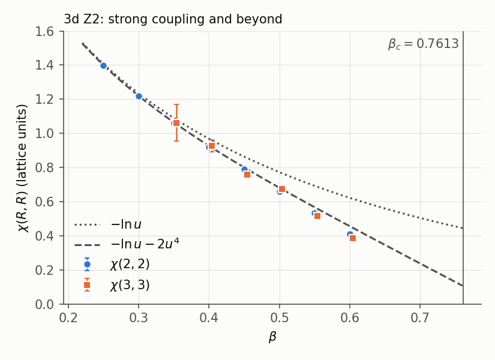
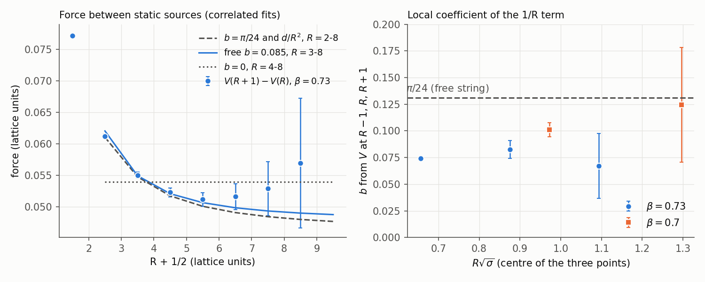
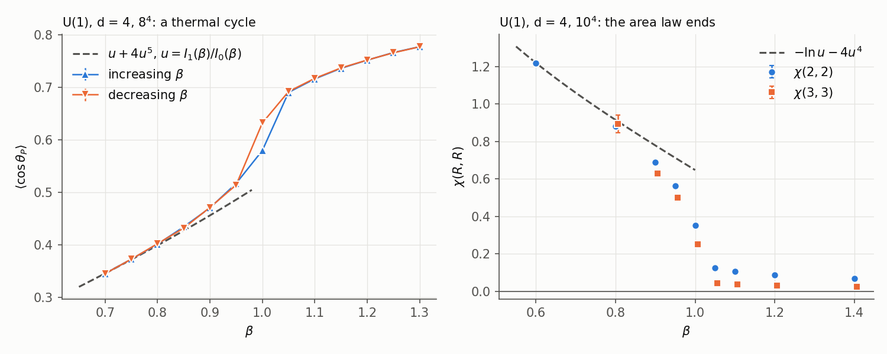

# The Casimir energy of a flux tube, and an area law on the computer

*qcdstring programme. Preprint QCDS-76/1, November 1976. Revised after the second line's report (`REFEREE.md`, `RESPONSE.md`).*

## Abstract

If the confining flux tube between static colour sources is a relativistic
string, its transverse zero-point motion adds a term $-\pi(d-2)/24R$ to the
static potential in $d$ spacetime dimensions. The number of massless
transverse modes fixes the coefficient; a tube pinned by the lattice (a smooth
surface) has no such term. We derive the term with three regulators and with a
harmonic chain, and test it by Monte Carlo simulation on the budget of a CDC
7600 (98 of 100 machine hours, pilot runs and checks included). In the
three-dimensional Z2 gauge theory, the ratios $\chi(R,T)$ of Wilson loops
agree with the strong-coupling series to $O(u^4)$ within 0.1% at
$\beta \le 0.30$ and within 1% at $\beta = 0.40$. At $\beta = 0.70$ and 0.73,
where the dual Ising interface is rough, correlators of closed time-like lines
measured by two-level averaging give the static potential to 0.2-2% for
separations up to 8 lattice spacings. With the full covariance of the data, a
potential without a $1/R$ term is excluded at both couplings over every range
of separations we can fit. The $1/R$ term has the sign of a Casimir energy. Its
fitted coefficient grows with the shortest separation admitted, from 0.070 to
0.10 at $\beta = 0.73$, and the free-string value $\pi/24 = 0.131$ fits once
the fit starts at $R\sqrt\sigma \gtrsim 0.9$. The same data are fitted equally
well over all separations by $\pi/24$ plus an $R^{-2}$ term from the ends of
the tube, whose coefficient agrees between the two couplings in units of
$\sqrt\sigma$. These two readings cannot be separated at
$R\sqrt\sigma \le 2$. In four-dimensional compact U(1) the strong-coupling area
law ends at $\beta \approx 1.0$, where the plaquette jumps; beyond it the
ratios $\chi$ fall like those of a Coulomb potential. A fit of the charmonium
levels with $V = -\kappa/r + \sigma r$ gives a tension 0.78-0.86 of the one
implied by the Regge slope, the range set by the spin-spin term of the same
potential.

## 1. Introduction

The dual resonance model describes hadrons as states of a relativistic string
whose tension, $\sigma = 1/(2\pi\alpha') \approx 0.18\ \mathrm{GeV}^2$, is read
off the Regge slope; our fit of the 1974 tables gives
$\alpha' = 0.865\ \mathrm{GeV}^{-2}$ [24]. Wilson's lattice gauge theory [1]
shows that at strong coupling a static colour source and antisource are joined
by a tube of flux whose energy grows linearly with their separation (see also
its Hamiltonian form [23]), and that the strong-coupling expansion of a Wilson
loop is a sum over surfaces spanning the loop. Nambu [2] and Nielsen and Olesen
[3] give continuum versions of the same picture.

A tube of flux can behave as a string in the dynamical sense, with a transverse
position that fluctuates through massless modes, or as a stiff bar whose
transverse fluctuations cost a finite energy. One number separates the two. A
string of length $R$ with fixed ends has a transverse zero-point energy whose
finite part is $-\pi(d-2)/24R$. This is the Casimir effect of the string [4],
and it is the same arithmetic that fixes the intercept of the dual model
through its zero-point sum [5, 6]. A tube with massive transverse modes has an
exponentially small finite part instead.

Section 2 derives the term and discusses which corrections can accompany it.
Sections 3 and 4 test the term, and the area law that comes before it, in two
lattice gauge theories simulated by the Monte Carlo method [7]. Section 5
compares the tension from the Regge slope with the one charmonium requires.

*Sources.* This programme keeps a dated ledger of predictions, some of them
remembered rather than derived; Appendix B lists every remembered item this
paper relies on, including methods (two-level averaging, the one-link average,
a von Mises sampler) and one closed formula. No remembered number enters any
calculation.

## 2. The Casimir energy of a string with fixed ends

### 2.1 The mode sum

Place a string between static sources at $x = 0$ and $x = R$ and expand the
Nambu-Goto area to second order in the $d-2$ transverse displacements
$X^i(t,x)$, with $X^i(t,0) = X^i(t,R) = 0$. The result is $d-2$ free massless
fields on an interval, with frequencies $\omega_n = n\pi/R$, and

$$E_0(R) = \sigma_0 R + \frac{d-2}{2}\sum_{n\ge1}\frac{n\pi}{R}.$$

With a regulator $g(\epsilon\omega)$, $g(0)=1$, the Euler-Maclaurin formula
gives

$$\frac12\sum_{n\ge1}\omega_n\,g(\epsilon\omega_n) =
\frac{R}{2\pi\epsilon^2}\int_0^\infty u\,g(u)\,du \;-\; \frac{\pi}{24R} \;+\; O(\epsilon^2).$$

The divergent piece is proportional to $R$ and renormalizes the tension. The
finite piece comes from the first derivative of the summand at $n=0$, which
equals $\pi/R$ for every regulator. Hence

$$E_0(R) = \sigma R + c - \frac{\pi(d-2)}{24R} + \dots\qquad(1)$$

Table 1 checks this numerically. Three regulators of different shape give the
same finite part to six digits. A lattice regulator, the harmonic chain of
$R-1$ masses between fixed ends with frequencies $2\sin(n\pi/2R)$, gives
$E_0 = (2/\pi)R - \tfrac12 - \pi/24R + O(R^{-3})$: a different tension, a
boundary constant, and the same $1/R$ coefficient.

**Table 1.** Finite part of $\tfrac12\sum_n \omega_n g(\epsilon\omega_n)$ at $R = 1$, $\epsilon \to 0$ (`code/casimir.py`).

| Regulator | Finite part |
|---|---|
| $e^{-u}$ | $-0.130900$ |
| $e^{-u^2}$ | $-0.130900$ |
| $(1+u^2)^{-3}$ | $-0.130900$ |
| harmonic chain, $1/R$ coefficient | $-0.130900$ |
| $-\pi/24$ | $-0.130900$ |

*What else can appear in (1).* Terms of the string's action that are local on
the worldsheet interior (a thickness, a stiffness, interactions between the
transverse modes) change the coefficients of $R$ and $R^0$ and add higher
inverse powers; a stiffness term $\propto(\partial^2X)^2$, for example, shifts
the frequencies by $O(\omega^3/\sigma)$ and enters at $O(R^{-3})$. The ends of
the tube carry local terms of their own. The lowest one,
$b_1[(\partial_x X)^2_{x=0} + (\partial_x X)^2_{x=R}]$, shifts the ground state
at first order by an amount proportional to $b_1(d-2)/\sigma R^2$ (its
expectation value is again a zeta-regulated mode sum). We know no argument, in
1976, that forbids it. Equation (1) therefore has corrections from $R^{-2}$ on,
with a coefficient that depends on the sources and on the lattice, and the
$1/R$ term can be isolated from data only together with an allowance for them.
A $1/R$ term needs modes whose wavelength is the length of the string, that is,
massless modes; this is the part of the argument that survives.

### 2.2 Smooth and rough tubes

If the transverse modes have a mass $m$, as they do for a surface pinned to the
lattice planes, the finite part of the zero-point energy becomes
$-(m/2\pi)\sum_{k\ge1} K_1(2kmR)/k$. Table 2 gives it in units of $-\pi/24R$.
It falls exponentially once $mR$ exceeds 1.

**Table 2.** Casimir energy of one massive transverse mode, divided by $-\pi/24R$.

| $mR$ | 0 | 0.1 | 0.25 | 0.5 | 1 | 1.5 | 2 | 3 |
|---|---|---|---|---|---|---|---|---|
| ratio | 1 | 0.834 | 0.642 | 0.419 | 0.178 | 0.075 | 0.031 | 0.005 |

Wilson's strong-coupling expansion describes such a pinned surface. Each of its
orders contributes to $\sigma$, to $c$ and to terms that fall exponentially with
$R$; no finite order produces $1/R$. The term can appear only beyond a
roughening point, where the surface comes loose from the lattice and its
transverse modes become massless. In the three-dimensional Z2 theory this point
can be located from statistical mechanics: the theory is dual to the Ising
model [8], the flux tube is dual to an Ising interface, and the interface
roughens near $T \approx 0.55\,T_c$ [9]. Section 3.1 translates this into
$\beta_R \approx 0.48$.

### 2.3 Excited levels

To the same order, the excitations of the tube are phonons on the interval:
$E_n - E_0 = n\pi/R + \dots$, with degeneracy equal to the number of ways of
distributing $n$ units of mode number among $d-2$ towers: 1, 1, 2, 3, 5, 7 in
$d = 3$ and 1, 2, 5, 10, 20, 36 in $d = 4$ for $n = 0, \dots, 5$. We remember
(Appendix B) a closed form for the Nambu-Goto string with fixed ends,

$$E_n(R) = \sqrt{\sigma^2R^2 + 2\pi\sigma\big(n - \tfrac{d-2}{24}\big)},\qquad(2)$$

whose expansion begins with (1) and these spacings. It becomes imaginary for
$R\sqrt\sigma < \sqrt{\pi(d-2)/12}$, that is $R\sqrt\sigma < 0.51$ in $d = 3$.
We use it below only as a fitting form; its derivation and its test on excited
levels are left for later work.

### 2.4 Size of the effect for hadrons

In four dimensions the term is $-\pi/12R$. With $\sigma = 0.184\ \mathrm{GeV}^2$
[24], a tube of length 1 fm carries $\sigma R = 0.93$ GeV and a Casimir term of
$-52$ MeV. In charmonium the term is part of the attractive $1/r$ potential and
cannot be separated from one-gluon exchange. The clean test is a pure gauge
theory on a lattice.

## 3. Z2 gauge theory in three dimensions

### 3.1 The model

Links $U = \pm1$ sit on a periodic lattice of $L \times L$ spatial sites and
$N_t$ time slices, with action $S = -\beta\sum_P U_P$. Wegner's duality [8]
maps the partition function onto that of the three-dimensional Ising model at
coupling $K$, with $\tanh\beta = e^{-2K}$. Strong gauge coupling is low Ising
temperature; the string tension is the interface tension; the confining phase
ends at the Ising critical point, $K_c = 0.2217$ from the series expansions
[25], that is, at $\beta_c = 0.7613$. The interface roughening near
$0.55\,T_c$ quoted above corresponds to $K_R \approx 0.40$ and
$\beta_R \approx 0.48$.

We update by heat bath [10]: a link is set to $+1$ with probability
$[1+e^{-2\beta h}]^{-1}$, with $h$ the sum of its four staples. Links of one
direction and one checkerboard class share no plaquette and are updated
together.

### 3.2 Strong coupling

The strong-coupling expansion of a Wilson loop starts from the minimal
surface, weight $u^A$ with $u = \tanh\beta$. The first correction raises one
plaquette of the surface into the other five faces of a cube, which can be done
in $2(d-2)$ ways per plaquette, at a relative cost $u^4$:

$$\sigma = -\ln u - 2(d-2)\,u^4 + O(u^6).\qquad(3)$$

Table 3 compares this with the ratios
$\chi(R,T) = -\ln[W(R,T)W(R-1,T-1)/W(R,T-1)W(R-1,T)]$, in which the perimeter
and corner terms of the loops cancel, on a $16^3$ lattice (1500 measurements per
coupling, every second sweep, hot starts; errors by jackknife over 30 blocks).
On the two time-like sides of each loop with $R \ge 2$ we replace every link by
its average in the field of its staples, $\tanh\beta h$; the replaced links share
no plaquette, so the estimate is unbiased, and at strong coupling it cuts the
noise several-fold.

**Figure 1.** Z2, $d = 3$: $\chi(2,2)$ and $\chi(3,3)$ on $16^3$ against the
leading strong-coupling term and the series (3).

**Table 3.** Z2, $d = 3$: ratios $\chi$ against the series (3) (`code/z2_strong.py`).

| $\beta$ | $\chi(2,2)$ | $\chi(3,3)$ | $-\ln u$ | $-\ln u - 2u^4$ | $\chi(2,2)$ / series $-1$ |
|---|---|---|---|---|---|
| 0.25 | 1.3983(33) | 1.30(41) | 1.4068 | 1.3996 | $-0.1\%$ |
| 0.30 | 1.2182(20) | 1.15(20) | 1.2334 | 1.2190 | $-0.1\%$ |
| 0.35 | 1.0589(20) | 1.06(11) | 1.0895 | 1.0639 | $-0.5\%$ |
| 0.40 | 0.9185(13) | 0.926(36) | 0.9677 | 0.9260 | $-0.8\%$ |
| 0.45 | 0.7888(11) | 0.760(20) | 0.8630 | 0.7996 | $-1.4\%$ |
| 0.50 | 0.6600(10) | 0.674(15) | 0.7719 | 0.6807 | $-3.0\%$ |
| 0.55 | 0.5335(11) | 0.5153(57) | 0.6921 | 0.5666 | $-5.8\%$ |
| 0.60 | 0.4085(11) | 0.3835(44) | 0.6217 | 0.4553 | $-10.3\%$ |

The area law holds at every coupling. The two-term series reproduces the
tension within the errors at $\beta \le 0.30$ and to 1% at $\beta = 0.40$,
where the difference is already six standard errors; it grows smoothly and
reaches 10% at $\beta = 0.60$. The omitted $u^6$ terms grow over the same
range, and these data cannot locate the roughening point.

### 3.3 Closed time-like lines and two-level averaging

The product of the time-like links along a line of fixed spatial position,
$P(\mathbf x) = \prod_t U_0(t,\mathbf x)$, is the world line of a static source
closed by the periodicity of time. For two such lines,

$$C(R) = \langle P(0)P(R)\rangle = \sum_n w_n\, e^{-N_t E_n(R)},\qquad V(R) \equiv -\frac{1}{N_t}\ln C(R).$$

When $N_t \gg R/\pi$ the ground state dominates. The free-string excitations of
Section 2.3 shift $V$ by $(1/N_t)\sum_k \ln(1-e^{-k\pi N_t/R})$, at most
$1.2\times10^{-4}$ for $R \le 8$ at $N_t = 16$; we remove this shift.

At $\beta = 0.73$ and $R = 8$, $C \approx 2\times10^{-4}$, while a single
measurement of $P(0)P(R)$ is $\pm1$. We therefore use two-level averaging
(Appendix B). The space-like links on every $\tau$-th time slice are frozen.
Given them, the slabs between frozen slices are statistically independent.
Within each slab we update the interior $n_{\rm sub}$ times and average the
product of the $\tau$ time-like links at $\mathbf x$ times the same product at
$\mathbf x + R$. The product of these slab averages over all slabs, averaged
over positions and over the frozen configurations, is an unbiased estimate of
$C(R)$. Its variance falls exponentially with the number of slabs once each
slab average sits near its physical value.

Pilot runs fixed the parameters (`code/pilots/`, `results/pilots/`). With slabs
of thickness 2, the slab averages on one frozen configuration stay near
0.48-0.67 for every $R$ from 2 to 10: they are set by the frozen boundary and
carry no information about $R$. With thickness 4 they fall from 0.43 to 0.14
over the same range, close to $e^{-4V(R)}$, and the method works. With
thickness 6 they are physical but too small to resolve with a few hundred
sub-updates. The one-link average of Section 3.2 gains little here: the mean of
$|\tanh\beta h|$ over time-like links is 0.934 at $\beta = 0.73$, with $h = 0$ on
4.3% of them, and a pilot with and without it (`pilot2_*.log`) gave the same
errors.

The production runs use $N_t = 16$, slabs of thickness 4, $n_{\rm sub} = 500$,
12 independent chains, each thermalized by 800 sweeps and then giving 50
frozen configurations separated by 20 full sweeps, and $L = 32$ at
$\beta = 0.73$, $L = 24$ at $\beta = 0.70$. Errors come from a jackknife over
blocks of 5 frozen configurations (120 blocks); blocks of 2 to 10 give the same
errors.

*Validation.* On a lattice small enough for the direct estimate to work
($\beta = 0.70$, $L = 12$, $n_{\rm sub} = 20$), both estimates are computed on
the same Markov chain: for each of 6000 frozen configurations the direct
product $P(0)P(R)$ is averaged over the very sub-updates that enter the slab
averages. The difference vanishes within errors 3.4 to 11 times smaller than
the errors of either estimate (Table 4). At the production parameters
($\beta = 0.73$, $N_t = 16$, $L = 32$) the direct estimate still works for
$R \le 4$ with $4\times10^4$ sweeps (`code/z2_direct_check.py`); it gives
$V = 0.12819(32)$, 0.20548(76), 0.26641(145), 0.32408(263) for $R = 1$-4,
against 0.12782(28), 0.20495(59), 0.26618(94), 0.32124(136) from the two-level
runs: differences of 0.9, 0.6, 0.1 and 1.0 standard errors.

**Table 4.** Same-chain comparison of the two estimators (`code/z2_validate.py`).

| Setting | $R$ | direct | two-level | difference | pull |
|---|---|---|---|---|---|
| $N_t = 6$, slabs of 2 | 1 | 0.29221(126) | 0.29228(124) | +0.00007(11) | +0.66 |
| | 2 | 0.12191(128) | 0.12198(127) | +0.00007(13) | +0.56 |
| | 3 | 0.05839(125) | 0.05868(122) | +0.00029(17) | +1.69 |
| | 4 | 0.03090(125) | 0.03108(123) | +0.00018(21) | +0.85 |
| $N_t = 8$, slabs of 4 | 1 | 0.19532(98) | 0.19534(97) | +0.00001(11) | +0.13 |
| | 2 | 0.06108(88) | 0.06103(83) | $-0.00005(16)$ | $-0.32$ |
| | 3 | 0.02237(67) | 0.02254(67) | +0.00018(16) | +1.08 |
| | 4 | 0.00907(59) | 0.00908(55) | +0.00001(16) | +0.04 |

### 3.4 The potential in the rough phase

**Table 5.** Static potential from two closed time-like lines, Z2, $d = 3$, $N_t = 16$ (`code/z2_multilevel.py`, `code/analyze.py`). Dashes: signal lost in noise.

| $R$ | $V(R)$, $\beta = 0.73$ | $V(R)$, $\beta = 0.70$ |
|---|---|---|
| 1 | 0.12782(28) | 0.20440(25) |
| 2 | 0.20495(59) | 0.35002(57) |
| 3 | 0.26618(94) | 0.47451(102) |
| 4 | 0.32124(136) | 0.59058(174) |
| 5 | 0.37355(196) | 0.70249(352) |
| 6 | 0.42474(287) | 0.81448(1107) |
| 7 | 0.47641(460) | - |
| 8 | 0.52933(841) | - |
| 9 | 0.5863(179) | - |

The potentials at neighbouring $R$ are strongly correlated (mean correlation
0.97 at $\beta = 0.73$, 0.86 at $\beta = 0.70$), so every fit below uses the
full covariance of the jackknife samples; $p$ is the probability of a larger
$\chi^2$. The models are $\sigma R + c - b/R$ with $b$ free, with $b = \pi/24$,
or with $b = 0$; $\pi/24$ plus an endpoint term $d/R^2$ (Section 2.1); and the
square root (2), fitted only where it is real.

**Table 6.** Correlated fits to Table 5. Rows give $\chi^2$/dof ($p$) and the fitted coefficient.

| $\beta$ | $R$ | $b$ free | $b = \pi/24$ | $b = 0$ | $\pi/24 + d/R^2$ | square root (2) |
|---|---|---|---|---|---|---|
| 0.73 | 2-8 | $b = 0.070(1)$; 13.1/4 (0.011) | 2083/5 | 2767/5 | $d = 0.051(1)$; 3.7/4 (0.45) | - |
| 0.73 | 3-8 | $b = 0.085(5)$; 4.1/3 (0.25) | 80.9/4 | 272/4 | $d = 0.054(6)$; 3.5/3 (0.32) | 5503/4 |
| 0.73 | 4-8 | $b = 0.103(17)$; 2.9/2 (0.23) | 5.6/3 (0.13) | 39.1/3 | $d = 0.041(26)$; 3.2/2 (0.20) | 50.8/3 |
| 0.73 | 4-9 | $b = 0.101(17)$; 3.4/3 (0.34) | 6.4/4 (0.17) | 39.1/4 | $d = 0.043(26)$; 3.7/3 (0.30) | 53.6/4 |
| 0.70 | 2-6 | $b = 0.099(6)$; 0.6/2 (0.73) | 34.0/3 | 328/3 | $d = 0.029(5)$; 0.4/2 (0.83) | - |
| 0.70 | 3-6 | $b = 0.133(47)$; 0.1/1 (0.76) | 0.1/2 (0.95) | 8.2/2 (0.016) | $d = -0.003(59)$; 0.1/1 (0.76) | 1.0/2 (0.62) |

**Figure 2.** Left: the force $V(R+1) - V(R)$ at $\beta = 0.73$ with three
correlated fits. Right: the coefficient $b$ obtained by solving
$V = \sigma R + c - b/R$ exactly at $R-1$, $R$, $R+1$ (from $R = 3$, so that
$V(1)$ never enters), against $R\sqrt\sigma$.

Four statements follow from Table 6.

1. *A $1/R$ term is present, with the sign of a Casimir energy.* The potential
   without it fails at both couplings over every range, including the
   shortest-reaching one at $\beta = 0.73$ ($\chi^2 = 39$ for 3 degrees of
   freedom from $R = 4$) and $p = 0.016$ at $\beta = 0.70$ from $R = 3$.
2. *Its fitted coefficient depends on where the fit starts.* At $\beta = 0.73$
   it is 0.070, 0.085 and 0.103 for fits from $R = 2$, 3 and 4. The local
   coefficient of Figure 2 shows the same: 0.074(2), 0.083(8) and 0.067(30) at
   $R\sqrt\sigma = 0.66$, 0.88 and 1.09 for $\beta = 0.73$; 0.101(7) and
   0.12(5) at 0.97 and 1.30 for $\beta = 0.70$. Beyond $R\sqrt\sigma \approx 1$
   the local errors reach 0.03-0.05.
3. *The free-string value is acceptable once the shortest separations are
   dropped:* from $R = 4$ ($R\sqrt\sigma = 0.86$) at $\beta = 0.73$, $p = 0.13$;
   from $R = 3$ ($R\sqrt\sigma = 0.97$) at $\beta = 0.70$, $p = 0.95$.
4. *An endpoint term describes all separations with the free-string
   coefficient.* $\pi/24 + d/R^2$ fits $R = 2$-8 at $\beta = 0.73$ ($p = 0.45$)
   and $R = 2$-6 at $\beta = 0.70$ ($p = 0.83$), with
   $d\sqrt\sigma = 0.0111(2)$ and $0.0094(16)$: equal within errors in units of
   the tension, as a term with a continuum meaning should be. Freeing $b$ as
   well gives $b = 0.124(17)$ at $\beta = 0.73$ from $R = 2$.

The data therefore admit two readings. In one, the coefficient of $1/R$ grows
with the length of the tube and reaches the free-string value near
$R\sqrt\sigma \approx 1$. In the other, it has the free-string value at all
these distances and an endpoint correction falling as $R^{-2}$ masks it at
short distance. Separating them needs longer strings: at $\beta = 0.73$ the
potential at $R = 9$ ($R\sqrt\sigma = 1.99$) is measured only to 3%, and
$R\sqrt\sigma \gtrsim 2$ with errors of $10^{-3}$ is beyond this budget. The
square root (2) fails at $\beta = 0.73$ from $R = 3$ and $R = 4$ and fits at
$\beta = 0.70$ from $R = 3$; near $R\sqrt\sigma = 0.6$-0.9 it curves more
strongly than the data. At the shortest separations the two couplings differ
by several standard errors at matched $R\sqrt\sigma$, which we attribute to the
lattice at $R \le 3$.

## 4. Compact U(1) in four dimensions

The Abelian theory has the same strong-coupling area law as the non-Abelian
ones and no confinement in the continuum, where it is free electrodynamics. It
is the test of whether the area law of Section 3.2 says anything about the
continuum. With links $e^{i\theta}$ and $S = -\beta\sum_P\cos\theta_P$, the local
distribution of a link given the sum $K$ of its six staples is
$\exp(\beta|K|\cos(\theta + \arg K))$, which we sample exactly (Appendix B).
Strong coupling gives $\langle\cos\theta_P\rangle = u + 4u^5 + \dots$ and
$\sigma = -\ln u - 4u^4 + \dots$ with $u = I_1(\beta)/I_0(\beta)$.

A thermal cycle on an $8^4$ lattice (100 sweeps to equilibrate and 100 to
measure at each coupling, $\beta$ raised from 0.70 to 1.30 and lowered back)
shows a smooth rise of the plaquette to $\beta = 0.95$ and a jump from 0.517 to
0.690 between $\beta = 0.95$ and $1.05$ (Figure 3, left). At $\beta = 1.00$ the
two branches differ, 0.5795(24) and 0.6319(28), but the autocorrelation time of
the plaquette there is 12-17 sweeps, and runs of 2500 sweeps from a hot and a
cold start (`u1_4d.py two_starts`) converge to the same value, 0.585, with a
single-peaked distribution. The difference in the cycle comes from runs too
short for that coupling. Our data establish the jump and leave its order open.

**Table 7.** U(1), $d = 4$, $10^4$ lattice, 400 measurements per coupling, hot starts for $\beta < 1.0$ and cold starts for $\beta \ge 1.0$ (`code/u1_4d.py`).

| $\beta$ | plaquette | $\chi(2,2)$ | $\chi(3,3)$ | $\chi(4,4)$ | strong coupling |
|---|---|---|---|---|---|
| 0.60 | 0.2949 | 1.2175(24) | 1.40(31) | - | 1.2201 |
| 0.80 | 0.4021 | 0.8815(13) | 0.894(47) | - | 0.9155 |
| 0.90 | 0.4690 | 0.6908(15) | 0.631(15) | - | 0.7791 |
| 0.95 | 0.5135 | 0.5617(16) | 0.4993(93) | 0.67(22) | 0.7130 |
| 1.00 | 0.5854 | 0.3523(46) | 0.2524(77) | 0.204(13) | 0.6477 |
| 1.05 | 0.6910 | 0.1244(3) | 0.0424(4) | 0.0160(6) | |
| 1.10 | 0.7167 | 0.1060(2) | 0.0360(3) | 0.0143(4) | |
| 1.20 | 0.7516 | 0.0871(1) | 0.0297(2) | 0.0119(3) | |
| 1.40 | 0.7964 | 0.0676(1) | 0.0236(2) | 0.0095(2) | |

**Figure 3.** U(1), $d = 4$. Left: thermal cycle of the plaquette on $8^4$.
Right: the ratios $\chi(R,R)$ on $10^4$ with the strong-coupling series.

Below the jump the ratios follow the series at $\beta = 0.60$ (1.2175 against
1.2201) and decrease only slowly with the loop size, by about 10% from
$\chi(2,2)$ to $\chi(3,3)$ at $\beta = 0.90$-0.95, toward a nonzero limit.
Above the jump they fall steeply with the loop size. For square loops a
potential $-\alpha/R$ gives $\chi(R,R) \approx 2\alpha/R(R-1)$, so that
$\chi(2,2):\chi(3,3):\chi(4,4) = 6:2:1$, where an area law gives $1:1:1$. At
$\beta = 1.10$ we find $7.4:2.5:1$.

The lattice U(1) theory therefore has a confining phase at strong coupling and
a deconfined one at weak coupling, separated near $\beta = 1.0$. (In three
dimensions Polyakov [11] argues that compact U(1) confines at every coupling.)
The lesson for the programme: an area law at strong coupling is a property of
the lattice and can end before the continuum is reached. The question for a
theory of the strong interactions is whether the non-Abelian area law survives
to weak coupling, where asymptotic freedom [12, 13] puts the continuum limit.
That is the next calculation, in SU(2).

## 5. One tension: charmonium

The narrow states found since November 1974 [14-16] and the radiative
transitions to the three $\chi$ states [17-19] give, in 1976, the levels
$\psi(3.098)$, $\psi'(3.684)$, and $\chi$ states at 3.413, 3.508 and 3.553 GeV
[20], each measured to a few MeV. Assuming $J = 0, 1, 2$ for the $\chi$ states in
order of mass, as the spin-orbit forces of a vector-exchange potential would
arrange them, their spin-weighted centre is 3.522 GeV; we allow it $\pm10$ MeV
for the assignment. We solve the radial equation in the potential of Eichten et
al. [22], $V = -\kappa/r + \sigma r$ (no additive constant, $M = 2m_c + E$), on a
grid (`code/charmonium76.py`).

*Model error, stated first.* The potential has no spin-dependent and no
relativistic terms, and the vector exchange that orders the $\chi$ states also
splits each S-wave level into a triplet (the observed $\psi$ states) and a
singlet. At first order the triplet lies above the spin average by
$\kappa|R_{nS}(0)|^2/6m_c^2$: 47 and 30 MeV for the 1S and 2S levels at the
parameters of fit (a) below. This shift is the size of the model error we
assign to the tension.

**Table 8.** Charmonium in $V = -\kappa/r + \sigma r$. Masses in GeV.

| | $\kappa$ | $\sigma$ (GeV²) | $m_c$ | 1S | 2S | 1P | 1D | 2P | 3S |
|---|---|---|---|---|---|---|---|---|---|
| data, 1976 | | | | 3.098 | 3.684 | 3.522 | | | |
| (a) three-level fit | 0.586 | 0.159 | 1.419 | input | input | input | 3.805 | 3.962 | 4.105 |
| (a') half the first-order spin-spin shift | 0.744 | 0.144 | 1.480 | input | input | input | 3.803 | | |
| (a'') the full first-order shift | 0.823 | 0.146 | 1.481 | input | input | input | 3.794 | | |
| (b) Regge tension | 0.357 | 0.184 | 1.304 | input | input | 3.486 | 3.778 | 3.961 | 4.135 |

Fit (a) treats the observed S-wave masses as spin averages and returns
$\sigma = 0.159\ \mathrm{GeV}^2$ (0.152-0.166 for the $\pm10$ MeV on the $\chi$
centre). Fits (a') and (a'') subtract half or all of the potential's own
first-order spin-spin shift, recomputed at each step, and return 0.144 and
0.146. The charmonium tension is therefore 0.14-0.16 GeV², 0.78-0.86 of the
Regge value $1/(2\pi\alpha') = 0.184\ \mathrm{GeV}^2$. Within the error of a
potential that omits terms of this size, one tension describes the light-quark
trajectories and the heavy-quark levels at the 15-20% level; a sharper
statement needs the spin-dependent and relativistic terms computed in the same
model. Fit (b) imposes the Regge tension and fits $\kappa$ and $m_c$ to the two
S-wave levels; it places the P-wave centre 36 MeV below the data.

All four fits put the lowest D-wave level at 3.78-3.81 GeV, 50-75 MeV above the
threshold for decay into two charmed mesons at $2 \times 1.865 = 3.73$ GeV [21],
where the coupling to that channel shifts it by an amount the potential does
not contain. We record the potential's value without an error. Both lines
remember where this level is found, so the record carries no weight as a test.

The Coulomb coefficient of the fits, $\kappa = 0.59$-0.82, contains one-gluon
exchange and, if the tube is already a string at charmonium sizes, its Casimir
term $\pi/12 = 0.26$. Section 3 shows that at $R\sqrt\sigma \approx 1$ the
Casimir term cannot yet be separated from short-distance corrections, so this
split cannot be made either.

## 6. Summary

* The Casimir energy of a string with fixed ends is $-\pi(d-2)/24R$ for any
  regulator; massive transverse modes replace it by an exponentially small
  term. Local terms at the ends of the tube can add corrections from $R^{-2}$
  on.
* In the three-dimensional Z2 gauge theory the area law holds, with the tension
  of the strong-coupling series to 1% up to $\beta = 0.40$.
* In the rough phase the static potential has a $1/R$ term with the sign of a
  Casimir energy; a potential without it is excluded. Fitted alone, its
  coefficient rises from 0.070 to 0.10 as the fit starts at longer distance,
  and the free-string value $0.131$ is acceptable from $R\sqrt\sigma \approx 0.9$
  on. With an $R^{-2}$ endpoint term, whose coefficient scales between the two
  couplings, the free-string value fits all separations. The data cannot yet
  tell these readings apart.
* Compact U(1) in four dimensions loses its area law near $\beta = 1.0$; the
  order of the transition is open.
* The charmonium tension is 0.78-0.86 of the Regge tension, the range set by
  the spin-spin term of the same potential.

Next: the SU(2) string tension between strong coupling and the region where
asymptotic freedom sets the scale, and the question that U(1) has made sharp,
whether the area law survives there. Separating the two readings of the
Casimir coefficient needs longer strings and the excited levels of the tube.

## Appendix A. Computing budget

The cap is 100 hours of a CDC 7600 at a sustained 3.3 Mflop/s, i.e.
$1.19\times10^{12}$ floating-point operations. We charge 20 operations per Z2
link update (a scalar Fortran heat bath; bit-packed coding would be an order of
magnitude cheaper), 300 per U(1) link update (six staples of three complex
products and a von Mises draw), and one operation per multiply-add in the
measurements (six for complex arithmetic). The programs count these as they
run (`code/analyze.py` prints the table). The charges are floors: they omit
memory traffic, indexing and random-number generation. The largest run holds
49,152 links and 81,920 accumulators, which fit the 512K-word large core memory
of the machine.

**Table 9.** Operations charged.

| Run | Operations | Share of cap |
|---|---|---|
| Z2 estimator validation | $1.28\times10^{10}$ | 1.1% |
| Z2 strong coupling | $2.93\times10^{10}$ | 2.5% |
| Z2 two-level, $\beta = 0.73$ | $3.21\times10^{11}$ | 27.0% |
| Z2 two-level, $\beta = 0.70$ | $1.81\times10^{11}$ | 15.2% |
| Z2 direct check at production parameters | $4.38\times10^{10}$ | 3.7% |
| U(1) thermal cycle | $2.65\times10^{10}$ | 2.2% |
| U(1) Wilson loops | $3.49\times10^{11}$ | 29.3% |
| U(1) two starts at $\beta = 1.00$ | $4.23\times10^{10}$ | 3.6% |
| Pilot runs (`code/pilots/README.md`) | $1.63\times10^{11}$ | 13.7% |
| **Total** | $1.17\times10^{12}$ | **98.3%** (98 hours) |

The total leaves no margin: if the charges are 10% low, the programme
overruns by about 8 hours. The U(1) loops, measured every second sweep, are
where a 1976 group would have saved.

## Appendix B. What this paper takes from memory

* Two-level averaging of time-like line products: M. Lüscher and P. Weisz,
  JHEP 09 (2001) 010. Section 3.3.
* The one-link average: G. Parisi, R. Petronzio and F. Rapuano, Phys. Lett.
  128B (1983) 418. Sections 3.2 and 4.
* Sampling the von Mises distribution with about 1.5 trials per draw (D. J.
  Best and N. I. Fisher, Appl. Statist. 28 (1979) 152). A 1976 rejection
  sampler with uniform proposals needs 4-6 trials at $\beta = 0.8$-1.2, which
  the 300-operation charge would not cover. Section 4.
* The closed form (2) for the Nambu-Goto string with fixed ends: J. F. Arvis,
  Phys. Lett. 127B (1983) 106. Used only as a fitting form.
* The universality argument of Section 2.1 restates M. Lüscher, Nucl. Phys. B
  180 (1981) 317, without its treatment of the ends.
* The sustained speed of a CDC 7600, 3.3 Mflop/s: J. Dongarra's LINPACK
  tables. Appendix A.
* The expectations registered in the programme's ledger before these runs:
  $b = \pi/24$ in $d = 3$ (P02); a roughening singularity of the series (P11);
  a U(1) transition near $\beta = 1.0$ (P13); one tension for Regge
  trajectories and charmonium (P01). None of these numbers enters a
  calculation. Three conclusions lean toward outcomes both lines remember:
  that the coefficient of $1/R$ approaches $\pi/24$, the order of the U(1)
  transition, and the position of the D-wave level. By the second line's
  standard none of them counts as evidence here.

## References

1. K. G. Wilson, Phys. Rev. D 10 (1974) 2445.
2. Y. Nambu, Phys. Rev. D 10 (1974) 4262.
3. H. B. Nielsen and P. Olesen, Nucl. Phys. B 61 (1973) 45.
4. H. B. G. Casimir, Proc. K. Ned. Akad. Wet. 51 (1948) 793.
5. L. Brink and H. B. Nielsen, Phys. Lett. 45B (1973) 332.
6. P. Goddard, J. Goldstone, C. Rebbi and C. B. Thorn, Nucl. Phys. B 56 (1973) 109.
7. N. Metropolis, A. W. Rosenbluth, M. N. Rosenbluth, A. H. Teller and E. Teller, J. Chem. Phys. 21 (1953) 1087.
8. F. J. Wegner, J. Math. Phys. 12 (1971) 2259; R. Balian, J. M. Drouffe and C. Itzykson, Phys. Rev. D 10 (1974) 3376, D 11 (1975) 2098 and 2104.
9. J. D. Weeks, G. H. Gilmer and H. J. Leamy, Phys. Rev. Lett. 31 (1973) 549.
10. R. J. Glauber, J. Math. Phys. 4 (1963) 294.
11. A. M. Polyakov, Phys. Lett. 59B (1975) 82.
12. D. J. Gross and F. Wilczek, Phys. Rev. Lett. 30 (1973) 1343.
13. H. D. Politzer, Phys. Rev. Lett. 30 (1973) 1346.
14. J. J. Aubert et al., Phys. Rev. Lett. 33 (1974) 1404.
15. J.-E. Augustin et al., Phys. Rev. Lett. 33 (1974) 1406.
16. G. S. Abrams et al., Phys. Rev. Lett. 33 (1974) 1453.
17. W. Braunschweig et al. (DASP), Phys. Lett. 57B (1975) 407.
18. G. J. Feldman et al., Phys. Rev. Lett. 35 (1975) 821.
19. W. Tanenbaum et al., Phys. Rev. Lett. 35 (1975) 1323.
20. Particle Data Group, Rev. Mod. Phys. 48 (1976) S1.
21. G. Goldhaber et al., Phys. Rev. Lett. 37 (1976) 255; I. Peruzzi et al., Phys. Rev. Lett. 37 (1976) 569.
22. E. Eichten, K. Gottfried, T. Kinoshita, J. Kogut, K. D. Lane and T.-M. Yan, Phys. Rev. Lett. 34 (1975) 369.
23. J. Kogut and L. Susskind, Phys. Rev. D 11 (1975) 395.
24. qcdstring programme, Chew-Frautschi fits to the 1974 Review of Particle Properties (November 1974), `numerics/regge_fit.py` in this repository: pooled $\alpha' = 0.865\ \mathrm{GeV}^{-2}$.
25. M. E. Fisher, Rep. Prog. Phys. 30 (1967) 615.
