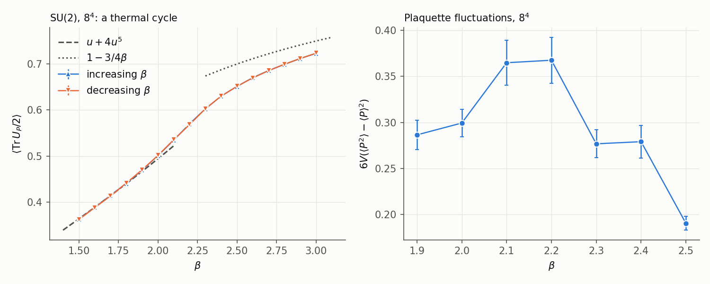
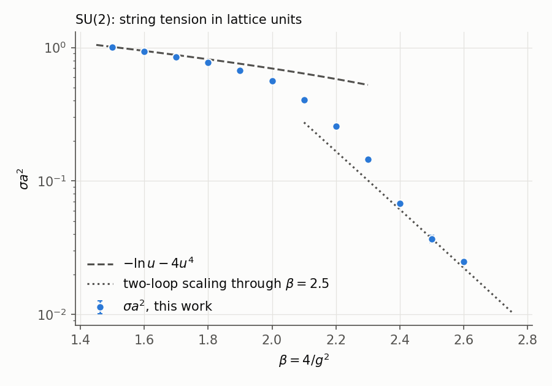
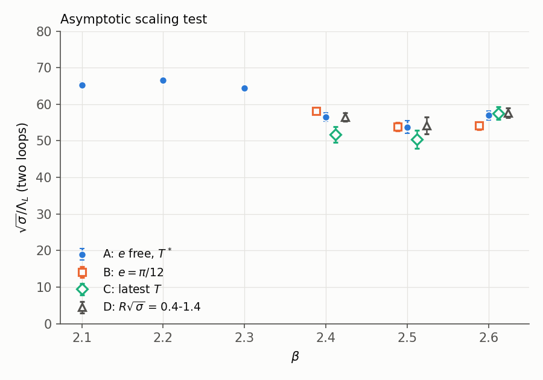

# The SU(2) string tension between strong coupling and asymptotic freedom

*qcdstring programme. Preprint QCDS-78/1, November 1978. Revised after the second line's report (`REFEREE.md`, `RESPONSE.md`).*

## Abstract

Our 1976 paper [1] found that the area law of compact U(1) ends near
$\beta = 1$, before the continuum is reached. Here we follow the string tension
of SU(2) lattice gauge theory in four dimensions from strong coupling,
$\beta = 4/g^2 = 1.5$, to $\beta = 2.6$, by heat-bath Monte Carlo on lattices
of $8^4$ to $16^4$ sites, within 95 hours of CDC 7600 time. On an $8^4$ lattice
the plaquette shows no hysteresis anywhere in $1.5 \le \beta \le 3.0$; its
fluctuations peak at $\beta = 2.1$-2.2, after the tension has left the
strong-coupling series at $\beta \approx 1.7$-1.9. The tension in lattice units
falls from $\sigma a^2 = 1.003(4)$ at $\beta = 1.5$ to $0.025(1)$ at
$\beta = 2.6$ and stays nonzero throughout. In units of the two-loop lattice
scale parameter, $\sqrt\sigma/\Lambda_L$ rises to $66.6 \pm 0.4$ at
$\beta = 2.2$ and lies between 50 and 58 at $\beta = 2.4$-2.6 under every
analysis choice we tried: consistent with a constant there, with too little
range in the coupling to test the two-loop form against the one-loop one. Smaller
boxes lower the tension. The coefficient of $1/R$ in the potential is 0.24-0.33,
depending on the coupling and on the time separation; its Casimir share stays
open. Since 1976 the $\psi(3772)$ and the $\Upsilon$ family have been found.
The four 1976 charmonium potentials, applied unchanged, give
$\Upsilon' - \Upsilon$ between 0.48 and 0.72 GeV against 0.56 GeV, and a joint
fit to both families gives a tension 0.91 of the Regge value and the $\chi_c$
centre within 12 MeV.

## 1. Introduction

A lattice gauge theory confines at strong coupling whatever its gauge group
[2, 3]. Our 1976 simulation of compact U(1) [1] showed what that statement is
worth: the area law of the Abelian theory ends near $\beta = 1.0$, as Banks,
Myerson and Kogut have since argued from the Villain form of the theory [4]. For
a non-Abelian theory the continuum limit sits at $\beta \to \infty$ by
asymptotic freedom [5, 6], and the question is whether the string tension of
strong coupling connects to that limit without a transition. The approximate
recursion relations of Migdal and Kadanoff [7] say that it does for SU(2) in four
dimensions. 't Hooft's analysis of the center of the gauge group [8] gives an
order parameter for the confining phase and a reason the non-Abelian and
Abelian theories can differ.

If the tension survives, asymptotic freedom fixes how it must scale. With
$g^2 = 4/\beta$ and the two-loop coefficients of the $\beta$ function [5, 6, 9, 10],

$$a\Lambda_L = (b_0 g^2)^{-b_1/2b_0^2}\, e^{-1/2b_0 g^2},\qquad
b_0 = \frac{11N}{48\pi^2},\quad b_1 = \frac{34}{3}\Big(\frac{N}{16\pi^2}\Big)^2,\qquad(1)$$

and a physical tension requires $\sqrt{\sigma a^2}/a\Lambda_L$ to approach a
constant as $\beta$ grows. We measure $\sigma a^2$ from $\beta = 1.5$ to 2.6 and
ask what the measurement can say about (1).

## 2. Method

The heat bath for SU(2) [11, 12] draws each link from its exact conditional
distribution. Writing the sum of the six staples of a link as $k\hat V$ with
$\hat V \in$ SU(2), the new link is $a\hat V^\dagger$, where the unit quaternion
$a$ has $a_0$ distributed as $\sqrt{1-a_0^2}\,e^{\beta k a_0}$ and its other
three components uniform on a sphere. Links of one direction and one
checkerboard class are updated together. All programs are in `code/` (numpy);
`code/checks78.py` checks them against exact results: the staple sum
reproduces the plaquette to machine precision, the sampled $\langle a_0\rangle$
equals $I_2(\beta k)/I_1(\beta k)$, and every Wilson-loop estimator is invariant
under a random gauge transformation to $10^{-16}$.

Wilson loops $W(R,T)$ are measured with time along one lattice axis. On the two
time-like sides each link is replaced by its conditional average,
$[I_2(\beta k)/I_1(\beta k)]\hat V^\dagger$, which is unbiased when the replaced
links share no plaquette ($R \ge 2$) and cuts the variance by a factor of
1.7-2.3 in a test on $6^4$. The space-like sides are built from links smeared
within their time slice (each link replaced by the normalized sum of itself and
half its four spatial staples, iterated). Both methods are taken from memory
(Appendix B). The number of smearing steps grows with $\beta$ so that the
smearing radius stays near the width of the flux tube; it was set by this rule,
without pilot runs.

All runs start cold. At $\beta \ge 2.4$ we discard the first quarter of the
measurements as further thermalization: on the $16^4$ lattice at $\beta = 2.6$,
keeping them lowers the tension by 9%. The large loops at $\beta = 2.5$ and 2.6
have integrated autocorrelation times of 3 measurements; errors come from a
jackknife over blocks of at least four autocorrelation times (20 blocks at
$\beta \le 2.3$, 15 at 2.4, 6 at 2.5, 5 at 2.6).

**Table 1.** Runs. Smearing steps grow with $\beta$ as the flux tube widens in lattice units.

| $\beta$ | $L^4$ | smearing | measurements | sweeps between | $\langle \mathrm{Tr}\,U_P/2\rangle$ |
|---|---|---|---|---|---|
| 1.5 | $8^4$ | 0 | 200 | 4 | 0.36232 |
| 1.6 | $8^4$ | 0 | 200 | 4 | 0.38778 |
| 1.7 | $8^4$ | 0 | 200 | 4 | 0.41381 |
| 1.8 | $8^4$ | 0 | 200 | 4 | 0.44131 |
| 1.9 | $8^4$ | 2 | 200 | 4 | 0.46994 |
| 2.0 | $8^4$ | 2 | 200 | 4 | 0.50130 |
| 2.1 | $8^4$ | 2 | 200 | 4 | 0.53427 |
| 2.2 | $10^4$ | 4 | 150 | 5 | 0.56892 |
| 2.3 | $12^4$ | 6 | 120 | 8 | 0.60225 |
| 2.4 | $12^4$ | 10 | 120 (90 used) | 8 | 0.63007 |
| 2.5 | $16^4$ | 15 | 100 (75 used) | 8 | 0.65188 |
| 2.6 | $16^4$ | 20 | 80 (60 used) | 8 | 0.67005 |

## 3. No transition

**Figure 1.** Left: a thermal cycle of the plaquette on $8^4$ (100 sweeps to
settle and 100 to measure per point), with the leading strong- and
weak-coupling expansions. Right: plaquette fluctuations,
$6V(\langle P^2\rangle - \langle P\rangle^2)$, on $8^4$ with 1000 sweeps per
point.

Raising $\beta$ from 1.5 to 3.0 and lowering it again gives the same plaquette
at every point: the largest difference between the two branches is 2.0
standard errors (at $\beta = 1.7$), and the other fifteen agree within 1.4. In
U(1) the same procedure on the same lattice size opened a gap of 0.05 at
$\beta = 1.0$ [1], although longer runs there showed that gap to come from
slow equilibration. The fluctuations of the plaquette have a broad maximum,
0.365(24) and 0.368(25) at $\beta = 2.1$ and 2.2 against 0.28-0.30 at 1.9-2.0
and at 2.3-2.4. We have them on one volume only, and for $\beta \ge 2.4$ an
$8^4$ box is small in units of the tension (Section 5), so we read the maximum
as the mark of a rapid crossover, not as evidence about its nature. We find no
sign of a phase transition in SU(2) on an $8^4$ lattice, in agreement with the
recursion relations [7].

## 4. The string tension

**Table 2.** Strong coupling. $u = I_2(\beta)/I_1(\beta)$; the series is $\sigma = -\ln u - 4u^4 + O(u^6)$, derived as in [1]. $\chi(R,T)$ is the ratio of Wilson loops defined in [1], in which perimeter and corner terms cancel.

| $\beta$ | $\chi(2,2)$ | $-\ln u$ | $-\ln u - 4u^4$ | $\chi(2,2)$ / series $-1$ |
|---|---|---|---|---|
| 1.5 | 1.0030(40) | 1.0667 | 1.0106 | $-0.8\%$ |
| 1.6 | 0.9317(33) | 1.0129 | 0.9433 | $-1.2\%$ |
| 1.7 | 0.8480(24) | 0.9634 | 0.8786 | $-3.5\%$ |
| 1.8 | 0.7738(28) | 0.9179 | 0.8161 | $-5.2\%$ |
| 1.9 | 0.6714(26) | 0.8757 | 0.7553 | $-11\%$ |

The series to $O(u^4)$ holds to about 1% up to $\beta = 1.6$ and leaves the data
at $\beta \approx 1.7$-1.9. The higher terms of the SU(2) series, which involve
plaquettes in the adjoint representation, grow faster with $\beta$ than those of
the Z2 series [1], where the same two terms held to $\beta = 0.40$. The center
of SU(2) allows only even powers of $u$ beyond the leading term, so the next
correction is $O(u^6)$.

For $\beta \ge 2.2$ the tension comes from fits $V = V_0 + \sigma R - e/R$ to
the potential $V(R,T) = \ln[W(R,T)/W(R,T+1)]$. For each $T$ we fit and take $T^*$
as the first $T$ at which the fitted tension agrees with that at $T+1$ within the
jackknife error of their difference. The effective potential approaches its
limit from above, so the tension at later $T$ can only be lower; we give that
shift as a one-sided error.

**Table 3.** Fits at $T^*$ (variant A of Section 5). $R$ in lattice units. The last column is the largest decrease of the tension at any later $T$ measured with at most twice the error at $T^*$.

| $\beta$ | $T^*$ | fit range | $\sigma a^2$ | $e$ | one-sided shift |
|---|---|---|---|---|---|
| 2.2 | 1 | 1-4 | 0.2561(33) | 0.204(5) | $-0.0003$ |
| 2.3 | 2 | 1-5 | 0.1449(30) | 0.224(5) | $-0.0028$ |
| 2.4 | 2 | 2-5 | 0.0676(27) | 0.295(10) | $-0.0109$ |
| 2.5 | 3 | 2-7 | 0.0369(24) | 0.264(8) | $-0.0044$ |
| 2.6 | 2 | 2-7 | 0.0250(11) | 0.237(2) | $-0.0006$ |

For $\beta \le 2.1$ the tension is the largest ratio $\chi$ measured to better
than 5%: $\chi(3,3) = 0.5605(175)$ at $\beta = 2.0$ and $0.4049(96)$ at 2.1,
$\chi(2,2)$ below. The two estimates differ in kind; at $\beta = 2.2$, where both
exist, $\chi(3,3) = 0.2937(46)$ exceeds the fitted tension by 15%, the size of the
$1/R^2$ terms a ratio of small loops retains.

The tension stays positive at every coupling and falls by a factor of 40
between $\beta = 1.5$ and 2.6 (Figure 2). At $\beta = 2.5$ the potential is
measured to 0.2-2% out to $R = 8$: 0.3351(8), 0.4832(12), 0.5642(25), 0.6229(40),
0.6726(60), 0.7187(84), 0.7628(112), 0.8056(140) for $R = 1, \dots, 8$.

**Figure 2.** $\sigma a^2$ against $\beta$, with the strong-coupling series and
the two-loop formula (1) normalized at $\beta = 2.5$.

## 5. Asymptotic scaling

**Table 4.** $\sqrt\sigma/\Lambda_L$ with the two-loop scale (1), under four analysis choices: (A) $e$ free at $T^*$; (B) $e = \pi/12$ at $T^*$; (C) $e$ free at the latest $T$ measured with at most twice the error at $T^*$; (D) $e$ free at $T^*$ over the window $0.4 \le R\sqrt\sigma \le 1.4$. Statistical errors. The last column is (A) with the one-loop scale.

| $\beta$ | $a\Lambda_L$ | (A) | (B) | (C) | (D) | one loop (A) |
|---|---|---|---|---|---|---|
| 2.0 | $1.250\times10^{-2}$ | 59.9(9) | | | | 163 |
| 2.1 | $9.751\times10^{-3}$ | 65.3(8) | | | | 181 |
| 2.2 | $7.597\times10^{-3}$ | 66.6(4) | | | | 189 |
| 2.3 | $5.914\times10^{-3}$ | 64.4(9) | | | | 186 |
| 2.4 | $4.600\times10^{-3}$ | 56.5(11) | 58.2(8) | 51.8(21) | 56.5(11) | 166 |
| 2.5 | $3.576\times10^{-3}$ | 53.7(18) | 53.9(12) | 50.5(25) | 54.2(23) | 161 |
| 2.6 | $2.777\times10^{-3}$ | 56.9(12) | 54.1(11) | 57.6(18) | 57.7(14) | 173 |

**Figure 3.** $\sqrt\sigma/\Lambda_L$ against $\beta$, with the four analysis
choices at $\beta \ge 2.4$.

Two facts are robust. Between $\beta = 2.2$ and 2.4 the ratio falls from 66.6 to
50-58 under every choice: at $\beta = 2.2$-2.3 the tension is not yet scaling.
From $\beta = 2.4$ to 2.6 the ratio stays between 50 and 58, with no trend common
to the four choices: (B) falls from 58 to 54, (C) rises from 52 to 58, and (A)
and (D) show no monotonic change.

What the data cannot do is test (1). Between $\beta = 2.4$ and 2.6, $g^2$
changes by 8%, and the two-loop factor moves $a\Lambda_L$ by 3.4% relative to
one loop, less than half the error of a single point. The one-loop ratios, 166,
161 and 173, are as flat as the two-loop ones. A constant over this range is
what both forms of scaling, and also a slow approach to either, would look
like.

*Box size.* We repeated $\beta = 2.4$ on $8^4$ ($L\sqrt\sigma = 2.1$) and
$\beta = 2.5$ on $12^4$ ($L\sqrt\sigma = 2.3$, from a hot start). At
$\beta = 2.5$ the smaller box gives a tension 14-19% below the $16^4$ value over
$R = 2$-6 (0.0331(13) against 0.0383 at $T = 2$, 0.0299(20) against 0.0370 at
$T = 3$), with the same plaquette, 0.65207 against 0.65188. At $\beta = 2.4$ the
$8^4$ tension, 0.0744(88), agrees with the $12^4$ value over the same range
within its 12% error. Smaller boxes therefore lower the tension, steeply below
$L\sqrt\sigma \approx 2.3$; the second line's referee found the same at
$\beta = 2.6$, where a $12^4$ box ($L\sqrt\sigma \approx 1.9$) gives about half
the $16^4$ tension. Our $\beta = 2.6$ point ($L\sqrt\sigma = 2.5$) sits just above
that onset and may be biased low by an amount we have not measured; correcting
it would raise its ratio.

We summarize the scaling region as

$$\sqrt\sigma = (54 \pm 4)\,\Lambda_L \qquad (\beta = 2.4\text{-}2.6),$$

where the error spans the four analysis choices, and where an unknown factor
for the remaining approach to scaling multiplies the whole. With
$\sqrt\sigma = 0.43$ GeV, the value the Regge slope gives in the real world,
this would make $\Lambda_L \approx 8$ MeV for SU(2) and the lattice spacing at
$\beta = 2.5$ about 0.088 fm, both subject to the same factor.

## 6. The $1/R$ term in four dimensions

The coefficient of $1/R$ depends on the coupling and on the time separation. At
$T^*$ it is 0.295(10), 0.264(8) and 0.237(2) at $\beta = 2.4$, 2.5 and 2.6; at
the latest usable $T$ it is 0.332(23), 0.272(27) and 0.251(8). With the
covariance of the potentials at different $R$ (estimated from 20 blocks, which
inflates $\chi^2$), the fit with $e$ fixed at the Casimir value $\pi/12 = 0.262$
gives $\chi^2 = 26/2$, $4.1/4$ and $336/4$ at $T^*$, against $0.3/1$, $3.3/3$
and $6.7/3$ for free fits: $\pi/12$ is acceptable at $\beta = 2.5$ only. At
$\beta = 2.2$ and 2.3, where $a\sqrt\sigma = 0.51$ and 0.38, the coefficient is
0.20-0.22.

Two contributions add up in $e$: the Casimir energy of the tube, and one-gluon
exchange, $-3g^2/16\pi R$ at lowest order (0.10 at $\beta = 2.5$ with the bare
coupling, more with a running one). The fitted range, $R\sqrt\sigma \approx
0.4$-1.3, is where both matter and the expansion of the string energy in
$1/\sigma R^2$ has not converged. The data fix $e$ to 0.24-0.33 and leave the
share of the Casimir term open.

## 7. Charm and beauty since 1976

*Remembered outcomes.* Both lines remember the charmonium and bottomonium
spectra. The comparisons in this section are consistency records; under the
second line's rule none of them counts as a test (Appendix B).

**The $\psi(3772)$.** In 1976 we recorded the lowest D-wave level of charmonium
at 3.78-3.81 GeV in our potentials, without an error and with the note that its
outcome is remembered. A resonance at $3.772 \pm 0.006$ GeV, with a width of
$28 \pm 5$ MeV and decaying to charmed mesons, has since been found in $e^+e^-$
annihilation [13].

**The $\Upsilon$ family.** A narrow state at 9.46 GeV and a second at 10.02 GeV
[14-17], with a third near 10.4 GeV [15], are the $b\bar b$ analogue of the $\psi$
family. We take the four potentials of 1976 unchanged and fit only the $b$-quark
mass, to the 1S level; for the two potentials that include the spin-spin shift,
the $\Upsilon$ levels are treated like the $\psi$ levels, as spin triplets
(`code/bottomonium78.py`).

**Table 5.** $\Upsilon' - \Upsilon$ (measured: 0.56 GeV) in the four 1976 potentials.

| 1976 potential | $\kappa$ | $\sigma$ (GeV²) | $m_b$ | $\Upsilon' - \Upsilon$ |
|---|---|---|---|---|
| (a) three charmonium levels | 0.586 | 0.159 | 4.863 | 0.611 |
| (b) Regge tension | 0.357 | 0.184 | 4.680 | 0.475 |
| (a') half the spin-spin shift | 0.744 | 0.144 | 4.983 | 0.714 |
| (a'') the full spin-spin shift | 0.823 | 0.146 | 4.997 | 0.718 |

The new family discriminates among the 1976 potentials. The two that include the
spin-spin shift, with their larger $\kappa$, overshoot the spacing by 27-28%; (a)
overshoots by 9% and (b) undershoots by 15%. A potential with one $\kappa$ and one
$\sigma$ for both families can be fitted to the four S-wave levels $\psi$,
$\psi'$, $\Upsilon$ and $\Upsilon'$: it gives $\kappa = 0.515$,
$\sigma = 0.168\ \mathrm{GeV}^2$ (0.91 of the Regge tension), $m_c = 1.381$ and
$m_b = 4.800$ GeV, and then places the centre of the $\chi_c$ states at
3.510 GeV against 3.522 measured. One tension, within 10% of the Regge value,
describes both heavy families and the light-hadron trajectories.

The same joint potential gives the bottomonium levels 3S 10.351, 1P 9.928,
1D 10.167, 2P 10.269 and 4S 10.618 GeV. For the threshold of pairs of
$b$-flavoured mesons, $2(m_b + M_D - m_c)$ gives 10.567 GeV; accounting for the
$D^* - D$ splitting [18], scaled by $m_c/m_b$, raises this to 10.720 GeV, and the
smaller kinetic energy of the heavier quark lowers it again by a similar amount.
Whether the 4S lies above the threshold is therefore undetermined. We record
these values as consistency checks.

## 8. Summary

* On an $8^4$ lattice the SU(2) plaquette shows no hysteresis between
  $\beta = 1.5$ and 3.0; its fluctuations peak at $\beta \approx 2.1$-2.2.
* The string tension is nonzero from strong coupling to $\beta = 2.6$, where
  $a\sqrt\sigma = 0.16$. The non-Abelian area law survives where the Abelian one
  did not.
* In units of the two-loop scale the tension falls by 13-25% between
  $\beta = 2.2$ and 2.4 and is constant within 50-58 over 2.4-2.6 under four
  analysis choices; the range is too short to tell two-loop from one-loop
  scaling. Smaller boxes lower the tension.
* The $1/R$ coefficient at $\beta = 2.4$-2.6 is 0.24-0.33, depending on the
  coupling and the time separation; its Casimir share is open.
* A joint potential for charmonium and bottomonium has a tension 0.91 of the
  Regge value and places the $\chi_c$ centre within 12 MeV.

Next: the excited levels of the flux tube, which test the string picture level by
level, and a direct look at the roughening that separates the strong-coupling
surface from the fluctuating string.

## Appendix A. Computing budget

Cap: 100 hours of a CDC 7600 at 3.3 Mflop/s, $1.19\times10^{12}$ operations.
Charges: 500 operations per SU(2) link update (six staples of two quaternion
products of 28 operations each, the draw, one product and a normalization), 28
per quaternion product in the measurements, 400 per one-link average. The
programs count as they run.

*Storage.* A $12^4$ gauge field is 331,776 words and fits the 512K-word large
core memory. A $16^4$ field is 1.05M words. For the two $16^4$ runs the field
stays on disk and passes through core one time slice at a time (65,536 words),
with the neighbouring slices the staples need; reading and writing the field
once per sweep adds, by our estimate, a tenth to their running time, which we
charge as operations.

**Table 6.** Operations charged.

| Run | Operations | Share |
|---|---|---|
| Wilson loops, $\beta = 1.5$-2.1 ($8^4$) | $8.4\times10^{10}$ | 7.1% |
| Wilson loops, $\beta = 2.2$ ($10^4$) | $3.3\times10^{10}$ | 2.7% |
| Wilson loops, $\beta = 2.3$, 2.4 ($12^4$) | $1.66\times10^{11}$ | 14.0% |
| Wilson loops, $\beta = 2.5$, 2.6 ($16^4$) | $5.47\times10^{11}$ | 46.0% |
| Disk traffic of the $16^4$ runs | $5.5\times10^{10}$ | 4.6% |
| Thermal cycle | $6.0\times10^{10}$ | 5.0% |
| Plaquette fluctuations | $8.3\times10^{10}$ | 7.0% |
| Box-size and start checks ($8^4$ at 2.4, $12^4$ hot at 2.5) | $9.5\times10^{10}$ | 8.1% |
| Program checks | $1\times10^{9}$ | 0.1% |
| **Total** | $1.12\times10^{12}$ | **94.6%** (95 hours) |

## Appendix B. What this paper takes from memory

* The heat-bath draw of $a_0$: A. D. Kennedy and B. J. Pendleton, Phys. Lett.
  156B (1985) 393. It samples the same density as Creutz's algorithm of 1980.
* The one-link average: G. Parisi, R. Petronzio and F. Rapuano, Phys. Lett.
  128B (1983) 418.
* Smearing of space-like links: M. Albanese et al. (APE), Phys. Lett. 192B
  (1987) 163.
* The sustained speed of a CDC 7600, 3.3 Mflop/s: J. Dongarra's LINPACK tables.
* Remembered outcomes: the charmonium spectrum including the $\psi(3772)$, and
  the bottomonium spectrum. Section 7 records agreements with them and draws no
  evidence from them.
* The programme's ledger expected no transition and asymptotic scaling at
  $\beta = 2.2$-2.4 (P13), and that expectation chose the couplings. Our data put
  the start of the constant ratio near 2.4 and cannot test the two-loop form, so
  the scaling half of P13 is neither confirmed nor refuted here.

## References

1. qcdstring programme, The Casimir energy of a flux tube, and an area law on the computer, preprint QCDS-76/1 (1976, revised).
2. K. G. Wilson, Phys. Rev. D 10 (1974) 2445.
3. R. Balian, J. M. Drouffe and C. Itzykson, Phys. Rev. D 10 (1974) 3376; D 11 (1975) 2098 and 2104.
4. T. Banks, R. Myerson and J. Kogut, Nucl. Phys. B 129 (1977) 493.
5. D. J. Gross and F. Wilczek, Phys. Rev. Lett. 30 (1973) 1343.
6. H. D. Politzer, Phys. Rev. Lett. 30 (1973) 1346.
7. A. A. Migdal, Zh. Eksp. Teor. Fiz. 69 (1975) 810 and 1457 [Sov. Phys. JETP 42 (1976) 413 and 743]; L. P. Kadanoff, Rev. Mod. Phys. 49 (1977) 267.
8. G. 't Hooft, Nucl. Phys. B 138 (1978) 1.
9. W. E. Caswell, Phys. Rev. Lett. 33 (1974) 244.
10. D. R. T. Jones, Nucl. Phys. B 75 (1974) 531.
11. N. Metropolis et al., J. Chem. Phys. 21 (1953) 1087.
12. R. J. Glauber, J. Math. Phys. 4 (1963) 294.
13. P. A. Rapidis et al., Phys. Rev. Lett. 39 (1977) 526.
14. S. W. Herb et al., Phys. Rev. Lett. 39 (1977) 252.
15. W. R. Innes et al., Phys. Rev. Lett. 39 (1977) 1240.
16. Ch. Berger et al. (PLUTO), Phys. Lett. 76B (1978) 243; C. W. Darden et al. (DASP II), Phys. Lett. 76B (1978) 246.
17. J. K. Bienlein et al., Phys. Lett. 78B (1978) 360; C. W. Darden et al., Phys. Lett. 78B (1978) 364.
18. G. J. Feldman et al., Phys. Rev. Lett. 38 (1977) 1313; G. Goldhaber et al., Phys. Lett. 69B (1977) 503.
