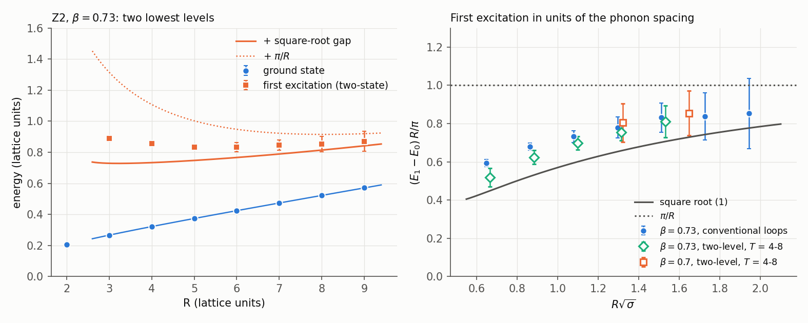
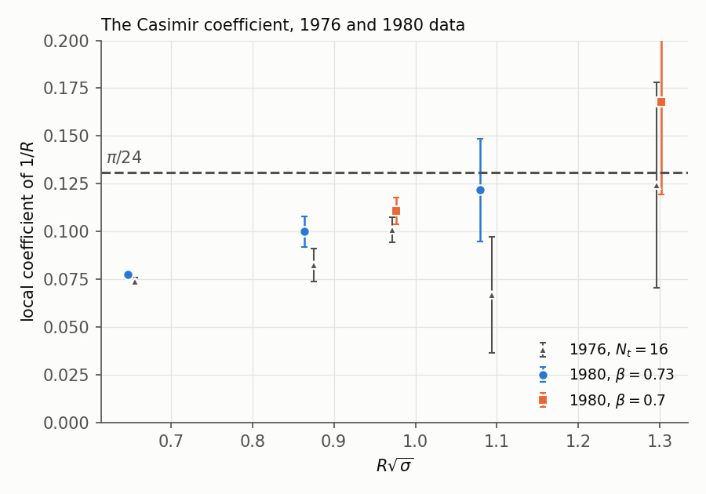
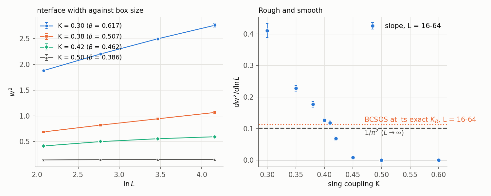

# Excited flux tubes, the square root, and roughening

*qcdstring programme. Preprint QCDS-80/1, November 1980. Revised after the second line's report (`REFEREE.md`, `RESPONSE.md`).*

## Abstract

We measure the two lowest levels of the flux tube between static sources in
the three-dimensional Z2 gauge theory, and locate the roughening point of its
surface. At $\beta = 0.73$ the ground state is measured to 0.2-2% for
separations up to 9 lattice spacings ($R\sqrt\sigma \le 1.9$), the reach of our
1976 data [1] with smaller errors. The first excitation, the state of one
transverse phonon, is measured with conventional generalized Wilson loops at
unit time steps and a basis of four distinct operators. Its gap above the
ground state lies far below the free-phonon spacing $\pi/R$ (by 17 to 4
standard errors for $R\sqrt\sigma = 0.86$-1.3) and above the Nambu-Goto square
root $\sqrt{\sigma^2R^2 + 2\pi\sigma(n - 1/24)}$, by a factor that falls from
1.30 at $R\sqrt\sigma = 0.86$ to 1.10 at 1.94; from $R\sqrt\sigma \approx 1.7$
on it agrees with the square root within errors. Levels with $n \ge 2$ are not
resolved. The ground state keeps both readings of [1]: from $R = 3$ on, a
single $1/R$ coefficient (0.089-0.107) and the free-string value $\pi/24$ with
an endpoint term $d/R^2$ fit equally well, in fits to the 1976 and 1980 data
together. Through Wegner's duality the flux tube is an Ising interface; its
width grows as the logarithm of the box size in the rough phase and saturates in
the smooth one. The slope of that logarithm crosses the universal value
$1/\pi^2$ at $K = 0.413$. Calibrated on the exactly solvable BCSOS model with
the same boxes, the roughening coupling is $K_R = 0.405 \pm 0.008$, gauge
coupling $\beta_R = 0.479 \pm 0.010$. The work used 99 of the 100 Cray-1 hours
allowed.

## 1. Introduction

Our 1976 paper [1] found a $1/R$ term with the sign of a Casimir energy in the
static potential of the three-dimensional Z2 gauge theory, and two ways to read
its size: a coefficient that grows with the length of the tube, or the
free-string value $\pi/24$ together with an endpoint term falling as $R^{-2}$.
Our 1978 paper [2] followed the SU(2) tension from strong coupling into a region
where it is constant in units of the two-loop scale. This paper measures the
first excited level of the tube, which tests the string picture level by level;
measures the ground state again with an independent method; and locates the
roughening point directly.

Much has happened since 1978. Creutz, Jacobs and Rebbi simulated the Z2 and
U(1) theories in four dimensions [3]; Creutz followed the SU(2) tension into the
scaling region [4]; Lautrup and Nauenberg [5] and Guth [6] have studied the U(1)
transition we found in 1976. Polyakov [7] and Susskind [8] made the closed
time-like line, which we used in 1976 as a technical device, the order parameter
of deconfinement. Lüscher, Symanzik and Weisz [9] have derived a universal $1/R$
term from the loop equations, and Itzykson, Peskin and Zuber [10] have argued
that the strong-coupling surface roughens before the continuum limit.
Hasenfratz and Hasenfratz [11] have related the lattice scale parameter to the
continuum one; with their ratio for SU(2), $\Lambda_{\overline{MS}}/\Lambda_L =
19.82$, our 1978 value $\sqrt\sigma = (54 \pm 4)\Lambda_L$ becomes
$\Lambda_{\overline{MS}} = (0.37 \pm 0.03)\sqrt\sigma$ at the couplings we used,
multiplied by the unknown factor for the remaining approach to scaling. Section 6
compares our hadron records of 1976 and 1978 with the new $\eta_c$, $\Upsilon''$
and $\Upsilon'''$ data.

## 2. Levels of a string with fixed ends

In $d = 3$ the tube has one transverse direction. Its states are labelled by two
reflections: $P_t$, the reflection of the transverse coordinate through the axis
of the sources, and $P_l$, the reflection that exchanges the two sources. A
phonon of mode number $k$ has the profile $\sin(k\pi x/R)$, odd under $P_t$ and
of parity $(-1)^{k+1}$ under $P_l$. A state's level $n$ is the sum of the mode
numbers of its phonons. The lowest states of each symmetry are

| $(P_t, P_l)$ | lowest level | content | next |
|---|---|---|---|
| $(+,+)$ | $n = 0$ | no phonon | $n = 2$ ($a_1^{\dagger 2}$) |
| $(-,+)$ | $n = 1$ | $a_1^\dagger$ | $n = 3$ ($a_3^\dagger$, $a_1^{\dagger 3}$) |
| $(-,-)$ | $n = 2$ | $a_2^\dagger$ | $n = 4$ |
| $(+,-)$ | $n = 3$ | $a_1^\dagger a_2^\dagger$ | $n = 5$ |

The free string gives $E_n - E_0 = n\pi/R$. The Nambu-Goto string with fixed
ends gives the square root (derived in Appendix A)

$$E_n(R) = \sqrt{\sigma^2R^2 + 2\pi\sigma\big(n - \tfrac{1}{24}\big)} + c,\qquad(1)$$

whose expansion in $1/\sigma R^2$ starts with the free-string levels and the
Casimir term. For $R\sqrt\sigma \approx 1$ the two differ strongly: at
$\beta = 0.73$ and $R = 5$ the square root predicts a first gap of 0.37 in lattice
units, against $\pi/R = 0.63$. The first excitation is the lowest state of the
$(-,+)$ channel, so operators of that symmetry isolate it from the ground state.
For $R\sqrt\sigma < 1.1$ the square root fails to describe the ground state
itself (Section 4.2); its gap there is a formal value.

## 3. Method

*Operators.* On a time slice we build space-like paths from the source at
$\mathbf x_0$ to the source at $\mathbf x_0 + R\hat e$ out of smeared links (two
or four steps in which each link receives half of the sum of its two staples in
the slice, normalized; Appendix C). The $(+,+)$ operators are straight paths.
For the others, $B_\pm^{(h)}(j)$ is the straight path with a bump of height $h$
toward $\pm\hat e_\perp$ over the link from $j$ to $j+1$, and

$$O^{(h)}_{k} = \sum_j \sin\tfrac{k\pi(j+1/2)}{R}\,[B^{(h)}_+(j) - B^{(h)}_-(j)]$$

projects onto phonon profiles of mode $k$. All operators transform covariantly
under random gauge transformations of the slice (`code/checks80.py`).

*Three productions*, all at $\beta = 0.73$ and 0.70 unless stated, on $24^3$
lattices:

1. *Two-level, one operator per channel.* As in [1]: the space-like links of
   every fourth slice are frozen, the time-like lines are averaged slab by slab
   over 300 updates, and the operators sit on the frozen slices, so $T = 0, 4, 8,
   12$. 16 chains, 150 (and 100) frozen configurations each. This production
   gives the ground state, from the effective energy between $T = 8$ and 12.
2. *Two-level, two operators per channel* ($h = 1, 2$ for the $(-,+)$ channel).
   The two operators proved 99% correlated, so the generalized eigenvalue
   analysis adds nothing over one operator; we keep the production as a
   cross-check.
3. *Conventional loops at unit time steps*, $T = 0, \dots, 7$, at $\beta = 0.73$
   only: 8000 configurations, five sweeps apart, from 8 chains, with all slices
   and positions used. In the $(-,+)$ channel the basis is $O^{(1)}_1$,
   $O^{(2)}_1$, $O^{(3)}_1$ and $O^{(1)}_3$ (the third aims at the state
   $a_1^{\dagger 3}$, the fourth at $a_3^\dagger$); at $R = 5$ their
   correlations at $T = 0$ range from 0.17 to 0.90. The generalized eigenvalue
   problem $C(T)v = \lambda(T)C(1)v$ gives effective energies
   $\ln[\lambda(T)/\lambda(T+1)]$.

Errors come from a jackknife over blocks: five frozen configurations in
productions 1 and 2, a hundred configurations in production 3.

*Check.* The product of all slab averages of production 1 is the correlator of
two closed time-like lines of length 24, the observable of [1]. At
$\beta = 0.73$ it gives $V(R) = 0.1281$, 0.2054, 0.2665, 0.3211, 0.3731 for
$R = 1$-5; the generalized Wilson loops give 0.1281, 0.2054, 0.2666, 0.3214,
0.3728; the 1976 runs at $N_t = 16$ gave 0.1278, 0.2050, 0.2662, 0.3212,
0.3736.

## 4. Results

### 4.1 The first excitation

At $R = 5$ the effective energy of the lowest $(-,+)$ state falls from 0.960 to
0.880 and 0.851(6) between the steps $T = 1 \to 2$, $2 \to 3$ and $3 \to 4$, and
then stays at 0.830(12), 0.862(28) and 0.847(53). The other separations behave
the same way. Each effective energy bounds the level from above. We quote two
numbers: the step $T = 4 \to 5$, the latest one measured to about 2%, as an upper
bound; and a two-state description $E(T) = E_1 + c\,e^{-\Delta T}$ of the steps
$T = 2 \to 3$ through $6 \to 7$, as an estimate.

**Table 1.** $\beta = 0.73$, production 3. Ground state $E_0$ from the step $T = 5 \to 6$; gaps $E_1 - E_0$; predictions with $\sigma = 0.0466$ from Section 4.2.

| $R$ | $R\sqrt\sigma$ | $E_0$ | gap, $T = 4 \to 5$ | gap, two-state | square root (1) | $\pi/R$ |
|---|---|---|---|---|---|---|
| 3 | 0.65 | 0.2668 | 0.618(13) | 0.621(20) | 0.462 | 1.047 |
| 4 | 0.86 | 0.3217 | 0.524(12) | 0.533(15) | 0.411 | 0.785 |
| 5 | 1.08 | 0.3739 | 0.457(12) | 0.460(19) | 0.373 | 0.628 |
| 6 | 1.29 | 0.4245 | 0.415(16) | 0.408(29) | 0.342 | 0.524 |
| 7 | 1.51 | 0.4734 | 0.377(18) | 0.373(34) | 0.315 | 0.449 |
| 8 | 1.73 | 0.5230 | 0.339(20) | 0.329(49) | 0.292 | 0.393 |
| 9 | 1.94 | 0.5728 | 0.319(23) | 0.298(64) | 0.271 | 0.349 |

**Figure 1.** Left: the two lowest levels at $\beta = 0.73$ (production 3), with
the ground-state fit and the first level it implies under the square root and
under $\pi/R$. Right: the gap in units of $\pi/R$ against $R\sqrt\sigma$, from the
two-state description (production 3) and from the step $T = 4 \to 8$ of
production 2.

The free-phonon spacing is excluded. Even the upper bounds lie below $\pi/R$ by
33, 22, 14, 7 and 4 standard errors for $R = 3$ to 7. The gap in units of
$\pi/R$ rises from 0.59 at $R\sqrt\sigma = 0.65$ to 0.85 at 1.94.

The square root describes the long-string end and misses the short one. The
two-state gaps exceed it by factors of 1.34, 1.30, 1.23, 1.19, 1.18, 1.13 and
1.10 for $R = 3$ to 9: by 8 and 5 standard errors at $R = 4$ and 5, by about 2
at $R = 6$ and 7, and by less than one at $R = 8$ and 9. The excess falls
steadily with the length of the string, and from $R\sqrt\sigma \approx 1.7$ on
the square root fits within errors. The steps between $T = 8$ and 12 of the
two-level productions lie lower (0.66-0.70 at $R = 4$-7, errors 0.11-0.16); they
leave room for a slower approach than the two-state description assumes, and our
estimates carry that one-sided uncertainty.

At $\beta = 0.70$ (productions 1 and 2 only) the gaps from the step $T = 4 \to 8$,
0.632(80) and 0.537(73) at $R = 4$ and 5 ($R\sqrt\sigma = 1.30$ and 1.63), lie 1.5
and 1.1 standard errors above the square root and 1.9 and 1.2 below $\pi/R$:
consistent with $\beta = 0.73$, without its precision. The $(-,-)$ channel
(lowest level $n = 2$) gives no stable effective energy in production 1 or 2, and
the $(+,-)$ channel (lowest level $n = 3$) none in production 1, the only one that
measured it: the levels with $n \ge 2$ are not resolved.

### 4.2 The ground state

**Table 2.** $\beta = 0.73$, ground state for $R = 2$-9 from production 1 (step $T = 8 \to 12$; neighbouring values correlated at 0.97). Correlated fits; $\chi^2$/dof and $p$.

| $R$ | $b$ free | $b = \pi/24$ | $b = 0$ | $\pi/24 + d/R^2$ | $b$ and $d$ free | square root (1) |
|---|---|---|---|---|---|---|
| 2-9 | $b = 0.072(1)$; 17.5/5 (0.004) | 2288/6 | 3382/6 | $d = 0.051(1)$; 1.8/5 (0.88) | $b = 0.149(19)$, $d = 0.067(16)$; 0.8/4 (0.94) | - |
| 3-9 | $b = 0.093(6)$; 1.8/4 (0.78) | 47.9/5 | 286/5 | $d = 0.045(7)$; 1.0/4 (0.91) | $b = 0.17(8)$; 0.7/3 | 4388/5 |
| 4-9 | $b = 0.108(18)$; 1.0/3 (0.80) | 2.5/4 (0.64) | 35.9/4 | $d = 0.036(28)$; 0.9/3 (0.83) | - | 42.8/4 |
| 5-9 | $b = 0.16(6)$; 0.2/2 (0.91) | 0.5/3 (0.93) | 6.8/3 (0.08) | $d = -0.06(12)$; 0.2/2 (0.91) | - | 0.3/3 (0.96) |

**Table 3.** The 1976 data ($N_t = 16$, closed time-like lines) and the 1980 data (production 1) fitted together, block-diagonal covariance.

| $\beta$ | $R$ | $b$ free | $\pi/24 + d/R^2$ | $b$ and $d$ free | $\pi/24$ |
|---|---|---|---|---|---|
| 0.73 | 2-9 | $b = 0.071(1)$; 34.9/13 (0.001) | $d = 0.051(1)$; 7.8/13 (0.86) | $b = 0.137(13)$; 7.6/12 (0.82) | 4418/14 |
| 0.73 | 3-9 | $b = 0.089(4)$; 8.6/11 (0.66) | $d = 0.050(4)$; 7.0/11 (0.80) | $b = 0.16(5)$; 6.7/10 | 134/12 |
| 0.73 | 4-9 | $b = 0.107(12)$; 6.4/9 (0.70) | $d = 0.036(19)$; 6.5/9 (0.69) | - | 10.2/10 (0.43) |
| 0.70 | 2-6 | $b = 0.103(4)$; 4.1/7 (0.77) | $d = 0.026(4)$; 3.5/7 (0.83) | $b = 0.24(11)$; 2.5/6 | 54.8/8 |
| 0.70 | 3-6 | $b = 0.140(31)$; 2.6/5 (0.77) | $d = -0.011(39)$; 2.6/5 (0.76) | - | 2.7/6 (0.85) |

The ground state is measured to the same distance as in 1976 ($R = 9$), with
errors smaller by factors of 1.2-1.8 at $R \ge 7$; the 1976 and 1980 data agree
($\chi^2 = 5.8$ for 9 points at $\beta = 0.73$ and 2.3 for 6 at 0.70, combining
the errors of each pair). From $R = 3$ on, the two
readings of [1] fit equally well, separately and together: a single coefficient,
$b = 0.089(4)$ from $R = 3$ and $0.107(12)$ from $R = 4$ in the joint fits, or
$\pi/24$ with an endpoint term. Only the $R = 2$ point prefers the endpoint
reading, and $R = 2$ is $R\sqrt\sigma = 0.43$, where neither reading has a claim
to hold. Over matched ranges of $R\sqrt\sigma$ (0.65-1.94: $R = 3$-9 at
$\beta = 0.73$, $R = 2$-6 at 0.70), the joint fits give
$d\sqrt\sigma = 0.0107(9)$ and $0.0084(12)$, 1.5 standard errors apart. An
endpoint term $d/R^2$ has the effect of moving the ends of the tube by
$24d/\pi \approx 0.4$ lattice spacings, the size of a lattice effect. With both
terms free and all separations, the coefficient of $1/R$ is $0.137(13)$, but that
number leans on $R = 2$. We present the two readings as equal; the data to
$R\sqrt\sigma = 1.9$ do not separate them. The square root (1) describes the
ground state only from $R\sqrt\sigma \approx 1.1$ on; at shorter distances it
bends more than the data.

**Figure 2.** The local coefficient of $1/R$ from three consecutive separations,
1976 and 1980 data, against $R\sqrt\sigma$.

## 5. Roughening

Wegner's duality maps the Z2 gauge theory onto the Ising model at
$\tanh\beta = e^{-2K}$ and the world sheet of the flux tube onto an Ising
interface [12]. An interface spanning an $L \times L$ box is the cleanest version
of the question asked in [1]. In the rough phase its height fluctuates through
massless capillary waves, and its mean square width grows as $\ln L$ [13], with
slope $1/2\pi\tilde\sigma$, $\tilde\sigma$ the stiffness; in the smooth phase the
width saturates. The interface model maps onto a two-dimensional Coulomb gas,
whose transition fixes the stiffness at roughening to $\pi/2$ in units of the
temperature [14-16]: in the limit of large boxes the slope at the roughening
point is $1/\pi^2$.

We simulate the Ising model on $L \times L \times 24$ boxes, periodic in the two
long directions, with the bottom layer fixed to $+1$ and the top layer to $-1$,
for $L = 8$, 16, 32 and 64 and nine couplings (`code/ising_interface.py`; heat
bath, 10,000 to 25,000 sweeps). The height of the interface over each column is
the number of minus spins in it; the width $w^2$ is the variance of the heights
over the columns. Bulk spin flips add a constant to $w^2$ that does not depend on
$L$. Errors come from 10 blocks per run.

**Table 4.** Interface width $w^2$ and its slope in $\ln L$ (fit to $L = 16$-64).

| $K$ | $\beta$ | $w^2$, $L = 8$ | 16 | 32 | 64 | slope |
|---|---|---|---|---|---|---|
| 0.30 | 0.617 | 1.879(16) | 2.203(14) | 2.497(16) | 2.760(32) | 0.410(22) |
| 0.35 | 0.545 | 0.994(9) | 1.173(5) | 1.334(9) | 1.486(14) | 0.228(9) |
| 0.38 | 0.507 | 0.688(10) | 0.820(8) | 0.943(5) | 1.066(9) | 0.177(9) |
| 0.40 | 0.484 | 0.547(6) | 0.650(6) | 0.741(4) | 0.826(6) | 0.127(6) |
| 0.41 | 0.473 | 0.476(6) | 0.568(4) | 0.651(5) | 0.730(10) | 0.118(7) |
| 0.42 | 0.462 | 0.414(7) | 0.500(5) | 0.555(9) | 0.594(5) | 0.068(5) |
| 0.45 | 0.432 | 0.281(5) | 0.316(4) | 0.328(3) | 0.331(2) | 0.009(3) |
| 0.50 | 0.386 | 0.142(3) | 0.149(1) | 0.151(1) | 0.151(0) | 0.001(1) |
| 0.60 | 0.311 | 0.044(1) | 0.044(1) | 0.044(0) | 0.044(0) | 0.001(0) |

**Figure 3.** Left: interface width against $\ln L$. Right: its slope against the
Ising coupling, with the asymptotic value at roughening and its finite-size
calibration.

The width grows logarithmically for $K \le 0.41$ and saturates for
$K \ge 0.45$. The slope falls through $1/\pi^2$ between $K = 0.41$ and 0.42, by
interpolation at $K = 0.413$ (0.412 with $L = 32$-64 alone).

*Calibration.* The value $1/\pi^2$ holds for infinite boxes. At the roughening
point the effective slope over finite boxes approaches it from above, slowly,
so a crossing found with boxes up to 64 lies on the smooth side of the true
point. The BCSOS model of van Beijeren [16], whose roughening coupling is known
exactly, $K_R = \tfrac12\ln 2$, measures the size of this effect with the same
boxes and the same estimator (`code/bcsos_calibration.py`; heights in layer
units). At its exact roughening point the BCSOS slope over $L = 16$-64 is
0.1128(20), 11% above $1/\pi^2$, and it crosses $1/\pi^2$ only at
$1.042\,K_R$. Two corrections for the Ising interface follow. Matching the
BCSOS slope at its roughening point gives $K = 0.411$; rescaling the Ising
crossing by the BCSOS ratio gives $K = 0.397$. They differ because the scale of
the logarithmic corrections belongs to each model. We take the range they span,
with the uncalibrated crossing as its upper end:
$K_R = 0.405 \pm 0.008$.

In gauge language, $\beta_R = 0.479 \pm 0.010$. Below this coupling the Wilson surface is
smooth and the potential has no Casimir term; the couplings of Section 4, 0.70
and 0.73, lie well inside the rough phase. Our 1976 strong-coupling ratios left
the two-term series at 1% near $\beta = 0.40$, before roughening; the departure
there came from the higher terms of the series.

Read in the gauge theory, the same mechanism says that the flux tube between
static sources widens as the logarithm of their separation in the rough phase,
with a coefficient fixed by the tension (Appendix C). That is a prediction for
the transverse profile of the tube, which we have not measured.

## 6. Hadron records since 1976

Our 1978 paper [2] recorded bottomonium values from a joint
charmonium-bottomonium potential: the 3S level at 10.351 GeV and the 4S level at
10.618 GeV, with the open-bottom threshold between 10.57 and 10.72 GeV, so that
the position of the 4S relative to it was left open. The CESR experiments have
since found a narrow third level and a broad fourth level [17, 18], about 0.9 and
1.1 GeV above the first. (The absolute masses of the 1980 measurements depend on
the energy scale of that machine, which differs from that of DORIS by some tens of
MeV; we compare spacings.) The records give 0.89 and 1.16 GeV.

A candidate for the charmonium spin singlet has been seen at 2.98 GeV [19]. The
first-order spin-spin shift of our 1976 potential (a), 47 MeV for the triplet,
implies a hyperfine splitting of 188 MeV and a singlet near 2.91 GeV, 70 MeV
below the candidate: the contact term of a vector exchange with $\kappa = 0.59$,
taken at first order, is too strong.

Both lines remember all of these outcomes. We record the agreements and the
disagreement as consistency checks, without weight.

## 7. Summary

* The first excitation of the Z2 flux tube in three dimensions lies far below
  the free-phonon spacing for $R\sqrt\sigma \le 1.5$ and above the Nambu-Goto
  square root, by a factor that falls from 1.30 at $R\sqrt\sigma = 0.86$ to 1.10
  at 1.94; it agrees with the square root within errors from
  $R\sqrt\sigma \approx 1.7$ on. The levels with $n \ge 2$ are not resolved.
* The ground state to $R\sqrt\sigma = 1.9$, from two independent methods,
  admits a single $1/R$ coefficient of 0.09-0.11 and the free-string value with
  an endpoint term $d\sqrt\sigma \approx 0.008$-0.011 equally well.
* The Ising interface dual to the flux tube roughens at
  $K_R = 0.405 \pm 0.008$, $\beta_R = 0.479 \pm 0.010$ (calibrated on the BCSOS
  model; the uncalibrated crossing, $K = 0.413$, is an upper bound); the Casimir term can exist only above this coupling.

## Appendix A. The square root from the methods of 1973

The steps follow the quantization of Goddard, Goldstone, Rebbi and Thorn [20],
with the ends of the string held fixed.

*Classical solution and modes.* Take the Nambu-Goto string with tension
$\sigma = 1/2\pi\alpha'$, ends at $x^1 = 0$ and $x^1 = R$, and all other spatial
coordinates of the ends at the origin. In conformal gauge, with
$0 \le \sigma_1 \le \pi$, the time coordinate satisfies Neumann conditions and
every spatial coordinate Dirichlet conditions:

$$X^0 = x^0 + 2\alpha' E\,\tau + \text{oscillators},\qquad
X^1 = \frac{R}{\pi}\sigma_1 + \sqrt{2\alpha'}\sum_{n\ne0}\frac{\alpha^1_n}{n}e^{-in\tau}\sin n\sigma_1,$$

and the $d-2$ transverse coordinates $X^i$ have the same form as $X^1$
without the stretched term.

*Constraint.* The zero mode of the Virasoro constraint reads

$$\alpha' E^2 = \alpha'\Big(\frac{R}{2\pi\alpha'}\Big)^2 + N - a,$$

with $N$ the total oscillator level. The other constraints remove the
oscillators of $X^0$ and $X^1$, as in light-cone gauge, so that $N$ counts the
$d-2$ transverse towers, $N = \sum_i \sum_{n>0} n\,N_{i,n}$.

*Intercept.* The normal-ordering constant is the zero-point energy of the
transverse towers, $a = (d-2)/24$, by the same mode sum as Section 2.1 of [1].

*Result.* With $\alpha' = 1/2\pi\sigma$,

$$E_N(R) = \sqrt{\sigma^2R^2 + 2\pi\sigma\Big(N - \frac{d-2}{24}\Big)}.$$

*Caveat.* In the covariant treatment the removal of two oscillator towers is
consistent only for $d = 26$. For $d = 3$ or 4 we take the formula as the
long-string prediction to be tested. Its expansion in $1/\sigma R^2$ reproduces
the free-string spacings and the Casimir term. At higher orders its claim to
universality rests on nothing we can derive in 1980.

## Appendix B. Computing budget

Cap: 100 hours of a Cray-1 at 12 Mflop/s, the speed of compiled Fortran on the
LINPACK benchmark; $4.32\times10^{12}$ operations. Charges as in [1]: 20 per Z2
link update, 10 per Ising spin update, 30 per BCSOS site update, one per
multiply-add in the measurements. The charges are floors (no memory traffic or
indexing). The largest run, production 2, holds about 0.6M words, within the
1M-word memory of the machine.

**Table 5.** Operations charged.

| Run | Operations | Share |
|---|---|---|
| Production 1, $\beta = 0.73$ | $6.88\times10^{11}$ | 15.9% |
| Production 1, $\beta = 0.70$ | $4.42\times10^{11}$ | 10.2% |
| Production 2, $\beta = 0.73$ | $7.18\times10^{11}$ | 16.6% |
| Production 2, $\beta = 0.70$ | $4.56\times10^{11}$ | 10.6% |
| Production 3, $\beta = 0.73$ (8 chains) | $1.59\times10^{12}$ | 36.8% |
| Ising interface | $2.75\times10^{11}$ | 6.4% |
| BCSOS calibration | $8.5\times10^{10}$ (two runs) | 2.0% |
| Smearing tests (2, 6, 12 steps) | $1.40\times10^{10}$ | 0.3% |
| **Total** | $4.27\times10^{12}$ | **98.8% (99 hours)** |

Production 3 costs about $2\times10^8$ operations per configuration, because it
builds every operator on every slice. We ran it on 16 chains at each coupling;
the budget covers 8 chains at $\beta = 0.73$, and only those enter this paper.
The rest is kept in `results/over_budget/` and enters no number here. The three
smearing tests chose two smearing steps: with 2, 6 and 12 steps the ground-state
effective energy at $R = 8$ between $T = 4$ and 8 was 0.528, 0.656 and 3.60, and
the relative error of the one-phonon correlator at $R = 6$, $T = 8$ was 0.33,
1.13 and 0.76.

## Appendix C. What this paper takes from memory

* Two-level averaging: M. Lüscher and P. Weisz, JHEP 09 (2001) 010; its use with
  operators on the frozen slices follows their 2002 work.
* Smearing of space-like links: M. Albanese et al. (APE), Phys. Lett. 192B
  (1987) 163, here in a real-valued form for Z2.
* The generalized eigenvalue method for excited states: C. Michael, Nucl. Phys.
  B 259 (1985) 58; M. Lüscher and U. Wolff, Nucl. Phys. B 339 (1990) 222.
* The logarithmic widening of the flux tube in the gauge theory: M. Lüscher,
  G. Münster and P. Weisz, Nucl. Phys. B 180 (1981) 1. Its interface version is
  the capillary-wave result of 1965 [13].
* The Cray-1 speed: J. Dongarra's LINPACK tables.
* Remembered outcomes that this paper's conclusions lean toward: the Nambu-Goto
  levels for $R\sqrt\sigma \gtrsim 1$, the Casimir coefficient $\pi/24$, the
  roughening coupling $K_R \approx 0.41$, and the bottomonium and $\eta_c$
  masses of Section 6. None enters a calculation, and none counts as evidence.

## References

1. qcdstring programme, The Casimir energy of a flux tube, and an area law on the computer, preprint QCDS-76/1 (1976, revised).
2. qcdstring programme, The SU(2) string tension between strong coupling and asymptotic freedom, preprint QCDS-78/1 (1978, revised).
3. M. Creutz, L. Jacobs and C. Rebbi, Phys. Rev. Lett. 42 (1979) 1390; Phys. Rev. D 20 (1979) 1915.
4. M. Creutz, Phys. Rev. Lett. 43 (1979) 553; Phys. Rev. D 21 (1980) 2308.
5. B. Lautrup and M. Nauenberg, Phys. Lett. 95B (1980) 63.
6. A. H. Guth, Phys. Rev. D 21 (1980) 2291.
7. A. M. Polyakov, Phys. Lett. 72B (1978) 477.
8. L. Susskind, Phys. Rev. D 20 (1979) 2610.
9. M. Lüscher, K. Symanzik and P. Weisz, Nucl. Phys. B 173 (1980) 365.
10. C. Itzykson, M. E. Peskin and J.-B. Zuber, Phys. Lett. 95B (1980) 259.
11. A. Hasenfratz and P. Hasenfratz, Phys. Lett. 93B (1980) 165.
12. F. J. Wegner, J. Math. Phys. 12 (1971) 2259.
13. F. P. Buff, R. A. Lovett and F. H. Stillinger, Phys. Rev. Lett. 15 (1965) 621.
14. J. M. Kosterlitz and D. J. Thouless, J. Phys. C 6 (1973) 1181.
15. S. T. Chui and J. D. Weeks, Phys. Rev. B 14 (1976) 4978.
16. H. van Beijeren, Phys. Rev. Lett. 38 (1977) 993.
17. D. Andrews et al. (CLEO), Phys. Rev. Lett. 44 (1980) 1108; T. Böhringer et al. (CUSB), Phys. Rev. Lett. 44 (1980) 1111.
18. D. Andrews et al. (CLEO), Phys. Rev. Lett. 45 (1980) 219; G. Finocchiaro et al. (CUSB), Phys. Rev. Lett. 45 (1980) 222.
19. R. Partridge et al. (Crystal Ball), Phys. Rev. Lett. 45 (1980) 1150.
20. P. Goddard, J. Goldstone, C. Rebbi and C. B. Thorn, Nucl. Phys. B 56 (1973) 109.
