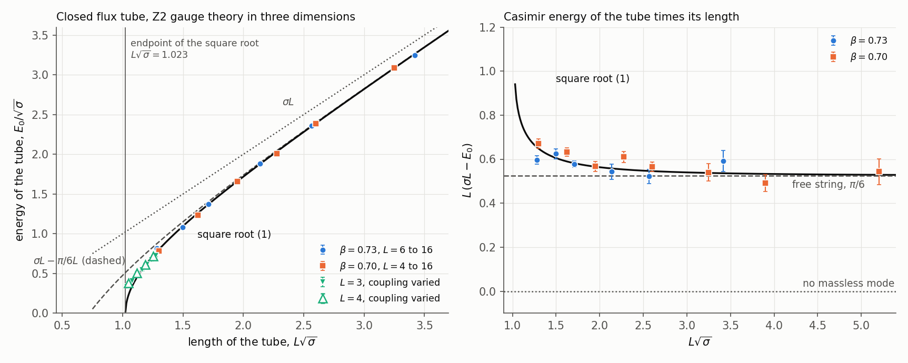
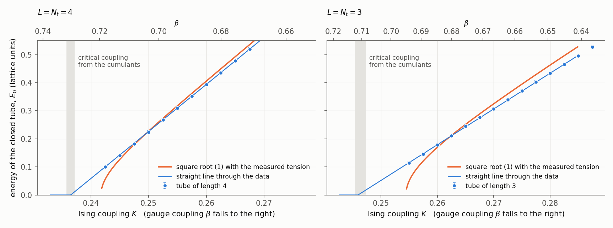
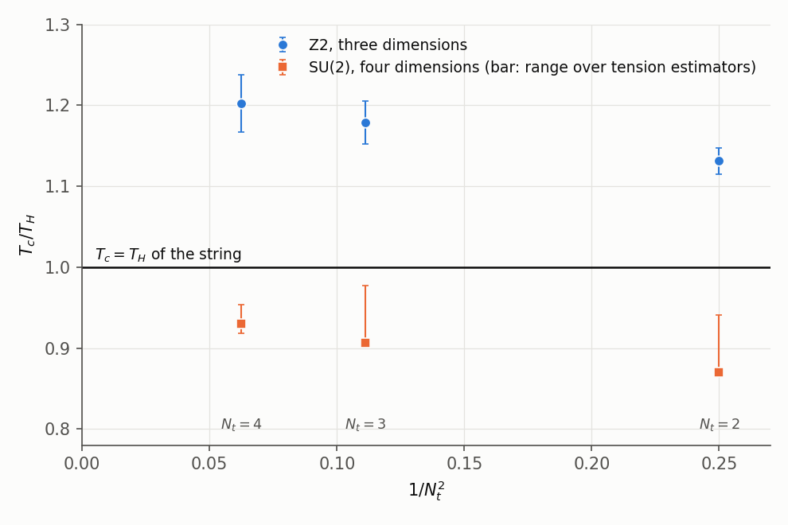

# Hagedorn versus deconfinement: the closed flux tube at finite temperature

*qcdstring programme. Preprint QCDS-82/1, November 1982.*

## Abstract

A string wound once around the periodic time direction of a system at
temperature $T = 1/L$ has, in the Nambu-Goto model, the ground-state energy
$E_0(L) = \sqrt{\sigma^2L^2 - \pi(d-2)\sigma/3}$. It vanishes at the temperature
$T_H = \sqrt{3\sigma/\pi(d-2)}$ at which the level density of the same string
makes its partition function diverge. We measure $E_0(L)$ for the flux tube of
the three-dimensional Z2 gauge theory, for lengths $L = 3$ to 16 lattice
spacings, through the dual Ising model: the tube that travels once around a
lattice is an interface forced by an antiperiodic boundary, and its free energy
follows from integrating an energy difference over the coupling. The method
reproduces Kaufman's exact result in two dimensions. Four results follow. (i)
The closed tube has a Casimir energy. At $\beta = 0.73$ a tube energy
$\sigma L$ fails ($\chi^2 = 553$ for 3 degrees of freedom) and so does
$\sigma L$ plus a constant; with a term $-\gamma/L$ we find
$\gamma = 0.58(3)$ for $L \ge 8$ at both couplings, against $\pi/6 = 0.52$ for
one free massless mode. The number $c$ of massless modes depends on what is
assumed for the term of order $L^{-3}$. With the $L^{-3}$ term of the square
root, $c = 0.97(4)$ at $\beta = 0.73$ and $1.04(6)$ at $\beta = 0.70$, with a
further $\pm0.1$ from the fit range and two systematic variants. With that
term free, $c = 0.99(12)$ and $1.01(10)$ when tubes down to
$L\sqrt\sigma \approx 1.3$ and 1.6 are kept, and $0.6(3)$ from $L \ge 8$
alone; $c = 2$ is excluded over every range, and $c = 0$ by the shorter tubes
and by the comparison of the two couplings. (ii) On the lattices with
$L \ge 6$ the tube energy stays within 3% of the square root for
$L\sqrt\sigma \ge 1.5$. Extrapolated in the lattice spacing at fixed
$L\sqrt\sigma$, with corrections of order $1/L^2$ or $1/L^4$, the ratio to the
square root is 1.02(2) or 1.01(1) at $L\sqrt\sigma = 1.50$ and 1.06(2) or
1.03(1) at 1.35. Beyond the endpoint 1.023 of the square root the tube is
still there: at $L\sqrt\sigma = 1.05$ its energy is $0.38(2)\sqrt\sigma$ for
$L = 4$. (iii) The tube energy reaches zero at the deconfinement coupling
linearly in the coupling. The exponent lies between 0.92 and 1.07 over fit
ranges and forms for $L = 4$ and 3, measured where the correlation length is
at most 2.9 tube lengths, and a square-root approach is excluded under every
choice. The cumulants of the order parameter place the transition in the
class of the two-dimensional Ising model: 0.61 to 0.62 at the crossing and
$1/\nu = 0.80(15)$ to $0.98(13)$ from their slopes. (iv) From the critical
couplings of lattices with $N_t = 2$, 3 and 4 time slices,
$T_c/\sqrt\sigma = 1.105(16)$, 1.152(26) and 1.175(35), and 1.19(3) linearly
in $1/N_t^2$: deconfinement lies 13 to 20% above the string's
$T_H = 0.977\sqrt\sigma$. In SU(2) in four dimensions, closed time-like lines
on $8^3$ and $12^3$ lattices give $\beta_c = 1.885(3)$, 2.172(3) and 2.292(5)
for $N_t = 2$, 3, 4. The ratio $T_c/T_H$ then depends on how the
zero-temperature tension is estimated: 0.87 to 0.94, 0.91 to 0.98 and 0.92 to
0.95 for the three lattices. Deconfinement lies 2 to 13% below the string
value $0.691\sqrt\sigma$ on these lattices, and neither a trend with $N_t$
nor the ordering in the continuum is established. With the tension fixed by
the closed tube, the $1/R$ coefficient of our 1976 and 1980 open-tube data
becomes 0.116(5) from $R = 4$ when fitted alone, 2.9 standard errors below
$\pi/24$ (2.3 to 3.5 over the closed-tube tensions), and $\pi/24$ with an
endpoint term remains an equally good description. The work used 88 of the
100 Cray-1 hours allowed.

## 1. Introduction

Hagedorn [4] read the exponential growth of the hadron level density as a
limiting temperature, and the dual models reproduce that growth: the states of
a string with $d-2$ transverse towers of oscillators multiply as
$\exp(m/T_H)$ [5, 6]. Cabibbo and Parisi [7] proposed that the divergence
marks a phase transition to a state of quarks. Polyakov [8] and Susskind [9]
found that transition in gauge theory, with the closed time-like line as its
order parameter, and in the last two years the Monte Carlo method has located
it in SU(2) [10-12]. Svetitsky and Yaffe [13] have argued that a continuous
deconfinement transition in $d$ dimensions has the critical behaviour of a spin
model in $d-1$ dimensions with the symmetry of the centre of the gauge group.

On the string side, Lüscher [15] has shown that the $1/R$ term of our 1976
paper [1] is universal, Lüscher, Münster and Weisz [16] have derived the
logarithmic widening of the tube, Alvarez [18] has obtained the square-root
potential in the limit of many dimensions, and a preprint of Pisarski and
Alvarez [19] treats the string at finite temperature in the same limit:
the tension falls as $\sqrt{1 - T^2/T_c^2}$ and vanishes continuously. Polyakov
[17] has shown that the quantum string in fewer than 26 dimensions carries one
more field, the conformal factor of its world sheet; we return to that in a
later paper.

This paper puts the two sides together in a calculation. The string that
matters at finite temperature is a closed one, wound around the periodic time
direction. Its ground-state energy $E_0(L)$ is the mass that governs the
correlator of two closed time-like lines, and the string model predicts it
completely (Section 2). The prediction has two parts of different standing.
At long length it is a Casimir energy, the closed-string partner of the $1/R$
term, and it comes without the endpoint ambiguity that has kept the open-tube
coefficient of [1, 3] undecided; its own ambiguity, the term of order
$L^{-3}$, turns out to limit what the number of massless modes can be known
to (Section 4.1). At short length it is a square root that
vanishes at $T_H$. Our ledger has carried since 1974 the expectation that
deconfinement lies at or below this temperature. Sections 3 and 4 test both
parts in the three-dimensional Z2 theory, Section 5 compares $T_c$ with $T_H$
in SU(2) in four dimensions, and Section 6 returns to the open tube.

*Sources.* Appendix D lists what this paper takes from memory, including the
couplings at which the critical-point runs were centred. No remembered number
enters a calculation.

## 2. A string wound around the time circle

### 2.1 The Casimir energy of a closed string

A system at temperature $T$ is periodic in Euclidean time with period $L = 1/T$.
A string wound once around that direction is closed, of length $L$, and
free to move in the $d-1$ spatial directions. Its $d-2$ transverse
displacements are periodic functions on a circle; their frequencies are
$2\pi|n|/L$, each with a left- and a right-moving mode, and the regulated
zero-point sum of [1] gives

$$E_0(L) = \sigma L - \frac{\pi(d-2)}{6L} + O(L^{-3}).\qquad(1)$$

The correlator of two closed time-like lines at spatial separation $R \gg L$
falls as $e^{-E_0(L)R}$, so $E_0(L)/L = \sigma - \pi(d-2)T^2/6$ is the tension
at temperature $T$.

Two features distinguish (1) from its open-string partner
$\sigma R - \pi(d-2)/24R$. The coefficient is four times larger, so the effect
is easier to see. And the closed string has no ends: every correction to (1) is
an integral of a local term over a world sheet without boundary, by counting
dimensions the first can appear at order $L^{-3}$, and the $R^{-2}$ endpoint
term that competes with the Casimir term in [1, 3] has no counterpart. The
square root of Section 2.2 has a definite term of that order,
$-\pi^2(d-2)^2/72\sigma L^3$. Whether the flux tube must have the same one we
do not know; a stiffness of the surface is the obvious candidate for a
different value, and we have no argument that fixes or removes its
contribution. Section 4.1 therefore fits the Casimir coefficient both ways.

The two coefficients are one statement. The correlator of two lines at
separation $R$ on a lattice of time extent $L$ can be written as a sum over the
states of the open tube between static sources, $\sum_N w_N e^{-E_N(R)L}$, as in
[1], or as a sum over the states of the closed tube that travels the distance
$R$. For the free string the first sum is
$e^{-\sigma RL}\,\eta(iL/2R)^{-(d-2)}$ with Dedekind's function $\eta$, and the
transformation $\eta(-1/\tau) = \sqrt{-i\tau}\,\eta(\tau)$ turns it term by term
into a sum over closed-string levels $\sigma L + 4\pi(n - (d-2)/24)/L$
(`code/hagedorn.py` checks the identity to twelve digits). The number of
massless modes that fixes $-\pi(d-2)/24R$ fixes $-\pi(d-2)/6L$.

### 2.2 The square root and the Hagedorn temperature

The quantization of Goddard, Goldstone, Rebbi and Thorn [20], applied to the
wound string as in Appendix A of [3], gives the complete spectrum
(Appendix A):

$$E_{N,\bar N}(L)^2 = \sigma^2L^2 + 4\pi\sigma\Big(N + \bar N - \frac{d-2}{12}\Big) + \Big(\frac{2\pi(N-\bar N)}{L}\Big)^2 + \mathbf p_\perp^2.\qquad(2)$$

The ground state is

$$E_0(L) = \sigma L\sqrt{1 - \frac{\pi(d-2)}{3\sigma L^2}},\qquad
T_H = \sqrt{\frac{3\sigma}{\pi(d-2)}},\qquad(3)$$

and its expansion starts with (1). It vanishes at $L = 1/T_H$. The level
density gives the same temperature: the number of states at level $N$ of $c$
towers grows as $N^{-(c+3)/4}\exp(2\pi\sqrt{cN/6})$, and with $m^2 = 2\pi\sigma N$
this is $\exp(m/T_H)$ with $T_H$ of (3). `code/hagedorn.py` verifies the growth
law on exact degeneracies up to $N = 1600$ (local exponent within 0.1% of
$2\pi\sqrt{c/6}$ for $c = 1$, 2 and 24). The divergence of the string's
partition function and the vanishing mass of the wound string are the same
event.

**Table 1.** The string's Hagedorn temperature (3).

| $d$ | $T_H/\sqrt\sigma$ | $L_H\sqrt\sigma$ |
|---|---|---|
| 3 | 0.9772 | 1.0233 |
| 4 | 0.6910 | 1.4472 |
| 26 | 0.1995 | 5.0133 |

With $\sqrt\sigma = 0.43$ GeV from the Regge slope, the value in four
dimensions is 0.30 GeV, nearly twice Hagedorn's 0.16 GeV [4]. Two remarks
bear on the comparison. The string's density in mass is
$m^{-(d-1)/2}e^{m/T_H}$, with the power $-3/2$ in four dimensions, while fits to
the hadron tables have used steeper powers, and a steeper power returns a lower
temperature from the same table. At the Regge tension, 0.16 GeV would need
$c = 3\sigma/\pi T^2 \approx 7$ towers in place of two. We leave the fit of the
tables to the string form for a later paper; the test made here is on the
lattice.

### 2.3 What a gauge theory allows at the endpoint

Three facts constrain what replaces (3) near its endpoint.

*Positivity.* Wilson's lattice theory has a positive transfer matrix along any
lattice direction [21]. The correlator of two closed lines is a sum of
decaying exponentials with positive weights, so $E_0(L)$ is real and positive
throughout the confined phase. A square root of a negative number is a
statement about the string model.

*The order parameter.* The closed line changes sign under the centre of the
gauge group [8, 9]. In the confined phase its correlator decays and
$E_0(L) > 0$; deconfinement at $L_c = 1/T_c$ is where that stops, either
because $E_0$ reaches zero continuously or because another phase takes over
while $E_0$ is still finite.

*Universality.* If the transition is continuous, $E_0 \propto (L - L_c)^\nu$
with the exponent of the $(d-1)$-dimensional spin model [13]: $\nu = 1$ for Z2
in three dimensions (Onsager [24]) and $\nu \approx 0.63$ for SU(2) in four.
The square root has $\nu = 1/2$ in every dimension, the mean-field value, which
is also what the limit of many dimensions returns [19].

A continuous transition in the Z2 theory therefore cannot follow (3) to its
endpoint, and nothing forces $T_c$ to equal $T_H$. A first-order transition
could preempt the endpoint, as the Potts analogy suggests for SU(3) [14], and
then $T_c < T_H$. For a continuous one the ordering is a question for
measurement. The expectation $T_c \le T_H$ in our ledger assumed that (3)
holds up to $T_H$.

## 3. Method: the closed tube as an Ising interface

### 3.1 The direct method and its cost

The direct route is the one of [1]: correlators of closed time-like lines,
summed over the transverse coordinate so that they project on zero transverse
momentum. We tried it first at $\beta = 0.73$ with lines of length 8, 12 and
16, unsmeared and smeared, with and without two-level averaging
(`code/z2_wall.py`, `code/z2_tube.py`). Three findings ended it as a
production method.

* The two-level average of [1] gains nothing here. On one Markov chain it
  agrees with the plain estimate within errors five to twelve times smaller
  than either
  (`code/pilots/samechain82.py`, output in `results/pilots/samechain82.log`),
  and at equal cost the two have equal errors:
  the correlator of wall sums is not small, and its error comes from the slow
  fluctuation of the lines from one configuration to the next.
* That fluctuation is slow. The mean line has autocorrelation times of 10 to
  150 sweeps at these parameters, and averages of the plaquette over 1000
  sweeps wander between 0.850 and 0.861. For the tube of length 8, three runs
  on the same $48\times16$ lattice gave effective energies 0.333(14), 0.291(16)
  and 0.296(22), and a run on $64\times12$ gave 0.251(16)
  (`results/gauge_check.txt`). A single link flips with probability
  $e^{-8\beta} \approx 0.003$ when its four plaquettes are satisfied, so the
  lines move on a time scale of some forty sweeps per site.
* With 2 to $8\times10^{10}$ operations per tube length the runs give the
  energy to 2 to 7%, and as an upper bound. The dual model reaches 0.5 to 1%
  with 1 to $4\times10^{11}$ operations, gives every coupling along its path
  at once, and has no excited states to wait out.

We keep these runs as an independent check (Section 3.4) and measure the tube
in the dual model, where the same quantity is a free energy and the dynamics is
fast.

### 3.2 The tube on a torus and the antiperiodic Ising lattice

Wegner's duality [22] maps the Z2 gauge theory at coupling $\beta$ onto the
Ising model at $K$ with $\tanh\beta = e^{-2K}$, and the surfaces of the
strong-coupling expansion onto Ising domain walls. Take a periodic lattice of
$N_t \times L_x \times L_y$ sites. A surface that wraps the $(t,x)$ torus once
is the world sheet of a tube of length $L = N_t$ that travels once around
$x$. In the Ising model such a wall is forced by making the bonds across one
plane $y = \text{const}$ antiferromagnetic. With $Z_P$ and $Z_A$ the partition
functions of the periodic and the antiperiodic lattice,

$$\frac{Z_A}{Z_P} = \frac12\sum_{k=0}^{2L_y-1} e^{-\epsilon_k L_x},\qquad
\cosh\epsilon_k = \cosh E_0 + 1 - \cos\frac{\pi k}{L_y},\qquad(4)$$

up to the corrections listed below. Appendix B derives (4) from the transfer
matrix along $x$. Its content: the wall is a particle of mass $E_0(L)$ moving
in the transverse direction; its position lives on a circle of $2L_y$ sites,
because carrying the wall once around $y$ exchanges the two Ising phases, so
its momenta are $\pi k/L_y$; and the periodic lattice has two degenerate
ground states, which is the factor $\tfrac12$. The dispersion law is the
lattice form of $\epsilon^2 = E_0^2 + p^2$.

Formula (4) neglects excited tube states, states of three tubes
($e^{-2E_0L_x}$), and the tunnelling between the two Ising ground states of a
slice, which is of order $e^{-E_0L_y}$ per unit length. The lowest excited
states of (2) carry one phonon and one unit of momentum along the tube
($N = 1$, $\bar N = 0$ and the reverse), about $2\pi/L$ above the ground
state; their weight $2e^{-2\pi L_x/L}$ is at most $2\times10^{-4}$ on our
lattices. The states at rest start $4\pi/L$ up. The tunnelling sets the
transverse size. In two dimensions everything is exactly known [23, 24], and
Table 2 shows the size of the error. What the two-dimensional comparison
tests is the factor $\tfrac12$, the doubled set of momenta, and the
treatment of the tunnelling, for a wall that has no internal states and whose
dispersion law is Onsager's exactly. The parts of (4) that are specific to
three dimensions (the dispersion law of a tube, and its excited states) rest
on the comparison of four lattices for the tube of length 8 below.

**Table 2.** Formula (4) against Kaufman's exact partition functions of the two-dimensional Ising model ($N_t = 1$); $m = 2K + \ln\tanh K$ is the exact mass of the wall (`code/analyze82.py`, section 0).

| $K$ | $L_x \times L_y$ | $mL_y$ | exact $-\ln(Z_A/Z_P)$ | from (4) | mass recovered from the exact ratio | error |
|---|---|---|---|---|---|---|
| 0.50 | $24\times12$ | 2.7 | 6.13196 | 6.05259 | 0.23150 | $+1.5\%$ |
| 0.50 | $24\times24$ | 5.5 | 5.47186 | 5.47136 | 0.22809 | $+0.01\%$ |
| 0.50 | $24\times48$ | 10.9 | 4.77888 | 4.77886 | 0.22806 | $<10^{-4}$ |
| 0.60 | $24\times12$ | 6.9 | 14.11389 | 14.11324 | 0.57836 | $<10^{-4}$ |
| 0.48 | $64\times32$ | 4.9 | 10.21830 | 10.21096 | 0.15323 | $+0.08\%$ |
| 0.46 | $64\times64$ | 4.9 | 4.93370 | 4.93259 | 0.07624 | $+0.01\%$ |

In two dimensions the error of the mass recovered through (4) depends on
$mL_y$ and on the shape $L_x/L_y$ of the lattice (`code/analyze82.py`,
section 0):

| $mL_y$ | $L_x/L_y = 1$ | 1.5 | 2 | 3 | 4 |
|---|---|---|---|---|---|
| 2.5 | $+1.1\%$ | $+1.7\%$ | $+2.1\%$ | $+2.5\%$ | $+2.6\%$ |
| 3.0 | $+0.5\%$ | $+0.8\%$ | $+1.0\%$ | $+1.3\%$ | $+1.4\%$ |
| 3.5 | $+0.2\%$ | $+0.4\%$ | $+0.5\%$ | $+0.7\%$ | $+0.7\%$ |
| 4.0 | $+0.1\%$ | $+0.2\%$ | $+0.3\%$ | $+0.4\%$ | $+0.4\%$ |
| 5.0 | $+0.02\%$ | $+0.04\%$ | $+0.07\%$ | $+0.10\%$ | $+0.12\%$ |

We accept a tube energy when $E_0L_y \ge 3$ and $E_0L_x \ge 4$ (the *window*).
The lattices we use inside the window have $L_x/L_y \le 2$ except
$48\times12$, so the two-dimensional error is at most 1.0% (1.4% on
$48\times12$), and
we treat energies with $3 \le E_0L_y < 5$ as possibly 1% too high. A second
systematic error concerns the
dispersion law in (4): with the continuum form $\epsilon^2 = E_0^2 + p^2$ in
its place the energies come out lower, by 0.1 to 0.3% at $\beta = 0.73$ and by
0.3 to 0.6% at $\beta = 0.70$, where the tubes are heavier in lattice units and
more momenta contribute. We quote results with the lattice form and give the
effect of the other where it matters. In three dimensions the tube of length 8 at
$\beta = 0.73$ was measured on four lattices (Table 4): $24\times12$,
$24\times16$ and $48\times12$ inside the window give 0.2947(30), 0.2932(36) and
0.2916(29), with $\chi^2 = 0.6$ for 2 degrees of freedom about their mean;
$24\times8$, outside the window at $E_0L_y = 2.4$, gives 0.2980(21),
1.7(1.0)% above that mean, where the two-dimensional table gives about 2.5%. The naive estimates $-\ln(Z_A/Z_P)/L_x$ of the same four
lattices are 0.316, 0.305, 0.306 and 0.326: without the sum over momenta and
the factor $\tfrac12$ they would disagree by many standard errors.

### 3.3 Thermodynamic integration

With $S = \sum_b \varepsilon_b s_is_j$ the sum over bonds
($\varepsilon_b = -1$ on the antiferromagnetic plane),
$\partial\ln Z/\partial K = \langle S\rangle$, so

$$F(K) \equiv -\ln\frac{Z_A}{Z_P} = \int_{K_0}^{K}\big[\langle S\rangle_P - \langle S\rangle_A\big]\,dK'.\qquad(5)$$

The surface tension of lattice gases has been obtained by integrating an
interface energy over the temperature [27]; here the integrand is the
difference between two lattices that differ in one plane of bonds (Appendix D
says what we remember of later uses of this form). We start at $K_0 = 0.15$,
deep in the disordered phase, where the two lattices differ by terms that
fall exponentially with $L_y$. For $L_y \ge 12$ the starting value $F(K_0)$ is
below $10^{-3}$. On $24\times8$ an exponential fit to the integrand gives
$F(K_0) = 0.002(2)$, which is $10^{-4}$ in the tube energy. We step by 0.005
to $K = 0.20$ and by 0.0025 beyond. Each coupling and each boundary condition
is an independent heat-bath run of 10,000 to 80,000 sweeps, longer near the
critical couplings, with one tenth more discarded
(`code/ising_twist.py`, `code/ising_path.py`). The integral is the
trapezoidal rule with the end correction $-h^2[f'(b) - f'(a)]/12$ on every
interval; the derivative $f'$ of the integrand is the difference of the
variances of $S$ on the two lattices, measured in the same runs. At the two
couplings of Table 5 the correction to $F$ is at most 0.013 on the lattices
inside the window, which moves $E_0$ by at most $6\times10^{-4}$; along the
paths it reaches 0.07 (tube of length 16). The statistical noise of the
correction, which comes from the variances, is left out of the covariance.
Errors of $\langle S\rangle$ come from block means of 100 sweeps,
merged in pairs until ten bins remain, taking the largest error found on the
way; the largest ratio of binned to unbinned error is 1.5 to 3.4. Errors of $F$
at different couplings of one lattice are strongly correlated, because the
integral accumulates; we carry the full covariance along each path, and
different lattices are independent. One path gives $E_0(L)$ at every coupling
it passes, by solving (4) for $E_0$.

*Check.* For $N_t = 1$ the model is the two-dimensional Ising model. Two
independent integrations on a $24\times12$ lattice from $K = 0.20$ to 0.60,
combined, give Table 3.

**Table 3.** Thermodynamic integration against the exact result, $N_t = 1$, $24\times12$.

| $K$ | $F$, Monte Carlo | exact | pull | wall mass from $F$ and (4) | exact |
|---|---|---|---|---|---|
| 0.40 | 0.3839(131) | 0.3675 | $+1.3$ | | |
| 0.44 | 1.7201(188) | 1.7071 | $+0.7$ | | |
| 0.48 | 4.5232(232) | 4.5122 | $+0.5$ | 0.1621 | 0.1531 ($mL_y = 1.8$) |
| 0.52 | 7.7702(253) | 7.7682 | $+0.1$ | 0.3027 | 0.3012 ($mL_y = 3.6$) |
| 0.56 | 10.9973(263) | 10.9910 | $+0.2$ | 0.4432 | 0.4427 ($mL_y = 5.3$) |
| 0.60 | 14.1190(270) | 14.1139 | $+0.2$ | 0.5786 | 0.5783 ($mL_y = 6.9$) |

**Table 4.** Lattices of the production. Each is one integration path; "operations" are those of Appendix C.

| Tube length $L = N_t$ | $L_x \times L_y$ | couplings $K$ | operations |
|---|---|---|---|
| 16 | $24\times12$ | 0.15-0.285, twice below 0.24 | $3.64\times10^{11}$ |
| 12 | $24\times12$ | 0.15-0.285, twice below 0.24 | $2.73\times10^{11}$ |
| 10 | $24\times12$ | 0.15-0.2625 | $1.15\times10^{11}$ |
| 8 | $24\times12$ | 0.15-0.285 | $1.04\times10^{11}$ |
| 8 | $24\times16$ | 0.15-0.2625 | $1.23\times10^{11}$ |
| 8 | $24\times8$ | 0.15-0.24 | $5.2\times10^{10}$ |
| 8 | $48\times12$ | 0.15-0.24 | $1.56\times10^{11}$ |
| 7 | $24\times16$ | 0.15-0.2625 | $1.08\times10^{11}$ |
| 6 | $32\times20$ | 0.15-0.2625 | $1.54\times10^{11}$ |
| 5 | $24\times16$ | 0.15-0.285 | $6.5\times10^{10}$ |
| 4 | $48\times32$ | 0.15-0.285 | $1.39\times10^{11}$ |
| 3 | $48\times32$ | 0.15-0.30 | $1.12\times10^{11}$ |

### 3.4 Check in the gauge theory

The seventeen gauge-theory runs of Section 3.1 give effective energies of the
wall-wall correlator at $\beta = 0.73$. Each effective energy bounds the level
from above. Averaging over the runs of each length and taking the error from
their scatter (`code/gauge_check.py`):

| $L$ | steps $2\to3$ | steps $3\to4$ | dual model |
|---|---|---|---|
| 8 | 0.293(17) | 0.288(21) | 0.2931(18) |
| 12 | 0.529(10) | 0.519(10) | 0.5044(26) |
| 16 | 0.727(8) | 0.678(18) | 0.6935(30) |

The gauge-theory values fall toward the dual ones as the step grows and agree
with them at the last step within 1.5 standard errors; for $L = 8$ and 16 the
last step lies below the dual value, by 0.2 and 0.9 standard errors. For
$N_t = 1$, where the lines form a two-dimensional Ising model exactly, the
wall correlator gave effective masses 0.169(5) and 0.167(5) at the steps 2
and 3, against $\ln\coth\beta - 2\beta = 0.1677$ at $\beta = 0.40$
(`code/pilots/gauge_nt1_check.py`, output in
`results/pilots/gauge_nt1_check.log`).

### 3.5 Critical couplings

The Ising film of thickness $N_t$ orders at $K_c(N_t)$, the dual of the
deconfinement coupling $\beta_c(N_t)$ of the gauge theory on $N_t$ time slices.
We locate it from the crossing of Binder's cumulant
$U = 1 - \langle M^4\rangle/3\langle M^2\rangle^2$ of the film magnetization
[25] for $L\times L$ films with $L = 16$, 24, 32, 48, one coupling per lattice,
eight chains with alternating hot and cold starts, and reweighting in $K$ with
$e^{(K'-K)S}$ [26] within $\pm0.003$ (`code/ising_film.py`). Errors are from a
bootstrap over blocks of four autocorrelation times of $M^2$ (72 to 304 blocks
per lattice; the autocorrelation times reach 1300 sweeps at $L = 48$). A
resampling whose two cumulant curves do not cross inside the reweighting
range (up to 8% of them for the pair of largest films in three dimensions,
13% in two) is assigned the nearer edge of the range; discarding these would
make the errors too small. At $L = 48$ the range $\pm0.003$ is 1.1, 1.6 and
2.0 standard deviations of $S$ for $N_t = 2$, 3 and 4, so the reweighting is
reliable over about $\pm0.0015$ on the two thicker films. We quote the
crossing of the two largest films and add in quadrature its largest distance
from the crossings of $L = 48$ with the smaller films. The same procedure on
the two-dimensional model gives $K_c = 0.4379(23)(33)$ against the exact
0.4407; the cumulant at the crossings of its six pairs of lattices lies
between 0.58 and 0.63.

## 4. Results in the Z2 theory

### 4.1 The Casimir energy of the closed tube

**Table 5.** Energy of the closed tube at two couplings. For $L = 8$ the lattices inside the window are averaged. "Square root" is (3) with $d = 3$ and the tension of the fit to $L \ge 8$. Entries marked * lie outside the window of Section 3.2.

| $L$ | $\beta = 0.73$: $L\sqrt\sigma$ | $E_0$ | square root | $\sigma L - \pi/6L$ | $\beta = 0.70$: $L\sqrt\sigma$ | $E_0$ | square root | $\sigma L - \pi/6L$ |
|---|---|---|---|---|---|---|---|---|
| 3 | | | | | 0.98 | 0.0753(47)* | imaginary | 0.1424 |
| 4 | 0.85 | 0.0172(40)* | imaginary | 0.0517 | 1.30 | 0.2550(53) | 0.2607 | 0.2917 |
| 5 | 1.07 | 0.1058(32)* | 0.0656 | 0.1236 | 1.63 | 0.4019(40) | 0.4104 | 0.4236 |
| 6 | 1.28 | 0.1745(33) | 0.1650 | 0.1867 | 1.95 | 0.5395(37) | 0.5397 | 0.5467 |
| 7 | 1.50 | 0.2304(33) | 0.2331 | 0.2448 | 2.28 | 0.6525(37) | 0.6606 | 0.6648 |
| 8 | 1.71 | 0.2931(18) | 0.2926 | 0.2998 | 2.60 | 0.7747(27) | 0.7771 | 0.7798 |
| 10 | 2.14 | 0.4022(34) | 0.4008 | 0.4042 | 3.25 | 1.0026(39) | 1.0029 | 1.0042 |
| 12 | 2.56 | 0.5044(26) | 0.5024 | 0.5042 | 3.90 | 1.2269(32) | 1.2235 | 1.2243 |
| 16 | 3.42 | 0.6935(30) | 0.6970 | 0.6978 | 5.20 | 1.6566(37) | 1.6575 | 1.6578 |

**Table 6.** Fits to Table 5; lengths are independent lattices. $\chi^2$/dof ($p$).

| $\beta$ | lengths | $\sigma L$ | $\sigma L + \text{const}$ | $\sigma L - \gamma/L$ | $\sigma L - \pi/6L$ | square root, $c$ free | square root, $c = 1$ |
|---|---|---|---|---|---|---|---|
| 0.73 | 8-16 | 553/3 | 15.3/2 (0.0005) | $\gamma = 0.577(25)$; 3.1/2 (0.22) | 7.7/3 (0.053) | $c = 0.971(36)$; 1.6/2 (0.45) | $\sigma = 0.04566(11)$; 2.2/3 (0.52) |
| 0.73 | 7-16 | 824/4 | 30.8/3 | $\gamma = 0.601(21)$; 6.7/3 (0.08) | 20.3/4 (0.0004) | $c = 0.994(30)$; 2.8/3 (0.42) | $\sigma = 0.04563(11)$; 2.9/4 (0.58) |
| 0.73 | 10-16 | 68.7/2 | 2.0/1 (0.16) | $\gamma = 0.493(60)$; 0.7/1 | 1.0/2 (0.62) | $c = 0.88(10)$; 0.6/1 | $\sigma = 0.04563(13)$; 2.1/2 (0.35) |
| 0.70 | 8-16 | 295/3 | 9.3/2 (0.010) | $\gamma = 0.574(34)$; 1.9/2 (0.40) | 4.1/3 (0.25) | $c = 1.042(58)$; 1.5/2 (0.47) | $\sigma = 0.10566(14)$; 2.0/3 (0.57) |
| 0.70 | 7-16 | 523/4 | 20.3/3 | $\gamma = 0.604(27)$; 4.0/3 (0.27) | 13.2/4 (0.010) | $c = 1.085(45)$; 2.9/3 (0.41) | $\sigma = 0.10558(14)$; 6.5/4 (0.17) |
| 0.70 | 10-16 | 54.2/2 | 2.1/1 (0.14) | $\gamma = 0.515(71)$; 0.9/1 | 1.0/2 (0.62) | $c = 0.95(13)$; 0.9/1 | $\sigma = 0.10573(16)$; 1.0/2 (0.60) |

**Figure 1.** Left: energy of the closed tube against its length in units of
the tension, at two couplings, with the tubes of length 3 and 4 followed along
the coupling near the endpoint of the square root. Right: the Casimir energy
times the length, $L(\sigma L - E_0)$, which is $\pi/6$ for the free string and
zero for a tube without massless modes.

**Table 6a.** Fits with the term of order $L^{-3}$ free, $\sigma L - \gamma/L - \kappa/L^3$, and with the Casimir coefficient fixed at zero or at two modes. "Range" is the shortest tube kept, in units of the tension. The square root has $\kappa = \pi^2/72\sigma$: 3.0 at $\beta = 0.73$ and 1.3 at $\beta = 0.70$.

| $\beta$ | lengths | range $L\sqrt\sigma \ge$ | $c = 6\gamma/\pi$, $\kappa$ free | $\kappa$ with $c = 1$ | $c = 0$, $\kappa$ free: $\chi^2$/dof ($p$) | $\kappa\sigma$ of that fit | $c = 2$, $\kappa$ free: $\chi^2$/dof |
|---|---|---|---|---|---|---|---|
| 0.73 | 6-16 | 1.28 | 0.99(12) | 3.08(63) | 69.3/4 | 0.93(3) | 72.6/4 |
| 0.73 | 7-16 | 1.50 | 0.61(21) | 3.90(95) | 8.4/3 (0.04) | 1.18(4) | 42.4/3 |
| 0.73 | 8-16 | 1.71 | 0.58(31) | 2.9(1.2) | 3.8/2 (0.15) | 1.26(5) | 21.3/2 |
| 0.70 | 5-16 | 1.63 | 1.01(10) | 2.65(44) | 108.6/5 | 1.65(5) | 105.6/5 |
| 0.70 | 6-16 | 1.95 | 1.09(15) | 2.42(73) | 54.5/4 | 2.10(8) | 39.4/4 |
| 0.70 | 7-16 | 2.28 | 0.69(25) | 3.9(1.2) | 7.7/3 (0.05) | 2.77(12) | 27.0/3 |
| 0.70 | 8-16 | 2.60 | 0.67(37) | 2.9(1.7) | 3.7/2 (0.16) | 3.03(18) | 13.4/2 |

Four statements follow from Tables 5, 6 and 6a.

1. *The closed tube has a Casimir energy.* A tube energy $\sigma L$ fails at
   both couplings over every range, and a constant added to it fails for
   $L \ge 8$ ($p = 0.0005$ and 0.010). The energy lies below $\sigma L$ by
   20% at $L\sqrt\sigma = 1.7$ and by 5% at 3.4. Fitted as $-\gamma/L$, the
   coefficient is 0.58(3) at both couplings from $L = 8$ and 0.49(6), 0.52(7)
   from $L = 10$, against $\pi/6 = 0.524$: the same number at two lattice
   spacings, as a term $1/L$ with a pure number in front requires.
2. *A term $L^{-3}$ alone does not replace it.* The four longest tubes of one
   coupling cannot tell $1/L$ from $1/L^3$: $\sigma L - \kappa/L^3$ with no
   Casimir term fits from $L = 8$ ($p = 0.15$ and 0.16). Two things exclude
   that reading. Its coefficient in units of the tension, $\kappa\sigma$,
   would be 1.26(5) at $\beta = 0.73$ and 3.03(18) at $\beta = 0.70$, where a
   term of the continuum theory needs equal values. And over the same range
   in units of the tension, $L\sqrt\sigma \ge 1.6$-1.7, it passes at
   $\beta = 0.73$ (four lengths) and fails at $\beta = 0.70$ (seven lengths,
   $\chi^2 = 109$ for 5 degrees of freedom).
3. *How many massless modes.* The answer depends on the term of order
   $L^{-3}$ (Section 2.1). If that term is the one of the square root, the
   number of modes is $c = 0.97(4)$ at $\beta = 0.73$ and $1.04(6)$ at
   $\beta = 0.70$ from $L \ge 8$. Over the ranges $L \ge 7$, 8, 10, with the
   tubes whose $E_0L_y$ lies between 3 and 5 lowered by 1% (Section 3.2), and
   with the continuum dispersion law in (4), the values run from 0.88 to 1.03
   and from 0.95 to 1.08: a systematic error of $\pm0.1$. If the term is left
   free, $c$ and $\kappa$ are almost degenerate (correlation $-0.96$ to
   $-0.99$) and the answer needs the short tubes: $c = 0.99(12)$ and
   $1.01(10)$ over the widest ranges, $0.6(2)$ to $0.7(4)$ from $L \ge 7$ and
   8. Two modes are excluded over every range of Table 6a. One mode fits
   everywhere, and
   with $c = 1$ the coefficient $\kappa$ comes out as 3.1(6) against the
   square root's 3.0 at $\beta = 0.73$, and as 2.4(7) to 3.9(1.2) against 1.3
   at $\beta = 0.70$. A smooth surface, with no massless mode, would give
   $c = 0$ and no power corrections at all.
4. *The free-string term alone is not enough below $L\sqrt\sigma \approx 2$.*
   $\sigma L - \pi/6L$ fails from $L = 7$ at both couplings ($p = 0.0004$ and
   0.010), where the square root with the same single parameter fits
   ($p = 0.58$ and 0.17). A further negative term is present in the data. At
   $\beta = 0.73$ it has the size of the square root's; at $\beta = 0.70$,
   where the same tubes are longer in units of the tension, it is larger than
   the square root's by 1 to 3 of its standard errors, which is the sign and
   size of the lattice offsets of the tubes of length 5 to 7 in Table 7.

In short: the data require a term $1/L$ with a coefficient that does not
depend on the lattice spacing, they are described by one massless mode and
the square root, and they exclude two modes. Without an assumption on the
next term they fix the number of modes to 0.1 when the shortest tubes are
trusted and to 0.3 otherwise. The term of order $L^{-3}$ is the open point of
this paper.

The tension that these fits return is $\sigma = 0.04566(11)(22)$ at
$\beta = 0.73$ and $0.10566(14)(39)$ at $\beta = 0.70$. The first error is
statistical, for the square root with $c = 1$ from $L \ge 8$; the second is
half the spread of the tension over the forms that fit from $L \ge 8$ (the
square root with $c$ free or fixed, $\sigma L - \gamma/L$,
$\sigma L - \pi/6L$) and over the two dispersion laws in (4). It carries no
endpoint ambiguity. The open-tube fits of [3] gave 0.0447 to 0.0475 at
$\beta = 0.73$ depending on the reading of the $1/R$ term; Section 6 uses the
new value to reduce that freedom.

### 4.2 Short tubes: the square root and beyond its endpoint

To follow the tube toward the endpoint we use the fact that each path gives
$E_0$ at every coupling. With the zero-temperature tension $\sigma(K)$ from the
tube of length 16 (0.0304(2) at $\beta = 0.738$ to 0.2439(3) at
$\beta = 0.641$; the tube of length 12 gives values 0.1 to 1.8% higher, at most
two combined standard errors), every point of every path becomes a pair
$(L\sqrt\sigma, E_0/\sqrt\sigma)$.

**Table 7.** Ratio of the tube energy to the square root (3) at fixed $L\sqrt\sigma$, for tubes of different length $L$ in lattice units, interpolated along each path; points inside the window (`code/analyze82.py`, section 3). The lattice spacing is $a\sqrt\sigma = (L\sqrt\sigma)/L$.

| $L\sqrt\sigma$ | $L = 3$ | $L = 4$ | $L = 5$ | $L = 6$ | $L = 7$ | $L = 8$ | $L = 10$ |
|---|---|---|---|---|---|---|---|
| 1.05 | 1.88(8) | 1.73(9) | | | | | |
| 1.12 | 1.051(30) | 1.111(41) | | | | | |
| 1.20 | 0.973(20) | 1.009(28) | | | | | |
| 1.32 | 0.941(14) | 0.978(20) | 1.014(17) | | | | |
| 1.40 | 0.937(12) | 0.973(16) | 0.996(14) | 1.027(16) | 1.008(17) | | |
| 1.50 | | 0.970(13) | 0.987(12) | 1.011(13) | 0.997(15) | | |
| 1.60 | | 0.969(11) | 0.981(10) | 1.004(11) | 0.989(12) | | |
| 1.80 | | 0.972(8) | 0.980(8) | 1.001(8) | 0.985(9) | 1.008(10) | 1.026(13) |

Every column of Table 7 is one integration path, and all columns share the
tension $\sigma(K)$ of the tube of length 16. The entries of a column move
together: the column $L = 7$ lies 1 to 2% below its neighbours at every
length, which is about one path error.

Away from the endpoint the ratio settles at a value that depends on the
lattice spacing: 0.937 for $L = 3$, 0.97 for $L = 4$, 0.98 for $L = 5$, and
between 0.985 and 1.03 for $L \ge 6$ (for $L = 8$ to 12 it stays between
0.995 and 1.03 over $L\sqrt\sigma = 1.7$ to 5.9). On top of these offsets the
ratio rises as the tube shortens, and the rise starts earlier on the finer
lattices: at $L\sqrt\sigma = 1.32$ the ratio is 0.94, 0.98 and 1.01 for
$L = 3$, 4 and 5.

To separate the two effects we extrapolate in the lattice spacing at fixed
$L\sqrt\sigma$, with the ratio taken as $r_\infty + a/L^2$, the leading
correction of the Ising action, or as $r_\infty + a/L^4$.

**Table 7a.** Ratio to the square root extrapolated to zero lattice spacing at fixed $L\sqrt\sigma$.

| $L\sqrt\sigma$ | tubes | $r_\infty$, correction $1/L^2$ | $\chi^2$/dof | $r_\infty$, correction $1/L^4$ | $\chi^2$/dof |
|---|---|---|---|---|---|
| 1.35 | 3-6 | 1.057(17) | 1.2/2 | 1.025(12) | 2.8/2 |
| 1.40 | 3-7 | 1.036(13) | 1.7/3 | 1.013(9) | 2.7/3 |
| 1.45 | 3-7 | 1.027(12) | 1.1/3 | 1.006(8) | 2.0/3 |
| 1.50 | 4-7 | 1.024(18) | 1.3/2 | 1.008(11) | 1.2/2 |
| 1.60 | 4-7 | 1.012(15) | 1.8/2 | 0.999(9) | 1.7/2 |
| 1.70 | 4-7 | 1.005(13) | 2.4/2 | 0.995(8) | 2.3/2 |

Both forms fit, and the data do not choose between them. With the $1/L^2$
form the tube is heavier than the square root by 2(2)% at
$L\sqrt\sigma = 1.50$, 4(1)% at 1.40 and 6(2)% at 1.35; with the $1/L^4$ form
by 1(1)%, 1(1)% and 3(1)%. The square root holds within 1 to 2% from
$L\sqrt\sigma = 1.6$ up under both, and the departure sets in between 1.5 and
1.35, with a size that depends on the form of the lattice correction. The
errors quoted are those of the fit and share the caveat on the columns above.

At a single lattice spacing the statement is sharper and means less. At
$\beta = 0.73$ ($a\sqrt\sigma = 0.21$, Table 5) the tube of length 6, at
$L\sqrt\sigma = 1.28$, is 5.7(2.0)% heavier than the square root, 5.7(2.3)%
with the error of the tension; the tubes of length 7 to 16 agree with it
within 1.2%. At $\beta = 0.70$ ($a\sqrt\sigma = 0.33$) the tubes of length 4
and 5, at $L\sqrt\sigma = 1.30$ and 1.63, lie 2.2(2.2)% and 2.1(1.0)% below
it, the offset of the coarser lattice.

Beyond $L\sqrt\sigma = 1.023$ the square root is imaginary and the tube is
still there. The tube of length 4 at $\beta = 0.718$ has $L\sqrt\sigma = 1.05$
and $E_0 = 0.383(20)\sqrt\sigma$ where the square root gives
$0.217\sqrt\sigma$; the tube of length 3 at $\beta = 0.694$ has
$L\sqrt\sigma = 1.03$ and $E_0 = 0.332(15)\sqrt\sigma$ against $0.146\sqrt\sigma$.
Both points are inside the window. Closer to the transition the tube energies
fall out of the window of our lattices (the starred entries of Table 5), and
the cumulants take over.

### 4.3 Where and how the tube energy vanishes

**Table 8.** Critical couplings from cumulant crossings, and $T_c$ in units of the zero-temperature tension at the critical coupling. First error of $K_c$ statistical, second from the spread of crossings.

| $N_t$ | $K_c$ | $\beta_c$ | cumulant at crossing | $\sigma(\beta_c)$ | $T_c/\sqrt\sigma$ | $T_c/T_H$ | $1/\nu$ from cumulant slopes |
|---|---|---|---|---|---|---|---|
| 2 | 0.27560(134)(50) | 0.6568(25) | 0.610 | 0.2046(60) | 1.105(16) | 1.131(17) | 0.80(15) |
| 3 | 0.24636(67)(66) | 0.7105(18) | 0.616 | 0.0837(38) | 1.152(26) | 1.179(27) | 0.87(12) |
| 4 | 0.23650(47)(52) | 0.7301(14) | 0.619 | 0.0453(27) | 1.175(35) | 1.203(35) | 0.98(13) |

The error of $T_c/\sqrt\sigma$ is dominated by that of the critical coupling,
because the tension changes fast there
($d\ln\sigma/dK \approx 85$ at $N_t = 4$). A straight line in $1/N_t^2$ through
the three values gives $T_c/\sqrt\sigma = 1.194(34)$ ($\chi^2 = 0.02$ for one
degree of freedom); the two finer lattices alone give $1.21(9)$. The string
value is 0.977. *In the three-dimensional Z2 theory deconfinement lies above
the string's Hagedorn temperature, by 13% at $N_t = 2$ and 20% at $N_t = 4$,
5.7 to 7.9 standard errors at each $N_t$, and by 22(4)% in the extrapolation.*

**Figure 2.** Energy of the tubes of length 4 and 3 against the coupling,
inside the window, with the square root (3) evaluated with the measured
tension, a straight line through the data, and the critical coupling from the
cumulants.

Figure 2 shows how the tube ends. Inside the window the energy of the tubes of
length 4 and 3 is a straight line in the coupling.

**Table 9.** Fits to $E_0(K)$ with the covariance along the path; $r = (K - K_c)/K_c$.

| $L$ | range | $a(K - K_0)$: $K_0$ | $\chi^2$/dof ($p$) | $a(K-K_c)^\nu$, $K_c$ of Table 8: $\nu$ | $\chi^2$/dof | $\nu$ with $K_c$ free | $a\sqrt{K - K_0}$: $\chi^2$/dof |
|---|---|---|---|---|---|---|---|
| 4 | $r \le 0.12$ (9 points) | 0.23651(31) | 8.5/7 (0.29) | 1.011(13)(13) | 7.8/7 | 1.014(15) | 9406/7 |
| 4 | $r \le 0.08$ (6) | 0.23652(32) | 7.9/4 (0.10) | 1.038(20)(24) | 4.3/4 | 1.057(27) | 2512/4 |
| 3 | $r \le 0.12$ (9) | 0.24593(40) | 17.8/7 (0.013) | 0.975(14)(19) | 16.0/7 | 0.976(18) | 4694/7 |
| 3 | $r \le 0.08$ (5) | 0.24618(40) | 5.3/3 (0.15) | 1.024(25)(40) | 4.6/3 | 1.074(42) | 1661/3 |

The second error of $\nu$ comes from the error of $K_c$. The zero of the
straight line agrees with the cumulant crossing (0.23651(31) against
0.23650(70) for $L = 4$; 0.24593(40) against 0.24636(94) for $L = 3$). A
square-root approach is excluded by many hundreds of units of $\chi^2$ under
every choice of range.

The exponents of Table 9 have small statistical errors and a larger
dependence on how the fit is made. Neighbouring energies on a path are
correlated at the level of 0.997, so the fit tests the increments between
couplings, and the choice of range matters.

**Table 9a.** The exponent under other choices: range $r \le 0.06$ to 0.20, $K_c$ fixed or free, and with a correction factor $1 + b(K - K_c)$ (`code/analyze82.py`, section 5).

| $L$ | points | $K_c$ fixed | $K_c$ free | $K_c$ fixed, with factor | all choices |
|---|---|---|---|---|---|
| 4 | 4 to 17 | 1.00 to 1.04 | 1.00 to 1.07 | 0.98 to 1.06 | 0.98 to 1.07 |
| 3 | 5 to 17 | 0.97 to 1.02 | 0.97 to 1.07 | 0.92 to 1.03 | 0.92 to 1.07 |

**Table 9b.** Local exponent $d\ln E_0/d\ln(K - K_c)$ between neighbouring couplings, against the correlation length in units of the tube length, $\xi/N_t = 1/E_0N_t$.

| $L = 4$: $\xi/N_t$ | 2.14 | 1.57 | 1.24 | 1.03 | 0.87 | 0.76 | 0.67 | 0.60 | 0.55 | 0.50 |
|---|---|---|---|---|---|---|---|---|---|---|
| local exponent | 0.98 | 0.99 | 1.02 | 1.03 | 1.02 | 1.00 | 1.00 | 1.00 | 1.01 | 1.01 |
| $L = 3$: $\xi/N_t$ | 2.60 | 2.08 | 1.72 | 1.47 | 1.28 | 1.15 | 1.03 | 0.94 | 0.86 | 0.80 |
| local exponent | 0.96 | 1.00 | 1.01 | 1.00 | 0.97 | 0.96 | 0.98 | 0.97 | 0.97 | 0.98 |

We quote $\nu = 1.00 \pm 0.07$ from the tube energies: the full spread of
Table 9a. Two limits of this number should be plain. The window keeps
$E_0 \ge 0.100$ for $L = 4$ and $E_0 \ge 0.114$ for $L = 3$, so the fitted
points have a correlation length between 0.6 and 2.5 tube lengths for $L = 4$
and between 0.9 and 2.9 for $L = 3$. The two-dimensional regime proper needs
$\xi \gg N_t$, and our numbers are effective exponents on the way from three
dimensions to two. What Table 9b shows is that the local exponent stays
within 0.04 of one over the whole of that way, from $\xi/N_t = 0.5$ to 2.6.
The second limit is the window itself: the point nearest $K_c$ has
$E_0L_y = 3.2$ ($L = 4$) and 3.7 ($L = 3$), where formula (4) reads the energy
0.6% and 0.3% too high in two dimensions. Lowering every point by the
two-dimensional error at its own $E_0L_y$ changes the exponents of Table 9 by
$-0.003$ to $-0.016$, a fifth of the spread quoted at most. A new path on a
lattice wide enough for $E_0L_y \ge 5$ at these points would cost about
$2\times10^{11}$ operations for each tube length, a third of what remains of
the budget, to remove an effect of that size; we have not run it.

Taking the zero of the straight line as the critical coupling gives
$T_c/\sqrt\sigma = 1.175(16)$ and $1.164(12)$ for $N_t = 4$ and 3, in agreement
with Table 8 and with half its errors; it assumes the line continues to zero.

The class of the transition rests on the cumulants more firmly than on the
tube energies. Svetitsky and Yaffe predict [13] that the transition of the
three-dimensional Z2 theory is that of the two-dimensional Ising model, in
which the mass of a wall vanishes linearly (Onsager's $m = 2K + \ln\tanh K$,
Table 2). The cumulant at the crossing is 0.61 to 0.62 for the three film
thicknesses, inside the range 0.58 to 0.63 that the same procedure and the
same lattices give for the two-dimensional model itself. The slopes of the
cumulants give $1/\nu = 0.80(15)$, 0.87(12) and 0.98(13) for $N_t = 2$, 3, 4,
against 1 for the two-dimensional model, 1.59 for the three-dimensional one
and 2 for mean field; the same procedure on the two-dimensional model gives
1.19(12).

## 5. SU(2) in four dimensions

For SU(2) the dual model is not available, and we use the closed time-like
line directly. Its dynamics is faster than in the Z2 theory (autocorrelation
times of 20 to 80 sweeps for the square of the mean line near the transition),
and locating a transition needs the order parameter, not a small correlator.

Lattices of $N_t \times L^3$ with $N_t = 2$, 3, 4 and $L = 8$, 12 were
simulated at three couplings each, 0.02 apart, by the heat bath of [2]
(`code/su2ft.py`): 12,000 sweeps on $L = 8$, and 6000 ($N_t = 2$) or 8000 on
$L = 12$, after 1000 discarded. The cumulant of the lattice average of the
line is reweighted in $\beta$ within $\pm0.014$ of each run and the three runs
of a lattice are joined with weights falling linearly to zero at the edge of
each run's range. Errors are from a bootstrap over blocks of four
autocorrelation times (24 to 155 blocks per run).

**Table 10.** SU(2): crossing of the cumulants of $L = 8$ and 12 and the two-loop scale of [2]. The second error of $\beta_c$ is the spread over three ways of joining the runs (weights falling linearly to the edge of each run's range, the nearest run only, weights within $\pm0.010$).

| $N_t$ | $\beta_c$ | cumulant | $T_c/\Lambda_L$ | $T_c/\sqrt\sigma$, range over estimators | $T_c/T_H$, range |
|---|---|---|---|---|---|
| 2 | 1.8846(33)(0) | 0.52 | 30.1(2) | 0.601 to 0.650 | 0.87 to 0.94 |
| 3 | 2.1724(24)(22) | 0.39 | 40.9(3) | 0.627 to 0.675 | 0.91 to 0.98 |
| 4 | 2.2924(46)(25) | 0.43 | 41.5(5) | 0.635 to 0.659 | 0.92 to 0.95 |

The peak of the susceptibility of the line on $L = 12$ lies at
$\beta = 1.882$, 2.176 and 2.299, within 0.007 of the crossings. The published
studies [10-12] find deconfinement near $40\,\Lambda_L$ on lattices of similar
size (a number we quote from memory, Appendix D); our $N_t = 3$ and 4 values
agree with it, and $N_t = 2$ lies in the strong-coupling region. The control
of the finite size is weak: two volumes, of which the smaller is only twice
$N_t$ at $N_t = 4$; cumulants at the crossing that scatter from 0.39 to 0.52;
and a reweighting range that reaches 1.3 to 1.7 standard deviations of the
action on $L = 12$.

The zero-temperature tension at $\beta_c$ comes from Wilson loops analysed as
in [2] (`code/su2_tension82.py`): a new run on $8^4$ at $\beta = 1.88$, a new
run on $10^4$ at $\beta = 2.17$, and for $N_t = 4$ the 1978 loops at
$\beta = 2.2$ and 2.3, interpolated in $\ln\sigma$. In this region of coupling
the tension depends on the estimator by more than its statistical error, and
that dependence is the main uncertainty of the section.

**Table 10a.** $T_c/\sqrt\sigma$ (and $T_c/T_H$ in brackets) under different estimators of the tension; statistical errors, with $\beta_c$ and its total error. "Fits" are $V_0 + \sigma R - e/R$ to the potential from distance $R$ up, at loop time $T$ or from the ratio at $T$ and $T + 1$ (`code/analyze82.py`, section 7).

| Estimator | $N_t = 2$ | $N_t = 3$ | $N_t = 4$ |
|---|---|---|---|
| as [2] would choose: $\chi(2,2)$; fit from $R = 1$, $T = 1$; 1978 values | 0.601(2) [0.87] | 0.627(5) [0.91] | 0.643(12) [0.93] |
| fits from $R = 1$, $T = 1$ | 0.635(8) [0.92] | 0.627(5) [0.91] | 0.635(10) [0.92] |
| fits from $R = 2$, $T = 1$ | 0.696(48) [1.01] | 0.641(8) [0.93] | 0.641(10) [0.93] |
| fits from $R = 2$, $T = 2$ | no signal | 0.675(26) [0.98] | 0.659(13) [0.95] |
| ratio $\chi(3,3)$ | 0.650(29) [0.94] | 0.591(5) [0.86] | 0.570(8) [0.83] |

The ranges of Table 10 take the estimators with a statistical error below 5%
and leave out $\chi(3,3)$ at $N_t = 3$ and 4, where [2] found it 15% above the
fitted tension and where it lies above $\chi(4,4)$ as well. The first line of
Table 10a takes at each coupling the estimator that the rules of [2] select.
It mixes three procedures, and the rise of $T_c/T_H$ with $N_t$ that it shows
is produced by that mixture: under any single rule the three lattices agree
within errors (0.92, 0.91, 0.92 for fits from $R = 1$; 1.01(7), 0.93(1),
0.93(1) for fits from $R = 2$).

**Figure 3.** $T_c$ in units of the string's $T_H = \sqrt{3\sigma/\pi(d-2)}$
for the two theories, against $1/N_t^2$. For SU(2) the bars are the ranges of
Table 10.

*In SU(2) in four dimensions deconfinement lies below the string's Hagedorn
temperature on these lattices, by 2 to 13%.* The data show no trend with
$N_t$ once one estimator is used throughout. A straight line in $1/N_t^2$
through $N_t = 3$ and 4 ends between 0.92 and 0.96 of $T_H$, depending on the
estimator, and the excluded $\chi(3,3)$ would give 0.79. Whether the continuum
value lies below or at $T_H$ is open. What the data establish is the
difference between the two theories: in the Z2 theory in three dimensions
$T_c$ is 13 to 22% above the string's value, and in SU(2) in four it is below
it or at it. A third volume at $N_t = 2$ would cost a tenth of the budget and
would sharpen $\beta_c$, which is already the smaller of the two errors; the
tension is what limits this section, and a tension free of this ambiguity
needs larger loops than the budget allows.

## 6. The open tube with the tension of the closed tube

In [1, 3] the potential between static sources at $\beta = 0.73$ admitted two
readings: a single coefficient $b$ of $1/R$ that grows with the shortest
distance fitted, or the free-string value $\pi/24$ with an endpoint term
$d/R^2$. The fits had three free parameters, and $b$ was strongly correlated
with the tension. The closed tube now supplies the tension. We refit the 1976
and 1980 data together, with their covariances, adding the closed-tube
tension with its total error, $\sigma = 0.04566(25)$ (and $0.10566(41)$ at
$\beta = 0.70$), as a Gaussian constraint (`code/analyze82.py`, section 8).
The total error includes the spread over the closed-tube forms of Section
4.1; $b$ is strongly anticorrelated with the tension, so this matters.

**Table 11.** Joint fits of the 1976 and 1980 open-tube data with the closed-tube tension as a constraint. $\chi^2$/dof ($p$).

| $\beta$ | $R$ | $b$ alone | $b = \pi/24$ alone | $\pi/24 + d/R^2$ | $b$ and $d$ free |
|---|---|---|---|---|---|
| 0.73 | 3-9 | $b = 0.0989(21)$; 18.7/12 (0.10) | 242/13 | $d = 0.0447(29)$; 9.3/12 (0.67) | $b = 0.159(18)$, $d = 0.084(24)$; 6.7/11 (0.82) |
| 0.73 | 4-9 | $b = 0.1156(53)$; 7.0/10 (0.73) | 15.3/11 (0.17) | $d = 0.029(10)$; 6.7/10 (0.76) | $b = 0.145(47)$; 6.6/9 (0.68) |
| 0.73 | 5-9 | $b = 0.121(12)$; 5.3/8 (0.73) | 6.0/9 (0.74) | $d = 0.027(29)$; 5.2/8 (0.74) | - |
| 0.70 | 2-6 | $b = 0.1093(21)$; 7.9/8 (0.45) | 119/9 | $d = 0.0231(22)$; 4.3/8 (0.83) | $b = 0.151(19)$, $d = 0.044(20)$; 3.2/7 (0.87) |
| 0.70 | 3-6 | $b = 0.1245(71)$; 2.8/6 (0.83) | 3.7/7 (0.82) | $d = 0.010(12)$; 2.9/6 (0.82) | - |

The constraint sharpens both readings without choosing between them. Fitted
alone, the coefficient is now 0.0989(21), 0.1156(53) and 0.121(12) from
$R = 3$, 4 and 5 at $\beta = 0.73$: it still grows with the distance. From
$R = 4$ it is 2.9 standard errors below $\pi/24 = 0.1309$ (against 0.107(12)
without the constraint); with each of the five closed-tube tensions of
Section 4.1 in turn and its statistical error alone the distance is 2.3 to
3.5 standard errors, and $b = \pi/24$ with no other term has $p = 0.17$ over
the same range. From $R = 5$ the coefficient is consistent with $\pi/24$. The
free-string value with an endpoint term fits from $R = 3$, with a coefficient
$d$ that falls from 0.045(3) to 0.029(10) between $R = 3$ and 4. With both
terms free, $b = 0.16(2)$ from $R = 3$, 1.6 standard errors above $\pi/24$.
The open question of [1] stands, in a narrower form: at
$R\sqrt\sigma \approx 0.9$-1.9 the open tube needs a correction to
$\sigma R + c - \pi/24R$ of relative size $R^{-1}$, and the present data do not
fix whether that correction has the dependence $R^{-2}$ of an endpoint term.
The closed tube, which has no ends, is described at these lengths by the
free-string coefficient with the next term of the square root (Section 4.1).

## 7. Hadron records since 1980

Two observations bear on records of our earlier papers. Both lines remember
how these matters end; the comparisons carry no weight.

A candidate for the radial excitation of the charmonium singlet has been
reported at 3.592 GeV [30], 92 MeV below the $\psi'$. The first-order
spin-spin shift of our 1976 potential (a), 30 MeV for the 2S triplet, implies
a splitting of 120 MeV and a singlet near 3.564 GeV, 28 MeV below the
candidate. The pattern is that of the 1S level in [3], where the same term
overshot the $\eta_c$ splitting by 70 MeV.

The P-wave states between the second and third upsilon levels have been seen
through photons of about 0.1 GeV from the third level [31]. Our 1978 record
put their centre at 10.269 GeV with the third level at 10.351 GeV, a photon
energy of 0.082 GeV.

## 8. Summary

* A closed string of length $L$ has the Casimir energy $-\pi(d-2)/6L$, four
  times the open-string coefficient and free of endpoint terms; the same
  transformation that exchanges the open and closed channels of the free
  string relates the two.
* In the three-dimensional Z2 theory the closed flux tube has a term $1/L$
  with the same coefficient, 0.58(3), at two lattice spacings. With the
  $L^{-3}$ term of the square root the number of massless modes is
  $c = 0.97(4)(10)$ and $1.04(6)(10)$; with that term free it is $0.99(12)$
  and $1.01(10)$ when the shortest tubes are kept and $0.6(3)$ without them.
  Two modes are excluded; a tube without a massless mode is excluded by the
  shorter tubes and by the comparison of the two couplings.
* On lattices with $L \ge 6$ the square root describes the tube within 3% for
  $L\sqrt\sigma \ge 1.5$. In the extrapolation to zero lattice spacing the tube
  becomes heavier than the square root between $L\sqrt\sigma = 1.5$ and 1.35,
  by 3 to 6% at 1.35 depending on the form of the lattice correction. It
  exists beyond the endpoint 1.023 of the square root, with 1.7 to 1.9 times
  the string energy at $L\sqrt\sigma = 1.05$.
* The tube energy vanishes at the deconfinement coupling linearly,
  $\nu = 1.00 \pm 0.07$, from points whose correlation length is at most 2.9
  tube lengths; the cumulants place the transition in the class of the
  two-dimensional Ising model.
  $T_c/\sqrt\sigma = 1.105(16)$, 1.152(26), 1.175(35) for $N_t = 2$, 3, 4:
  deconfinement is 13 to 20% above the string's Hagedorn temperature, and
  22(4)% in the extrapolation.
* In SU(2) in four dimensions $T_c/T_H$ lies between 0.87 and 0.98 on lattices
  with $N_t = 2$, 3, 4, the range coming from the estimator of the tension;
  there is no established trend with $N_t$.
* With the closed-tube tension, the open tube's $1/R$ coefficient fitted alone
  is 0.116(5) from $R = 4$, 2.9 standard errors below $\pi/24$; the
  free-string value with an endpoint term fits equally.

The string's Hagedorn temperature is the place where an expansion in
$1/\sigma L^2$ stops making sense, and the gauge theory decides by its own
critical behaviour what happens there. The universal content of the string
picture at finite temperature is the fall of the tension,
$\sigma(T) = \sigma - \pi(d-2)T^2/6 - \dots$, which the Z2 theory obeys in its
first term. The ledger's expectation $T_c \le T_H$ is refuted for the
three-dimensional Z2 theory; for SU(2) it holds on our lattices, by a margin
comparable to the uncertainty of the tension, and is undecided in the
continuum; for SU(3), where the transition is expected to be of first order
[14], it is untested.

Next: the term of order $L^{-3}$. The square root supplies one value, the
data are consistent with it, and we have no argument that the flux tube must
share it. Then the closed tube's excited levels, and what the critical
dimension of the dual model means for a tube that follows the square root so
closely in three dimensions.

## Appendix A. The wound string by the methods of 1973

The steps follow Appendix A of [3]. Let one spatial direction $x^1$ be periodic
with period $L$ and take a closed string wound once around it. In conformal
gauge, with $0 \le s \le 2\pi$,

$$X^1 = \frac{L}{2\pi}s + \text{oscillators},\qquad X^0 = 2\alpha'E\,\tau + \text{oscillators},$$

and the other coordinates are periodic with a centre-of-mass momentum
$\mathbf p_\perp$. Each coordinate has left- and right-moving oscillators. The
two zero-mode constraints read

$$\frac{\alpha'}{4}\Big(E^2 - \mathbf p_\perp^2\Big) = \frac{\alpha'}{4}\Big(\frac{L}{2\pi\alpha'}\Big)^2 + \frac{N + \bar N}{2} - a,\qquad N - \bar N = \text{integer},$$

with the second fixing the momentum $2\pi(N - \bar N)/L$ along the string.
The remaining constraints remove the oscillators of two coordinates, leaving
$d-2$ transverse towers of each chirality, and the normal-ordering constant is
their zero-point energy, $a = (d-2)/24$ for each chirality, by the mode sum of
Section 2.1. With $\alpha' = 1/2\pi\sigma$ and the momentum along the string
added to the energy squared, this is (2).

*Caveat.* As for the string with fixed ends, the removal of two oscillator
towers is consistent with Lorentz invariance only for $d = 26$. For $d = 3$ and
4 we take (2) as the long-string prediction to be tested. Its first two terms
are those of free transverse modes on a circle.

## Appendix B. Derivation of formula (4)

Let $\mathcal T_P$ and $\mathcal T_A$ be the Ising transfer matrices along $x$
for a slice of $N_t \times L_y$ spins with periodic and antiperiodic coupling
in $y$, so that $Z_P = \mathrm{Tr}\,\mathcal T_P^{L_x}$ and
$Z_A = \mathrm{Tr}\,\mathcal T_A^{L_x}$. Both commute with the flip $G$ of all
spins.

*Periodic slice.* In the ordered phase $\mathcal T_P$ has two leading
eigenvalues, the even and odd combinations of the two magnetized states, with
ratio $e^{-\delta}$; $\delta$ is the rate of tunnelling between them, which
needs a wall across the slice and is of order $e^{-E_0L_y}$. For
$\delta L_x \ll 1$, $Z_P = 2\lambda^{L_x}$ up to states with two walls.

*Antiperiodic slice.* Flipping the spins of one layer $y = y_0$ moves the
antiferromagnetic plane by one layer and leaves the weights unchanged. The
shift by one layer combined with that flip, $\mathcal S$, therefore commutes
with $\mathcal T_A$, and $\mathcal S^{L_y} = G$. The eigenvalues of
$\mathcal S$ are $e^{ip}$ with $e^{ipL_y} = \pm1$: $p = \pi k/L_y$,
$k = 0, \dots, 2L_y - 1$, with even $k$ in the sector $G = +1$ and odd $k$ in
$G = -1$. The lowest states of $\mathcal T_A$ contain one wall. They form one
band $\lambda e^{-\epsilon(p)}$ over these momenta, with $\epsilon(0) = E_0$,
the energy of the closed tube of length $N_t$.

*Dispersion.* For a free particle on a lattice,
$\cosh\epsilon = \cosh E_0 + 1 - \cos p$. In two dimensions this is Onsager's
exact relation for the wall; in three we use it as the lattice form of
$\epsilon^2 = E_0^2 + p^2$, which holds in the continuum because a boost in the
transverse direction is a symmetry. Replacing it by the continuum form changes
the energies of Table 5 by less than 0.3% for $E_0 < 0.7$ and by up to 0.6% for
the heaviest tubes.

Dividing the two traces gives (4). When $\delta L_x$ is not small the two
sectors $G = \pm1$ enter with different weights; the size of that effect is
what Table 2 measures in the exactly solvable case, and the four dual-model
lattices for the tube of length 8 in three dimensions.

## Appendix C. Computing budget

Cap: 100 hours of a Cray-1 at 12 Mflop/s, $4.32\times10^{12}$ operations, as in
[3]. Charges: 10 per Ising spin update and 3 per site for each measurement of
$S$; 20 per Z2 link update; 500 per SU(2) link update and 28 per quaternion
product in the measurements; one per multiply-add elsewhere. The charges are
floors (no memory traffic or indexing). The largest lattice, the SU(2) field on
$4\times12^3$, holds 110,592 words.

**Table 12.** Operations charged.

| Run | Operations | Share |
|---|---|---|
| Tubes of length 16 and 12 | $6.37\times10^{11}$ | 14.7% |
| Tube of length 10 | $1.15\times10^{11}$ | 2.7% |
| Tube of length 8, four lattices | $4.35\times10^{11}$ | 10.1% |
| Tubes of length 7 and 6 | $2.61\times10^{11}$ | 6.0% |
| Tubes of length 5, 4 and 3 | $3.16\times10^{11}$ | 7.3% |
| Two-dimensional check of the integration (two runs) | $3.5\times10^{10}$ | 0.8% |
| Ising films, $N_t = 2$, 3, 4 | $1.54\times10^{11}$ | 3.6% |
| Two-dimensional check of the cumulant crossing | $1.7\times10^{10}$ | 0.4% |
| SU(2) at finite temperature, 18 runs | $1.43\times10^{12}$ | 33.1% |
| SU(2) Wilson loops at $\beta = 1.88$ and 2.17 | $4.6\times10^{10}$ | 1.1% |
| Gauge-theory wall correlators, 17 runs (Sections 3.1, 3.4) | $1.40\times10^{11}$ | 3.2% |
| Pilot runs (`code/pilots/README.md`) | $1.99\times10^{11}$ | 4.6% |
| **Total** | $3.78\times10^{12}$ | **87.6% (88 hours)** |

One third of the budget went to SU(2), which yields the least precise result of
the paper. The direct gauge-theory method, with its four pilots, took 7.4%
before we abandoned it. The pilots were not counted by the programs; their
charges are computed from sweeps and lattice sizes, listed in
`code/pilots/README.md`.

## Appendix D. What this paper takes from memory

* Two-level averaging (M. Lüscher and P. Weisz, 2001) and the smearing of links
  (M. Albanese et al., 1987), used in the gauge-theory runs of Sections 3.1 and
  3.4.
* The Wilson loops of Section 5 are measured with the 1978 program, which
  replaces each time-like link by its average over the heat-bath distribution
  (G. Parisi, R. Petronzio and F. Rapuano, 1983) and applies two or four steps
  of smearing to the space-like links (1987).
* Error analysis. The autocorrelation times that set the block lengths of
  Sections 3.5 and 5 are sums of the autocorrelation function cut at a window
  of six times the result (N. Madras and A. D. Sokal, 1988). The errors of
  $\langle S\rangle$ merge blocks in pairs and keep the largest error found
  (H. Flyvbjerg and H. G. Petersen, 1989).
* The integration over the coupling of the difference between a periodic and
  an antiperiodic lattice: K. K. Mon and D. Jasnow (1984), as far as we
  remember. Of the two items of [27], the first integrates an interface
  energy over the temperature and the second obtains the tension from the
  distribution of the order parameter.
* The heat-bath draw for SU(2) (A. D. Kennedy and B. J. Pendleton, 1985), as in
  [2].
* The use of an antiperiodic boundary and of the dependence on the lattice
  shape to study the fluctuations of an Ising interface belongs to work of the
  late 1980s and 1990s that we remember only in outline. Formula (4), with its
  factor $\tfrac12$ and its doubled set of momenta, is derived here and checked
  against Kaufman; we do not remember a source for it.
* The reading of $T_H$ as the temperature at which a wound string becomes
  massless, and formula (3) for general $d$: P. Olesen, Phys. Lett. 160B (1985)
  144; B. Sathiapalan and I. Kogan (1987); J. Atick and E. Witten (1988). The
  derivations of Section 2 and Appendix A are ours and use the methods of 1973.
* The citation form of [19] and the number $T_c \approx 40\,\Lambda_L$ of
  [10-12] are from memory. We remember [13] as Nucl. Phys. B 210 (1982) 423,
  in an issue that follows this preprint.
* The couplings at which the critical-point runs were centred
  ($K = 0.2761$, 0.2459, 0.2361 for the films; $\beta = 1.88$, 2.18, 2.30 for
  SU(2)) are remembered critical couplings. They chose where to simulate. The
  crossings were then found by reweighting within $\pm0.003$ and $\pm0.014$ of
  those centres, and a wrong centre would have shown up as no crossing in the
  window; all crossings lie within 0.0005 (films) and 0.008 (SU(2)) of the
  centres. On the largest films the reweighting is reliable over about half
  the window (Section 3.5), so the safeguard covers $\pm0.0015$ there.
* Remembered outcomes that this paper's conclusions lean toward: one massless
  mode on the tube; $T_c/\sqrt\sigma \approx 1.2$ in the three-dimensional Z2
  theory and $\approx 0.7$ in SU(2); the cumulant value 0.61 of the
  two-dimensional Ising class; the validity of the square root for closed tubes
  down to $L\sqrt\sigma \approx 1.5$. None enters a calculation, and none
  counts as evidence. Two of them deserve a warning. We remember that the
  $L^{-3}$ term of the closed string is later shown to be the square root's
  for any string (M. Lüscher and P. Weisz, 2004; O. Aharony and E. Karzbrun,
  2009); in 1982 that is unknown, and the value $c = 0.97(4)$ presumes it,
  which is why Section 4.1 gives the fit without it. And the remembered
  SU(2) value sits at the string's $0.691$; our lattices give 0.87 to 0.98 of
  it, and the text claims no more. We also remember that the candidate of [30] is later
  withdrawn; Section 7 carries no weight in either direction.
* The Cray-1 speed: J. Dongarra's LINPACK tables.

## References

1. qcdstring programme, The Casimir energy of a flux tube, and an area law on the computer, preprint QCDS-76/1 (1976, revised).
2. qcdstring programme, The SU(2) string tension between strong coupling and asymptotic freedom, preprint QCDS-78/1 (1978, revised).
3. qcdstring programme, Excited flux tubes, the square root, and roughening, preprint QCDS-80/1 (1980, revised).
4. R. Hagedorn, Nuovo Cimento Suppl. 3 (1965) 147.
5. K. Huang and S. Weinberg, Phys. Rev. Lett. 25 (1970) 895.
6. S. Fubini and G. Veneziano, Nuovo Cimento 64A (1969) 811.
7. N. Cabibbo and G. Parisi, Phys. Lett. 59B (1975) 67.
8. A. M. Polyakov, Phys. Lett. 72B (1978) 477.
9. L. Susskind, Phys. Rev. D 20 (1979) 2610.
10. L. D. McLerran and B. Svetitsky, Phys. Lett. 98B (1981) 195; Phys. Rev. D 24 (1981) 450.
11. J. Kuti, J. Polónyi and K. Szlachányi, Phys. Lett. 98B (1981) 199.
12. J. Engels, F. Karsch, I. Montvay and H. Satz, Phys. Lett. 101B (1981) 89; Nucl. Phys. B 205 (1982) 545.
13. B. Svetitsky and L. G. Yaffe, Critical behavior at finite-temperature confinement transitions, preprint (1982), to appear in Nucl. Phys. B.
14. L. G. Yaffe and B. Svetitsky, Phys. Rev. D 26 (1982) 963.
15. M. Lüscher, Nucl. Phys. B 180 (1981) 317.
16. M. Lüscher, G. Münster and P. Weisz, Nucl. Phys. B 180 (1981) 1.
17. A. M. Polyakov, Phys. Lett. 103B (1981) 207.
18. O. Alvarez, Phys. Rev. D 24 (1981) 440.
19. R. D. Pisarski and O. Alvarez, Strings at finite temperature and deconfinement, preprint (1982), to appear in Phys. Rev. D.
20. P. Goddard, J. Goldstone, C. Rebbi and C. B. Thorn, Nucl. Phys. B 56 (1973) 109.
21. M. Lüscher, Commun. Math. Phys. 54 (1977) 283; K. Osterwalder and E. Seiler, Ann. Phys. (N.Y.) 110 (1978) 440.
22. F. J. Wegner, J. Math. Phys. 12 (1971) 2259.
23. B. Kaufman, Phys. Rev. 76 (1949) 1232.
24. L. Onsager, Phys. Rev. 65 (1944) 117.
25. K. Binder, Z. Phys. B 43 (1981) 119; Phys. Rev. Lett. 47 (1981) 693.
26. M. Falcioni, E. Marinari, M. L. Paciello, G. Parisi and B. Taglienti, Phys. Lett. 108B (1982) 331.
27. H. J. Leamy, G. H. Gilmer, K. A. Jackson and P. Bennema, Phys. Rev. Lett. 30 (1973) 601; for another method, K. Binder, Phys. Rev. A 25 (1982) 1699.
28. M. Creutz, Phys. Rev. D 21 (1980) 2308.
29. A. Hasenfratz and P. Hasenfratz, Phys. Lett. 93B (1980) 165.
30. C. Edwards et al. (Crystal Ball), Phys. Rev. Lett. 48 (1982) 70.
31. K. Han et al. (CUSB), Phys. Rev. Lett. 49 (1982) 1612; G. Eigen et al. (CUSB), Phys. Rev. Lett. 49 (1982) 1616.
