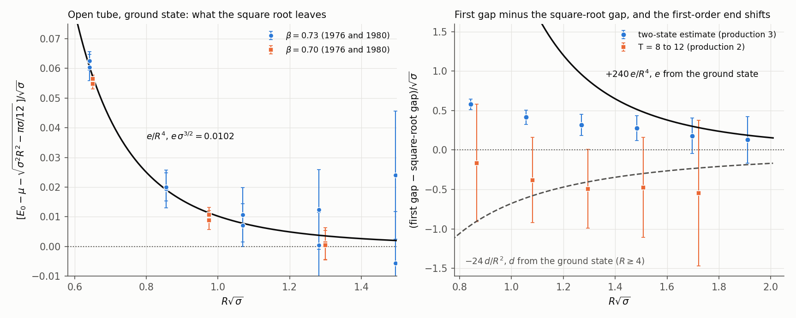
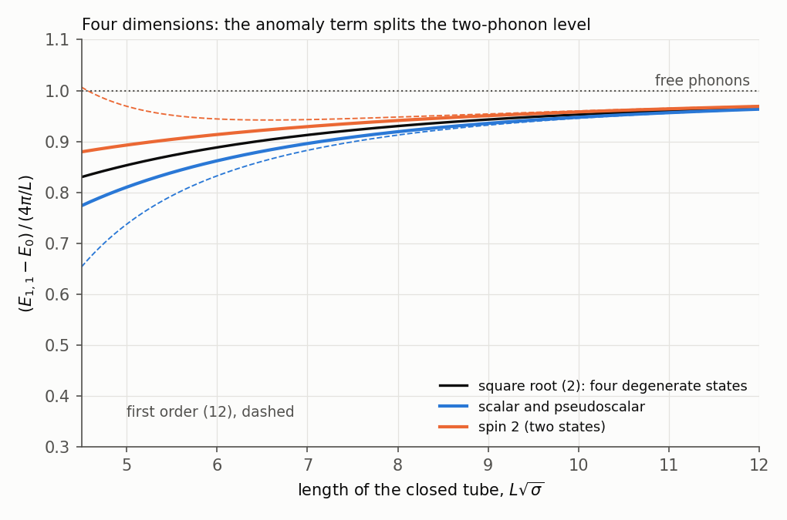

# The critical dimension as a statement about the effective string

*qcdstring programme. Preprint QCDS-84/1, November 1984.*

## Abstract

The dual model is consistent in 26 dimensions, and the flux tube of a
three-dimensional gauge theory is described by its square-root levels [3, 4].
We ask what the critical dimension says about a long string in any dimension.
No new simulation is involved. (i) Lorentz invariance of the vacuum fixes
every term of a long string's action with one derivative per field: it is the
area. Its quartic term is the product of the energy densities of the two
directions of motion and shifts every level of a closed string by
$-2E_+E_-/\sigma L$ at first order. This is the term of order $L^{-3}$ that
our 1982 paper had to assume. A stiffness term is, by Gauss's equation, a
total derivative plus terms that vanish with the equations of motion. The
first bulk term with a free coefficient has eight derivatives and shifts
levels at order $\sigma^{-3}L^{-7}$. (ii) A point source is rotation
invariant, which forbids the end term $(\partial_xX)^2$ and its $R^{-2}$
correction to the potential. The first allowed end term,
$b_2(\partial_t\partial_xX)^2$, shifts the ground state by $e/R^4$ and a
phonon of mode $k$ by $+240k^3e/R^4$; a term $d/R^2$ would shift the phonon
by $-24kd/R^2$. The opposite signs are a test. Our data of 1976 and 1980
cannot apply it. With one baseline for both levels, the ground state and the
first gap are described from $R\sqrt\sigma = 1.5$ by the square root with an
$R^{-4}$ term and equally by the free string with an $R^{-2}$ term, and
$e\,\sigma^{3/2}$ runs from 0.002 to 0.010 with the baseline. The endpoint
question of 1976 stays open; a first gap measured to 1% at
$R\sqrt\sigma = 2.5$ would close it. (iii) Two phonons that cross on the
string scatter, at lowest order in the area action, with the pure phase
$e^{is/4\sigma}$: free phonons on a string lengthened by the momentum that
travels the other way. Applied also to the zero-point motion and to the
standing waves of an open string, this rule reproduces the square-root
spectra of the closed and the open string. At first order the rule is
derived; beyond it is an assumption. (iv) We propose that the quantum
correction to the area action of a long string is Polyakov's anomaly
evaluated on the metric that the string induces on itself. The proposal
passes a test without free parameter: the central term of the
energy-momentum tensor then cancels in every dimension. Its consequence is a
local interaction of four phonons,
$(26-d)\,[\partial_a(\partial_cX\cdot\partial_cX)]^2/384\pi$. It is a total
derivative for one transverse direction and absent in 26 dimensions. In four
dimensions it lets a pair of phonons of one polarization turn into a pair of
the other, and splits the level $N = \bar N = 1$ of a closed tube: scalar and
pseudoscalar fall, the spin-2 pair rises, by $22\,(4\pi^3/3)/\sigma^2L^5$ at
first order. On this proposal the critical dimension is the dimension in
which that interaction is absent. (v) With the $L^{-3}$ term fixed by (i),
the closed-tube data of [4] give $c = 0.99(3)(9)$ massless modes and exclude
one more scalar field on the tube lighter than $1.2\sqrt\sigma$ (95%;
$1.9\sqrt\sigma$ if the shortest tubes are taken as measured).

## 1. Introduction

The dual model has a ghost-free spectrum and a closed Lorentz algebra only in
26 dimensions [5, 6]. Since Polyakov's work [7] the number has a second
meaning: it is the dimension in which the conformal factor of the world-sheet
metric drops out of the quantum theory, and in covariant quantization it is
the central term that the reparametrization ghosts must cancel [8, 9, 19]. Below
26 dimensions the conformal factor becomes a field with Liouville's action.

Our own data pull the other way. In three dimensions the first excited level
of the open flux tube agrees with the square root of the dual model from
$R\sqrt\sigma \approx 1.7$ [3], and the closed tube follows the square root
within 3% down to $L\sqrt\sigma = 1.5$, with a Casimir energy that one
massless mode describes [4]. Arvis has derived the fixed-end square root by
the method we used in [3] and remarks that with the ends fixed the
consistency conditions of the free string do not arise [10]. Elsewhere the
string picture of the tube has gained ground: Ambjørn, Olesen and Peterson
report the $1/R$ term with the string's coefficient in three-dimensional
SU(2) [11], Griffiths, Michael and Rakow have measured the potential of the
first excited state of the glue between static sources in SU(2) in four
dimensions [12], and the phonon spacing $\pi/R$ is the basis of the flux-tube
model of Isgur and Paton [13].

So the question is concrete: what does 26 mean for a string that is long, lives
in three or four dimensions, and is observed to behave? This paper answers it
with the tools of effective Lagrangians [14]. The answer has a classical part
(Sections 2 to 4: what Lorentz invariance fixes, what the ends can do, and why
the square root is the spectrum of free phonons) and a quantum part (Section 5:
where $26 - d$ enters). The classical part closes the question our 1982 paper
left open, the term of order $L^{-3}$. Section 3 states what theory says about
the endpoint term of our 1976 paper and finds that the data we have cannot
test it. Section 6 counts the modes on the tube.

In September Green and Schwarz announced that the open superstring whose ends
carry the charges of SO(32) is free of anomalies in ten dimensions [15]. On
the line of this programme that result constrains the charges string ends can
carry, and it poses for the fermionic string the question answered here for
the bosonic one, with 10 in place of 26. We take it up in a later paper.

*Sources and standing of the results.* Appendix E lists what this paper takes
from memory. The paper contains three kinds of statement, and the text says
which is which: derivations, whose algebra `code/effective_string.py`
repeats; one proposal (Section 5.1) with the test it passes and the
consequences that depend on it; and two rules of Section 4.2 that are
assumptions beyond first order. The numerical statements are refits of the
data of [1, 3, 4] (`code/refit84.py`).

## 2. The area, and what can be added to it

### 2.1 Terms with one derivative per field

Take a string along $x$, long compared with $\sigma^{-1/2}$, and describe it
by its $d-2$ transverse displacements $X^i(t,x)$. The vacuum is Lorentz
invariant and the string breaks the rotations and boosts that tilt it; these
act on $X$ nonlinearly [14], and the action must respect them.

Consider a flat world sheet, $X^i = a^it + b^ix$. It is a boosted and rotated
copy of the straight static string, so its action is the tension times its
area; up to total derivatives a flat sheet has no other invariant. A term of
the Lagrangian that contains only first derivatives is a function of the
gradients alone and is therefore determined by its values on flat sheets.
Hence

$$\mathcal L = -\sigma\sqrt{-\det(\eta_{ab} + \partial_aX\cdot\partial_bX)}
\;+\;\text{terms with second derivatives},\qquad(1)$$

to all orders in $X$. To fourth order,

$$\mathcal L = -\sigma - \frac\sigma2\,\partial_aX\cdot\partial^aX
+ c_2\,(\partial_aX\cdot\partial^aX)^2 + c_3\,(\partial_aX\cdot\partial_bX)(\partial^aX\cdot\partial^bX),
\qquad c_2 = -\frac\sigma8,\quad c_3 = \frac\sigma4,$$

and the flat sheet $X^1 = at$, $X^2 = bx$ alone fixes both coefficients
(`effective_string.py`, part A). With one transverse direction the two quartic
terms coincide and only $c_2 + c_3 = \sigma/8$ appears. The area action is
therefore a consequence of the symmetry of the vacuum for every long string,
whatever its interior structure, and its coefficients are the same in every
dimension.

### 2.2 The term of order $L^{-3}$

With $\partial_\pm = \tfrac12(\partial_t \pm \partial_x)$ the two quartic
terms combine, for these values of $c_2$ and $c_3$ and for any number of
transverse directions, into

$$\mathcal L_4 = 2\sigma\,(\partial_+X\cdot\partial_+X)(\partial_-X\cdot\partial_-X) = \frac{2}{\sigma}\,\varepsilon_+\varepsilon_-,$$

where $\varepsilon_\pm = \sigma\,\partial_\pm X\cdot\partial_\pm X$ are the
energy densities of the waves that travel in the two directions (part A). On a
closed string the two sets of oscillators are independent, so in a state with
energies $E_+$ and $E_-$ in the two directions the expectation value
factorizes, and the first-order shift of the level is

$$\Delta E = -\int_0^L\!dx\,\langle\mathcal L_4\rangle = -\frac{2E_+E_-}{\sigma L}.$$

For the ground state $E_\pm$ are the zero-point energies
$-\pi(d-2)/12L$, regulated as in [1], and the shift is
$-\pi^2(d-2)^2/72\sigma L^3$: the term of order $L^{-3}$ of the square root
(2) of [4]. For a state with $N$ and $\bar N$ phonons,
$E_\pm = 2\pi(N - (d-2)/24)/L$ and $2\pi(\bar N - (d-2)/24)/L$, and the shift
is again that of the square root at this order (part A). Our 1982 paper took
this term from the string model and named it as its open point, because the
number of massless modes it extracted depended on it. The term follows from
the Lorentz invariance of the vacuum and carries no free parameter.

For fixed ends the corresponding term of order $R^{-3}$ has been computed
directly from the area action by Dietz and Filk [20], with the value of
Arvis's square root.

### 2.3 Terms with second derivatives

The freedom of the effective string starts with the extrinsic curvature
$K^i_{ab}$ of the sheet, which in a flat sheet's neighbourhood is
$\partial_a\partial_bX^i$. A local term is a scalar built from the induced
metric $h_{ab}$, from $K^i_{ab}$ and from covariant derivatives; this is what
the nonlinear symmetry of Section 2.1 allows. We order the terms by the
number of derivatives in excess of the number of fields.

*Excess two: the stiffness.* There are two scalars, $K^i_{ab}K^{i\,ab}$ and
$K^iK^i$ with $K^i = h^{ab}K^i_{ab}$. Gauss's equation for a surface in flat
space relates them to the curvature scalar $R$ of the induced metric,

$$K^i_{ab}K^{i\,ab} = K^iK^i - R.$$

In two dimensions $\sqrt h\,R$ is a total derivative, and $K^i$ is the
variation of the area with respect to $X^i$: it vanishes with the equations
of motion of (1), to all orders in $X$. A term quadratic in the equations of
motion is removed by a redefinition of $X$, and what the redefinition leaves
at the next order is again proportional to the equations of motion. A
stiffness therefore changes no level of a long string. At lowest order the
statement is the identity

$$(\partial_a\partial_bX)^2 = (\partial^2X)^2 + \partial_a\big[\partial_bX\cdot\partial_a\partial_bX - \partial_aX\cdot\partial^2X\big]$$

(part B), and the bracket vanishes at a fixed end, so the open string is
included. Section 2.1 of [1] gave a stiffness as its example of a correction
at order $R^{-3}$, and [4] left the term of order $L^{-3}$ open for the same
reason. Both had in mind the bending energy $(\partial_x^2X)^2$ of a rod,
which the Lorentz invariance of the vacuum excludes.

*Excess three.* A scalar cubic in $K$ needs an invariant tensor with three
indices in the normal directions. With one transverse direction it exists,
and $K_a{}^bK_b{}^cK_c{}^a$ is, for a symmetric two-by-two matrix,
proportional to its trace $K$, hence to the equations of motion; it is also
odd under the reflection $X \to -X$. With two transverse directions there is
no such tensor, and with three the antisymmetric one gives zero for
two-by-two matrices.

*Excess four.* The terms $(\nabla_cK^i_{ab})^2$ reduce, by the symmetry of
$\nabla_cK^i_{ab}$ in its three indices (Codazzi's equation) and by
commuting covariant derivatives, to $(\nabla_aK^i)^2$, which vanishes with
the equations of motion, and to terms quartic in $K$. The quartic terms are
the first with free coefficients: one, $(K_{ab}K^{ab})^2$, for one transverse
direction, and two when there are more. They carry eight derivatives on four
fields, and with a coefficient of natural size $1/\sigma$ they shift levels
by amounts of order $\sigma^{-3}L^{-7}$.

This classification is of local terms that respect the symmetry. The measure
of the quantum theory can add a term that is none of these, and Section 5
proposes what it is.

**Table 1.** What fixes the levels of a long closed string of length $L$, order by order.

| Order | Source | Free parameter |
|---|---|---|
| $L$ | tension | $\sigma$ |
| $L^{-1}$ | zero-point motion of $d-2$ free modes [18] | none |
| $L^{-3}$ | quartic term of the area at first order (Section 2.2) | none |
| $L^{-5}$ | the area at the next order; for $d \ge 4$ also the term of Section 5 | none |
| $L^{-7}$ | terms quartic in the curvature | first free coefficients |

Table 1 says that no free parameter enters before $L^{-7}$. It leaves a
calculation undone: the level of the area action at order $L^{-5}$, which
needs the quartic term at second order, the sextic term at first order and
one loop of phonons. Section 4 gives the part of it that we can derive.

For the open string the ends add terms of their own (Section 3).

## 3. The ends

### 3.1 What a point source allows

A static source is a point, and a point is rotation invariant. The action
localized on its world line can depend on the string only through quantities
that have a meaning at the source. The direction in which the string leaves is
a unit vector $n$; rotation invariance leaves no scalar to build from $n$
itself, and the first one available is the square of its rate of change. In
terms of the displacement,

$$\mathcal L_{\rm end} = b_1\,(\partial_xX)^2 + b_2\,(\partial_t\partial_xX)^2 + \dots,\qquad b_1 = 0.\qquad(2)$$

The term $b_1$ measures the angle between the string and the line joining the
sources. That line is known to the far end of the string; the action at one
source cannot refer to it. In the variables of Section 2: a rotation by a
small angle $\theta$ about the source changes $\partial_xX$ by $\theta$ at
lowest order, so $(\partial_xX)^2$ changes by $2\theta\cdot\partial_xX$, and
there is no term of lower order at the end whose variation could cancel this.
In 1976 we wrote that we knew no argument to forbid $b_1$ [1]. This is the
argument.

Both terms are quadratic, and their effect follows from the mode sums of [1]
(Appendix C). For the ground state and for a state with one phonon of mode $k$
in one transverse direction, relative to the ground state:

$$b_1:\quad \delta E_0 = \frac{d_1}{R^2},\quad d_1 = \frac{\pi(d-2)\,b_1}{6\sigma};\qquad \delta(E_k - E_0) = -\frac{24k}{d-2}\,\frac{d_1}{R^2},\qquad(3)$$

$$b_2:\quad \delta E_0 = \frac{e}{R^4},\quad e = -\frac{\pi^3(d-2)\,b_2}{60\sigma};\qquad \delta(E_k - E_0) = +\frac{240k^3}{d-2}\,\frac{e}{R^4}.\qquad(4)$$

The signs differ because the regulated sums $\sum n = -1/12$ and
$\sum n^3 = +1/120$ do. An $R^{-2}$ term that raises the ground state lowers
every gap: it acts as a lengthening of the string by $24d_1/\pi$, as noted in
[3]. An $R^{-4}$ term that raises the ground state raises the gaps, by 240 times
as much for the first.

On a lattice the source is invariant under the cubic group only, and a term
$b_1$ proportional to a power of the lattice spacing is possible. The two
relations (3) and (4) are a test that needs two levels: the sign of the shift
of the first gap, given the sign of the shift of the ground state.

Both relations are first-order statements, and (4) is demanding: the shift
of the gap is small compared with the gap $\pi/R$ only for
$R^3 \gg 76\,e$. They also presuppose that the levels without the end term
are known. The expansion of the first excited level of the square root in
powers of $1/\sigma R^2$ converges for $R\sqrt\sigma > 2.45$, and that of the
ground state for $R\sqrt\sigma > 0.51$. Below these lengths a comparison needs
a resummed form of the levels, a *baseline*, and the only one available is
the square root itself.

### 3.2 The ground state of 1976 and 1980

Our 1982 paper fitted the open-tube potentials of [1] and [3] again with the
tension fixed by the closed tube, and found that the free-string coefficient
$\pi/24$ needs a correction below $R\sqrt\sigma \approx 1$ whose form was open.
Table 2 repeats those fits with end terms $d/R^2$, $f/R^3$ and $e/R^4$ on two
baselines: the free string, $\sigma R + \mu - \pi/24R$, and the square root,
$\mu + \sqrt{\sigma^2R^2 - \pi\sigma/12}$.

**Table 2.** Joint fits of the 1976 and 1980 ground-state data with the closed-tube tension of [4] and its total error as a constraint ($\sigma = 0.04566(25)$ at $\beta = 0.73$, $0.10566(41)$ at $\beta = 0.70$). $\chi^2$/dof ($p$) and the coefficient (`results/refit84.txt`, part 1). At $\beta = 0.73$ the square root is imaginary at $R = 2$.

| $\beta$ | baseline | $R$ | no end term | $d/R^2$ | $f/R^3$ | $e/R^4$ | $d/R^2 + e/R^4$ |
|---|---|---|---|---|---|---|---|
| 0.73 | free string | 2-9 | 6051/15 | $d = 0.0501(6)$; 13.4/14 (0.49) | 20.6/14 (0.11) | 59.8/14 | $d = 0.039(6)$, $e = 0.023(11)$; 9.2/13 (0.76) |
| 0.73 | free string | 3-9 | 242/13 | $d = 0.0447(29)$; 9.3/12 (0.67) | $f = 0.0865(56)$; 6.8/12 (0.87) | $e = 0.194(13)$; 6.9/12 (0.87) | $d = 0.010(22)$, $e = 0.15(9)$; 6.7/11 (0.83) |
| 0.73 | free string | 4-9 | 15.3/11 (0.17) | $d = 0.029(10)$; 6.7/10 (0.76) | $f = 0.076(26)$; 6.6/10 (0.76) | $e = 0.223(76)$; 6.7/10 (0.76) | 6.6/9 (0.68) |
| 0.73 | square root | 3-9 | 10597/13 | 131.5/12 | 32.4/12 (0.001) | $e = 1.064(10)$; 7.3/12 (0.84) | $d = -0.011(22)$, $e = 1.11(10)$; 7.0/11 (0.80) |
| 0.73 | square root | 4-9 | 199/11 | $d = 0.132(10)$; 8.6/10 (0.57) | $f = 0.342(25)$; 6.7/10 (0.76) | $e = 1.017(73)$; 6.8/10 (0.74) | $d = 0.03(7)$, $e = 0.8(6)$; 6.6/9 (0.68) |
| 0.70 | free string | 2-6 | 119/9 | $d = 0.0231(22)$; 4.3/8 (0.83) | $f = 0.0334(31)$; 3.2/8 (0.92) | $e = 0.0550(51)$; 3.0/8 (0.93) | 3.0/7 (0.88) |
| 0.70 | square root | 2-6 | 5355/9 | 36.3/8 | $f = 0.1769(25)$; 7.9/8 (0.44) | $e = 0.2931(42)$; 3.1/8 (0.93) | $d = 0.004(21)$, $e = 0.28(5)$; 3.1/7 (0.88) |
| 0.70 | square root | 3-6 | 27.3/7 | $d = 0.056(11)$; 2.7/6 (0.84) | $f = 0.122(25)$; 2.9/6 (0.82) | $e = 0.297(60)$; 3.1/6 (0.80) | 2.7/5 (0.75) |

Three properties of the fits can be compared: the quality of fit, the
agreement of the coefficient between the two couplings in units of the
tension over matched ranges ($R\sqrt\sigma \ge 0.64$: $R \ge 3$ at
$\beta = 0.73$, $R \ge 2$ at 0.70), and the stability of the coefficient at
$\beta = 0.73$ when $R = 3$ is dropped.

| Baseline | term | fits from $R\sqrt\sigma = 0.64$ | coefficient in units of the tension, two couplings | difference | shift when $R = 3$ is dropped |
|---|---|---|---|---|---|
| free string | $d/R^2$ | yes | $d\sqrt\sigma = 0.0096(6)$, 0.0075(7) | 2.2 s.e. | $-1.6$ s.e. |
| free string | $f/R^3$ | yes | $f\sigma = 0.00395(26)$, 0.00353(33) | 1.0 | $-0.4$ |
| free string | $e/R^4$ | yes | $e\sigma^{3/2} = 0.00189(12)$, 0.00189(18) | 0.0 | $+0.4$ |
| square root | $d/R^2$ | no | 0.0503(5), 0.0395(6) | 14 | $-11$ |
| square root | $f/R^3$ | no at 0.73 | 0.0213(2), 0.0187(3) | 7.6 | $-5.1$ |
| square root | $e/R^4$ | yes | $e\sigma^{3/2} = 0.01038(10)$, 0.01006(14) | 1.8 | $-0.6$ |

On the free-string baseline the three forms fit equally from
$R\sqrt\sigma = 0.64$, and with both terms free $d$ and $e$ are 99%
anticorrelated: the ground state does not choose. From $R = 2$
($R\sqrt\sigma = 0.43$) only $R^{-2}$ fits, at a distance where no expansion
applies. On the square-root baseline $R^{-4}$ is the one form that fits from
$R\sqrt\sigma = 0.64$, scales between the couplings and is stable; $R^{-2}$
and $R^{-3}$ fail on all three counts. The comparison between the two
couplings is one comparison, and a lattice term $b_1$ would have no reason to
scale, so the scaling test bears on the origin of a term more than on its
presence.

The size of the $R^{-4}$ coefficient depends on the baseline by a factor
five. With the free string $e\,\sigma^{3/2} = 0.0019$; with the term of order
$R^{-3}$ of Section 2.2 added to the free string, 0.0060 and 0.0065 (2.3
standard errors apart and unstable under the range); with the square root,
0.0104 and 0.0101. The reason is that $R\sqrt\sigma = 0.6$ to 1 is close to
the radius of convergence of the ground state's expansion. In terms of the
coefficient of (2),

$$e\,\sigma^{3/2} = 0.002\ \text{to}\ 0.010,\qquad b_2\sqrt\sigma = -\frac{60}{\pi^3}\,e\,\sigma^{3/2} = -0.004\ \text{to}\ -0.020,\qquad(5)$$

if the correction is the $b_2$ term at all.

### 3.3 The first excited level of 1980

In [3] the gap between the two lowest levels at $\beta = 0.73$ exceeded the
square-root gap at short distance, by a factor falling from 1.30 to 1.10, and
we had no explanation. The relations (3) and (4) invite one: an end term that
raises the ground state changes the gap with a definite sign. A first version
of this paper drew that conclusion, and the referee showed that it rested on
two different baselines, the free string for the ground state and the square
root for the gap. We repeat the comparison with one baseline for both levels.

**Table 3.** First gap of the open tube at $\beta = 0.73$ [3], rebuilt from the raw files of production 3 with the jackknife covariance across $R$ (80 blocks; neighbouring separations are correlated at 0.8). "Two-state" is the estimate of [3] from effective energies at time steps 2 to 7; "upper bound" is the effective energy at steps 4 to 5; "late" is production 2 of [3], two operators, steps 8 to 12, against the ground state of production 1. Baselines with $\sigma = 0.04566$.

| $R$ | $R\sqrt\sigma$ | two-state | upper bound | late | square-root gap | $\pi/R$ |
|---|---|---|---|---|---|---|
| 4 | 0.85 | 0.533(14) | 0.524(12) | 0.37(16) | 0.409 | 0.785 |
| 5 | 1.07 | 0.460(19) | 0.457(12) | 0.29(12) | 0.371 | 0.628 |
| 6 | 1.28 | 0.408(29) | 0.415(16) | 0.24(11) | 0.340 | 0.524 |
| 7 | 1.50 | 0.373(34) | 0.377(18) | 0.21(14) | 0.314 | 0.449 |
| 8 | 1.71 | 0.329(48) | 0.339(20) | 0.17(20) | 0.290 | 0.393 |
| 9 | 1.92 | 0.298(63) | 0.319(23) | 0.10(26) | 0.270 | 0.349 |

The two-state estimates lie above the square-root gap by 0.124(14) at
$R = 4$, falling to 0.027(63) at $R = 9$, and below the free gap $\pi/R$ by
0.25 to 0.05. Without any end term they agree with the square root from
$R = 6$ ($\chi^2 = 7.0$ for 4 separations, with the covariance) and with the
free string from $R = 7$ (6.4 for 3). The late values lie below the square
root, by 0.04 to 0.17 with errors of 0.11 to 0.26; they agree with it
($\chi^2 = 2.4$ for the five separations $R = 4$ to 8) and suggest that the
two-state estimates are still high.

**Table 4.** Both levels on one baseline: joint fits to the ground state ($R \ge 3$, Table 2) and to the two-state gaps from $R_g$ on, with the tension constrained. The gap is the baseline's gap plus $-24d/R^2 + 240e/R^4$. $\chi^2$/dof ($p$); in brackets the share of the gaps (`results/refit84.txt`, part 2b).

| Baseline | $R_g$ | $d$ alone | $e$ alone | $d$ and $e$ |
|---|---|---|---|---|
| square root | 7 | 169.8/15 [38.2/3] | $e = 1.063(10)$; 11.1/15 (0.75) [3.8/3] | $d = 0.014(18)$, $e = 1.00(8)$; 10.5/14 (0.73) |
| square root | 6 | 201.7/16 | 42.4/16 (0.0003) [35.0/4] | $d = 0.057(14)$, $e = 0.81(6)$; 24.8/15 (0.05) |
| square root | 5 | 520/17 | 593/17 | 54.1/16 |
| free string | 7 | $d = 0.0450(29)$; 12.5/15 (0.64) [3.1/3] | $e = 0.192(13)$; 17.6/15 (0.29) [10.7/3] | 12.4/14 (0.58) |
| free string | 6 | $d = 0.0454(29)$; 20.2/16 (0.21) [10.8/4] | 41.2/16 (0.001) | $d = 0.066(14)$, $e = -0.09(6)$; 17.9/15 (0.27) |
| free string | 5 | 76.5/17 | 251/17 | $d = 0.085(6)$, $e = -0.17(2)$; 20.3/16 (0.21) |
| free string | 4 | 207/18 | 640/18 | $d = 0.075(3)$, $e = -0.127(9)$; 25.0/17 (0.09) |

**Figure 1.** Left: what the square root leaves of the open tube's ground
state, at two couplings in units of the tension, with the $R^{-4}$ term of
Table 2. Right: the first gap minus the square-root gap [3], two-state
estimates and late values, with the first-order shifts that the ground state
implies on the same baseline for an $R^{-4}$ and for an $R^{-2}$ end term.

Table 4 has two acceptable descriptions and they are opposite. On the square
root, the allowed term $e/R^4$ alone describes the ground state from $R = 3$
and the gaps from $R = 7$ ($p = 0.75$), and the forbidden term alone fails.
On the free string, the forbidden term $d/R^2$ alone describes the ground
state and the gaps from $R = 6$ or 7 ($p = 0.21$ and 0.64), and the allowed
one alone is the poorer fit. Neither description reaches the short
separations where the gaps are precise. On the square root with
$e = 1.064$, the first-order shift $240e/R^4$ is 1.9, 0.9 and 0.5 times the
gap at $R = 4$, 5 and 6 and exceeds the upper bound there by 58, 26 and 8
standard errors: first order has no meaning at these separations, and where
it has ($R \ge 7$, a shift of 0.3 to 0.1 of the gap) the gaps agree with it
($\chi^2 = 3.8$ for 3) and with no shift at all (5.0). On the free string
with $d = 0.045$, the predicted gap $\pi/R - 24d/R^2$ lies above the upper
bound by 16, 11, 5 and 3 standard errors at $R = 4$ to 7. Against the upper
bounds the two descriptions do equally at $R = 7$ (2.4 and 2.8 standard
errors too high) and both pass from $R = 8$.

The data therefore do not decide. Which description one prefers depends on
the baseline, and at $R\sqrt\sigma \le 2$ neither baseline is under control
for the excited level. The one inference we draw is conditional: if the
square root is the right resummation, which Section 2.2 supports to order
$R^{-3}$, then the data need no $R^{-2}$ term and are described by the term a
rotation-invariant source allows. *The endpoint question of 1976 stays open,
with the theory's answer stated and untested.*

What would test it is the first gap at lengths where the expansion converges.
At $R\sqrt\sigma = 2.5$ the square-root gap is $1.056\sqrt\sigma$; an
$R^{-4}$ term with the coefficients (5) raises it by 1.1 to 6.1%, and an
$R^{-2}$ term with $d\sqrt\sigma = 0.0096$ lowers it by 3.5%
(`refit84.txt`, part 4). A gap measured to 1% there decides. At
$\beta = 0.73$ that is a separation of 12 lattice spacings, where our present
errors are 20% and more.

## 4. Phonon scattering and the square root

### 4.1 The phase

The quartic terms of (1) make phonons scatter. Take a right-moving phonon of
momentum $p$ and polarization $i$ and a left-moving one of momentum $q$ and
polarization $j$, so that $s = 4pq$. In two dimensions energy and momentum
conservation leave the two momenta unchanged, and the amplitude can only
relabel polarizations: transmission ($ij \to ij$), annihilation
($ii \to kk$), reflection ($ij \to ji$). At lowest order, with
$t$ and $u$ the other two invariants (Appendix A; part D),

$$\mathcal M = -\frac{1}{2\sigma}\big[\delta_{ij}\delta_{kl}\,tu + \delta_{ik}\delta_{jl}\,su + \delta_{il}\delta_{jk}\,st\big]
\;\longrightarrow\; \frac{s^2}{2\sigma}\,\delta_{ik}\delta_{jl}\qquad(t = 0).\qquad(6)$$

Annihilation and reflection vanish, and transmission is a phase:

$$S = e^{2i\delta},\qquad 2\delta = \frac{s}{4\sigma} = \frac{pq}{\sigma}.\qquad(7)$$

No dimension enters. A phase linear in $p$ is a displacement: the right-mover
emerges behind the place where a free phonon would be by $q/\sigma$, the
length of string whose energy equals that of the phonon it has crossed. This
is Section 2.2 seen from the phonons: the interaction is the product of the
two energy densities.

### 4.2 Free phonons on a string of variable length

Put the phonons on a closed string of length $L$, with right-movers of
momenta $p_i$ and left-movers of momenta $q_j$. A right-mover that is carried
once around meets every left-mover once, so its momentum is quantized by
$p_iL + \sum_j p_iq_j/\sigma = 2\pi n_i$, that is

$$p_i\Big(L + \frac{Q}{\sigma}\Big) = 2\pi n_i,\qquad q_j\Big(L + \frac{P}{\sigma}\Big) = 2\pi m_j,\qquad(8)$$

with $P$ and $Q$ the total momenta of the right- and left-movers. Each phonon
is free on a string that is longer by the energy of the phonons moving the
other way, divided by the tension.

Equation (8) follows from (7) for phonons. It says nothing by itself about
the zero-point motion, which belongs to a string of finite length and has no
scattering phase. *We assume* that the zero-point motion obeys the same rule,
with the momentum $-\pi(d-2)/12\ell$ that it has on a circle of length $\ell$
for each direction of motion. Then

$$P\Big(L + \frac Q\sigma\Big) = 2\pi\Big(N - \frac{d-2}{24}\Big),\qquad Q\Big(L + \frac P\sigma\Big) = 2\pi\Big(\bar N - \frac{d-2}{24}\Big),\qquad E = \sigma L + P + Q,$$

and elimination of $P$ and $Q$ gives

$$E^2 = \sigma^2L^2 + 4\pi\sigma\Big(N + \bar N - \frac{d-2}{12}\Big) + \Big(\frac{2\pi(N - \bar N)}{L}\Big)^2,$$

which is the spectrum (2) of [4], term for term (part E repeats the algebra
on random cases). The assumption is correct at first order: expanding in
$1/\sigma L$, the rule gives the shift $-2E_+E_-/\sigma L$ with the
zero-point energies included, which Section 2.2 derived. Beyond first order
we have not derived it.

For the open string a second assumption is needed. A single phonon between
fixed ends has no other phonon to cross, and (7) gives it no phase. *We
assume* that every standing wave counts as two travelling halves, each of
which sees the string lengthened by the momentum of the other halves, the
zero-point motion included: $P(R + P/2\sigma) = \pi(N - (d-2)/24)$ with
$E = \sigma R + P$. This gives $E^2 = \sigma^2R^2 + 2\pi\sigma(N - (d-2)/24)$,
the square root of [3, 10]. At first order the assumption reproduces the
term of order $R^{-3}$ that Dietz and Filk computed for the ground state
[20].

With these two assumptions the dual model at long length is a theory of free
phonons with a geometric delay, and its square roots are what the phase (7)
gives when it is exact. Four remarks.

* The phase is large where we measure. For the lowest two-phonon state of a
  closed tube with $L\sqrt\sigma = 2.6$ in three dimensions, (8) gives
  phonons of momentum $1.54\sqrt\sigma$ and $2\delta = 2.4$ radians. A phase
  of this size is why the free spacing $\pi/R$ fails by 15 to 32% for the
  open tube between $R\sqrt\sigma = 1.9$ and 0.85 (Table 3).
* (7) is a lowest-order result, and the equivalence with the square root needs
  the phase to remain linear and the scattering to remain elastic.
* For one transverse direction part of this can be derived. There is one
  amplitude; as long as no further phonons are produced it is a phase
  $e^{2i\delta(s)}$, and crossing a phonon to the other side exchanges $s$
  and $-s$ and turns the amplitude into its complex conjugate. The phase is
  therefore odd in $s$: after $s/4\sigma$ the next term is of order
  $s^3/\sigma^3$, and the correction of order $s^2$ that a loop of phonons
  could add is absent. Production of a second pair changes the modulus only
  at order $s^4$. Used in (8), an $s^3$ term moves levels at order $L^{-7}$,
  which is where Table 1 puts the first free coefficient. In three dimensions
  the phonon levels of (8) are therefore those of the square root through
  order $L^{-5}$, given (8) itself and the zero-point assumption. We have not
  computed the level of the area action at order $L^{-5}$ directly.
* With more transverse directions the same argument holds for transmission
  alone. Annihilation and reflection receive the term of Section 5 at
  relative order $s/\sigma$.

## 5. Where the critical dimension enters

### 5.1 A proposal: the anomaly on the induced metric

The classical argument of Section 2 used the Lorentz invariance of the action.
The quantum theory must keep it, and the measure can fail to. Polyakov's
calculation [7] states the failure for the string of the dual model:
integrating over $d$ coordinates and the ghosts on a world sheet with metric
$g_{ab} = e^\varphi\delta_{ab}$ leaves

$$S_{\rm anom} = \frac{26-d}{48\pi}\int d^2\xi\,\tfrac12(\partial\varphi)^2 = \frac{26-d}{96\pi}\int d^2\xi\,\sqrt g\,R\,\frac{1}{\Delta}\,R,\qquad(9)$$

where the second form is covariant and $\Delta = -\nabla^2$ is the positive
Laplacian of $g$. For the string of the dual model $g$ is an independent
variable, and (9) makes its conformal factor a field.

A long string has a metric of its own, the one its position induces,
$h_{ab} = \delta_{ab} + \partial_aX\cdot\partial_bX$, which is nowhere
degenerate. *We propose* that for a long string the quantum correction to
(1) is (9) evaluated on this metric, $g = h$, with Polyakov's coefficient.
The proposal is the hypothesis that a long string needs no variable beyond
its position. It is an assumption of this section, and everything from (10)
on depends on it.

The proposal can be tested, and the test has no free parameter. In conformal
gauge the constraints of the string can be imposed only if the central term
of the energy-momentum tensor vanishes: the $d$ coordinates contribute $d$
and the ghosts $-26$ [8, 9]. With $\varphi$ the logarithm of the induced
conformal factor, (9) is an action for $X$ alone,
$(\beta/4\pi)\int d\tau^+d\tau^-\,\partial_+\varphi\,\partial_-\varphi$ with
$\beta = (26-d)/12$ fixed by Polyakov's coefficient. Expanded about a long
straight string it contributes to the central term in two ways
(Appendix B, part H): its energy-momentum tensor has a term
$\beta\,\partial_-^2\varphi$, linear in the fluctuation, whose product with
the classical part of the tensor gives $24\beta$; and its quadratic part
changes the propagator of the fluctuation along the string, which gives
$-12\beta$. The sum is $12\beta = 26 - d$, and

$$d + (26 - d) - 26 = 0$$

in every dimension. A different coefficient in (9) would fail the test, and
so would the same coefficient with either of the two contributions left out.
For a long string the missing central charge is supplied by the string's own
geometry.

### 5.2 A four-phonon vertex without free parameter

To second order in the displacement the curvature of the induced metric is
$R = (\partial^2X)^2 - (\partial_a\partial_bX)^2$ (part C), and with the
equation of motion $R = -\tfrac12\partial^2A$, $A = \partial_cX\cdot\partial_cX$.
The inverse Laplacian in (9) then cancels:

$$S_{\rm anom} = \frac{26-d}{384\pi}\int d^2\xi\,\big[\partial_a(\partial_cX\cdot\partial_cX)\big]^2 + O(X^6).\qquad(10)$$

This is a local interaction of four phonons with six derivatives, of fixed
strength. It is the term that Table 1 lists at order $L^{-5}$. Its amplitude
is (Appendix A; part F evaluates it)

$$\mathcal M_{\rm anom} = \frac{26-d}{192\pi\sigma^2}\,\big[\delta_{ij}\delta_{kl}\,s^3 + \delta_{ik}\delta_{jl}\,t^3 + \delta_{il}\delta_{jk}\,u^3\big]
\;\longrightarrow\;\frac{(26-d)\,s^3}{192\pi\sigma^2}\,\big[\delta_{ij}\delta_{kl} - \delta_{il}\delta_{jk}\big].\qquad(11)$$

Where the area action only delays, this term changes polarizations: two
phonons of equal polarization annihilate into a pair of another, and two of
different polarization exchange theirs. Transmission is untouched.

Three cases.

* *One transverse direction, $d = 3$.* The bracket vanishes, and (10) itself
  is a total derivative on the equations of motion, a total time derivative
  when the ends are fixed. The long string in three dimensions has no
  anomaly term at this order, whatever $26 - d$ is. Together with Section 2.3
  this means that through order $L^{-5}$ its levels are those of the area
  action alone, and Section 4.2 gives the reasons to expect the square root.
* *$d = 26$.* The coefficient vanishes: this is the dual model.
* *$d = 4$.* The coefficient is $22/192\pi$, and the term acts on states with
  phonons moving both ways.

### 5.3 The first effect in four dimensions

The lowest states that feel (11) are those of the closed tube with one phonon
each way, $N = \bar N = 1$, both of momentum $2\pi/L$: $(d-2)^2$ states that
the square root leaves degenerate. On them the bracket of (11) has the
eigenvalue $\lambda = d-3$ on the scalar, $+1$ on the antisymmetric states and
$-1$ on the symmetric traceless ones, and the first-order shift of the level is

$$\Delta E = -\frac{(26-d)\,\lambda\,s^2}{192\pi\,\sigma^2L}\bigg|_{s = 16\pi^2/L^2} = -\,(26-d)\,\lambda\,\frac{4\pi^3}{3}\,\frac{1}{\sigma^2L^5}.\qquad(12)$$

In four dimensions the four states are a scalar, a pseudoscalar and a pair of
spin 2 about the axis of the tube. The scalar and the pseudoscalar fall and the
spin-2 pair rises, each by $909/\sigma^2L^5$. The vacuum and the states with
phonons moving one way are untouched, because the two sets of oscillators are
independent.

Formula (12) uses the momenta $2\pi/L$ of free phonons. At the lengths of
Table 5 the phase (7) is of order one and the momenta are smaller. An
estimate of the effect adds the phase of (11) to the quantization rule (8)
with the momenta that (8) gives; it relies on the assumptions of Section 4.2.

**Table 5.** The level $N = \bar N = 1$ of a closed tube in four dimensions, in units of $\sqrt\sigma$: the first-order shift (12), and the shift when the phase of (11) is added to (8) (part F).

| $L\sqrt\sigma$ | square root | shift (12) | relative | with the momenta of (8) | ratio |
|---|---|---|---|---|---|
| 5 | 6.931 | $\mp0.291$ | 4.2% | $-0.108$, $+0.100$ | 0.37, 0.34 |
| 6 | 7.684 | $\mp0.117$ | 1.5% | $-0.055$, $+0.053$ | 0.47, 0.45 |
| 8 | 9.329 | $\mp0.028$ | 0.3% | $\mp0.017$ | 0.63 |
| 10 | 11.092 | $\mp0.009$ | 0.08% | $\mp0.007$ | 0.73 |
| 12 | 12.924 | $\mp0.004$ | 0.03% | $\mp0.003$ | 0.80 |

**Figure 2.** Excitation energy of the level $N = \bar N = 1$ of a closed tube
in four dimensions, in units of the free-phonon value $4\pi/L$: the square
root, the first-order splitting (12) (thin lines), and the splitting with
the momenta of (8) (Table 5, thick lines).

The first-order shift is within 20% of the estimate only from
$L\sqrt\sigma \approx 12$; at $L\sqrt\sigma = 6$ it is twice too large. The
sign and the pattern (scalar and pseudoscalar down, spin 2 up) are common to
both. The splitting is a prediction for the closed flux tube of any
four-dimensional gauge theory, conditional on Section 5.1, with no parameter,
and it is beyond the reach of present simulations: at $L\sqrt\sigma = 6$ it
asks for an excited level of a tube six times longer than its width to better
than a per cent. The same vertex acts in the open tube on the states with two
phonons, which the square root leaves degenerate at the level $N = 2$; we
have not computed those shifts, nor the expectation value of (10) in the
ground state and the one-phonon states of an open tube in four dimensions,
where the two directions of motion are tied together by the ends.

### 5.4 What the critical dimension is

Put together: for a long string, in any dimension, the action is the area. If
the proposal of Section 5.1 holds, the quantum theory adds to it the anomaly
of the induced metric, with a coefficient proportional to $26 - d$. In three
dimensions the addition is empty at leading order. In four it is the
interaction (10), which appears in the levels at order $L^{-5}$. In 26 it is
absent, and there the spectrum of the area action is exact down to the
shortest strings, which is the dual model. *On this reading the critical
dimension is the dimension in which the long string has no interaction beyond
the area.* For the flux tube it is a coefficient to be measured, and its
value is known in advance.

Arvis's remark has its place in this picture for three dimensions: with
fixed ends and one transverse direction, nothing in the bulk of the string
distinguishes $d$ from 26 through order $R^{-5}$. The statement that the
Nambu string is inconsistent away from 26 dimensions concerns short strings,
where the expansion in $1/\sigma L^2$ has no meaning. Our 1982 paper found
where the closed Z2 tube leaves the square root: between
$L\sqrt\sigma = 1.5$ and 1.35.

## 6. How many modes move on the tube

The Casimir energy of the closed tube counts the massless modes on it. Our
1982 paper [4] could give the count only with an assumption about the term of
order $L^{-3}$: $c = 0.97(4)$ and $1.04(6)$ at its two couplings with the
term of the square root, and $0.6(3)$ to $1.0(1)$ with that term free.
Section 2.2 removes the assumption: for $c$ free massless modes the term is
$-2E_+E_-/\sigma L$ with $E_\pm = -\pi c/12L$, which is the square root with
$c$ in place of $d - 2$. The two couplings together then give
(`refit84.py`, part 3)

$$c = 0.99(3)(9)\qquad(L \ge 8).\qquad(13)$$

The first error is statistical. The second is half the spread over the
ranges $L \ge 7$, 8 and 10 and over the three versions of the 1982 energies
(as measured; tubes with $3 \le E_0L_y < 5$ lowered by 1%; continuum
dispersion law in the momentum sum), which run from 0.87 to 1.05.

One transverse direction, one mode. The count excludes one more massless
field on the world sheet: a second boson would give $c = 2$, and a Majorana
fermion would change the count to $3/2$ if it is antiperiodic around the tube
and to 0 if it is periodic.

A massive field leaves a Casimir energy too, cut off when the tube is longer
than its Compton wavelength: for a scalar of mass $m$ on a circle of length
$L$, $-(m/\pi)\sum_{n\ge1}K_1(nmL)/n$ (checked against a regulated mode sum in
part I of `effective_string.py`). We add one such field to the square root
with $c = 1$, fit the tension again at each coupling, and quote the mass
below which $\chi^2$ exceeds its value without the field by 2.71, a one-sided
95% limit.

**Table 6.** Lower limit on the mass of one more scalar on the tube, $m/\sqrt\sigma$, by range and by version of the 1982 energies.

| Version | $L \ge 7$ | $L \ge 8$ | $L \ge 10$ |
|---|---|---|---|
| as measured | 1.91 | 2.10 | 1.45 |
| tubes with $3 \le E_0L_y < 5$ lowered by 1% | 1.45 | 1.57 | 1.19 |
| continuum dispersion law | 2.10 | 2.25 | 1.51 |

$$m > 1.2\,\sqrt\sigma\qquad(95\%,\ \text{all ranges and versions};\ 1.9\text{ to }2.1\text{ with }L \ge 7\text{ or }8\text{ as measured}).\qquad(14)$$

The limits from $L \ge 7$ and 8 lean on the shortest tubes,
$L\sqrt\sigma = 1.5$ and 1.7 at $\beta = 0.73$, where [4] found lattice
offsets of 1 to 2% and the first departure from the square root. A limit
measures how far the data let the energy fall, so an offset upward at these
lengths tightens it artificially; the limit from $L \ge 10$ is free of this
and is the one we state. With the threshold 3.84 in place of 2.71 the limits
are lower by 0.04 to 0.16.

This bears on Polyakov's conformal factor [7]. If it propagated along the
tube as a massless field of its own, as (9) makes it for the string of the
dual model, the count would be 2. The closed tube of the Z2 theory has no
additional mode below the bound (14). The data say no more than that: they
are equally consistent with no such field and with a heavier one.

## 7. Hadron records since 1982

Both lines remember how these matters end; the comparisons carry no weight.

The P-wave states below the second upsilon level have been seen through
photons of 0.11 to 0.16 GeV [16], which puts their centre about 0.44 GeV above
the first level; our 1978 record was 0.47 GeV. Mesons carrying the $b$ quark
have been reconstructed at 5.27 GeV [17], so the threshold for pairs lies near
10.55 GeV and the fourth upsilon level is some 30 MeV above it. Our 1978
record put the level 40 MeV higher than it is seen. The potential's error on
the level is thus larger than the level's distance from the threshold, which
is why the record left the side of the threshold open.

## 8. Summary

* The action of a long string is the area in every dimension, by the Lorentz
  invariance of the vacuum. Its quartic term shifts every closed-string level
  by $-2E_+E_-/\sigma L$, the $L^{-3}$ term of the square root. A stiffness
  changes no level; the first free bulk coefficients enter at
  $\sigma^{-3}L^{-7}$.
* A rotation-invariant source forbids the $R^{-2}$ end term. The first end
  term gives $e/R^4$ in the ground state and $+240k^3e/R^4$ per phonon, where
  an $R^{-2}$ term would give $-24kd/R^2$. Our 1976 and 1980 data cannot
  apply this test: on the square root they are described by the allowed term,
  on the free string by the forbidden one, and neither baseline is controlled
  below $R\sqrt\sigma = 2$. The endpoint question stays open.
* The area action makes phonons scatter with the phase $e^{is/4\sigma}$. Free
  phonons with that phase have the square-root spectra of the dual model, for
  closed and open strings, given two rules for the zero-point motion and the
  ends that are derived at first order and assumed beyond.
* Proposed: the quantum correction for a long string is Polyakov's anomaly on
  the induced metric. Its central term cancels in every dimension. It gives
  the four-phonon interaction (10) with coefficient $(26-d)/384\pi$: empty in
  three dimensions, absent in 26, and in four a splitting (12) of the level
  $N = \bar N = 1$ of a closed tube.
* The closed tube of the Z2 theory carries $c = 0.99(3)(9)$ massless modes and
  no other scalar lighter than $1.2\sqrt\sigma$.

The dual model was abandoned as a theory of hadrons in part because it demanded
26 dimensions. Read through the long string, the demand is a statement about
one interaction, which a flux tube in four dimensions has and a string in 26
lacks. Three things are left undone and are named in the text: the level of
the area action at order $L^{-5}$, the rules of Section 4.2 beyond first
order, and a measurement of the first gap at $R\sqrt\sigma \ge 2.5$. Next:
the fermionic string and the number 10, and the excited levels of the closed
tube, where (8) and (12) can be confronted with a gauge theory.

## Appendix A. Amplitudes and level shifts

*Conventions.* Metric $(-,+)$; canonical fields $\phi^i = \sqrt\sigma X^i$;
all four momenta incoming, $s = -(p_1+p_2)^2$, $t = -(p_1+p_3)^2$,
$u = -(p_1+p_4)^2$, $s + t + u = 0$. A right-mover $p_1 = (p, p)$ and a
left-mover $p_2 = (q, -q)$ have $s = 4pq$; the final state has $p_3 = -p_1$,
$p_4 = -p_2$, so $t = 0$ and $u = -s$.

*Area action.* Summing a quartic vertex over the assignments of the four legs
gives, for $c_2(\partial\phi\cdot\partial\phi)^2 + c_3(\partial_a\phi\cdot\partial_b\phi)^2$,

$$\mathcal M = \delta_{ij}\delta_{kl}\big[2c_2s^2 + c_3(t^2 + u^2)\big] + \delta_{ik}\delta_{jl}\big[2c_2t^2 + c_3(s^2+u^2)\big] + \delta_{il}\delta_{jk}\big[2c_2u^2 + c_3(s^2+t^2)\big],$$

and with $c_2 = -1/8\sigma$, $c_3 = 1/4\sigma$ and $s + t + u = 0$ this is (6).
The $S$ matrix of a left- and a right-mover is $1 + i\mathcal M/2s$ (the flux
factor is $4pq\cdot2 = 2s$), which gives (7).

*Anomaly vertex.* In Minkowski space (10) is
$\mathcal L = -\kappa\,\partial_aA\,\partial^aA$ with
$\kappa = (26-d)/384\pi\sigma^2$ and $A = \partial_c\phi\cdot\partial^c\phi$.
The pairing of legs $(12)(34)$ contributes
$(p_1\cdot p_2)(p_3\cdot p_4)(p_1+p_2)^2 = -s^3/4$ to
$\partial_aA\,\partial^aA$, eight times, so that
$\mathcal M = 2\kappa[\delta_{ij}\delta_{kl}s^3 + \delta_{ik}\delta_{jl}t^3 + \delta_{il}\delta_{jk}u^3]$,
which is (11).

*Level shift.* For two phonons on a circle of length $L$ the first-order shift
is $\Delta E = -\mathcal M/4pqL = -\mathcal M/sL$; equivalently each momentum
moves by $-2\delta/L$ for an additional phase $2\delta = \mathcal M/2s$. With
(11) this is (12). A positive $\lambda$ means an attractive phase and a lower
level.

## Appendix B. The central term

*Setting.* In conformal gauge, with light-cone coordinates $\tau^\pm$, write
the long string as
$X^\mu = R(e_+^\mu\tau^+ + e_-^\mu\tau^-) + Y^\mu$ with $e_\pm^2 = 0$,
$e_+\cdot e_- = -\tfrac12$. The action is the free one plus (9) on the
induced metric,

$$S = \frac{1}{4\pi}\int d\tau^+d\tau^-\Big[\frac{1}{a^2}\,\partial_+X\cdot\partial_-X + \beta\,\partial_+\varphi\,\partial_-\varphi\Big],\qquad \varphi = \ln(-2\,\partial_+X\cdot\partial_-X),\qquad \beta = \frac{26-d}{12}.$$

Only the components $f = e_+\cdot Y$ and $g = e_-\cdot Y$ enter $\varphi$ at
first order: $\varphi = \ln R^2 - (2/R)(\partial_-f + \partial_+g)$.

*The tensor.* Under $\delta X = \epsilon(\tau)\,\partial_-X$ the action
changes by $-(1/2\pi)\int\partial_+\epsilon\,T_{--}$, which defines $T_{--}$.
To first order in $Y$, and on the equations of motion,

$$T_{--} = -\frac{R}{a^2}\,\partial_-g - \frac{1}{2a^2}\,\partial_-Y\cdot\partial_-Y - \frac{2\beta}{R}\,\partial_-^3f + \dots$$

The third term is $\beta\,\partial_-^2\varphi$, the improvement term that the
conformal factor of an independent metric would have. (The first version of
this appendix quoted half of it, without derivation; the referee's
calculation gave the value above, and part H confirms it.)

*The propagator.* The quadratic part of
$\beta\,\partial_+\varphi\,\partial_-\varphi$ is
$(4\beta/R^2)(\partial_+\partial_-f + \partial_+^2g)(\partial_-^2f + \partial_+\partial_-g)$.
It vanishes on the free equations of motion, and it changes the propagator
off them. In momentum space the kernel of the quadratic action in the basis
$(f, g)$ has $K_{fg} = -4k_+k_-/a^2 + 8\beta k_+^2k_-^2/R^2$,
$K_{ff} = 8\beta k_+k_-^3/R^2$ and $K_{gg} = 8\beta k_+^3k_-/R^2$, so that to
first order in $\beta$

$$\langle g\,g\rangle \propto -\frac{K_{ff}}{K_{fg}^2} = -\frac{\beta a^4}{2R^2}\,\frac{k_-}{k_+}.$$

The free theory has $\langle g\,g\rangle = 0$, because $e_-^2 = 0$.

*The central term.* The central term is the coefficient of $k_-^3/k_+$ in
$\langle T_{--}(k)\,T_{--}(-k)\rangle$; for a canonical field $\chi$ with a
term $q\,\partial_-^2\chi$ in its tensor that coefficient is $q^2/2$ and the
central term is $12q^2$. Here the terms linear in the fluctuation give, in
the same units,

$$\underbrace{\frac{R^2}{a^4}\,k_-^2\,\langle g\,g\rangle}_{-\beta/2}\;+\;\underbrace{2\cdot\frac{R}{a^2}\cdot\frac{2\beta}{R}\,k_-^4\,\langle g\,f\rangle_{\rm free}}_{+\beta}\;=\;\frac{\beta}{2},$$

a central term $12\beta$. The quadratic term of the tensor gives $d$ and the
ghosts $-26$:

$$d + 12\beta - 26 = 0\qquad\text{for}\qquad\beta = \frac{26-d}{12}.$$

Part H of `effective_string.py` derives the quadratic action, the kernel and
the tensor from the action above by symbolic computation and obtains $12\beta$;
with the free propagator alone it obtains $24\beta$, and with the tensor of
the first version and the free propagator $12\beta$ by the cancellation of
two omissions. The same $12\beta$ follows if the terms of the action
proportional to the free equations of motion are first removed by the
redefinition $Y \to Y + (2\beta a^2/R^2)\,e_+\,(e_+\cdot\partial_-^2Y)$: the
propagator is then free and the first term of the tensor supplies
$+(\beta/R)\,\partial_-^3f$, leaving $-(\beta/R)\,\partial_-^3f$ in all.

## Appendix C. Mode sums for the end terms

With fixed ends,
$X = \sum_n (\sigma R\omega_n)^{-1/2}\sin(n\pi x/R)\,(a_ne^{-i\omega_nt} + a_n^\dagger e^{i\omega_nt})$,
$\omega_n = n\pi/R$. At an end,
$\langle(\partial_xX)^2\rangle = \sum_n (n\pi/R)^2/\sigma R\omega_n = (\pi/\sigma R^2)\sum n$
and
$\langle(\partial_t\partial_xX)^2\rangle = (\pi^3/\sigma R^4)\sum n^3$.
The regulated sums are $-1/12$ and $+1/120$ (part G repeats the regulator
test of [1]). A perturbation $\delta\mathcal L$ shifts a level by
$-\langle\delta\mathcal L\rangle$ at first order; this holds also for the
term $b_2$, which contains velocities, because at first order the
interaction Hamiltonian is minus the interaction Lagrangian with the
velocities expressed through the free momenta. With two ends and $d-2$
directions this gives $\delta E_0$ of (3) and (4). A phonon of mode $k$ adds
$2(k\pi/R)^2/\sigma R\omega_k$ and $2(k\pi/R)^2\omega_k/\sigma R$ to the two
expectation values, which gives the gap shifts.

## Appendix D. Computing

This paper contains no new simulation. Its numbers come from three sources:
symbolic and numerical checks of the derivations (`code/effective_string.py`,
seconds); refits of the stored data of [1, 3, 4] (`code/refit84.py`, a minute);
and the tables of those papers. From here on the papers of this programme rest
on derivations and on data already taken; a single machine no longer represents
what a group can compute.

## Appendix E. What this paper takes from memory

Three kinds of statement are kept apart, as from this paper on.

*Remembered and derived here.*

* The proposal of Section 5.1, the anomaly action on the induced metric with
  the count of the central term: J. Polchinski and A. Strominger, Phys. Rev.
  Lett. 67 (1991) 1681. We remember the construction and its outcome. The
  paper states it as a proposal, and Appendix B derives the count from the
  action (9) with Polyakov's published coefficient. The static-gauge form
  (10) and its coefficient: O. Aharony and Z. Komargodski, JHEP 05 (2013)
  118. The level shifts (12): O. Aharony and collaborators, 2009-2013.
* That Lorentz invariance fixes the quartic coefficients, the form of the
  quartic term as a product of energy densities, and the classification of
  Section 2.3 with its first free coefficients at $L^{-7}$: H. B. Meyer, JHEP
  05 (2006) 066; O. Aharony and E. Karzbrun, JHEP 06 (2009) 012; and the
  later literature on the deformation of a free theory by the product of its
  energy-momentum components. Sections 2.2 and 2.3 give the arguments.
* The vanishing of $b_1$ and the $R^{-4}$ term: M. Lüscher and P. Weisz, JHEP
  07 (2004) 014 (from the exchange of open and closed channels); O. Aharony and
  M. Field, JHEP 01 (2011) 065 (from Lorentz invariance, with the coefficient of
  (4)). The argument of Section 3.1 is ours in its wording.
* The phase (7) and its reading as a lengthening: S. Dubovsky, R. Flauger and
  V. Gorbenko, JHEP 09 (2012) 044 and 133. The argument from crossing for one
  transverse direction is in the same papers.

*Remembered and used as an assumption.*

* The rules of Section 4.2 for the zero-point motion and for the open string.
  We remember that the first follows from the thermodynamic Bethe ansatz with
  the phase (7) (M. Caselle, D. Fioravanti, F. Gliozzi and R. Tateo, JHEP 07
  (2013) 071, and the papers above); the paper does not carry that out and
  labels both rules as assumptions beyond first order.
* That the square root is the spectrum of the area action through order
  $L^{-5}$ in three dimensions. The paper derives the absence of free
  parameters and of an anomaly term, and the oddness of the phase, and says
  that the level at order $L^{-5}$ is not computed.
* The result of [20] for the term of order $R^{-3}$ with fixed ends is quoted
  from memory, as is its agreement with Arvis's formula.

*Remembered and used only to choose the work, or not at all.*

* That the Casimir energy counts the central charge of any conformal field
  theory (H. Blöte, J. Cardy and M. Nightingale; I. Affleck; 1986). Section 6
  uses only free fields.
* The reading of the conformal factor as one more coordinate of the space in
  which the string moves belongs to the years after 1988. The first version
  of this paper used it in Section 6; it is removed.
* Remembered outcomes that the conclusions lean toward: a negative $b_2$ of
  order $10^{-2}$ in units of the tension in three-dimensional gauge theories
  and no $R^{-2}$ term (lattice work of 2010-2017); closed-tube levels in four
  dimensions in which a pseudoscalar lies below the square root (2010 on); a
  massive pseudoscalar on the four-dimensional tube near $1.85\sqrt\sigma$
  (2013), which concerns another dimension and another theory than the bound
  (14). None enters a calculation, and none counts as evidence. The first
  version of this paper concluded that the endpoint term of 1976 is the
  $R^{-4}$ term, which is the remembered outcome; with one baseline for both
  levels the data are neutral, and the conclusion is withdrawn. The upsilon
  and $B$ masses of Section 7 are remembered.

## References

1. qcdstring programme, The Casimir energy of a flux tube, and an area law on the computer, preprint QCDS-76/1 (1976, revised).
2. qcdstring programme, The SU(2) string tension between strong coupling and asymptotic freedom, preprint QCDS-78/1 (1978, revised).
3. qcdstring programme, Excited flux tubes, the square root, and roughening, preprint QCDS-80/1 (1980, revised).
4. qcdstring programme, Hagedorn versus deconfinement: the closed flux tube at finite temperature, preprint QCDS-82/1 (1982, revised).
5. C. Lovelace, Phys. Lett. 34B (1971) 500.
6. P. Goddard, J. Goldstone, C. Rebbi and C. B. Thorn, Nucl. Phys. B 56 (1973) 109.
7. A. M. Polyakov, Phys. Lett. 103B (1981) 207.
8. M. Kato and K. Ogawa, Nucl. Phys. B 212 (1983) 443.
9. D. Friedan, in Recent Advances in Field Theory and Statistical Mechanics, Les Houches 1982 (North-Holland, 1984); O. Alvarez, Nucl. Phys. B 216 (1983) 125.
10. J. F. Arvis, Phys. Lett. 127B (1983) 106.
11. J. Ambjørn, P. Olesen and C. Peterson, Phys. Lett. 142B (1984) 410; Nucl. Phys. B 244 (1984) 262.
12. L. A. Griffiths, C. Michael and P. E. L. Rakow, Phys. Lett. 129B (1983) 351.
13. N. Isgur and J. Paton, Phys. Lett. 124B (1983) 247.
14. S. Coleman, J. Wess and B. Zumino, Phys. Rev. 177 (1969) 2239; C. G. Callan, S. Coleman, J. Wess and B. Zumino, Phys. Rev. 177 (1969) 2247.
15. M. B. Green and J. H. Schwarz, Anomaly cancellations in supersymmetric D = 10 gauge theory and superstring theory, Caltech preprint CALT-68-1182 (1984), to appear in Phys. Lett. B.
16. C. Klopfenstein et al. (CUSB), Phys. Rev. Lett. 51 (1983) 160; F. Pauss et al. (CUSB), Phys. Lett. 130B (1983) 439.
17. S. Behrends et al. (CLEO), Phys. Rev. Lett. 50 (1983) 881.
18. M. Lüscher, Nucl. Phys. B 180 (1981) 317.
19. A. A. Belavin, A. M. Polyakov and A. B. Zamolodchikov, Nucl. Phys. B 241 (1984) 333.
20. K. Dietz and T. Filk, Phys. Rev. D 27 (1983) 2944.
