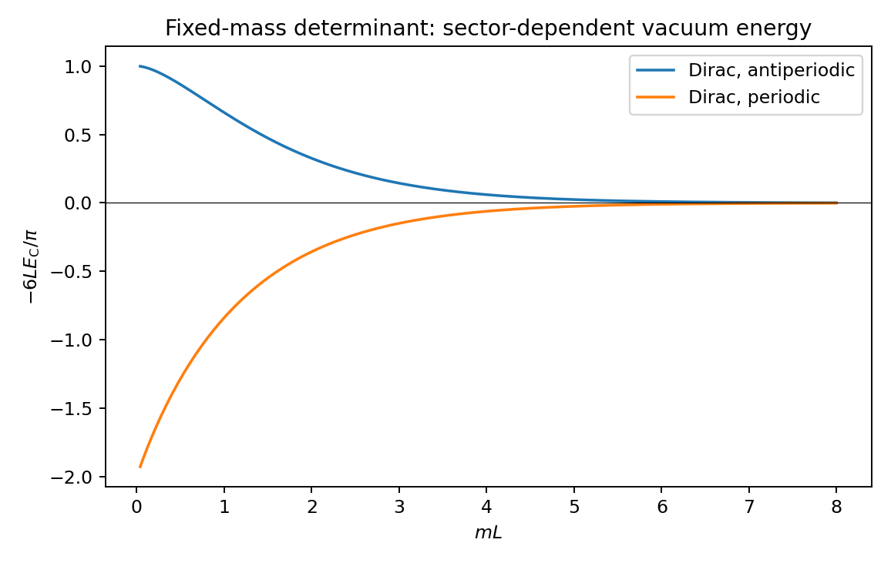
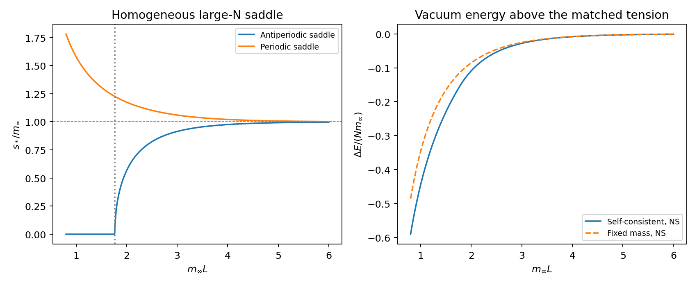

# Ten years of QCD strings: fermions, hidden dimensions, and the long flux tube

*qcdstring programme. Preprint QCDS-86/1, November 1986.*

*A review of the 1976-1986 programme, with a calculation of massive worldsheet sectors. Historical cutoff: 30 November 1986. Author-checked edition; the independent referee was waived by the user for this slot. This is not a refereed paper.*

## Abstract

The evidence accumulated in the first decade of this programme supports a
relativistic description of long confining flux tubes. It has not produced a
complete string representation of four-dimensional QCD. We review what the
five preceding papers established, what their revisions withdrew, and what the
new critical superstrings require us to reconsider. The most precise mode count
belongs to a three-dimensional Z2 gauge theory; neither its precision nor its
field content can be transferred to four-dimensional Yang-Mills theory.

The new calculation concerns a possible reconciliation between a fermionic
microscopic sheet and a bosonic long tube. We derive the finite-length vacuum
energy of massive nonchiral fermions for both spatial spin structures, including
the subtraction that defines the physical tension. A massive sector becomes
exponentially invisible in this energy, while its virtual effects remain in
local couplings. A difference between spin sectors isolates odd windings and
provides a conditional mass diagnostic. A periodic boson-fermion pair supplies
an explicit counterexample to counting all fields from one vacuum energy.

To give the mass a dynamical origin, we place a Gross-Neveu sector on the
induced metric and solve its homogeneous saddle at leading order in the number
of Dirac flavours. The antiperiodic saddle loses its condensate at
$m_\infty L=\pi e^{-\gamma}$; the periodic saddle is instead enhanced. The
condensate energy must accompany the determinant: inserting the
length-dependent mass into a fixed-mass Casimir formula alone gives the wrong
energy. These are calculations in a specified effective model, not a derivation
of its fields from colour dynamics. The finite-flavour limitation of the sharp
transition is already known from Dashen, Ma and Rajaraman.

We distinguish this mechanism from critical-string anomaly cancellation,
from chiral heterotic current algebras, and from approximate meson-baryon
symmetries. The tachyon-free nonsupersymmetric constructions of 1986 disprove
the claim that removing a string tachyon necessarily entails spacetime
supersymmetry, but do not supply a gravity-free QCD string. Finally we examine
whether the special ultraviolet status of four-dimensional Yang-Mills theory
motivates the suppression of extra dimensions. It gives a conditional scale
hierarchy, not a compactification theorem; a small compact target direction
need not remove a local massless worldsheet field. A pinned compact-coordinate
model supplies a candidate gap and a quantum scaling test which limits weak
pinning at small radius. This links the spacetime and worldsheet questions
and specifies a concrete missing mechanism.

## 1. The question after a decade

In 1974 the string was a proposal for the strong interaction. Its tension was
fixed by hadronic trajectories, its ends carried flavour, and its topology
resembled the large-colour expansion of a gauge theory. It also had three
conspicuous difficulties: the critical dimension was wrong, the most familiar
amplitudes were too soft at large momentum transfer, and the spectrum contained
massless states where the hadron tables did not. The subsequent reinterpretation
of the critical string as a theory containing gravity addressed some of those
difficulties by changing the physical question.

This programme retained the hadronic question. Our first paper appeared in
1976 [1]; four more followed at two-year intervals [2-5]. The anniversary is a
useful point to distinguish three enterprises that can otherwise share the
same language. One is the effective theory of a long tube already known to
exist. A second is a calculational representation of a confining gauge theory
in terms of surfaces. A third is a complete critical string construction whose
physical observables might admit a hadronic interpretation. Success in the
first enterprise supplies constraints on the other two. It does not complete
them.

The first enterprise is now substantially stronger than it was in 1976. We
have measured fluctuating surfaces, excited levels, a closed-tube vacuum
energy, roughening, and deconfinement. Symmetry fixes part of their common
long-distance expansion. The second enterprise still lacks a controllable
four-dimensional solution. The third has been transformed by Green and
Schwarz, the heterotic construction, and compactification, but its relation to
our physical flux tube remains a construction to be made.

The question of this paper is therefore specific: **can a string with
additional fermionic or internal structure have the bosonic long-distance
spectrum that the flux-tube evidence suggests?** A useful answer must exhibit
action, subtraction, spectrum, and domain of validity. Calling the fermions
heavy is insufficient unless one can say what their mass changes and how it
could arise.

Sections 2 and 3 review the decade and the effective description. Sections
4-8 develop the distinction between critical and physical mode counts, the
massive determinant, a dynamical mass model, and its limitations. Sections
9-11 discuss endpoint charges, dimensional reduction, and hadron physics.
Section 12 states the results and the next calculations. The appendices give
regulator details, additional checks, source provenance, and the memory
account required by this programme.

Throughout, $d$ is the spacetime dimension in which the observed tube moves,
$q=d-2$ its number of transverse translation fields, $N_c$ the number of
colours, and $N_f$ the number of **Dirac species in our model on the sheet**.
There is no identification of $N_f$ with either quark flavour or colour.
$L$ denotes the circumference of a closed tube, $R$ an open-tube length,
and $\sigma$ the physical tension after infinite-length matching. Units have
$\hbar=c=1$. Numerical tables below evaluate derived model formulas; they are
not new measurements.

## 2. What the five papers actually established

### 2.1 From an area law to a moving surface: 1976

The strong-coupling expansion [6] supplies surfaces bounded by a Wilson loop.
The topology of colour diagrams supplies a separate surface organisation [7].
Neither statement by itself proves that a smooth relativistic sheet is
the appropriate continuum variable. A surface may be pinned, a strong-coupling
series may cease to converge before the continuum regime, and a topological
organisation does not specify the local action on a surface.

The Nielsen-Olesen vortex [8] supplies a complementary field-theory example
in which an extended flux configuration and its collective motion can be
studied directly. It is an Abelian Higgs construction, not a solution of
pure non-Abelian confinement. Its value is to show concretely how a string
can be a state of a field theory rather than a replacement for all its fields.

Our 1976 paper [1] asked for the simplest dynamical signature. The transverse
motion of a string with fixed ends contributes $-\pi q/(24R)$ to its energy.
We derived that term and measured potentials in the three-dimensional Z2
and four-dimensional compact U(1) theories. In Z2 the sign of a Casimir term
was required. Its magnitude was not separated cleanly from short-distance
and endpoint corrections. In U(1), the confining strong-coupling branch ended
near the transition into a Coulomb regime. An area law at strong coupling was
therefore demonstrably not enough to guarantee a confining continuum limit.

The same paper compared the tension inferred from Regge slopes with that
needed by a simple charmonium potential. Agreement at the level allowed by the
spin-dependent ambiguity was encouraging. It was not an exact identification
of the fitted parameters of two different approximations.

### 2.2 A non-Abelian connection: 1978

The 1978 paper [2] followed the SU(2) tension through the strong-coupling
crossover. It remained nonzero throughout the simulated range. At the larger
couplings it was approximately constant in units of the perturbative lattice
scale, within analysis and finite-volume uncertainties. The range did not
distinguish one-loop from two-loop scaling. Our original ledger window for
scaling was too optimistic.

This result matters because it connects the surface picture to a non-Abelian
theory with asymptotic freedom. It does not establish the continuum limit with
arbitrary precision or prove confinement at every coupling. The coefficient of $1/R$ in the potential also mixed the short-distance Coulomb contribution with
long-distance string physics. Its approximate agreement with $\pi/12$ was
not a four-dimensional count of precisely two worldsheet modes.

The published calculations of Creutz [9] subsequently made the same general
connection part of the common subject. In this chronology those publications
have their actual dates and are independent of our papers.

### 2.3 Excitations and roughening: 1980

The first excited Z2 tube [3] lay well below the free-phonon spacing at short
lengths and approached the square-root string prediction at longer lengths.
The higher levels were unresolved. This is evidence about one channel, not
an empirical determination of an entire oscillator spectrum. A variational
estimate obtained at finite Euclidean time must also be distinguished from an
isolated asymptotic eigenvalue.

Through the dual Ising interface we located roughening. The distinction
between a pinned and a fluctuating surface became operational: transverse
widths could grow logarithmically and the Casimir description could become
appropriate. The contemporary work on string fluctuations and roughening
[10,11] gave the same questions a continuum formulation.

The inverse-length expansion and the exact square-root ansatz are different
claims. A short tube may be fitted by a square root beyond the interval in
which an expansion of an excited level converges. Such a fit can be useful,
but it does not enlarge the domain of a perturbative derivation.

### 2.4 The thermal counterexample: 1982

The closed tube eliminated endpoint ambiguities [4]. Its vacuum energy
supported a transverse Casimir contribution. The finite-temperature calculation
also supplied an informative failure. The extrapolated Nambu-Goto ground state
vanishes at its putative Hagedorn circumference, but the Z2 tube continued to
exist past that point. Its approach to deconfinement was incompatible with
the square-root critical behaviour.

The four-dimensional SU(2) result was less decisive: the ordering of the
transition and the ideal-string temperature depended on the tension estimate,
and the continuum ordering was not settled. Neither calculation tested the
specific statement in the ledger about the first-order transition of pure SU(3).

The lesson is stronger than a disagreement in one number. Agreement with a
long-string expansion does not license extrapolation to its formal branch
point. A singularity of an approximate expression need not be a singularity
of the gauge theory. That distinction will recur when additional massive
fields become important at $mL$ of order unity.

### 2.5 Symmetry and its limits: 1984

The 1984 paper [5] derived the area action at the first nontrivial order from
nonlinear Lorentz symmetry, calculated its first level shift, and examined
allowed boundary terms. It also proposed evaluating the conformal anomaly on
the induced metric and calculated a consequent polarization splitting.
The proposal and its consequences were distinguished after review.

The revisions are part of the result. The data did not identify the old
endpoint correction uniquely. The direct calculation of the $L^{-5}$ contribution of the area action remained unfinished. Rules that reconstruct the square
root from phonon momenta were established at first order and assumed beyond
it. A mass bound originally dominated by short strings was weakened. None of
these qualifications should disappear in an anniversary review.

The most precise retained closed-tube count was

$$c_{\rm fit}=0.99(3)(9), \qquad d=3,\quad Z_2. \tag{1}$$

The first uncertainty is statistical, the second represents the spread over
specified analysis choices. The fit also excluded one additional **free
periodic scalar** below approximately $1.2\sqrt\sigma$ in the model tested.
It did not produce a universal lower bound on every possible internal mode.
A fermion has a different sign or multiplicity, its spin structure matters,
and interactions can change its finite-size mass.

| Slot | Result retained for this review | Question still open |
|---|---|---|
| 1976 | Casimir sign in Z2; U(1) area law has a limited branch | Universal coefficient separated from endpoint effects |
| 1978 | Nonzero SU(2) tension into an approximate scaling regime | Controlled continuum scaling and the four-dimensional mode count |
| 1980 | First excitation approaches the string spectrum; roughening located | Higher excitations and precise asymptotic gaps |
| 1982 | Closed-tube Casimir energy; failure of the thermal square-root extrapolation in Z2 | SU(3), continuum thermal ordering, internal excitations |
| 1984 | First nonlinear area correction; symmetry restrictions; conditional anomaly calculation | Direct $L^{-5}$ calculation, endpoint identification, ultraviolet completion |

This table is a summary of the revised papers, not a reanalysis of their raw
data. The archived analyses remain the sources of their uncertainties.

## 3. The long string before adding fermions

### 3.1 Translation fields and the area

A straight tube breaks translations in $q$ transverse directions. If those
translations are continuous symmetries of the vacuum and the tube is in a
rough continuum regime, its transverse position is described by fields
$X^i(t,x)$. In static gauge the induced metric is

$$h_{ab}=\eta_{ab}+\partial_aX^i\partial_bX^i,
\qquad S_{\rm area}=-\sigma\int d^2\xi\sqrt{-\det h}. \tag{2}$$

Tilting a flat sheet is a target-space rotation. This fixes the nonlinear
completion of the terms with one derivative on each field and relates the
quartic coefficients to the tension. A mass term for $X^i$ would explicitly
select a transverse position. There is no analogous translation protection
for an internal fermion or a fluctuation of the internal structure of the tube.

The distinction is the starting point of decoupling. We are not trying to
remove the Goldstone fields that make the tube a moving object. We are asking
whether other fields can cease to propagate at energies below their gaps.

### 3.2 What is universal and what is matched

For a closed tube in the transverse vacuum sector, the result through the
first interaction correction is

$$E_0(L)=\sigma L-\frac{\pi q}{6L}
-\frac{\pi^2q^2}{72\sigma L^3}+\cdots. \tag{3}$$

The $L^{-3}$ coefficient follows from the quartic area interaction and its
first-order matrix element in [5]. For an open tube the Casimir coefficient
is four times smaller, and endpoint operators add their own corrections.
The physical tension, endpoint energies, and coefficients of higher operators
are matching data. A massive field can renormalize them even when it has no
appreciable winding contribution to (3).

The fixed-end square root of Arvis [12] gives a valuable organizing expression
for the spectrum. The treatment of the conformal anomaly in [13] explains
why extending a critical free-string quantization to other dimensions is a
separate quantum problem. Our effective expansion uses the symmetry and
long-length statements that have been derived; it does not assume that either
construction supplies an exact microscopic QCD spectrum.

Consequently there are two senses in which a massive field can disappear.
It disappears as a low-energy particle. It does not disappear from the values
of all the couplings of the remaining theory. An exponential finite-size
correction and a power correction from a local matched operator must not be
identified merely because both improve a fit on a short interval.

### 3.3 Rigidity as a warning about the expansion

The Gauss relation expresses the square of the extrinsic curvature as a
mean-curvature square plus the intrinsic Euler term. In the perturbative
long-string expansion, a term proportional to the leading equations of
motion can be removed by a field redefinition, provided the induced terms
and boundary conditions are transformed as well. This is the useful reading
of the stiffness argument in [5].

It is too broad to infer that every theory containing a finite stiffness is
physically identical to an area theory at all scales. A higher-derivative
propagator treated as an exact object can acquire additional poles; its
truncated derivative expansion cannot settle their physical meaning. A
healthy massive microscopic field can instead generate a series of local
operators when it is integrated out. The series need not be useful at the
mass threshold.

The new proposals of Polyakov and Kleinert [29,30] make this distinction timely.
We leave a full curvature-coupled model for the next slot. The present
calculation treats massive fermions directly and thus keeps the threshold
visible rather than encoding it in a few derivative coefficients.

## 4. Ten dimensions and two transverse modes answer different questions

### 4.1 Critical RNS bookkeeping

In the flat covariant Ramond-Neveu-Schwarz construction, each embedding
coordinate contributes one unit of matter central charge and its real
worldsheet superpartner contributes one half, in each chiral sector where
that multiplet is present. The reparametrization ghosts contribute $-26$ and
the superconformal ghosts $+11$. Thus

$$c_{\rm matter}=\frac32D,\qquad
c_{\rm ghost}=-15,\qquad c_{\rm total}=0\ \Longrightarrow\ D=10. \tag{4}$$

This is an anomaly condition for a particular gauge system. It is not a
measurement of ten unconfined spatial directions. With four free embedding
supermultiplets, the remaining matter sector must have $c=9$ if the same
critical construction is used. Six free internal supermultiplets provide
one realization; a number by itself does not specify the internal theory,
its projections, or its physical spectrum.

The compactification analysis of Candelas, Horowitz, Strominger and Witten [17]
provides an explicit example of geometry serving several constraints at once.
Their candidate vacua impose unbroken four-dimensional supersymmetry and
restrict the compact geometry; SU(3) holonomy is central to their construction.
This demonstrates a substantive relation between geometry and consistency.
It does not show that the confining QCD vacuum selects that geometry, or that
its internal fluctuations would all be massive on a long tube.

For the heterotic construction [16], the bosonic chiral side has a matter
budget of 26. Ten embedding coordinates leave an internal contribution of
16. Thirty-two real chiral fermions are one way to realize that contribution.
Their number is not the number of quark flavours measured in a flux tube.
The global consistency conditions of the construction are essential.

### 4.2 The finite-size coefficient is sector dependent

For a nonchiral conformal theory with $c_L=c_R=c$, a state on a spatial
circle has energy above the bulk term

$$E(L)=\frac{2\pi}{L}\left(h+\bar h-\frac{c}{12}\right).
\tag{5}$$

The lowest allowed conformal weights depend on the sector. Defining
$c_{\rm eff}=c-12(h_{\min}+\bar h_{\min})$ reproduces the vacuum-energy
coefficient $-\pi c_{\rm eff}/(6L)$. This is the finite-size connection made
explicit this year [21,22]. It is $c_{\rm eff}$ for the chosen physical
sector that the vacuum energy measures, not an unrestricted census of fields.

One nonchiral Majorana fermion has $c=1/2$. Its antiperiodic sector has zero
lowest weights and contributes $-\pi/(12L)$. Its periodic sector has
$h=\bar h=1/16$ and contributes $+\pi/(6L)$, corresponding to
$c_{\rm eff}=-1$. A negative effective coefficient in this sector does not
mean a nonunitary theory or a negative local central charge.

The old statement that an extra Majorana changes the three-dimensional
transverse count to $3/2$ or to zero is therefore a statement about specified
sectors. It should not be read as a theorem excluding every arrangement of
massless bosons and fermions. Section 5 gives a direct cancellation example.

### 4.3 Four meanings of supersymmetry

A symmetry between fields on a two-dimensional sheet, a global spacetime
supercharge, a local spacetime supersymmetry, and an approximate algebra of
bound states are different structures. The first requires an actual
worldsheet transformation and supercurrent. The second requires physical
charges acting on the projected spectrum. The third has further gauge and
gravity content. The fourth can relate selected meson and baryon levels
without imposing an exact super-Poincare algebra on QCD.

The GSO construction [15] illustrates why a projection of states is an
essential extra step between a local worldsheet action and the physical
spacetime spectrum. A fermion in that action does not, by its presence alone,
specify the surviving charges or multiplets.

Neither a worldsheet Grassmann field nor a numerical degeneracy demonstrates
all four structures. Our action below contains ordinary two-dimensional
fermions. It does not posit a supersymmetry relating them to the translation
fields. It therefore illustrates how fermionic structure can become invisible;
it does not prove that a critical superstring can be converted into QCD by
adding the same mass term.

### 4.4 What changed in 1986

The new SO(16)$\times$SO(16) constructions [19,20] are tachyon-free without
spacetime supersymmetry. They are a direct counterexample to the implication
"tachyon-free string implies spacetime supersymmetry." This corrects a
necessity claim in our earlier roadmap.

Their existence is not a completed hadronic construction. Their spectra
still contain gravity, and absence of a tree-level tachyon does not establish
a stable quantum vacuum. In particular, the nonzero one-loop vacuum energy
reported in [20] prevents an unqualified claim of vacuum stability. The
example serves a logically narrower purpose: supersymmetry breaking,
tachyon removal, and removal of a coupled massless spin-two state are separate
problems.

Green-Schwarz cancellation [14] is likewise a consistency achievement whose
physical premises must be retained when importing it. A physical massless
helicity-two state with a nonzero soft coupling cannot simply be renamed a
hadron and assigned arbitrary nonuniversal couplings [31]. A hadronic tensor
state must acquire a mass, fail to belong to the physical spectrum, or arise
in a demonstrably different dictionary. This paper does not solve that problem.

## 5. A massive sector on a long tube

### 5.1 Action and physical assumptions

Consider $N_f$ nonchiral Dirac fields on the induced metric of (2). In
Euclidean signature their free action is

$$S_\psi=\sum_{A=1}^{N_f}\int d^2\xi\sqrt h\,
\bar\psi_A(\gamma^a\nabla_a+m)\psi_A. \tag{6}$$

The spin connection is the one of $h$. The fields are worldsheet spinors;
we assign no target-space spinor transformation or flavour interpretation.
Coupling to the induced metric gives a way to respect the geometric
realization of target-space symmetry without identifying these fields with
the RNS partners of every embedding coordinate.

We first evaluate (6) on a straight cylinder. This is the leading term in the
expansion in transverse gradients and inverse tension. The mass is positive
and fixed. On a spatial circle the momenta are

$$k_n=\frac{2\pi(n+\alpha)}{L},\qquad
\omega_n=\sqrt{k_n^2+m^2},\qquad
\alpha=0\ ({\rm R}),\quad \alpha=\frac12\ ({\rm NS}). \tag{7}$$

Here R and NS name periodic and antiperiodic **spatial** boundary conditions.
They do not by themselves specify a sum over spin structures, a string
projection, or the temporal boundary condition used to take a trace. In the
vacuum-energy calculation the Euclidean time extent is sent to infinity.

A two-component Dirac field has twice the contribution of a nonchiral
Majorana field. A real scalar has the opposite sign to a Majorana with the
same frequencies. These multiplicities are responsible for several apparent
factor-of-two disagreements if the type of fermion is left implicit.

### 5.2 Subtraction and the Bessel sum

The raw zero-point sum is divergent. Its extensive part is an infinite-line
energy density and belongs in the matched tension. With the same regulator
on the sum and integral, one Dirac field contributes

$$E_{\rm D}(m,L,\alpha)=-\left[
\sum_{n\in\mathbb Z}\omega_n
-L\int_{-\infty}^{\infty}\frac{dk}{2\pi}\sqrt{k^2+m^2}
\right]_{\rm finite}.
\tag{8}$$

Poisson summation, or the proper-time calculation in Appendix A, gives

$$E_{\rm D}(m,L,\alpha)=\frac{2m}{\pi}
\sum_{w=1}^{\infty}\frac{\cos(2\pi w\alpha)}{w}K_1(wmL).
\tag{9}$$

For comparison a real periodic scalar contributes

$$E_{\rm B}(m,L)=-\frac{m}{\pi}
\sum_{w=1}^{\infty}\frac{K_1(wmL)}{w}. \tag{10}$$

The infinite-line subtraction does not assert that the microscopic vacuum
energy vanishes. It defines which parameter is called $\sigma$. If a mass
subsequently becomes dynamical, the difference between vacuum potentials at
different masses must be restored. Section 6 does so explicitly.

### 5.3 Limits and a cancellation counterexample

Since $K_1(z)\sim 1/z$ as $z\to0$, the massless Dirac energies are

$$E_{\rm D}^{\rm NS}(0,L)=-\frac{\pi}{6L},\qquad
E_{\rm D}^{\rm R}(0,L)=+\frac{\pi}{3L}. \tag{11}$$

Dividing by two gives the Majorana values discussed after (5). For
$mL\gg1$, the first winding dominates and

$$E_{\rm D}^{\rm R,NS}(m,L)
=\mathord{\pm}\sqrt{\frac{2m}{\pi L}}e^{-mL}
\left[1+\frac{3}{8mL}+O((mL)^{-2})\right]
+O(e^{-2mL}), \tag{12}$$

with the plus sign for R. Massive propagation around the tube therefore
becomes exponentially small. Formula (12) concerns the finite-size determinant;
it does not bound the coefficients of local operators already generated by
that field.

A real periodic scalar and an equal-mass periodic Majorana cancel exactly
between (9) and (10), at this free determinant order. In particular, one may
add a massless pair of this kind without changing the vacuum $1/L$
coefficient. The pair still changes excited states and other observables.
This counterexample prevents an unrestricted interpretation of (1) as a
complete inventory of massless degrees of freedom.

An antiperiodic Majorana instead adds to the negative scalar Casimir term.
A projection that selects a different lowest state can further alter the
sector energy. The periodic cancellation does not imply that either sector
occurs in a microscopic gauge flux tube; it specifies a loophole that an
identification of the physical sector must close.

### 5.4 A difference which selects odd windings

For one fixed-mass Dirac field define

$$\mathcal D(L)=E_{\rm D}^{\rm R}-E_{\rm D}^{\rm NS}
=\frac{4m}{\pi}\sum_{\substack{w\ge1\\w\ {\rm odd}}}
\frac{K_1(wmL)}{w}>0. \tag{13}$$

The common extensive subtraction cancels. Even windings cancel as well.
The massless value is $\pi/(2L)$ and the large-length behaviour is
$\sqrt{8m/(\pi L)}e^{-mL}$, times its inverse-$mL$ expansion. Thus, when
the same mass and local matching coefficients describe the two sectors,

$$m_{12}=-\frac{1}{L_2-L_1}
\log\frac{\mathcal D(L_2)\sqrt{L_2}}
{\mathcal D(L_1)\sqrt{L_1}}
\ \longrightarrow\ m. \tag{14}$$

This is a conditional diagnostic. A pure gauge simulation does not acquire
a tunable worldsheet spin structure just because (13) can be written down.
One must identify microscopic sectors or defects that realize the two
boundary conditions and show that their other matching data agree. If their
condensates differ, as they do below, (13) is not the exact answer for their
full energy difference.

The model numbers illustrate the scale of the effect. Each entry is for
one Dirac field; Majorana entries are half as large.

| $mL$ | $LE_{\rm NS}$ | $LE_{\rm R}$ | $L\mathcal D$ |
|---:|---:|---:|---:|
| 0 | -0.523599 | 1.047198 | 1.570796 |
| 0.25 | -0.499157 | 0.835400 | 1.334558 |
| 0.5 | -0.453021 | 0.672486 | 1.125507 |
| 1 | -0.345604 | 0.438932 | 0.784536 |
| 2 | -0.170661 | 0.186655 | 0.357316 |
| 3 | -0.075443 | 0.078012 | 0.153455 |
| 5 | -0.012845 | 0.012904 | 0.025749 |
| 8 | -0.000791 | 0.000791 | 0.001583 |

### 5.5 Excited levels and projections

Before projection or interaction corrections, a fermionic occupation changes
the energy by $\omega_n$ in (7). A periodic single-particle gap tends to $m$;
an antiperiodic one has lowest energy $\sqrt{m^2+\pi^2/L^2}$. If only
even fermion parity is physical, a one-particle state is absent. For a Dirac
particle-antiparticle pair with opposite momenta the corresponding thresholds
are $2m$ and $2\sqrt{m^2+\pi^2/L^2}$.

These statements specify the unprojected free model and one simple parity
restriction. They do not assign hadronic quantum numbers or determine which
operators create the states. The utility is that excited levels can reveal a
sector which a cancellation hides in the vacuum energy. A serious matching
calculation should predict energies and operator overlaps together.

## 6. Generating the mass instead of assigning it

### 6.1 A mechanism already available in 1974

Gross and Neveu [23] exhibited dynamical mass generation in a two-dimensional
asymptotically free fermion model. We use that mechanism as an internal sector
on the tube, with an auxiliary real field $s$:

$$S_{\rm int}=\int d^2\xi\sqrt h\left[
\sum_{A=1}^{N_f}\bar\psi_A(\gamma^a\nabla_a+s)\psi_A
+\frac{N_fs^2}{2\lambda_0}\right]. \tag{15}$$

Integrating out $s$ gives an attractive interaction
$-\lambda_0(\sum_A\bar\psi_A\psi_A)^2/(2N_f)$ in this Euclidean convention.
The discrete chiral transformation reverses $s$ and $\bar\psi\psi$.
There is no continuous chiral Goldstone field in this model. We take the
large-$N_f$ limit at fixed $\lambda_0$ and retain a homogeneous saddle.
The auxiliary field is not an extra freely chosen massless scalar.

Equation (15) is a model assumption, not a consequence of Wilson loops or
the colour expansion. Its value is that the mass can be derived from a
coupling and its renormalization, rather than inserted as an unexplained
number. Its limitations are equally explicit: the number and representation
of the fields, the four-fermion interaction, and their matching to QCD have
not been derived.

### 6.2 Infinite-line matching

The fermion integral gives, per Dirac flavour,

$$\frac{\Gamma[s]}{N_f}
=\int d^2\xi\,\frac{s^2}{2\lambda_0}
-\operatorname{Tr}\log(\gamma^a\partial_a+s). \tag{16}$$

On a flat infinite sheet, differentiation of the constant-field potential
removes an irrelevant additive constant. With a spatial momentum cutoff
$\Lambda$, integration over continuous frequency gives

$$V'_{\Lambda}(s)=s\left[
\frac{1}{\lambda_0}-\frac{1}{\pi}
\operatorname{arsinh}\frac{\Lambda}{s}\right]. \tag{17}$$

Fix the coupling by requiring a positive infinite-line saddle $m_\infty$:
$1/\lambda_0=\operatorname{arsinh}(\Lambda/m_\infty)/\pi$.
After removing the cutoff,

$$V_\infty(s)=\frac{s^2}{4\pi}
\left(\log\frac{s^2}{m_\infty^2}-1\right),\qquad
V_\infty'(s)=\frac{s}{\pi}\log\frac{s}{m_\infty}.
\tag{18}$$

We use $s\ge0$ to choose one of the equivalent saddle branches. The limit
$s\to0$ of $V_\infty$ is zero. At a large finite cutoff,
$m_\infty\simeq2\Lambda\exp(-\pi/\lambda_0)$ in this scheme. The factor
two is regulator dependent; the physical matching condition is not. No
remembered hadronic mass fixes $m_\infty/\sqrt\sigma$.

The negative value $V_\infty(m_\infty)=-m_\infty^2/(4\pi)$ renormalizes
the tension. A stable positive physical tension must be imposed in matching;
the fermion calculation does not guarantee that the tube forms.

### 6.3 Finite circumference and the missing condensation energy

At length $L$ the homogeneous potential is

$$\mathcal V_\alpha(s;L)=V_\infty(s)-V_\infty(m_\infty)
+\frac{E_{\rm D}(s,L,\alpha)}{L}. \tag{19}$$

The minimizing saddle $s_\alpha(L)$ determines the leading internal energy

$$\Delta E_\alpha(L)=N_f L\mathcal V_\alpha(s_\alpha(L);L).
\tag{20}$$

The total tube energy is $\sigma L$ plus the transverse contribution and
(20), with transverse-interaction and subleading-$N_f$ corrections. The
same infinite-line tension is used for both spatial spin sectors.

Substituting $s_\alpha(L)$ into (9) alone omits the first two terms of (19).
That omission changes the answer at exactly the order at which condensation
matters. It is not repaired by fitting a separate tension at each length,
which would abandon a common local theory.

For a nonzero saddle, the identity
$d[sK_1(wsL)]/ds=-wsL K_0(wsL)$ gives the gap equation

$$\log\frac{s}{m_\infty}
=2\sum_{w=1}^{\infty}\cos(2\pi w\alpha)K_0(wsL).
\tag{21}$$

The $s=0$ possibility must be examined in the potential itself; it is lost
if one divides a stationarity equation by $s$ and then treats the result as
the full set of extrema.

### 6.4 Antiperiodic fermions and a critical circumference

For NS boundary conditions the alternating sum in (21) reduces the mass.
The curvature at the origin is particularly simple:

$$\mathcal V_{\rm NS}''(0;L)=\frac1\pi
\log\frac{\pi e^{-\gamma}}{m_\infty L}.
\tag{22}$$

To derive it without an alternating Bessel expansion, take $M$ positive
half-integer momentum modes and their negatives. The bare inverse coupling
is $\operatorname{arsinh}(2\pi M/(Lm_\infty))/\pi$, and the curvature
subtracts $\pi^{-1}\sum_{n=0}^{M-1}(n+1/2)^{-1}$. The harmonic sum is
$\log M+\gamma+2\log2+o(1)$. Their difference is (22).

The quartic coefficient is positive:

$$\mathcal V_{\rm NS}(s;L)-\mathcal V_{\rm NS}(0;L)
=\frac{s^2}{2\pi}\log\frac{L_c}{L}
+\frac{7\zeta(3)L^2}{32\pi^3}s^4+O(s^6L^4),
\quad L_c=\frac{\pi e^{-\gamma}}{m_\infty}.
\tag{23}$$

It follows that the homogeneous leading saddle is zero below $L_c$ and
nonzero above it, with

$$s^2\simeq\frac{8\pi^2}{7\zeta(3)L^2}\log\frac{L}{L_c}
\quad (L\downarrow L_c\text{ from above}). \tag{24}$$

This is the familiar large-flavour finite-temperature mechanism [24], read
by interchanging the two axes of the Euclidean cylinder. It is not a new
phase transition predicted for QCD. At finite flavour number, fluctuations
and configurations with varying order parameter invalidate the assertion of
a sharp broken-symmetry thermal phase in this two-dimensional model. We retain
the saddle as a controlled leading-$N_f$ calculation away from its critical
region, and explicitly do not extrapolate its transition to $N_f=1$.

When $s=0$, (20) is

$$\frac{\Delta E_{\rm NS}}{N_f}
=-\frac{\pi}{6L}+\frac{m_\infty^2L}{4\pi}. \tag{25}$$

The second term is the lost condensation energy. The massless finite-size
coefficient alone is therefore not the whole energy even on this branch.

### 6.5 Periodic fermions and comparison of the energies

For R boundary conditions the right side of (21) is positive. The positive
saddle lies above $m_\infty$ and approaches it as $L$ increases. Its zero
momentum mode makes a small-$s$ expansion different from (23); the potential
has a term linear in $|s|$. The periodic branch does not undergo the same
homogeneous restoration at $L_c$.

The following table uses $m_\infty=1$ and divides all internal energies by
$N_f$. The last column holds the mass fixed at its infinite-line value and
omits any change of condensate because none occurs in that fixed model.

| $m_\infty L$ | $s_{\rm NS}/m_\infty$ | $s_{\rm R}/m_\infty$ | $\Delta E_{\rm NS}/(N_fm_\infty)$ | Fixed-mass NS |
|---:|---:|---:|---:|---:|
| 1.0000 | 0.000000 | 1.578478 | -0.444021 | -0.345604 |
| 1.5000 | 0.000000 | 1.306237 | -0.229700 | -0.165125 |
| 1.7639 | 0.000000 | 1.226188 | -0.156481 | -0.115817 |
| 1.8000 | 0.243992 | 1.217217 | -0.147821 | -0.110459 |
| 2.0000 | 0.567338 | 1.174167 | -0.108893 | -0.085330 |
| 2.5000 | 0.823414 | 1.101756 | -0.053584 | -0.045806 |
| 3.0000 | 0.914348 | 1.059956 | -0.027822 | -0.025148 |
| 5.0000 | 0.992370 | 1.007157 | -0.002614 | -0.002569 |
| 8.0000 | 0.999706 | 1.000292 | -0.000099 | -0.000099 |

Minimization necessarily lowers the energy relative to evaluating the same
potential at $s=m_\infty$. This variational inequality is a useful check on
the signs and the subtraction. It holds in both spin sectors, even though
the shift in the mass has opposite signs.

For $m_\infty L\gg1$, (21) gives
$s/m_\infty=1\mathord{\pm}2K_0(m_\infty L)+\cdots$, plus for R and
minus for NS. The leading winding energy is still (12), evaluated at
$m_\infty$. Changes in the optimized energy start at second winding order
because the infinite-line potential is stationary at $m_\infty$.
The exact odd-winding identity (13) does not hold for two separately
optimized saddles, although its leading long-length term survives.

### 6.6 The controlled window

The large-$N_f$ limit and the string derivative expansion are separate
approximations. A conservative sufficient hierarchy for studying the crossover
without strong transverse backreaction is

$$N_f\gg1,\qquad
N_fm_\infty^2\ll\sigma,\qquad
L\sqrt\sigma\gg\sqrt{N_f},\qquad
m_\infty L\text{ of order one or larger}.
\tag{26}$$

One can arrange this in a model by scaling the physical tension with
$N_f$. It is not an assertion about real QCD, where an internal mass might
be comparable to $\sqrt\sigma$ and the multiplicity need not be large.
Near the critical circumference of the saddle an additional critical-region
qualification is required. We do not claim that $1/N_f$ corrections are
uniform there.

The infinitely long flat-sheet Gross-Neveu model is asymptotically free,
but its coupling to the transverse string in (15) is still an effective
construction. Its ultraviolet existence as an isolated two-dimensional model
does not complete the ultraviolet theory of the whole flux tube.

## 7. What the calculation permits us to infer

### 7.1 A bosonic infrared spectrum need not imply a bosonic microscopic sheet

The model supplies an explicit conditional answer to the main question.
Translation symmetry protects the $X^i$ fields; the discrete chiral dynamics
of a vectorlike internal sector generates a gap; and the finite-length
fermion determinant becomes exponentially small. After local matching, the
leading Casimir coefficient of the long tube is that of the translations.
No spacetime supersymmetry was needed for this mechanism.

This is an existence example within effective theory. It does not establish
that the QCD tube has these fermions, that its gap has this origin, or that
the model is the low-energy limit of a critical superstring. A microscopic
identification would have to produce the internal fields, the interaction,
and the spin-sector prescription together.

### 7.2 How to distinguish several explanations of a deviation

There are at least four explanations of a departure from a transverse-only
spectrum: a boundary interaction, a local bulk operator, a massive propagating
field, or a sector-dependent cancellation among light fields. Their long-length
signatures differ. Endpoint effects occur only on open tubes. Local operators
give power corrections within their domain. A gapped determinant winds with
an exponential. A cancellation can hide vacuum energy while leaving extra
excited states.

A practical programme would therefore combine open and closed spectra,
several lengths in a controlled range, and more than one symmetry channel.
For a candidate fermion sector it would also identify the allowed parity
projection. These requirements are more informative than fitting a different
Casimir coefficient independently to each short interval.

The dynamical model adds a fifth possibility: the mass itself changes with
length. A fixed-mass fit in that region can misidentify the long-string mass
or absorb condensation energy into an apparent tension shift. The difference
between the two last columns of the table is a calculable example of that
bias. It is a model forecast, not a demonstrated bias in the old Z2 data.

### 7.3 What we have not measured

We do not refit the Z2 data with an arbitrarily chosen multiplicity of
Gross-Neveu fields. Such a fit would add a mass, a coupling interpretation,
a spin-sector choice, and an approximation whose validity is not established
at those lengths. The older scalar bound and mode count retain their original
model qualifications.

We also do not transfer those bounds to SU(3), identify the Majoranas with
quarks, or infer a supersymmetric partner from a missing contribution to a
vacuum energy. P18 remains unmeasured in four dimensions by this programme.
The useful new objects are the formulas and discriminators that a subsequent
microscopic matching or spectral calculation can test.

## 8. Why this is not yet a descent from a critical superstring

### 8.1 A relevant deformation and a gauge anomaly are different things

An explicit mass changes a two-dimensional conformal theory. In a physical
static-gauge effective theory this can be an admissible relevant deformation.
In a critical covariant string, Weyl invariance is part of the gauge
consistency conditions. One cannot delete massive matter from its central
charge budget, leave the ghosts unchanged, and declare the resulting theory
consistent.

The background-field approach [18] gives a more constructive question: can
the fields and geometry be changed together so that the required beta
functions vanish? An internal condensate might then be part of a background,
but it must satisfy those equations and the physical-state conditions. No
such background is constructed here. The induced-metric proposal of [5] is
also not a substitute for proving this fermionic extension.

The local anomaly, the physical transverse spectrum, and the vacuum energy of a sector are therefore three different checks. Passing one is not a way of
waiving the others.

### 8.2 The chiral obstruction

The mass term in (15) pairs left- and right-moving components. A purely
chiral set of fields cannot be gapped by this same Lorentz-invariant bilinear
without additional fields or structure. An isolated sector with unequal
left and right anomaly coefficients cannot become a featureless trivial
gapped theory while preserving its symmetries and locality. An anomaly must
be matched, cancelled by additional content, or accounted for by a larger
system.

This matters for the heterotic interpretation. The internal chiral current
sector that contributes $c=16$ is not our nonchiral Gross-Neveu sector.
Assigning it a Gross-Neveu mass is not an available operation on that sector
alone. The full heterotic string includes other matter, ghosts, and global
constraints; its consistency cannot be decided by the isolated matter count,
but neither can those ingredients be omitted from a proposed reduction.

Thus the model answers a limited existence question and leaves a sharper
construction problem: find an anomaly-consistent completion in which the
unwanted physical excitations are gapped while the desired hadronic sectors
remain. This is a useful restriction on the roadmap, not evidence against
all possible internal constructions.

### 8.3 Compact coordinates can still fluctuate

Take a free internal coordinate $Y$ of period $2\pi r$ with action
$\tfrac12\int(\partial Y)^2$ after a choice of normalization. Changing
$r$ changes momentum and winding energies. It does not change the central
charge of the local oscillator theory, which remains one. The oscillator
Casimir term on a long sheet remains that of a massless scalar.

A compact target direction is therefore not automatically a massive
worldsheet direction. If the target background has an exact internal
translation symmetry and the classical string can sit anywhere along that
circle at the same cost, its local displacement along the circle has no
potential. Compactness alone does not supply one.

There are possible mechanisms that do. A position-dependent tension can
localize the tube at a preferred internal location. A nontrivial interacting
internal sigma model may generate a scale. Background couplings can lift
particular fluctuations. Each proposal requires a fluctuation operator and
an actual mass or gap. A metric with additional coordinates is an acceptable
language for the confining vacuum only after its observable modes have been
identified.

This distinction will be essential in Section 10. A four-dimensional
low-energy gauge theory and a worldsheet with only two light transverse
fields are related physical requirements; neither is an automatic consequence
of writing down a small compact manifold.

### 8.4 A pinned compact coordinate: a constructive test

We can turn the preceding distinction into a small calculation. Let
$\theta\equiv\theta+2\pi$ parameterize an internal circle of radius $r$.
For a tube with local tension
$T(\theta)=\sigma+u(1-\cos\theta)$, expansion of the area action about a
straight tube at $\theta=0$ gives the Euclidean internal action

$$S_\theta=\int d^2\xi\left[
\frac{\kappa}{2}(\partial\theta)^2+u(1-\cos\theta)\right]+\cdots,
\qquad \kappa=\sigma r^2.
\tag{26a}$$

The omitted terms include higher gradients and the dependence of the kinetic
coefficient on $\theta$. For $u/\sigma\ll1$ they are small in the same
long-string expansion. Here $u$ is a supplied background parameter: the
preferred internal position has been put into the model, not generated from
an initially translation-invariant vacuum.

With the canonical local field $Y=\sqrt\kappa\,\theta$, the positive
Hessian gives a tree-level small-oscillation mass

$$m_{\theta,\mathrm{tree}}^2=\frac{u}{\kappa}
=\frac{u}{\sigma r^2}. \tag{26b}$$

For a sufficiently stiff field and weak fluctuations about one minimum,
the leading finite-size contribution is the massive scalar determinant (10).
This is an explicit example of the extra ingredient that compactness alone
lacks. It is a local effective model of a pinned coordinate, not a complete
critical background. The mass in (26b) is not the exact quantum mass at
arbitrary stiffness. The distinction between the classical expansion and the
quantum sine-Gordon theory is already explicit in [36].

There is an informative countertest. At $u=0$, the free-field correlation is
$\langle\theta(x)\theta(0)\rangle=-\log(\mu|x|)/(2\pi\kappa)$.
The vertex $e^{i\theta}$ therefore has scaling dimension
$\Delta=1/(4\pi\kappa)$. Equivalently, integrating a thin momentum shell
of width $d\ell$ gives variance $d\ell/(2\pi\kappa)$ and multiplies the
cosine by $\exp[-d\ell/(4\pi\kappa)]$. Rescaling the two-dimensional
area gives, for a small dimensionless pinning coupling $y$,

$$\frac{dy}{d\ell}=(2-\Delta)y+\hbox{higher orders},\qquad
\Delta=\frac{1}{4\pi\kappa},\qquad
\Delta<2\ \Longleftrightarrow\ \kappa>\frac{1}{8\pi}.
\tag{26c}$$

Here $\ell$ increases toward longer distance, and $y$ denotes the cosine
coefficient normal-ordered and normalized at the running cutoff. This is a
perturbation about the free compact-boson fixed point; other relevant
operators and strong initial pinning are outside the calculation. The
linear test is inconclusive at equality. It does not prove that every
relevant deformation has the tree mass (26b).

For the minimal geometric identification $\kappa=\sigma r^2$ and the
conventional momentum scale $M_{\rm KK}=1/r$, weak pinning is relevant only
when $M_{\rm KK}/\sqrt\sigma<\sqrt{8\pi}$. Thus this particular weakly
perturbed model does not give a parametrically large Kaluza-Klein scale
while simultaneously gapping the coordinate by that weak cosine. Shrinking
the radius strengthens the fluctuations which undermine the classical
localization argument. A more general background, a different kinetic
matching, or strong dynamics may evade this restricted conclusion; each
would require another calculation.

The example is useful in both directions. A positive classical Hessian
supplies a candidate gap, and the scaling calculation identifies where that
candidate cannot be trusted. Together they prevent the statement "the
direction is compact" from doing the work of an uncomputed fluctuation
spectrum.

## 9. Endpoint charges, SO(32), and hadronic supersymmetry

### 9.1 What the group number says

The anomaly cancellation of the ten-dimensional construction singles out
particular gauge content under particular assumptions [14]. It is not a
bound stating that any confining tube can have at most thirty-two endpoint
flavours. A Chan-Paton label, a colour line in the large-$N_c$ expansion, and
a chiral worldsheet current belong to different descriptions. A proposed
identification must respect their distinct roles in amplitudes.

A modest algebraic exercise helps state what would have to be added. Under
$U(n)\subset SO(2n)$, the complexified vector splits as
$\mathbf n_{+1}\oplus\overline{\mathbf n}_{-1}$. Its exterior square gives

$$\operatorname{adj}SO(2n)
=(\mathbf n\otimes\overline{\mathbf n})_0
\oplus(\Lambda^2\mathbf n)_{+2}
\oplus(\Lambda^2\overline{\mathbf n})_{-2}.
\tag{27}$$

The dimensions are

$$n(2n-1)=n^2+2\frac{n(n-1)}2,
\qquad 496=256+120+120\quad(n=16). \tag{28}$$

There are neutral quark-antiquark-like labels and charged antisymmetric
pair-like labels if the fundamental labels are assigned that interpretation.
The displayed charges are those of the chosen $U(1)$ generator, not an
already identified electromagnetic charge. The identity follows from tensor
algebra for every $n$; it does not single out the observed flavours.

### 9.2 What the exercise does not supply

To turn (27) into a hadronic model, one must choose the physical flavour
embedding, assign electric charge and baryon number, enforce colour singlet
conditions, and identify the physical oscillator states that carry the
representations. A bosonic adjoint decomposition is not a proof that baryons
are present. A scalar interpretation would require a specified reduction or
excitation sector. Unwanted representations cannot be discarded without
checking closure and factorization.

The same qualification applies to the suggested relation between endpoint
labels and internal currents. A representation identity does not establish
an equality of open- and closed-string amplitudes. The sewing and projection
conditions are where an attractive bookkeeping analogy becomes a theory or
fails to become one.

This review therefore records (27) as a starting calculation. It makes no
claim about a number of generations, no exclusion of additional quark
flavours, and no derivation of observed electric charges. Those questions
remain appropriate for a separate paper with a complete representation
assignment and a consistency test.

### 9.3 Mesons and baryons can share a tension without exact spacetime supersymmetry

The programme initiated by Miyazawa [28] and the recent work of Catto and Gursey [27]
address approximate symmetries of bound states. If an antiquark and a compact
diquark act as endpoints of a long tube carrying the same colour flux, the
leading energy per length can be similar, while endpoint masses, spin
couplings, and finite-size effects differ. This gives a physical route to
nearly parallel trajectories.

For a classical straight string rotating with massless ends, integration of
the energy and angular momentum densities gives

$$E=\frac{\pi\sigma}{\omega},\qquad
J=\frac{\pi\sigma}{2\omega^2},\qquad
J=\frac{E^2}{2\pi\sigma}. \tag{29}$$

The common slope is therefore compatible with a common tension. Equation
(29) says nothing about an exact intercept, an exact meson-baryon pairing,
or the existence of a spacetime supercharge. Massive ends and junction
structure matter before extending it to particular hadrons.

The calculation of the quantum intercept of a rotating string is especially
sensitive to its ends and to the region near lightlike endpoints. The static
Casimir coefficient alone does not settle it. We retain that calculation as
a next-slot question rather than using it to supply an uncomputed universal
half-unit offset in the hadron tables.

## 10. Can the ultraviolet problem motivate hidden dimensions?

### 10.1 The special status of four-dimensional Yang-Mills theory

There is a physical question which the critical-dimension count does not
answer. If an interacting non-Abelian theory is to describe arbitrarily short
distances using its ordinary weak-coupling continuum limit, how many dimensions
can remain accessible to its gauge fields?

In the canonical normalization of Yang-Mills theory,

$$[g_D]=\frac{4-D}{2},\qquad
\widehat g(\mu)=\mu^{(D-4)/2}g_D. \tag{30}$$

For $D<4$ the interaction is superrenormalizable by power counting. At
$D=4$ it is marginal and the non-Abelian quantum correction produces
asymptotic freedom. Above four dimensions the coupling has negative mass
dimension and ordinary perturbation theory around the Gaussian fixed point
requires higher operators. A theory specified by only the original Yang-Mills
term is no longer perturbatively renormalizable in that sense.

It is tempting to replace this statement by "above four dimensions only
free fields exist." That replacement is not justified. An interacting
effective gauge theory with a finite cutoff is meaningful. A non-Gaussian
continuum fixed point is another logical possibility. The difficulty of
constructing the four-dimensional theory nonperturbatively should also not
be confused with the separate power-counting problem above four dimensions.

### 10.2 A countertest available without later discoveries

The Wilsonian viewpoint [35] and an expansion about four dimensions already
provide a countertest to an impossibility argument. Let $D=4+\epsilon$,
$\epsilon>0$, and denote the positive four-dimensional coefficient of a
pure SU($N_c$) theory by
$b=11N_c/(48\pi^2)$. To the first order in the small-$\epsilon$ expansion,

$$\mu\frac{d\widehat g}{d\mu}
=\frac{\epsilon}{2}\widehat g-b\widehat g^3+\cdots.
\tag{31}$$

The canonical scaling and the non-Abelian sign permit a candidate fixed
point,

$$\widehat g_*^2=\frac{\epsilon}{2b}+O(\epsilon^2),\qquad
\beta'(\widehat g_*)=-\epsilon+O(\epsilon^2). \tag{32}$$

The slope is ultraviolet attractive in this one-coupling calculation.
The omitted operator space and the extrapolation to an integer dimension
must still be controlled. Equation (32) is not an existence proof of a
five-dimensional continuum Yang-Mills theory. It is enough to show why
negative mass dimension alone is not a proof of triviality. Critical
behaviour of gauge theories and Wilson loops is already an explicit subject
of the period [33].

For pure U(1), the continuum Maxwell action without charged matter is
quadratic. It is free in any dimension in which that local field theory is
considered. Adding charged matter reintroduces an interaction with the same
engineering dimension (30); the Abelian sign does not reproduce the weak
non-Abelian fixed-point mechanism of (31). Compact lattice U(1), with its
nonperturbative sectors, must be distinguished from simply writing a Gaussian
Maxwell action. Our own 1976 example already requires that distinction.

### 10.3 A conditional argument for dimensional suppression

Suppose the goal is a four-dimensional confining regime below a scale
$M_{\rm KK}$, while a higher-dimensional effective theory is used above it
up to a cutoff $\Lambda_{\rm UV}$. A useful hierarchy is

$$\Lambda_4\ll M_{\rm KK}\ll\Lambda_{\rm UV}. \tag{33}$$

Here $\Lambda_4$ is a four-dimensional strong-coupling scale, not a rigorously
computed mass gap. In a simple unwarped product compactification of volume
$V_k$, with the zero-mode gauge kinetic term normalized by dimensional
integration,

$$\frac1{g_4^2(M_{\rm KK})}=\frac{V_k}{g_{4+k}^2}
+\hbox{threshold corrections}. \tag{34}$$

If all unwanted zero modes have been lifted, one-loop pure Yang-Mills running
below the matching scale gives

$$\Lambda_4\simeq M_{\rm KK}
\exp\left[-\frac{1}{2b\,g_4^2(M_{\rm KK})}\right]. \tag{35}$$

Thus a weak matched coupling can separate the nonperturbative gauge scale
from the compactification scale. The formula explains a possible hierarchy;
it does not calculate a compactification radius or prove confinement. A
mass gap and tension, if generated, require further nonperturbative matching
to $\Lambda_4$.

There is a further condition often hidden in this argument. Components of
the higher-dimensional gauge field along a torus become adjoint scalar zero
modes. They do not disappear merely because nonzero Kaluza-Klein momenta are
heavy. A claim of *pure* four-dimensional Yang-Mills must give a mechanism
which lifts or projects out these scalars without destroying the desired
light gauge sector. Other internal fields require the same treatment.

Compactification does not cure the higher-dimensional ultraviolet problem.
At energies above $M_{\rm KK}$ the tower becomes accessible and the parent
problem returns. A separate ultraviolet completion, a suitable fixed point,
or an explicit cutoff remains necessary. The conditional statement is that
a dimensionally reduced regime can protect a useful four-dimensional window
from that problem, not that it solves the problem at all scales.

### 10.4 Compactification is one mechanism, not the conclusion

The ultraviolet observation motivates the requirement that additional
propagation be suppressed. Several mechanisms might meet that requirement:
small compact dimensions, localization of gauge modes, or strong interactions
which prevent propagation between effectively lower-dimensional regions.
The premise alone does not select among them. It also does not select four
rather than three or two extended dimensions; a separate physical requirement
is needed to pick the upper endpoint of the permitted range.

Fu and Nielsen [34] give an especially relevant contemporary example. Their
anisotropic compact U(1) lattice theory has, in the approximation studied,
a layer phase with Coulomb behaviour within layers and strong-coupling
behaviour between them. This is a dynamical restriction of propagation,
not ordinary geometric compactification. Its explicit anisotropy and Abelian
layer physics are part of the construction. It is not a demonstration that
an isotropic higher-dimensional non-Abelian theory selects four-dimensional
QCD spontaneously.

One can nevertheless make a useful programme from the comparison. Find an
action for which the suppression scale is generated or stabilized. Calculate
propagation both along and across the proposed four-dimensional region.
Identify surviving scalar and fermion zero modes. Match the gauge coupling
and demonstrate a hierarchy of the form (33). Only then ask whether the
low-energy theory forms the flux tube whose spectrum we have studied.

### 10.5 A second reduction, on the sheet

The spacetime and worldsheet requirements must now be imposed together.
Even if (33) gives four-dimensional gauge dynamics, a string description
using additional coordinates must explain why its internal local
oscillations do not add unwanted light modes. Sections 8.3-8.4 show why making
a free target coordinate compact is insufficient, and calculate the range
in which a weak periodic pinning potential can begin to change that conclusion.

A promising conditional mechanism is a tube localized at a minimum of its
internal energy. Expand that energy and the kinetic metric about the
minimum. If the resulting fluctuation operator has strictly positive
internal eigenvalues, those coordinates are massive worldsheet fields.
Their winding effects then have the structure of (9) or (10), with the
appropriate statistics and interactions. The translation fields in the
extended spacetime remain protected.

The proof obligations are explicit: a stable background or effective vacuum,
a positive fluctuation operator for the unwanted modes, consistent anomaly
and projection conditions, and a separation between those masses and the
energies used to test the long string. We have supplied a fermionic model
of the last step. We have not supplied the full geometry or the microscopic
four-dimensional gauge construction.

In this form the dimensional-selection idea is productive. It asks for two
related decouplings and a common mechanism rather than reading the number
of accessible dimensions off a central-charge equation. Its potential force
is a consistency requirement on a proposed model. Its present status is a
research proposal with derived matching conditions, not a theorem that
extra dimensions must compactify.

## 11. Hagedorn, flux-tube hadrons, and the unfinished scattering problem

### 11.1 The temperature of the ideal string

For a closed Nambu-Goto tube with $q$ transverse oscillators the familiar
formal ground-state expression is

$$E_0^2(L)=\sigma^2L^2-\frac{\pi q\sigma}{3},\qquad
T_H=\sqrt{\frac{3\sigma}{\pi q}}. \tag{36}$$

Our 1982 paper derived the corresponding ideal-string level-density result;
The 1985 work of Olesen [25] develops the relation between the string tachyon and
deconfinement. The useful common calculation is the singularity of the ideal string. Identifying it with a transition in a particular gauge theory is
an additional physical claim, already contradicted by our Z2 example when
made without qualifications.

The massive-sector calculation supplies another reason to resist that
identification. At $L\gg m^{-1}$ the vacuum energy may count only
translations. At shorter circumference additional fields become active;
in the dynamical example their mass and condensation energy change as well.
The infrared count cannot simply be inserted into an all-energy density of
states. Conversely, adding an ultraviolet central charge to (36) without
constructing the interacting spectrum is not a derivation of a new
Hagedorn temperature.

The internal NS saddle scale $L_c$ is not the gauge deconfinement length.
It belongs to an auxiliary effective model with a freely matched
$m_\infty$. Equating the two would impose an extra relation between
$m_\infty$ and $\sigma$ which this paper has not derived.

### 11.2 What Isgur and Paton add

The flux-tube model of Isgur and Paton [26] makes the hadronic use of the
string concrete: collective excitations of colour flux organize candidate
hadron states. It encourages comparisons beyond the ground-state static
potential. A successful effective tube theory should eventually describe
which excitations survive for moving endpoints and closed configurations,
and how they mix with constituent and short-distance degrees of freedom.

The comparison is not an identification of every model parameter with the
endpoint coefficient of [5]. A phenomenological hadron model uses finite
strings and dynamical constituents; our boundary analysis used static,
rotation-invariant sources. The matching between those descriptions is a
calculation still to be done.

The new internal sector gives a further possible source of excitations,
but it has no assigned hadronic channel yet. In particular, it is not the
remembered pseudoscalar mode in the ledger. Its multiplicity, statistics,
and mass were not selected to reproduce that memory. A channel assignment
would require a microscopic operator and its transformation under spatial
reflection, charge conjugation, and the symmetries of the tube.

### 11.3 Hard scattering is still a decisive test

The original hard-scattering objection has not been removed by obtaining
a good long-string spectrum. Parton counting [32] concerns amplitudes at
large momentum transfer. A derivative expansion for a long tube is not
valid in that limit. Internal masses do not by themselves convert a soft
critical-string amplitude into the observed hard behaviour.

A variable describing transverse size or resolution remains an interesting
possibility. To make it a solution one must calculate an amplitude and
recover the appropriate power law with the correct operator interpretation.
The conformal factor, an extra coordinate, or a compact space cannot be
assigned that function solely because it is available in the notation.

The decade has therefore reduced one obstacle, the absence of a controlled
long-distance string description. It has not solved the complete spectrum,
the ultraviolet representation, or the hard-scattering problem. This is the
proper scale of the conclusion.

## 12. Results and the next calculations

The review leaves a programme with a reliable long-distance question and
several distinct microscopic questions. The original papers establish
nontrivial flux-tube behaviour in specified gauge theories and ranges.
Their strongest mode count is three-dimensional. Their thermal calculation
also gives a counterexample to unrestricted square-root extrapolation.

The new work establishes the following statements within its assumptions.
The massive Dirac determinant has the spin-dependent winding expansion
(9), the odd-winding difference (13), and the mass diagnostic (14).
A periodic equal-mass scalar-Majorana pair can be invisible in that vacuum
energy. A homogeneous large-flavour Gross-Neveu sector generates an
infinite-line mass and gives the self-consistent finite-length energy
(19)-(20). The two spin sectors move its saddle in opposite directions.
The NS critical circumference and its expansion follow from explicit mode
sums, with the finite-flavour limitation retained.

These statements provide a mechanism by which an internal fermionic sector
can disappear from the leading long-string mode count. They do not prove
that the QCD string contains that sector or that a critical superstring
reduces to it. The chiral pairing obstruction and the Weyl-anomaly problem
show what must be added before such a claim can be made.

The dimensional argument supplies a second, complementary target. A useful
four-dimensional regime can be protected by a separation between confinement,
extra-dimensional propagation, and the ultraviolet cutoff. The hierarchy
is possible in matching equations. Its dynamical realization and the removal
of unwanted zero modes remain open. The compact-coordinate calculation adds
a concrete limitation: the simplest weak cosine cannot both remain relevant
and generate a parametrically large geometric Kaluza-Klein scale relative to
the square root of the tension. Compactification and the disappearance
of worldsheet internal modes must both be checked.

For 1988 we would make the next paper centre on thickness and curvature:
start with a healthy massive field coupled to the tube, integrate it out,
and compare the exact threshold contribution with the local curvature
expansion. That can clarify precisely what the stiffness argument of [5]
does and does not remove. A rotating-string intercept is a related but
separate calculation and should be included only if its endpoint treatment
is controlled.

Two carried-over obligations remain explicitly unfinished. The direct
$L^{-5}$ area-action level calculation has not been replaced by the
Gross-Neveu calculation. Nor have the zero-point and open-string rules of
Section 4.2 of [5] been derived beyond their previously established order.
These are mathematical tasks with clear targets, rather than reasons to
claim that the whole effective-string picture is untested.

A further paper can attempt the SO(32) endpoint interpretation with an
explicit flavour embedding and a factorization test. Equation (27) is the
algebraic starting point, not the answer. The new dimensional-selection
proposal should meanwhile be pursued through an actual background or
anisotropic gauge construction. Both projects have a useful failure
criterion: an unavoidable unwanted light mode, inconsistent projection, or
missing scale hierarchy would reject the proposed realization.

## Appendix A. The determinant with the extensive term removed

For one real scalar, write the square root by proper time,

$$\sqrt a=-\frac{1}{2\sqrt\pi}\int_0^\infty
 dt\,t^{-3/2}e^{-at}, \tag{A1}$$

understood with a regulator or analytic continuation. The original unregulated
integral is not convergent at its lower limit; the formula is used on the
subtracted expression. Poisson summation gives

$$\sum_{n\in\mathbb Z}e^{-t(2\pi(n+\alpha)/L)^2}
=\frac{L}{2\sqrt{\pi t}}
\sum_{w\in\mathbb Z}e^{-w^2L^2/(4t)}e^{2\pi iw\alpha}.
\tag{A2}$$

The $w=0$ term is exactly the continuum momentum integral multiplied by
$L$. Remove it before removing the regulator. The remaining integrals are
finite for $m>0$ and nonzero winding. The identity

$$\int_0^\infty dt\,t^{-2}
 e^{-m^2t-w^2L^2/(4t)}
=\frac{4m}{|w|L}K_1(|w|mL) \tag{A3}$$

gives $-m/\pi$ times the positive-winding Bessel sum for the scalar.
The fermionic vacuum sign reverses it for a Majorana, and a Dirac doubles
it, giving (9). A continuous twist is a convenient spectral notation for
the Dirac field; for the real periodic scalar in the text only $\alpha=0$
is used.

There is a numerically independent representation. With
$\omega(k)=\sqrt{k^2+m^2}$,

$$E_{\rm D}^{\rm NS}
=-\frac{2}{\pi}\int_0^\infty dk\,
\log(1+e^{-L\omega(k)}),\qquad
E_{\rm D}^{\rm R}
=-\frac{2}{\pi}\int_0^\infty dk\,
\log(1-e^{-L\omega(k)}). \tag{A4}$$

Expansion of the logarithms and the substitution $k=m\sinh u$ reproduce
the two Bessel sums. The periodic massless integral has an integrable
logarithmic singularity at its lower endpoint. This form is used to check
the sums without repeating their discretization.

As a further check, the periodic Dirac energy at small positive mass has
a term $-m$, coming from its zero momentum mode. The full energy remains
positive and tends to $\pi/(3L)$ at zero mass. Losing this term would
incorrectly alter the periodic Gross-Neveu saddle near the origin.

## Appendix B. Checks on the dynamical saddle

Expansion of $-L^{-1}\sum_n\sqrt{k_n^2+s^2}$ for antiperiodic momenta
gives the quartic coefficient

$$\frac{1}{8L}\sum_{n\in\mathbb Z}\frac{1}{|k_n|^3}
=\frac{7\zeta(3)L^2}{32\pi^3}. \tag{B1}$$

The quadratic coefficient is divergent before matching. Using the same
spatial cutoff to define the infinite-line coupling and the finite-size
sum produces (22). A circular Euclidean cutoff would change the bare
coupling relation; mixing the two cutoff conventions would introduce a
spurious constant in $L_c$.

At large length let $s=m_\infty+\delta s$.
Since $V_\infty''(m_\infty)=1/\pi$, minimization gives

$$\delta s=-\frac{\pi}{L}
\left.\frac{\partial E_{\rm D}}{\partial s}\right|_{m_\infty}
+\cdots,\qquad
\frac{\Delta E}{N_f}
=E_{\rm D}(m_\infty,L)
-\frac{\pi}{2L}
\left(\left.\frac{\partial E_{\rm D}}{\partial s}\right|_{m_\infty}\right)^2
+\cdots. \tag{B2}$$

The correction is negative in both sectors and starts at order
$e^{-2m_\infty L}$. This agrees with the variational inequality used in the
numerical checks. The expansion assumes a noncritical saddle; it is not
appropriate near $L_c$.

The script also differentiates the independent integral (A4) at the Bessel
root, minimizes that independently integrated potential, compares the
critical curvature to a cutoff mode sum, and checks the near-critical
quartic coefficient against (24). These are author checks of formulas and
implementations. They do not establish the microscopic matching or replace
an independent review of the physical assumptions.

## Appendix C. What an expansion of the square root would and would not prove

Expanding the ideal expression in (36) gives

$$E_0(L)=\sigma L-\frac{\pi q}{6L}
-\frac{\pi^2q^2}{72\sigma L^3}
-\frac{\pi^3q^3}{432\sigma^2L^5}+O(L^{-7}). \tag{C1}$$

The algebraic coefficient of $L^{-5}$ is easy to obtain. Deriving it from
the quantum area action is a different calculation: it needs the sextic
interaction at first order, the quartic interaction at second order, a
consistent treatment of the measure and counterterms, and the relevant
state projection. Expanding (36) is not that derivation. The direct task
left in [5] is still open in this paper.

Similarly, the large-length exponential formulas of Section 5 are derived
from a quadratic internal determinant. Applying a guessed square-root
resummation to the sum of transverse and internal vacuum energies would
introduce a new assumption. We have not used such a resummation.

## Appendix D. Sources and historical discipline

The scientific body of this paper uses results published by November 1986,
our earlier papers, and derivations displayed here. The dated bibliography
below distinguishes those sources from the retrospective programme notes.
The bibliography keys, DOI metadata, access routes, and reading coverage are
recorded in `SOURCES.md` and `sources.tsv` beside the paper.

A bibliography entry does not imply that its full text was available in
this run. In particular, several publisher originals could be verified
only through their metadata and abstracts. The detailed finite-size and
Gross-Neveu formulas used here are derived in the paper and checked by the
program accompanying this paper; they are not attributed to unread equations. The
finite-flavour warning of [24] is explicit in the publisher abstract of that paper.
Selected pages of [17] and the existing transcript of [27] were read; the
source record states the coverage and extraction limitations.

The 2026 discussion which prompted Section 10 included a report of a recent
Lean proof concerning Yang-Mills theory. That reported result was neither
investigated nor used as a premise, source, or validation. It is excluded
from the historical argument. The argument in Section 10 uses power
counting, the known non-Abelian one-loop sign, dimensional matching, and a
published 1984 layered construction.

The modern machine runs Python for algebraic and numerical checks and
builds this document. No new gauge simulation was performed and no
contemporary computing power is represented as historical lattice evidence.
The theory-first rule adopted for the series from 1984 applies.

## Appendix E. Memory, invention, and claim strength

**Remembered and re-derived here.** Massive scalar and fermion Casimir sums,
their massless sector limits, the Gross-Neveu homogeneous potential and gap
equation, its NS critical circumference, the compact-scalar vertex dimension, the tensor-algebra decomposition
(27), and the elementary dimensional matching relations are established
calculations or standard consequences. Their derivations are written here;
this paper makes no historical priority claim for them. The small-$\epsilon$
fixed-point expression is a formal countertest, not an existence theorem.

**Remembered and used only to choose the work.** Later expectations of extra
massive worldsheet excitations, critical-string descriptions of confining
gauge theories, and possible interpretations of SO(32) helped select the
questions. No later measured mass, coupling, geometry, or hadron identification
enters the model. The later effective-string literature motivates interest
in the uncomputed $L^{-5}$ term but supplies no replacement for its derivation.

**Programme proposals without a specific remembered counterpart.** The
combined use of the fixed-spin determinant, a self-consistent internal
condensate, and paired spacetime/worldsheet decoupling conditions is our
proposed organization of the problem. The user-suggested dimensional-selection
question is developed as a conditional construction programme. No specific
prior paper is asserted for that complete organization, and no claim of
novelty across the literature follows from our not recalling one. Its support
is the derivation and explicit limitations in this paper, not memory.

**Still assumptions or open calculations.** The microscopic internal field
content, its worldsheet spin-sector prescription, matching to QCD, a stable
critical background, removal of a coupled massless tensor, a physical flavour
embedding, dynamical dimensional suppression, and the higher-order obligations
of [5] remain unproved. The large-$N_f$ saddle is an approximation with a
known finite-$N_f$ limitation. No ledger prediction about real
four-dimensional QCD is closed by the new model tables.

## Appendix F. Author checks and review status

`code/worldsheet86.py` produces `results/worldsheet86.txt`, the JSON record,
the two numerical tables, and the figures. Its tests compare distinct
representations where possible: Bessel sums against momentum integrals,
stationarity against an independently evaluated potential, and critical
curvature against a cutoff mode sum. Exact limiting and representation
identities are additional checks. `AUTHOR_CHECKS.md` records the complete
validation and the limitations left after it.

The user explicitly requested publication without an independent referee.
`REFEREE.md` records that waiver and contains no invented report.
`RESPONSE.md` records the absence of a referee response and points to the
corrections and checks made in this work. The customary different-model cold review
has not occurred. This status belongs to the published package as well as to
its repository bookkeeping.

## References

1. qcdstring programme, *The Casimir energy of a flux tube, and an area law on the computer*, QCDS-76/1 (1976), revised edition, `../1976-flux-tube-casimir/paper.md`.
2. qcdstring programme, *The SU(2) string tension between strong coupling and asymptotic freedom*, QCDS-78/1 (1978), `../1978-su2-scaling/paper.md`.
3. qcdstring programme, *Excited flux tubes, the square root, and roughening*, QCDS-80/1 (1980), `../1980-excited-flux-tube/paper.md`.
4. qcdstring programme, *Hagedorn versus deconfinement: the closed flux tube at finite temperature*, QCDS-82/1 (1982), `../1982-hagedorn-deconfinement/paper.md`.
5. qcdstring programme, *The critical dimension as a statement about the effective string*, QCDS-84/1 (1984), revised edition, `../1984-critical-dimension/paper.md`.
6. K. G. Wilson, *Confinement of quarks*, Phys. Rev. D **10** (1974) 2445. DOI: [10.1103/PhysRevD.10.2445](https://doi.org/10.1103/PhysRevD.10.2445).
7. G. 't Hooft, *A planar diagram theory for strong interactions*, Nucl. Phys. B **72** (1974) 461. DOI: [10.1016/0550-3213(74)90154-0](https://doi.org/10.1016/0550-3213(74)90154-0).
8. H. B. Nielsen and P. Olesen, *Vortex-line models for dual strings*, Nucl. Phys. B **61** (1973) 45. DOI: [10.1016/0550-3213(73)90350-7](https://doi.org/10.1016/0550-3213(73)90350-7).
9. M. Creutz, *Monte Carlo study of quantized SU(2) gauge theory*, Phys. Rev. D **21** (1980) 2308. DOI: [10.1103/PhysRevD.21.2308](https://doi.org/10.1103/PhysRevD.21.2308).
10. M. Luescher, K. Symanzik and P. Weisz, *Anomalies of the free loop wave equation in the WKB approximation*, Nucl. Phys. B **173** (1980) 365. DOI: [10.1016/0550-3213(80)90009-7](https://doi.org/10.1016/0550-3213(80)90009-7).
11. M. Luescher, *Symmetry breaking aspects of the roughening transition in gauge theories*, Nucl. Phys. B **180** (1981) 317. DOI: [10.1016/0550-3213(81)90423-5](https://doi.org/10.1016/0550-3213(81)90423-5).
12. J. F. Arvis, *The exact q qbar potential in Nambu string theory*, Phys. Lett. B **127** (1983) 106. DOI: [10.1016/0370-2693(83)91640-4](https://doi.org/10.1016/0370-2693(83)91640-4).
13. A. M. Polyakov, *Quantum geometry of bosonic strings*, Phys. Lett. B **103** (1981) 207. DOI: [10.1016/0370-2693(81)90743-7](https://doi.org/10.1016/0370-2693(81)90743-7).
14. M. B. Green and J. H. Schwarz, *Anomaly cancellation in supersymmetric D=10 gauge theory and superstring theory*, Phys. Lett. B **149** (1984) 117. DOI: [10.1016/0370-2693(84)91565-X](https://doi.org/10.1016/0370-2693(84)91565-X).
15. F. Gliozzi, J. Scherk and D. Olive, *Supersymmetry, supergravity theories and the dual spinor model*, Nucl. Phys. B **122** (1977) 253; work circulated in 1976. DOI: [10.1016/0550-3213(77)90206-1](https://doi.org/10.1016/0550-3213(77)90206-1).
16. D. J. Gross, J. A. Harvey, E. Martinec and R. Rohm, *Heterotic string*, Phys. Rev. Lett. **54** (1985) 502. DOI: [10.1103/PhysRevLett.54.502](https://doi.org/10.1103/PhysRevLett.54.502).
17. P. Candelas, G. T. Horowitz, A. Strominger and E. Witten, *Vacuum configurations for superstrings*, Nucl. Phys. B **258** (1985) 46. DOI: [10.1016/0550-3213(85)90602-9](https://doi.org/10.1016/0550-3213(85)90602-9).
18. C. G. Callan, D. Friedan, E. Martinec and M. J. Perry, *Strings in background fields*, Nucl. Phys. B **262** (1985) 593. DOI: [10.1016/0550-3213(85)90506-1](https://doi.org/10.1016/0550-3213(85)90506-1).
19. L. Alvarez-Gaume, P. Ginsparg, G. Moore and C. Vafa, *An O(16) x O(16) heterotic string*, Phys. Lett. B **171** (1986) 155. DOI: [10.1016/0370-2693(86)91524-8](https://doi.org/10.1016/0370-2693(86)91524-8).
20. L. J. Dixon and J. A. Harvey, *String theories in ten dimensions without spacetime supersymmetry*, Nucl. Phys. B **274** (1986) 93. DOI: [10.1016/0550-3213(86)90619-X](https://doi.org/10.1016/0550-3213(86)90619-X).
21. H. W. J. Bloete, J. L. Cardy and M. P. Nightingale, *Conformal invariance, the central charge, and universal finite-size amplitudes at criticality*, Phys. Rev. Lett. **56** (1986) 742. DOI: [10.1103/PhysRevLett.56.742](https://doi.org/10.1103/PhysRevLett.56.742).
22. I. Affleck, *Universal term in the free energy at a critical point and the conformal anomaly*, Phys. Rev. Lett. **56** (1986) 746. DOI: [10.1103/PhysRevLett.56.746](https://doi.org/10.1103/PhysRevLett.56.746).
23. D. J. Gross and A. Neveu, *Dynamical symmetry breaking in asymptotically free field theories*, Phys. Rev. D **10** (1974) 3235. DOI: [10.1103/PhysRevD.10.3235](https://doi.org/10.1103/PhysRevD.10.3235).
24. R. F. Dashen, S.-K. Ma and R. Rajaraman, *Finite-temperature behavior of a relativistic field theory with dynamical symmetry breaking*, Phys. Rev. D **11** (1975) 1499. DOI: [10.1103/PhysRevD.11.1499](https://doi.org/10.1103/PhysRevD.11.1499).
25. P. Olesen, *Strings, tachyons and deconfinement*, Phys. Lett. B **160** (1985) 144. DOI: [10.1016/0370-2693(85)90010-3](https://doi.org/10.1016/0370-2693(85)90010-3).
26. N. Isgur and J. Paton, *A flux tube model for hadrons in QCD*, Phys. Rev. D **31** (1985) 2910. DOI: [10.1103/PhysRevD.31.2910](https://doi.org/10.1103/PhysRevD.31.2910).
27. S. Catto and F. Gursey, *Algebraic treatment of effective supersymmetry*, Nuovo Cimento A **86** (1985) 201. DOI: [10.1007/BF02902548](https://doi.org/10.1007/BF02902548).
28. H. Miyazawa, *Baryon number changing currents*, Prog. Theor. Phys. **36** (1966) 1266. DOI: [10.1143/PTP.36.1266](https://doi.org/10.1143/PTP.36.1266).
29. A. M. Polyakov, *Fine structure of strings*, Nucl. Phys. B **268** (1986) 406. DOI: [10.1016/0550-3213(86)90162-8](https://doi.org/10.1016/0550-3213(86)90162-8).
30. H. Kleinert, *The membrane properties of condensing strings*, Phys. Lett. B **174** (1986) 335. DOI: [10.1016/0370-2693(86)91111-1](https://doi.org/10.1016/0370-2693(86)91111-1).
31. S. Weinberg, *Photons and gravitons in S-matrix theory: derivation of charge conservation and equality of gravitational and inertial mass*, Phys. Rev. **135** (1964) B1049. DOI: [10.1103/PhysRev.135.B1049](https://doi.org/10.1103/PhysRev.135.B1049).
32. S. J. Brodsky and G. R. Farrar, *Scaling laws at large transverse momentum*, Phys. Rev. Lett. **31** (1973) 1153. DOI: [10.1103/PhysRevLett.31.1153](https://doi.org/10.1103/PhysRevLett.31.1153).
33. M. E. Peskin, *Critical point behavior of the Wilson loop*, Phys. Lett. B **94** (1980) 161. DOI: [10.1016/0370-2693(80)90848-5](https://doi.org/10.1016/0370-2693(80)90848-5).
34. Y. K. Fu and H. B. Nielsen, *A layer phase in a non-isotropic U(1) lattice gauge theory: dimensional reduction a new way*, Nucl. Phys. B **236** (1984) 167. DOI: [10.1016/0550-3213(84)90529-7](https://doi.org/10.1016/0550-3213(84)90529-7).
35. K. G. Wilson and J. Kogut, *The renormalization group and the epsilon expansion*, Phys. Rept. **12** (1974) 75. DOI: [10.1016/0370-1573(74)90023-4](https://doi.org/10.1016/0370-1573(74)90023-4).

36. S. Coleman, *Quantum sine-Gordon equation as the massive Thirring model*, Phys. Rev. D **11** (1975) 2088. DOI: [10.1103/PhysRevD.11.2088](https://doi.org/10.1103/PhysRevD.11.2088).
