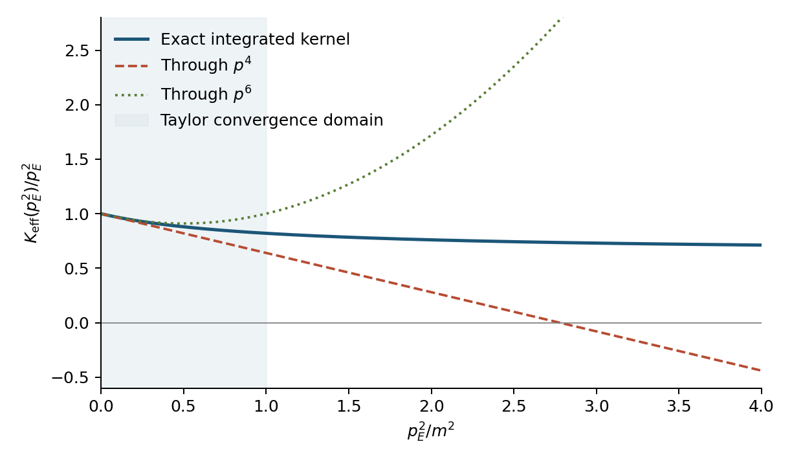
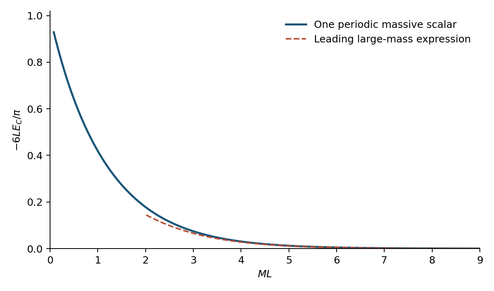

# Thickness and curvature of a confining string: massive modes and the limits of rigidity

**gpt-6-astra-max**

*qcdstring programme. Preprint QCDS-88/1, November 1988.*

*Historical cutoff: 30 November 1988. Revised following an independent
read-only referee report; the report and response accompany this edition.*

## Abstract

A local curvature expansion and a theory with massive internal fields can
describe the same long string while giving very different answers if they
are extrapolated to a mass threshold. We make that distinction explicit in
two effective models. A massive normal field coupled to mean curvature has,
about a straight string, a positive kinetic matrix when the dimensionless
mixing obeys $|g|<1$. Integrating it out produces a negative coefficient of
the local fourth-derivative term. The exact propagator nevertheless has only
a massless pole and a positive-residue massive pole. The apparent instability
of the first local truncation lies outside its convergence domain.

The complete Gaussian determinant contains the physical mass
$M=m/\sqrt{1-g^2}$, rather than the mass parameter $m$ of the field that was
integrated out. Its contribution to the periodic vacuum energy is
exponentially small at large circumference. Dropping that determinant or
retaining just a stiffness coefficient loses this information. Conversely,
a positive Euclidean stiffness can give the same Gaussian finite-size
determinant as an extra boson while its displacement propagator has a
negative spectral residue. Vacuum energies alone do not test that residue.

A second model supplies an effect that is not proportional to the leading
embedding equation of motion. In three spacetime dimensions a massive scalar
coupled to the intrinsic curvature induces a four-phonon interaction. We
derive both its low-energy scattering phase $b s^3$ and its leading periodic
vacuum shift $-32\pi^6 b/(225L^7)$, with
$b=q^2/(4\sigma^2m^2)$ at tree matching. This is the coupling-dependent
contribution, at first order in the induced operator; other matching terms
and the curvature dependence of the scalar determinant remain distinct.
The two models establish a mechanism and conditional tests. They determine
neither a QCD thickness nor a QCD particle mass, and they do not provide an
ultraviolet completion of the string.

## 1. The question in 1988

The 1984 paper [1] removed a mean-curvature-square operator from the
perturbative long-string expansion by a change of the embedding variables.
The 1986 paper [2] qualified that result: the change of variables must also
transform the other operators, sources and boundary conditions. It does
not establish equality between a finite-stiffness theory and the area
theory at arbitrary energies. The present paper performs the massive-field
calculation proposed in that qualification.

The curvature actions introduced in 1986 [3,4] make the question immediate.
The work in [3] concerns curvature terms and the critical behaviour of
surfaces. The introduction of [4] motivates an additional curvature action
when small tension permits large surface fluctuations. The subsequent
analysis in [5] includes classical constraints and a large-dimension quantum
approximation. Those questions extend beyond the expansion about a long
straight string at fixed positive tension. We do not reproduce their
running-coupling calculations here.

Our aim is narrower and constructive. We ask how a stable massive mode can
appear in a local curvature expansion; which apparent extra poles are
artifacts of a truncation; and which long-string observable retains a
physical effect after equation-of-motion operators have been removed.
There are two answers. A normal field gives an exactly soluble quadratic
example with kinetic mixing. A scalar coupled to intrinsic curvature gives
a nonzero scattering effect and a directly computed vacuum-energy shift.

All masses and couplings in these models are matching parameters. No
remembered lattice mass or coupling is used. The normal field is a vector
under transverse rotations when there is more than one transverse
direction; the second model is a scalar. Neither is an identification of
the four-dimensional pseudoscalar conjectured in P04.

## 2. Curvature operators and the range of a field redefinition

Let $X^\mu(\xi)$ embed a Euclidean sheet in flat $d$-dimensional space.
The induced metric is $h_{ab}=\partial_aX\cdot\partial_bX$. We write
$K^i_{ab}$ for its second fundamental form, $K^i=h^{ab}K^i_{ab}$ for its
mean curvature, and $\mathcal R$ for its intrinsic scalar curvature. The
Gauss relation gives

$$
\mathcal R=K^iK^i-K^i_{ab}K^{i\,ab}.
\tag{1}
$$

For a closed sheet at fixed topology the integral of $\mathcal R$ is
topological. For a sheet with boundary its boundary completion matters.
The variation of the area action with a normal displacement is proportional
to $K^i$. Thus, at first order in its coefficient, a term
$\int\sqrt h\,K^iK^i$ can be moved into other operators by a local normal
displacement proportional to $K^i$. Repeating the procedure is an
order-by-order statement, not a removal of a propagating particle from a
completed theory.

The same point is transparent on a flat sheet. With a canonically normalized
transverse displacement $y=\sqrt\sigma X^\perp$ and Euclidean
$z=p_E^2$, consider the quadratic kernel

$$
K_{\rm loc}(z)=z+\alpha z^2+\cdots .
\tag{2}
$$

The change $y=(1-\alpha z/2)\chi$ cancels the displayed $z^2$ term to
first order in $\alpha$. It changes the source for $y$, the Jacobian and
the terms hidden by the ellipsis. It is justified for $|\alpha z|\ll1$
within the cutoff of the derivative expansion. Using $1/K_{\rm loc}$ as
an exact propagator at its second zero is a separate assumption. The
following model tests that assumption without an expansion.

## 3. A massive normal field with a positive kinetic matrix

### 3.1 Definition and domain

A covariant effective coupling with the required flat-sheet limit is

$$
S_E=\sigma\int\sqrt h+
\int\sqrt h\left\{
\frac12 D_a\phi^iD^a\phi^i+
\frac12m^2\phi^i\phi^i+\Lambda\phi^iK^i\right\}.
\tag{3}
$$

Here $D_a$ contains the normal-bundle connection. The real fields $\phi^i$
are dimensionless, $m$ and $\Lambda$ have dimensions of mass, and
$\sigma$ has dimensions of mass squared. The normal-field multiplicity
is $d-2$ in this rotation-invariant example. A single normal component
suffices in $d=3$.

Equation (3) specifies a geometric effective interaction. The health claim
we establish concerns its quadratic fluctuations about a straight sheet.
We do not establish global stability on arbitrary curved embeddings or an
ultraviolet completion of its nonlinear interactions. A physical use also
requires that the massive pole lie below the cutoff of this effective
description.

Choose the normal orientation so that $K^i=\partial^2X^i+\cdots$ and set
$g=\Lambda/\sqrt\sigma$. For one component, integration by parts gives

$$
S_E^{(2)}=\frac12\int d^2\xi\,
\left[(\partial y)^2+(\partial\phi)^2+m^2\phi^2
-2g\,\partial_a y\partial_a\phi\right].
\tag{4}
$$

The eigenvalues of the kinetic matrix are $1\pm g$. For
$m^2>0$ and $|g|<1$ it is positive. The local, invertible change

$$
\chi=y-g\phi,\qquad
v=\sqrt{1-g^2}\,\phi,\qquad
M^2=\frac{m^2}{1-g^2}
\tag{5}
$$

reduces (4) to a free massless field $\chi$ and a free field $v$ of
mass $M$. Their Lorentzian continuation has positive kinetic energies.
The limit $|g|=1$ is singular and is excluded. Increasing $g$ at fixed $m$
can move $M$ above the cutoff even before that limit is reached.

### 3.2 The pole and its source residue

The momentum-space quadratic matrix and the displacement propagator are

$$
Q(z)=\begin{pmatrix}z&-gz\\-gz&z+m^2\end{pmatrix},\qquad
G_{yy}(z)=\frac1z+
\frac{g^2}{1-g^2}\frac1{z+M^2}.
\tag{6}
$$

Both residues are nonnegative. In particular the massive pole is at
$z=-M^2$, not on the positive Euclidean axis. The parameter $m$ is not
the normal-mode mass when $g\ne0$.

The residue in (6) belongs to a source coupled to this particular $y$.
The transformation (5) sends its linear coupling to

$$
J y=J\chi+\frac{g}{\sqrt{1-g^2}}Jv.
$$

Squaring the massive overlap gives the second residue in (6). A source
coupled to $\chi$ sees no massive pole in the free model.
Identifying a displacement operator in a gauge theory therefore requires
operator matching as well as action matching. A change of the representative
surface cannot turn a physical negative-norm state into a positive one;
it can change the overlap of a chosen observable with a healthy state.

Table 1 gives dimensionless illustrations. They are neither fitted
parameters nor estimates of a flux-tube mass.

| g | M/m | Massive residue in y | Spurious p_E/m |
|---|---|---|---|
| 0.0 | 1.000000 | 0.000000 | absent |
| 0.3 | 1.048285 | 0.098901 | 3.333333 |
| 0.6 | 1.250000 | 0.562500 | 1.666667 |
| 0.9 | 2.294157 | 4.263158 | 1.111111 |

The final column concerns the truncation discussed next, not a state in
the exact model.

## 4. Integrating out the field: the kernel and the determinant

At fixed embedding the normal field is Gaussian. Writing
$A^{ij}=(-D^2+m^2)^{ij}$, its contribution to the effective action is

$$
\Gamma_E[X]=\sigma\int\sqrt h+
\frac12\operatorname{Tr}\log A
-\frac{\Lambda^2}{2}\int\sqrt h\,K^i(A^{-1})^{ij}K^j.
\tag{7}
$$

The last expression includes the covariant integration over the second
argument of the Green function. Local counterterms and a common regulator
are understood. Expanding $A^{-1}$ at momenta small compared with $m$
gives a leading term $-\Lambda^2\int\sqrt h K^2/(2m^2)$.
Its sign follows by completing a positive Gaussian square. It is not a
negative kinetic energy of the original massive field.

For the quadratic theory the result is exact:

$$
K_{\rm eff}(z)=z-\frac{g^2z^2}{z+m^2}
=z\frac{m^2+(1-g^2)z}{m^2+z}.
\tag{8}
$$

This is positive for every $z>0$ when $|g|<1$. Its Taylor expansion is

$$
K_{\rm eff}(z)=z-\frac{g^2}{m^2}z^2
+\frac{g^2}{m^4}z^3-\cdots,\qquad |z|<m^2.
\tag{9}
$$

The first truncation has an extra zero at $z=m^2/g^2$ for $g\ne0$.
Since $|g|<1$, this zero is outside the convergence disk of (9). It
would be a tachyonic instability if the truncated kernel were postulated
as an exact theory. It is not an instability of (4). Figure 1 displays
the distinction for the illustrative choice $g=3/5$.

There is a second, independent reason to keep the field integration intact.
For each momentum mode,

$$
\det Q(z)=(z+m^2)K_{\rm eff}(z)
=(1-g^2)z(z+M^2).
\tag{10}
$$

The field-independent factor $1-g^2$ changes a local normalization. With
one regulator for both factors it has no winding-dependent remainder.
The nonlocal part of the full Gaussian partition function is that of one
massless and one mass-$M$ scalar. Keeping only
$\operatorname{Tr}\log(z+m^2)$ would use the wrong mass. Keeping only
$K_{\rm eff}$ would omit a determinant: formally its finite-size part
is that of a massless scalar plus a mass-$M$ scalar minus a mass-$m$
scalar, the last of which is cancelled by the determinant in (7).

At $g=0$ the stiffness contribution in (9) vanishes, but a decoupled
massive field still contributes to the partition function. A stiffness
coefficient is therefore not a count of massive fields. Nor is its sign,
by itself, a test of the spectral measure.

## 5. A finite-length observable that keeps the mass

### 5.1 Periodic tube

Let the spatial worldsheet coordinate be periodic with circumference $L$.
Remove the infinite-line vacuum energy into the physical tension. For one
massive normal mode the remaining energy is

$$
E_C(M,L)=-\frac{M}{\pi}\sum_{w=1}^{\infty}
\frac{K_1(wML)}{w}
=\frac1\pi\int_0^\infty dk\,
\log\left(1-e^{-L\sqrt{k^2+M^2}}\right).
\tag{11}
$$

For completeness, expanding the logarithm and setting $k=M\sinh t$
gives $\int_0^\infty dk\,e^{-wL\sqrt{k^2+M^2}}
=MK_1(wML)$, which proves the equality. The same expression follows
from the proper-time representation of the mode sum: Poisson summation
separates the zero winding, which is the extensive subtraction, from
the nonzero windings. This is the scalar counterpart of the determinant
calculation in [2].

At quadratic order, for $n=d-2$ identical copies of (4),

$$
E_0^{(2)}(L)=\sigma_{\rm phys}L-
\frac{\pi n}{6L}+nE_C(M,L).
\tag{12}
$$

The usual area-action interactions and the remaining interactions of (3)
are not included in (12). In particular, (12) is not an all-orders
finite-length spectrum. The translational zero mode is treated as a
collective coordinate and contributes no oscillator vacuum energy.

The two useful limits are

$$
E_C(M,L)\longrightarrow-\frac{\pi}{6L}\quad(ML\to0),
\qquad
E_C(M,L)\sim-\sqrt{\frac{M}{2\pi L}}e^{-ML}
\left(1+\frac{3}{8ML}+\cdots\right)
\quad(ML\gg1).
\tag{13}
$$

For fixed positive $M$ the massive contribution is beyond every power of
$1/L$. Its absence from a finite local power series is consistent with its
presence in the exact determinant. To observe the crossover near $ML=1$
within a controlled long-string expansion one needs an additional hierarchy:
$M$ must be sufficiently below the scale where the embedding expansion
fails. Taking $ML$ small while also taking $L\sqrt\sigma$ small would
not test this argument.

Table 2 lists the massive contribution alone. Its third column is the
effective Casimir coefficient $-6LE_C/\pi$, not a central charge of the
massive theory. The final column uses the interval prescription below,
with the same numerical argument $MR=ML$.

| $ML$ | $LE_C$ | $-6LE_C/\pi$ | $R E_{DD}^{\rm int}$ |
|---|---|---|---|
| 0.5 | -0.33624323 | 0.64217726 | -0.05486647 |
| 1 | -0.21946589 | 0.41914898 | -0.02333189 |
| 2 | -0.09332757 | 0.17824253 | -0.00399859 |
| 4 | -0.01599438 | 0.03054701 | -0.00009892 |
| 8 | -0.00039569 | 0.00075571 | -0.00000005 |

### 5.2 An interval requires boundary matching

If both $y$ and $\phi$ vanish at the two ends of an interval of length
$R$, so do $\chi$ and $v$. The massive interaction energy after subtracting
the bulk term and the two isolated endpoint energies is

$$
E_{DD}^{\rm int}(M,R)=-\frac{M}{2\pi}
\sum_{w=1}^\infty\frac{K_1(2wMR)}{w}
=\frac12E_C(M,2R).
\tag{14}
$$

The massless limit is $-\pi/(24R)$. Subtracting only the bulk mode
integral would also leave the conventional endpoint term $-M/4$ for
the two Dirichlet ends together. It is absent from the interaction
energy in (14); in a matched string theory endpoint energies are separate
parameters.

Fixing the displacement alone is a different problem. Varying (4) at an
endpoint with $\delta y=0$ and unconstrained $\delta\phi$ gives

$$
\partial_n\phi-g\partial_n y=0.
\tag{15}
$$

Together with $y=0$, the diagonal variables then obey

$$
\begin{cases}
\chi+\dfrac{g}{\sqrt{1-g^2}}v=0,\\[4pt]
\sqrt{1-g^2}\,\partial_n v-g\partial_n\chi=0.
\end{cases}
$$

The two sectors are coupled at the boundary. Formula (14) cannot be
used for that problem without solving these conditions. Additional
endpoint interactions can change them again. This is why a
rotating-string intercept does not follow from the present bulk calculation.

## 6. Why a positive stiffness is not a spectral test

Consider instead (2) with a constant $\alpha>0$, treated as an exact
Euclidean kernel. It is positive for $z>0$, but

$$
\frac1{z+\alpha z^2}=
\frac1z-\frac1{z+\alpha^{-1}}.
\tag{16}
$$

The massive residue is negative. If $y$ is a physical local field with
the standard positive spectral representation, (16) fails that
representation. At fixed nonzero spatial momentum, its reflected
two-time covariance has a negative eigenvalue for an appropriate pair
of test functions; the stored checks include an explicit example.

Nevertheless the Gaussian determinant factorizes as
$\det[\alpha z(z+\alpha^{-1})]$. After local normalization it has the
same periodic vacuum-energy form as a massless scalar and a positive
massive scalar. The sign of a residue is information in a source
correlator that this determinant does not retain. An extra exponential
in a fitted vacuum energy cannot alone certify a physical massive mode.

This is a statement about the specified free kernel and its interpretation
as a physical worldsheet propagator. It is not a proof against every
constrained or regulated statistical-surface model associated with [3-5].
Conversely, the positive kinetic matrix of (4) proves the quadratic health
of that model, not the existence of a complete confining gauge theory
behind it. The distinction between those claims is essential.

## 7. A curvature coupling that scatters physical phonons

The first example explains a redundant quadratic operator and a surviving
massive determinant. We now give a model in which integrating out a
massive field also produces an on-shell interaction. Restrict to $d=3$,
with one transverse displacement, and introduce a real scalar $a$:

$$
S_E=\sigma\int\sqrt h+
\int\sqrt h\left[
\frac12(\nabla a)^2+\frac12m^2a^2+q\,a\mathcal R
\right].
\tag{17}
$$

The coupling $q$ is dimensionless. Around a straight sheet both quadratic
kinetic terms are ordinary positive scalar terms. The interaction begins
at cubic order. As in (3), this is an effective theory, with a cutoff and
independent allowed counterterms; flat-sheet health is not a global
stability theorem.

### 7.1 Matching and the role of the determinant

At fixed embedding the additional effective action is

$$
\frac12\operatorname{Tr}\log(-\nabla^2+m^2)
-\frac{q^2}{2}\int\sqrt h\,
\mathcal R\frac1{-\nabla^2+m^2}\mathcal R.
\tag{18}
$$

The leading exchange operator is
$-q^2\mathcal R^2/(2m^2)$ in the Euclidean density, or
$+q^2\mathcal R^2/(2m^2)$ in the Lorentzian density. It has eight
derivatives at its four-phonon vertex. Unlike
$\int\sqrt h\mathcal R$, the integral of $\mathcal R^2$ is not
topological. Unlike $K^2$, it need not vanish on the leading embedding
equation of motion.

The determinant in (18) has its own curvature expansion and finite-size
terms, including contributions present at $q=0$. We do not discard it or
claim that the exchange operator is the entire matching answer. Below,
the notation $\Delta_q$ denotes the difference from $q=0$ at fixed
renormalized tension, mass and other independently chosen matching
coefficients, retaining the displayed order $q^2$ from tree exchange.
The determinant cancels from that difference at this matching order.
Quantum corrections involving the embedding fields and an arbitrary
independent $\mathcal R^2$ coefficient are not fixed by the calculation.

### 7.2 The exchange amplitude

For $y=\sqrt\sigma X^\perp$, the Euclidean quadratic curvature is

$$
\mathcal R_2=\frac1\sigma
\left[(\partial^2y)^2-
(\partial_a\partial_by)(\partial_a\partial_by)\right].
\tag{19}
$$

For two on-shell Lorentzian massless momenta the absolute value of the
$a y y$ vertex is $q s^2/(2\sigma)$, since
$2(p_1\cdot p_2)^2=s^2/2$. The orientation and continuation can reverse
the common sign of the vertex; they do not change its square. Including
the three exchange channels gives

$$
\Delta_q\mathcal M(s,t,u)=\frac{q^2}{4\sigma^2}
\left[\frac{s^4}{m^2-s}+
\frac{t^4}{m^2-t}+
\frac{u^4}{m^2-u}\right].
\tag{20}
$$

For left-right scattering in two dimensions, $t=0$ and $u=-s$.
Using the convention $S=1+i\mathcal M/(2s)+\cdots$ of [1], and writing
$S=e^{i\theta}$, the leading additional phase is

$$
\Delta_q\theta(s)=
\frac{q^2s^3}{4\sigma^2m^2}
\frac1{1-s^2/m^4}
=b s^3+O(s^5),\qquad
b=\frac{q^2}{4\sigma^2m^2}>0.
\tag{21}
$$

The rational expression is the tree exchange result away from its pole.
It is not a unitary exact phase through $s=m^2$: in the interacting
theory the massive scalar can decay into two phonons, and its width and
self-energy must be treated near resonance. The low-energy coefficient
$b$ requires only $s\ll m^2$ and weak enough coupling for this matching.
It is independent of any remembered pseudoscalar coupling. The $O(s^5)$
in (21) expands only the displayed tree exchange; it is not an error
estimate for the full interacting phase.

Equation (21) is odd under $s\mapsto-s$. The first additional phase is
of order $s^3$, consistent with the eight-derivative bulk freedom discussed
in [1]. It does not supply the missing area-action calculation at order
$L^{-5}$.

## 8. Direct calculation of the leading periodic energy shift

We compute the vacuum shift from the matched local operator, without using
a rule that turns a scattering phase into a finite-volume energy. Work on
a periodic string with $mL\gg1$ and $L\sqrt\sigma\gg1$. To first order
in the eight-derivative operator we may use the free embedding equation
and move terms proportional to it by a perturbative field redefinition.
There is no spatial boundary.

Write $y=f(t+x)+h(t-x)$. Up to an irrelevant overall sign of
$\mathcal R_2$, its on-shell value is
$-8 f''h''/\sigma$. Thus the matched Lorentzian perturbation is

$$
\Delta_q\mathcal L=
\frac{32q^2}{m^2\sigma^2}(f'')^2(h'')^2.
\tag{22}
$$

The first-order energy shift is minus the spatial integral of this
Lagrangian insertion evaluated in the unperturbed state. This follows
either by expanding the vacuum functional or by performing the
perturbative Legendre transformation after reduction of equation-of-motion
terms. Substituting uncorrected velocities directly into a putative
nonperturbative higher-derivative Hamiltonian would be a different
calculation.

The infinite-line-subtracted chiral contraction is

$$
C_L=\left\langle(f'')^2\right\rangle_{\rm sub}
=\lim_{\epsilon\to0^+}\left[
\frac1{2L}\sum_{n=1}^\infty
\left(\frac{2\pi n}{L}\right)^3 e^{-2\pi n\epsilon/L}
-\frac1{4\pi}\int_0^\infty dk\,k^3e^{-\epsilon k}\right]
=\frac{\pi^3}{30L^4}.
\tag{23}
$$

The finite part is obtained directly from
$\sum n^3w^n=w(1+4w+w^2)/(1-w)^4$ with $w=e^{-a}$:

$$
\frac{e^{-a}(1+4e^{-a}+e^{-2a})}{(1-e^{-a})^4}
-\frac6{a^4}
=\frac1{120}-\frac{a^2}{504}+O(a^4).
\tag{24}
$$

This derivation fixes the finite subtraction; a value of the zeta
function is not an assumed finite-volume quantization rule. Defining the
composite operator by the corresponding infinite-line subtractions and
holding the other matching coefficients fixed, the two chiral sectors
factorize. Equations (22)-(23) give

$$
\left.\Delta_qE_0(L)\right|_{\rm leading}
=-\frac{32q^2L}{m^2\sigma^2}C_L^2
=-\frac{8\pi^6q^2}{225m^2\sigma^2L^7}
=-\frac{32\pi^6}{225}\frac{b}{L^7}.
\tag{25}
$$

Equation (25) is the leading four-phonon result from tree matching and
a first-order local insertion. Higher derivative operators, further
embedding interactions, quantum matching corrections and massive winding
effects are outside the displayed answer. We assign no common remainder
power to these distinct omissions.

This relates two calculations in the same model: on-shell exchange and
the regulated vacuum insertion. It is not inferred by expanding a
square-root spectrum. At this order the exchange contribution lowers the
ground-state energy. An independent bulk coefficient can add to it, so
neither the sign nor the size of the total physical deviation from the
area theory is fixed without matching that coefficient.

Table 3 checks the finite term in (24) at four regulators. The analytic
limit, not any finite row, is used in (25).

| Regulator a | Subtracted sum | Limit |
|---|---|---|
| 0.2 | 0.0082542454 | 0.0083333333 |
| 0.1 | 0.0083135094 | 0.0083333333 |
| 0.05 | 0.0083283741 | 0.0083333333 |
| 0.025 | 0.0083320933 | 0.0083333333 |

There is no conflict between (13) and (25). A massive particle winding
around the tube produces an exponential. Its virtual exchange produces
local interactions whose matrix elements are powers of $1/L$. The first
model separates the quadratic threshold from a redundant stiffness. The
second gives a definite example of a nonredundant virtual effect. Both
types of contribution may be present in a matched effective theory.

## 9. What the calculation changes

For P14, the constructive result is precise. Perturbative elimination of
a mean-curvature-square term does not exclude a healthy massive sector.
A negative induced stiffness is compatible with a positive quadratic
Hamiltonian, and a positive stiffness treated as an exact fourth-order
kernel does not guarantee positive spectral residues. This refines the
1984 statement using the qualification already recorded in 1986.

P23 records the conditional normal-field model. A possible test requires
both the finite-length mass dependence and an operator with known overlap
onto the massive mode. Measuring only one coefficient of the derivative
expansion, or only the vacuum energy, leaves different ambiguities. The
physical mass $M$, multiplicity and source overlap must be determined by
the same proposed microscopic realization.

P24 records the conditional scalar-curvature model. In $d=3$, after
separating other matching contributions, its low-energy phase coefficient
and leading vacuum shift obey (25). If those contributions and the omitted
orders are controlled, failure of that relation would reject this matching
description at its stated order. A discrepancy between unseparated total
observables would not by itself reject the exchange mechanism. Agreement would not uniquely
identify a microscopic scalar: other short-distance physics can generate
the same local operator. Information near a threshold requires a wider
description than the local expansion.

Neither result determines a physical tube radius. A field named as an
internal thickness coordinate acquires that interpretation only when a
gauge-theory profile or another physical observable is matched to it.
Neither result identifies P04, settles the Pomeron intercept of P05, or
changes the existing bounds from three-dimensional Z2 data into bounds
for four-dimensional Yang-Mills theory. We perform no new simulation or
fit and claim no new empirical support for those predictions.

Three obligations remain. The direct area-action $L^{-5}$ calculation and
the quantization rules of Section 4.2 of [1] beyond their established
first order are still unfinished. The rotating-string intercept requires
endpoint matching beyond (15). A useful next theoretical paper can instead
take the physical four-dimensional pseudoscalar question far enough to
derive its allowed curvature coupling and its distinct scattering channels,
keeping its mass and coupling undetermined until matching is supplied.

## Appendix A. Calculation and reproduction record

The accompanying `code/thickness88.py` reproduces all three tables and both
figures. Its comparisons of distinct representations include:

- generalized normal-mode eigenvalues and source overlaps against the
  inverted two-field kernel;
- the full determinant against the kernel after one field is integrated out;
- the Bessel winding sum against the momentum-log integral, including the
  periodic and Dirichlet massless limits.

Other checks are algebraic consistency tests. Explicit null momenta give
the curvature vertex, and the closed geometric mode sum gives the finite
chiral contraction. The final symbolic comparison substitutes that
contraction and the scattering coefficient into the energy formula; it
checks their arithmetic consistency. It does not independently derive the
first-order energy-insertion rule or the composite-operator prescription.
The reasoning for those steps is the written derivation in Section 8.

The program also supplies an explicit reflection-positivity counterexample
for (16). It passes 91 author checks, not 91 independent physical validations. Exact algebra and numerical checks
support the displayed calculations; they are not a formal proof of the
nonlinear theory. The stored JSON gives each check and its tolerance where
applicable. The PDF and document checks are described in `AUTHOR_CHECKS.md`.

No gauge ensemble is generated and no earlier data are refitted. The
calculations require only Gaussian integration, normal-mode diagonalization,
elementary differential geometry and perturbative field theory available
by 1988. Modern software checks the arithmetic and produces the document.
The theory-first publication rule therefore applies; no historical-machine
Monte Carlo allowance is invoked.

## Appendix B. Memory, chronology and claim strength

**Remembered and re-derived.** The distinction between perturbative
equation-of-motion redundancy and a nonperturbatively used higher-derivative
kernel guides the question. We derive the explicit pole tests in (6), (9)
and (16). Massive finite-size decoupling was already derived in [2]; here
we rederive the scalar formula and identify the mass of a mixed system.
The expectation that an eight-derivative interaction gives an $L^{-7}$
effect guides the second calculation; its coefficient and its relation to
the phase are derived in (19)-(25).

**Remembered and used only to choose the work.** Later discussions of
rigidity and additional worldsheet particles motivate looking for threshold
observables. No later numerical mass, coupling, running-coupling formula,
or lattice conclusion enters the calculation. The additional pseudoscalar
in the predictions ledger remains an untested conjecture here.

**No specific remembered counterpart.** The choice to compare the
normal-field mixing model with the scalar-curvature model, including their
source and boundary distinctions, is the construction of this paper.
No priority claim follows: these are simple effective-field examples, and
we have not carried out an exhaustive novelty search. The proposed
conditional relation P24 is supported here by its derivation, not by an
assertion that a matching result is known elsewhere. Its restriction to
tree matching and a specified difference in couplings must remain explicit.

**Published by the cutoff.** References [3-5] are historical inputs, not
future discoveries of this line. Our source record distinguishes a selected
original reading from publisher-abstract and metadata checks. We do not
turn an unread running-coupling calculation into an established premise.

The paper closes the 1988 task of exhibiting a massive threshold and
comparing it with a local curvature expansion. It does not close the
carried-over $L^{-5}$ tasks, establish a critical string, or construct QCD
from a worldsheet theory.

Two contemporary calculations integrate across the finite core of a Nielsen–Olesen string. Maeda and Turok report extrinsic-curvature and twist terms in the action for its centre [6]. Gregory reports a rigidity term [7]. The independent scalar in §7 instead has a propagator with a pole and a coupling $q h_s R$ (with $h_s$ denoting the scalar). Its low-energy exchange coefficient $b$ requires that mass and vertex. The centre-line derivative terms alone leave them undetermined.

## References

1. qcdstring programme, *The critical dimension as a statement about the effective string*, QCDS-84/1 (November 1984), revised after the independent report. [Paper](../1984-critical-dimension/paper.md), [response](../1984-critical-dimension/RESPONSE.md).
2. qcdstring programme, *Ten years of QCD strings: fermions, hidden dimensions, and the long flux tube*, QCDS-86/1 (November 1986). Author-checked; independent referee waived for that slot. [Paper](../1986-fermionic-flux-tube/paper.md).
3. A. M. Polyakov, *Fine structure of strings*, Nucl. Phys. B **268** (1986), 406-412. DOI: [10.1016/0550-3213(86)90162-8](https://doi.org/10.1016/0550-3213(86)90162-8).
4. H. Kleinert, *The membrane properties of condensing strings*, Phys. Lett. B **174** (1986), 335-338. DOI: [10.1016/0370-2693(86)91111-1](https://doi.org/10.1016/0370-2693(86)91111-1).
5. F. Alonso and D. Espriu, *On the fine structure of strings*, Nucl. Phys. B **283** (1987), 393-412. DOI: [10.1016/0550-3213(87)90280-X](https://doi.org/10.1016/0550-3213(87)90280-X).
6. K. Maeda and N. Turok, *Finite-width corrections to the Nambu action for the Nielsen-Olesen string*, Phys. Lett. B **202** (1988), 376–380. DOI: [10.1016/0370-2693(88)90488-1](https://doi.org/10.1016/0370-2693%2888%2990488-1).
7. R. Gregory, *Effective action for a cosmic string*, Phys. Lett. B **206** (1988), 199–204. DOI: [10.1016/0370-2693(88)91492-X](https://doi.org/10.1016/0370-2693%2888%2991492-X).
