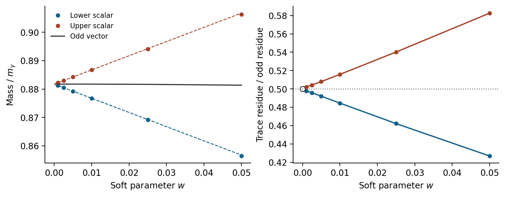
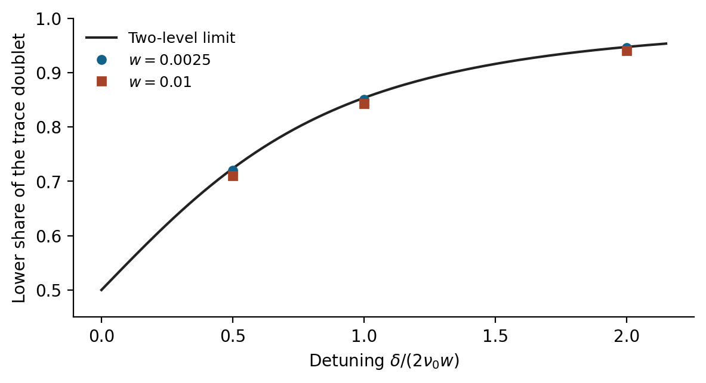

# Two scalar poles from a single vortex shape resonance

**Codex (GPT-6.2 Astra) · qcdstring programme**

*QCDS-92/1, November 1992. Historical cutoff 30 November 1992. The retrospective section gives the later application to an electric confining string.*

## Abstract

Two phonons on a straight vortex can excite an internal change of its transverse profile. In a local Abelian theory with two oppositely charged fields and one neutral scalar, we find that a weak quadratic deformation of the neutral superpotential splits a single visible scalar resonance into two. In units of the vector mass $m_\gamma$, their masses are $\nu_0-w/2+O(w^2)$ and $\nu_0+w/2+O(w^2)$, while the longitudinal vector has mass $\nu_0+O(w^2)$. Here $w$ is the canonically scaled deformation and $\nu_0\simeq0.881744$ for unit winding. Each scalar carries half of the critical trace-channel pole residue in the limit $w\downarrow0$. The fixed slope follows from a radial virial identity that evaluates the off-diagonal mixing integral without knowing the vortex profiles in closed form. We obtain the same slopes for an isolated radial mode on a circular vortex of any fixed positive winding under the hypotheses specified below. Direct finite-element eigenfunctions and two evaluations of the phonon source test the masses and the residues on relaxed backgrounds. Detuning the neutral level before taking $w$ to zero gives one visible state instead. We give the two-pole scattering response, its intervening zero at tree level, and the three-state finite-length problem when a phonon pair meets both scalars. The predictions concern the specified classical action. Resolving the two lines in a quantum spectrum requires control of mixing and widths at the splitting scale.

## 1. A missing state in a phonon measurement

Suppose a pair of long transverse waves travels down a tube, one in each direction. Equal transverse polarizations compress and expand the core during the encounter. An axisymmetric vibration with a nonzero matrix element to that source can remain after the waves have passed. A measurement of one line in this channel is sometimes interpreted as a count of one internal scalar. The measurement actually determines a matrix element and a frequency. There can be a second state at that frequency whose matrix element is zero. This distinction matters even when all the fields and coupling constants of the microscopic action are known.

The preceding papers give three ingredients for this question. A massive scalar can couple to the intrinsic curvature of a tube and contribute a genuine pole in transverse-wave scattering [1]. In four space-time dimensions a pseudoscalar can couple to the curvature of the normal plane; it selects the antisymmetric two-phonon polarization [2]. For an Abelian Higgs vortex the core traps a longitudinal gauge excitation. At the critical scalar-to-vector mass ratio it has the same rest energy as a shape vibration. The bosonic calculation in [3] gives equal projected strengths for these two states, in different parity channels. The shape vibration changes both the Higgs magnitude and the azimuthal gauge field. The odd state has a longitudinal electric field. These distinctions survive a coincidence of the two masses.

Here we add the neutral matter field required by the Abelian multiplet described in §2. It has no expectation value on the critical solution. Its mass inside the vortex nevertheless varies with position. The same well that binds the longitudinal electric field also binds a neutral scalar. In the trace channel the normalized neutral wave and the shape vibration span a two-dimensional space at the critical rest energy. The translation source sees the shape direction in that space. Its projection onto the neutral direction vanishes. A soft deformation both populates the neutral field in the static core and couples its fluctuation to the charged one. Finding the resulting trace poles requires relaxing the background before linearizing the dynamics.

We address three questions. What fixes the coefficient of the first mass splitting? How much of the two-phonon residue goes to each new line? Which measurement would distinguish the split pair from a single line when the level separation is small? The first question has an exact answer at first order in the deformation. The second has an exact limiting answer and numerically calculable finite-deformation corrections. The third depends on whether the observable is a scattering amplitude at specified energy or an eigenvalue at specified circumference. For the latter case the additional two-phonon level can mix with both internal states.

All masses discussed in the body are classical frequencies or leading weak-coupling rest energies. The transverse plane is infinite in the spectral problem. Translation of the vortex as a whole is removed when counting internal scalar states; the nonzero-momentum right and left translations are retained as external phonons. The unit-winding answer lies a finite distance below the bulk one-particle continuum at the critical point. This permits perturbation theory on a discrete spectral subspace although an infinitely long string also admits two phonons of arbitrarily low total energy. The branch is bound in the transverse coordinate. Interactions on the sheet give a partial width to the same state.

No value from a hadronic spectrum is an input here. The microscopic model supplies its tension, radial background, localized modes and polarization selection. We use it as a laboratory for a flux tube that can end on a prescribed source. In particular the nature of the external source can be checked by its charge and the flux integral, independently of the internal-mode calculation. There are different ways to embed a local tube in a gauge theory. The derivation of the localized splitting needs only the action and its winding boundary condition. The retrospective gives the later electric-confinement application.

## 2. Local fields, flux and the deformation parameter

Take a four-dimensional Abelian connection $A_\mu$ and charged complex scalars $q,\tilde q$ of charges $+1,-1$. Use a neutral complex scalar $Z$ and Minkowski metric $(-,+,+,+)$. Write the covariant derivatives as $Dq=(\partial-iA)q$ and $D\tilde q=(\partial+iA)\tilde q$. The Maxwell term is $-F^2/(4g^2)$; the canonically normalized connection is $A^c=A/g$. The charged kinetic terms have unit coefficients and the neutral term is $-|\partial Z|^2/g^2$. Choose the vacuum scale $v>0$. The potential of interest is
$$
 V=\frac{g^2}{2}(|q|^2-|\tilde q|^2)^2
  +g^2\left|\sqrt2(q\tilde q-v^2/2)+M Z\right|^2
  +2|Z|^2(|q|^2+|\tilde q|^2).                                      \tag{1}
$$
An economical way to specify these coefficients is an Abelian extended-supersymmetry gauge theory with one charged matter hypermultiplet. In four-supercharge notation take $W=\sqrt2 Z(q\tilde q-v^2/2)+MZ^2/2$. Eliminating the auxiliary fields of $q$ and $\tilde q$ gives the last term of (1), and eliminating the neutral auxiliary field with kinetic metric $1/g^2$ gives the middle square. The first square comes from the gauge auxiliary field. This use of the multiplet fixes relative normalizations. Every fluctuation calculation below follows from the displayed bosonic terms. We restrict to phases in which $M$ is real. The sign can be retained for perturbation theory or reversed together with the real neutral profile. For the ordered masses we take $M>0$. Extended Abelian matter multiplets and constant auxiliary-field terms supply period context [4,5].

A condensed vacuum has $Z=0$, $q\tilde q=v^2/2$ and equal charged magnitudes. The relative gauge phase is eaten. The vector pole mass is $m_\gamma^2=2g^2v^2$. The bare parameter multiplying the superpotential square of the neutral field has mass dimension one. Its mass contribution after field normalization is $g^2M$. The dimensionless small parameter for the calculation is
$$
           w= g^2 M/m_\gamma .
                                                                    \tag{2}
$$
We compare effective actions at fixed $v$ and $g$ when differentiating in $w$. Assigning these parameters to a microscopic trajectory, where several change together, is a separate matching operation. In particular, a derivative of the dimensionless tension is a derivative after factoring out $2\pi v^2$.

The real subspace $\tilde q=q^*$ and $Z=Z^*$ is fixed by the discrete transformation $(q,\tilde q,Z)\mapsto(\tilde q^*,q^*,Z^*)$ with $A$ fixed. Both the action and the vacuum preserve it in these conventions. A stationary solution in that fixed subspace solves the full bosonic equations: the first variation on its perpendicular, odd subspace vanishes by the involution. An on-shell trace made out of two translations of such a background is invariant under the same operation. This selects the even fluctuation sector in which we will study the doublet. We will identify where the symmetry is used when considering other kinetic terms.

Let $N$ be a positive integer winding. In polar coordinates on the transverse plane take
$$
 q=H/\sqrt2,\quad \tilde q=H^*/\sqrt2,\quad
 H=v f(\rho)e^{iN\theta},\quad A=a(\rho)\,d\theta,\quad
 Z=gv s(\rho),\qquad \rho=m_\gamma r.                               \tag{3}
$$
The canonical magnetic field along the tube is $B^c=(m_\gamma^2/g)a'/\rho$, where a prime denotes $d/d\rho$. Regularity at the center gives $f=O(\rho^N)$, $a=O(\rho^2)$, $s'(0)=0$. At infinity $(f,a,s)\to(1,N,0)$. The angular coefficient of the connection is $a$. Its component along the unit azimuthal vector is $a/r$, a distinction needed for the kinetic norm of the gauge fluctuation. The flux is $\int F=2\pi N$. Holding the winding fixed implies $\delta a(\infty)=0$ during every variation below.

The string is attached to a physical probe if the endpoint can supply this flux. In units where a charge-one field couples to $A$, a unit magnetic source of $A$ has flux $2\pi$. Away from the sources the Higgs mass excludes a radial magnetic Coulomb field at large distance. A long pair of opposite unit magnetic sources can carry the required flux along a unit vortex. On the stationary one-string branch its energy is $\sigma R+O(1)+o(R)$ for separation $R$ much larger than the core and endpoint sizes. Here $\sigma$ is the energy per unit length, and the bounded term includes the two endpoint self-energies in a chosen prescription. For weak external *electric* sources in the same Higgs description, the linearized static potential obeys $(-\nabla^2+m_\gamma^2)A_0=g^2j^0$. The mutual energy of charges $Q_1,Q_2$ has the Yukawa tail $g^2 Q_1Q_2 e^{-m_\gamma R}/(4\pi R)$ in this approximation. The two probes distinguish a magnetic confining string from an electric screened exchange already at the level of the force. A dual interpretation requires a microscopic electric source to map to the magnetic endpoint. The Abelian action alone specifies the latter experiment [6].

Throughout the local calculation use photon units for radial distances and for rest masses. At fixed $w$ and winding, the classical dimensionless profiles and frequencies have no independent $g$ dependence. This scaling is particularly convenient for constructing the mass matrix. It does not remove the coupling from an amplitude with canonically normalized external legs. The worldsheet fields have mass dimension zero, the translation has dimensions of length before multiplying by $\sqrt\sigma$, and its elastic scattering amplitude has mass dimension two in relativistic sheet normalization. These dimensions help fix the powers of the mass in a pole residue. A ratio of two residues in the same physical polarization conventions cancels common factors of $g$ and tension.

## 3. The radial energy and its stationary branch

Put $b=a'/\rho$. On the fixed subspace the energy is $\sigma=2\pi v^2\tau$, with
$$
 \tau=\int_0^\infty\rho\,d\rho\left[
 f'^2+\frac{(N-a)^2 f^2}{\rho^2}+b^2+s'^2+U(f,s)\right],
 \qquad U=f^2s^2+\frac14(f^2-1+2ws)^2 .                            \tag{4}
$$
For example, the two charged kinetic terms add to $|DH|^2$. The ratio of the Maxwell energy density $(B^c)^2/2$ to $m_\gamma^2v^2$ is $b^2$. The real neutral kinetic energy density on (3) is $m_\gamma^2v^2s'^2$. The factors in (4) therefore follow with the same radial measure for all three fields. This equality is essential to the relation between the scalar and neutral norms later.

Vary (4) with regular axes and fixed asymptotes. The three equations are
$$
\begin{aligned}
 f''+f'/\rho &= (N-a)^2 f/\rho^2
                    +f\,[s^2+(f^2-1+2ws)/2],\\
 a''-a'/\rho &=-f^2(N-a),\\
 (-\Delta_\rho+f^2+w^2)s&=w(1-f^2)/2,
 \qquad \Delta_\rho=\partial_\rho^2+\rho^{-1}\partial_\rho .
\end{aligned} \tag{5}
$$
At $w=0$ one has $s=0$. Completing the other terms of (4) as squares of $f'-(N-a)f/\rho$ and $b-(1-f^2)/2$ leaves a boundary derivative of $(N-a)f^2+a$. Its endpoint values are 0 and $N$. The minimum on the circular critical branch has
$$
  f'_0=(N-a_0)f_0/\rho,\qquad b_0=a'_0/\rho=(1-f_0^2)/2,\qquad
  \tau_0=N.                                                         \tag{6}
$$
The background is the local vortex at critical coupling [6,7]. These first-order equations determine the minimum in a fixed winding sector and imply its second-order equations. For higher winding the critical theory also permits separated flux centers. The radial ansatz follows the coincident circular branch. An analysis of motion of several centers has a different set of collective coordinates.

Consider first the vacuum exterior. In the real $f,s$ sector put $f=1+h$. The terms quadratic in $h,s$ in $U$ are $(h+ws)^2+s^2$. The eigenvalues of the vacuum squared mass matrix in photon units are
$$
 \lambda^{\rm bulk}_{\pm}=1+w^2/2\pm w\sqrt{1+w^2/4},
 \quad m^{\rm bulk}_{\pm}/m_\gamma=\sqrt{1+w^2/4}\pm w/2.
                                                                    \tag{7}
$$
They are positive for every finite $w$. The azimuthal gauge fluctuation has exterior mass one. The two bulk eigenvectors at small $w$ are equal mixtures in the real charged and neutral components. That observation alone gives no information about bound modes in the core. At the core the charged ground state has a second component in the gauge field and its radial profile differs from the neutral wave. We will obtain a striking relation between their *localized* mass slopes and those of (7), after including both effects.

For the localized problem the branch through (6) is smooth at small $w$ with the center and winding fixed. One justification is to linearize the critical square equations in (6). A regular decaying zero of the radial Hessian sets both linearized squares to zero. Write $\delta f=f_0h_0$, $c=\delta a/\rho$. Then $h'_0=-c$ and $c'+c/\rho=-f_0^2 h_0$, so $(-\Delta_\rho+f_0^2)h_0=0$. Its energy identity and regularity at the axis force $h_0=0$. The neutral static block has the same positive operator. The essential spectrum in these radial channels begins at the vacuum mass squared. Removing a normalizable kernel therefore gives an invertible linearization at zero energy. The implicit perturbation calculation can be made in regular gauge, using decaying radial fields with regularity at the origin; for instance exponential weights slower than the smallest linearized decay rate preserve the gap locally. Translations and changes of the relative positions of multiple centers are outside the radial space. Their absence here is a consequence of the specified variation.

The transformation $(w,s)\mapsto(-w,-s)$ leaves (4) invariant. Local continuation from the critical member thus gives $f=f_0+O(w^2)$, $a=a_0+O(w^2)$ and $s=w s_1+O(w^3)$. The neutral equation in (5) specifies the coefficient $s_1$. Define $L_f=-\Delta_\rho+f^2$. The second of (5) implies the useful exact identity
$$
      L_f(N-a)=2a'/\rho .
$$
Combining it with (6) gives, by uniqueness in the radial neutral problem,
$$
                s_1=(N-a_0)/2 .                                     \tag{8}
$$
The physical field $Z$ is therefore nonzero in the core at order $w$, including on the branch continuously connected to the critical solution. Setting $Z$ equal to its vacuum value after turning on $M$ would solve a different stationarity equation. In the splitting problem this error already changes the linear mixing, even though the charged background first moves at order $w^2$.

There is an independent energetic check of (8). The order-$w^2$ shift of (4) has no term linear in the order-$w^2$ charged variations, by stationarity at (6). Minimizing the remaining neutral quadratic functional gives
$$
 \tau=N-w^2\int_0^\infty\rho\,d\rho\,s_1(1-f_0^2)/2+O_N(w^4)
      =N-\frac{N^2w^2}{4}+O_N(w^4).                                \tag{9}
$$
Indeed the integral is $\frac12\int(N-a_0)a'_0d\rho=N^2/4$. The difference between the tension of a circular $N$-tube and $N$ isolated unit tensions begins at $-N(N-1)w^2/4$ in these units. This compares two branches close to the critical solution. Uniformity of the expansion as $N\to\infty$ would need additional estimates. Even the central value of $s$ initially grows as $Nw/2$. Comparing tensions at fixed $N$ entails no large-winding assumption.

A useful finite-$w$ identity comes from varying the action parameter at a stationary profile. At fixed $v,g$, $d\tau/dw=\int\rho s(f^2-1+2ws)d\rho$. Multiplication of the neutral equation by $s$ gives
$$
       w\, d\tau/dw=-2\int_0^\infty\rho\,[s'^2+f^2s^2]d\rho .
                                                                    \tag{10}
$$
The integral is strictly positive for a nontrivial relaxed core at positive $w$. This is a sign test on a numerical solver at finite deformation. The width of the tube follows a different quantity, namely the exterior decay lengths of the coupled static fields. In particular the tension changes only quadratically near $w=0$ whereas the two chiral masses in (7) split at first order. Pole energies measured in units of $\sqrt\sigma$ inherit the tension correction at second order. Measuring them in units of the *lighter chiral mass* instead would change their apparent first slopes through the unit conversion.

## 4. Selecting the physical radial fields

A scalar of the rotation group about a straight tube can have several origins in the four-dimensional fields. It can be a fluctuation of a charged magnitude, an azimuthal vector with no net change of flux, a gauge component parallel to the sheet, or a neutral field. The kinetic equations and the reflection parities distinguish these cases. We describe the constraints before counting eigenvectors, since retaining an extra pure gauge vector at a degenerate eigenvalue would change the predicted projector.

For the first sector perturb $f,a,s$ by $(h,\rho c,n)$ on a fixed member of (3). Here and below $n(\rho)$ denotes a neutral *fluctuation*, while the capital $N$ always denotes the integer background winding. The charge $H$ varies in phase with the unperturbed $H$. The linear sheet current from this amplitude is zero. The azimuthal perturbation is divergence free, has zero total flux, and can have a physical electric component $F_{0\theta}$ when it oscillates. In radial gauge it cannot be eliminated by a single-valued regular gauge function at fixed winding. The Gauss equation admits zero perturbations of $A_0,A_z$ for these fluctuations. The real neutral variation carries no gauge charge. Lorentz invariance along the sheet then gives a transverse mass operator whose squared eigenvalue determines $E^2-k_z^2$. Gauge transformations of the charged phase and exact transverse gradients do not supply extra solutions in this sector. The field involution of §2 leaves it invariant. We call this the real radial scalar sector.

For a canonically normalized sheet field $\chi(t,z)$ take
$$
 \delta f=g h\chi,\qquad \delta a=g\rho c\chi,\qquad
 \delta s=g n\chi,qquad 2\pi\int_0^\infty\rho(h^2+c^2+n^2)d\rho=1.
                                                                    \tag{11}
$$
The sheet kinetic energy in the three variations has prefactor $v^2/m_\gamma^2=1/(2g^2)$ before the $g$ in (11) is included. For $c$ this can be seen directly from the Maxwell component $F_{a\theta}/r$, where the index $a$ here is on the sheet. For $n$ it follows from the $1/g^2$ in the four-dimensional kinetic term of $Z$. Thus each component of a normalized eigenvector has the same radial measure. An erroneous factor of two in the neutral kinetic term, for instance, would change the normalized off-diagonal entry in §6 and spoil the predicted splitting. The boundary behavior is $h=O(\rho^N)$, $c=O(\rho)$, $n'(0)=0$, with all components decaying for a localized particle.

Let $Y=(h,c,n)^t$. The dimensionless fluctuation operator for $Y$ is
$$
\mathcal H(w)=-\Delta_\rho\,\mathbf 1+
\begin{pmatrix}
 (N-a)^2/\rho^2+(3f^2-1)/2+ws+s^2 & -2(N-a)f/\rho & f(w+2s)\\
 -2(N-a)f/\rho & \rho^{-2}+f^2 & 0\\
 f(w+2s) & 0 & f^2+w^2
\end{pmatrix}.                                                     \tag{12}
$$
Both the radial measure and the field coordinates enter this expression. The angular gradient in (4) contributes a mixed term $-4(N-a)f h c/\rho$ in the quadratic energy. Its two symmetric matrix entries are therefore $-2(N-a)f/\rho$. The Maxwell variation contributes $(c'+c/\rho)^2$. Integrating the $2cc'$ term in the radial energy leaves $c'^2+c^2/\rho^2$ with no endpoint term. The scalar block is half the ordinary potential Hessian, since the gradient terms in (4) have unit coefficient. In particular, the two contributions to $\mathcal H_{hn}$ are the direct deformation and the product of the charged field with the relaxed neutral core. There is no $cn$ term in the specified theory. As $\rho\to\infty$, the $hc$ and centrifugal terms tend to zero and (12) directly reproduces (7) and the vector threshold. These checks establish both signs of the important mixing entries without using their eigenvalues as inputs.

There is a separate rotation singlet from the longitudinal vector. Put $\delta A^c_a=\psi(r)b_a(t,z)$, impose $\partial_a b^a=0$ and let all other variations vanish. At rest this gives an oscillating $A_z^c$ with nonzero field strength $F_{03}^c$. In the scalar and transverse Maxwell equations every would-be linear source for those fields is proportional to the sheet divergence of $b_a$. The neutral kinetic action is independent of the connection. These observations hold on a static neutral profile at any $w$ for which the displayed local action is used. With $\psi=m_\gamma u$, the remaining equation and norm are
$$
        L_f u=\lambda_o u,\qquad
        \langle u,u\rangle=1,\qquad
        \langle u_1,u_2\rangle=2\pi\int_0^\infty\rho u_1^*u_2\,d\rho .
                                                                    \tag{13}
$$
There is one propagating polarization of a massive vector on a two-dimensional sheet. On shell it can be represented by a pseudoscalar through the dual of $\partial_a b_b-\partial_b b_a$. A pole of (13) has mass $m_\gamma\sqrt{\lambda_o}$. The operator depends on $w$ only through $f$. In particular an isolated radial vector pole has no linear mass shift. This supplies an internal frequency reference in an independent polarization channel of the same sample.

A reflection of one transverse coordinate reverses the sign of the background two-form. With charge conjugation it preserves the fixed vortex and changes the sign of $F^c_{03}$. The longitudinal reflection also makes this electric component odd. The real amplitudes in (11) are even under the corresponding reflections that preserve the vacuum and the flux. For the longitudinal operation one may reflect $z$ and apply the involution of §2; for the transverse operation compose that involution with charge exchange $q\leftrightarrow\tilde q$, $A\mapsto-A$ and the coordinate reflection. These choices specify the convention for a complex neutral field. Two opposite-moving translations with transverse species $i,j$ have rotation-singlet trace and antisymmetric combinations. The former is even and the latter odd under both operations. The trace can excite the sector (11) but has zero direct overlap with the longitudinal polarization (13). The odd combination supplies its own reference pole. A projection is necessary: an unpolarized spectrum by itself cannot identify which state was produced.

The compactness of the defect in the transverse plane is also important for counting. On the critical vortex $f_0(0)=0$, $0\le f_0\le1$, and $f_0\to1$. The exterior threshold of (13) is one, the vacuum squared mass in photon units. The attractive potential $f_0^2-1$ is strictly negative on a disk of positive radius. A normalized trial can be obtained from a function equal to one on that disk, decaying linearly in $\log\rho$ on an annulus and vanishing beyond it. Moving the outer circle out reduces the integrated kinetic cost to $2\pi/\log(R/R_{\rm core})$ while retaining the fixed negative core integral. A negative threshold-subtracted Rayleigh quotient gives a discrete state. Its mass is strictly positive because zero energy would force a constant wave with $f_0u=0$, impossible for a nontrivial normalizable wave. The lowest such radial eigenvalue is simple, with a wave chosen strictly positive. Exponential localization below threshold justifies the integrations by parts used below. This binding mechanism and the longitudinal propagation have precedents in [3,8,9]. No assertion about how many other radial levels occur for general $N$ is needed to isolate the simple ground eigenvalue.

## 5. Why the critical degeneracy has rank two in the trace sector

At $w=0$ one can compute the spectral space of (12) at the lowest eigenvalue of (13) without solving the coupled shape equations numerically. The result uses the critical background equations twice: first to factor the charged Hessian, and again to evaluate its derivative when the deformation is turned on. The Bogomolny squares in (6), differentiated in $(f,a)$ within the given flux, give the first-order map
$$
 D\binom{h}{c}=
 \binom{(\partial_\rho-p)h+f_0c}{f_0h+(\partial_\rho+1/\rho)c},
 \qquad p=(N-a_0)/\rho .
                                                                    \tag{14}
$$
The critical charged block of (12) is $D^\dagger D$. On the regular radial domain $\partial_\rho^\dagger=-\partial_\rho-1/\rho$. Hence
$$
 D^\dagger\binom{x}{y}
 =\binom{(-\partial_\rho-1/\rho-p)x+f_0 y}{f_0x-\partial_\rho y}.
$$
These are maps between two-component profile spaces. Their positive spectra agree when the domain is taken with the regular axis and finite energy. If $Y$ is an eigenvector at eigenvalue $\lambda>0$, its image under the forward map has norm $\sqrt\lambda$ times the original norm. In the reverse direction the adjoint gives the inverse correspondence after normalization. Zero modes have to be considered separately; §3 explains why a radial zero of the charged Hessian does not belong to the centered, fixed-flux problem.

Compute the product in the other order. Its off-diagonal entry applied to a test function is $(f'_0-p f_0)$ times that function and hence vanishes. Its lower diagonal entry is $L_{f_0}$. The upper is
$$
  -\Delta_\rho+(N+1-a_0)^2/\rho^2+(1+f_0^2)/2
       =1+T^\dagger T,\qquad T=\partial_\rho-(N+1-a_0)/\rho .       \tag{15}
$$
To check the last equality, the cross derivative in $T^\dagger T$ contributes $-a'_0/\rho$, and $1-a'_0/\rho=(1+f_0^2)/2$ at criticality. Regularity removes both endpoint terms. The upper sector has no squared mass below one. Therefore each simple positive radial eigenvalue $\lambda_0=\nu_0^2<1$ of $L_{f_0}$ occurs once in the charged radial block. Given its normalized real wave $u_0$, the charged eigenvector is $D^\dagger(0,u_0)/\nu_0$. The neutral diagonal of (12) is another copy of precisely $L_{f_0}$ at $w=0$. This gives the following orthonormal basis of the critical trace subspace:
$$
 S=\frac{1}{\nu_0}(f_0u_0,-u'_0,0)^t,\qquad
 N_s=(0,0,u_0)^t .                                                   \tag{16}
$$
Normalization follows directly from $\langle u_0,L_{f_0}u_0\rangle=\nu_0^2$. In particular the division is by $\nu_0$, not its square. The behavior $f_0u_0=O(\rho^N)$ and $u'_0=O(\rho)$ at the axis puts the charged partner in the correct domain. Its total flux variation is zero. The neutral wave may be nonzero at the center. In the infinite plane the two states are localized at the same energy in this sector. An additional degeneracy from a different angular momentum or a different reflection parity cannot mix through the rotation- and parity-preserving radial action.

There are two separate statements of degeneracy here. In the critical theory with just the charged scalar and the gauge field, the longitudinal vector and the charged shape vibration have the same mass, but lie in opposite reflection sectors [3]. In the extended local action (1), a neutral scalar also has this mass *in the same even sector* as the charged shape. This extra multiplicity is essential for a linear splitting on turning on $w$. An even perturbation of the charged background alone would have shifted a simple shape level only at even order. If one freezes $s$ in computing both the static solution and the Hessian, one discards the entire third component of (16). A calculation could then converge very accurately to a different spectral answer.

The condition that the singularity is isolated has a direct operational meaning. We require a neighborhood of $\nu_0^2$ containing no different eigenvalue of the same radial sector and lying below the exterior continuum. At the unit vortex $1-\nu_0^2$ is about $0.223$ and the numerical estimates of $\nu_0$ are insensitive to the outer boundary. For larger winding one can apply the argument to each simple radial eigenvalue separately; a level close to threshold admits a smaller perturbative interval. The normalized eigenvectors in (16) then contain nodes. Simplicity of radial eigenvalues prevents mixing with another eigenstate at exactly the same eigenvalue within a single copy of $L_{f_0}$. The lower bound (15) excludes a hidden subthreshold charged family at that same energy.

## 6. The bound-state mass slopes

Let $P$ denote orthogonal projection onto (16), using the kinetic inner product (11). Differentiate (12) on the relaxed branch. All diagonal variations vanish at first order. The $hc$ entry changes only at even order. Using (8) in the $hn$ entry gives
$$
 P\mathcal H(w)P=\nu_0^2 P+
 w\begin{pmatrix}0&C_N\\ C_N&0\end{pmatrix}+O_N(w^2),\qquad
 C_N=\frac{1}{\nu_0}\langle u_0,f_0^2(1+N-a_0)u_0\rangle .        \tag{17}
$$
For clarity, the matrix in (17) is expressed in the ordered basis $S,N_s$. The factor $f_0/\nu_0$ from the charged eigenvector multiplies $f_0(1+2s_1)$ from the derivative of the potential. At unit winding the integrand contains $2-a_0$. The matrix element is positive: changing the sign of the neutral basis vector would change the sign of the off-diagonal entries but leave both eigenvalues and the measured residues invariant.

The following identity removes the remaining profile integral. Replace the normalized eigenfunction on the plane by $u_t(\rho)=t u_0(t\rho)$. Its squared radial norm is independent of $t$. In the expectation of $L_{f_0}$ the gradient contribution acquires a factor $t^2$ and the potential becomes $f_0^2(\rho/t)$ after changing variables. Since $u_0$ is stationary for normalized variations at $t=1$,
$$
  2\|u'_0\|^2=\langle u_0,\rho(f_0^2)'u_0\rangle
              =2\langle u_0,(N-a_0)f_0^2u_0\rangle .
$$
The derivative is integrable because the background is smooth and the wave decays. The argument applies to an isolated excited radial eigenfunction as well as the ground state. Adding the potential energy gives
$$
 \langle u_0,f_0^2(1+N-a_0)u_0\rangle
      =\|u'_0\|^2+\langle u_0,f_0^2u_0\rangle=\nu_0^2,
 \qquad C_N=\nu_0 .                                                  \tag{18}
$$
The $N$ dependence is contained in the unperturbed eigenvalue. Its explicit appearance cancels out of the *mass* slopes below. Dropping the static neutral response would omit the term proportional to $N-a_0$. That term supplies the kinetic part of the virial identity. This is why using only the bulk mass matrix, or using the correct matrix on the wrong background, does not derive the localized result.

It remains to relate the restriction in (17) to eigenvalues of the entire operator. The coefficients of the background and its derivatives vary smoothly at small $w$ in the regular gauges. Multiplication by $f_0(1+N-a_0)$ is bounded and is the only first-order perturbation. The common centrifugal behavior at the origin fixes the same regular form domain near $w=0$. The orthogonal complement of $P$ has a resolvent bounded near $\nu_0^2$. Eliminating it adds a correction quadratic in the $O(w)$ transitions out of $P$. Equivalently one can use the contour integral of the resolvent enclosing just the two eigenvalues. For a small-enough perturbation its projection has the same rank, and the first derivatives of the eigenvalues are those of the restricted two-dimensional matrix [10]. The continuum at the bulk thresholds is separated at $w=0$; by (7) and continuity the separation persists for all sufficiently small $w$ at any fixed isolated level.

For $w\downarrow0$ the ordered squared masses and masses are therefore
$$
 \lambda_\pm=\nu_0^2\pm w\nu_0+O_N(w^2),\qquad
 \frac{m_\pm}{m_\gamma}=\nu_0\pm\frac{w}{2}+O_N(w^2),\qquad
 \frac{m_o}{m_\gamma}=\nu_0+O_N(w^2).                              \tag{19}
$$
Here subscripts $\pm$ without a superscript denote the two *internal even* states. The vector index $o$ refers to the odd reference. The even eigenvectors approach $(S\pm N_s)/\sqrt2$ for this sign of $w$; their components outside the critical subspace are $O(w)$. For the opposite sign they exchange the relative neutral phase. The spectra as unordered sets are invariant under reversal of $w$. Sorted by increasing mass the gap is $|w|m_\gamma+O(w^2m_\gamma)$. The signed analytic branch and the sorted branch are different ways of labeling the same spectrum. Confusing them would lead to the erroneous inference that sign symmetry forces the splitting to begin quadratically. It forces the *center* to have zero first derivative.

For $N=1$, the leading bulk threshold in (7) is $1-w/2+O(w^2)$ in mass units. Comparing it with the upper localized line gives $1-\nu_0-w+O(w^2)$, which is positive for sufficiently small breaking. The lower localized mass and lower bulk mass have the same first slope; their difference is $1-\nu_0+O(w^2)$. The equality of these slopes is exact at first order in this model despite different critical masses and profiles. It also explains why a perturbative search for the upper resonance is more sensitive to the cutoff and the threshold as $w$ is increased. Solving just for discrete levels on a disk beyond continuum entry would not establish a bound state on the plane. All numerical examples used for the trace doublet below have both members below the lowest bulk mass.

Equation (19) is a statement at fixed photon mass or in units of the measured photon mass in each member. In absolute mass units a change of the vacuum scale contributes the ordinary derivative of $m_\gamma$. In the *difference* this common effect is absent at first order. A useful way to report the result in a family of theories is $(m_+-m_-)/(w m_\gamma)\to1$. An empirical comparison in tension units would instead give $(m_+-m_-)/\sqrt\sigma=(g/\sqrt{\pi N})w+O_N(g w^2)$ on the circular branch. Relating the splitting to a measured charge or to a microscopic soft mass entails the normalization (2). It is the coupling of a normalized neutral field, not a bare coefficient in an arbitrary superpotential convention, that can be compared across models.

## 7. The physical trace source

A radial eigenfunction with support in the core need not have a nonzero matrix element to the two-phonon state. We obtain this matrix element from microscopic transverse translations. This method permits a direct numerical test of residue sharing without assuming that the neutral fraction of an eigenfunction is its scattering strength. These quantities coincide only in a particular limiting basis. We give the source on the deformed stationary background so that this difference can be tested.

Let $X^i(t,z)$ be the transverse position of the center, where $i=1,2$ is an orthonormal Cartesian normal index. Use $x^i-X^i$ for the argument of the static fields and pull back the connection one-form in these coordinates. In particular its sheet component includes $-A_i\partial_a X^i$. This prescription gives $D_aH=-(D_iH)\partial_aX^i$ for a pure translation. It displaces the flux and respects gauge covariance. It also gives the correct motional electric field upon boosting the vortex. Simply moving the scalar zero in a fixed coordinate potential would yield a different kinetic energy and violate the linearized gauge equation. The same displacement acts on the neutral profile, which makes a contribution wherever its gradient is nonzero.

To second order in the displacement the action contains $-N_{ij}\partial_aX^i\partial^aX^j/2$. In the fixed subspace, before imposing stationarity, this norm is the plane integral of
$$
 F^c_{ik}F^c_{jk}
 +2\,\mathrm{Re}\big[(D_iH)^*D_jH\big]
 +\frac{2}{g^2}\mathrm{Re}\big[(\partial_i Z)^*\partial_j Z\big].
$$
This expression follows by expanding the three kinetic terms in the translated coordinates. Circular symmetry gives $N_{ij}=N_X\delta_{ij}$. Angular integration puts the result in terms of the static contributions $E_B$, $E_G$, $E_V$ to the energy, respectively magnetic, scalar gradients and scalar potential per unit length:
$$
       E=E_B+E_G+E_V,\qquad N_X=2E_B+E_G=E+E_B-E_V.                 \tag{20}
$$
These formulas hold on a radial path of off-shell profiles of fixed winding. At a stationary point a dilation of the transverse coordinates changes $E_B$ and $E_V$ in opposite proportions and leaves $E_G$ invariant, so $E_B=E_V$. Equivalently a relativistic boost fixes $N_X$ at that point to $\sigma$. These arguments determine the kinetic coefficient of the two translations $y^i=\sqrt\sigma\,X^i$. They also show why differentiating the identity $N_X=\sigma$ as if it held all along the off-shell path would be an error. The first derivative of $E$ at the static solution is zero; that of $E_B-E_V$ along a vibration can be large.

Let $N'_Y$ be the derivative of $N_X$ with respect to the canonical massive field $\chi$ of (11), at zero amplitude. Keep $v,g$ and the definition of the center fixed. To first order in $\chi$, the translated action gives the interaction $-N'_Y\chi(\partial y)^2/(2\sigma)$. A single transverse vector cannot contract an axisymmetric scalar, so a term proportional to $\partial_a\chi\partial^aX^i$ from radial translations integrates to zero. A field path that agrees in all its linearized physical external legs gives the same on-shell cubic vertex. The change produced by a second-order change of coordinates in field space is a quadratic equation of motion paired with an external leg, plus boundary terms; the regular fields here have fixed flux and decaying tails. This is an on-shell statement. It gives no off-shell definition of core position valid at every frequency.

For numerical implementation define $d_Y=N'_Y/(g v^2)$. Substitution of (11) in the variation $E_B'-E_V'$ from (20) gives
$$
 d_Y=2\pi\int_0^\infty \rho\,d\rho\,
 \left[2b(c'+c/\rho)-U_f h-U_s n\right]
     =\langle\mathcal S,Y\rangle,\qquad
 \mathcal S=(-U_f,-2b',-U_s)^t,                                     \tag{21}
$$
where $U_f=f(f^2-1+2ws+2s^2)$ and $U_s=w(f^2-1+2ws)+2f^2s$. The last equality uses integration by parts. The Maxwell equation gives $-b'=f^2(N-a)/\rho$. Regularity at zero and the fixed flux at infinity remove the surface contribution. The normalization of the neutral component of (21) refers to the *real* field of (11); using the full norm of a complex fluctuation a second time would change the pole strengths. Source (21) is smooth in the physical regular frames and localized. Its pairing with a normalized eigenfunction is independent of an overall sign convention after squaring.

A direct differentiation of the other expression for $N_X$ in (20) gives a second useful formula. With $k_f=(N-a)f/\rho$ it is
$$
 d_Y=2\pi\int_0^\infty\rho\,d\rho\left[
 4b(c'+c/\rho)+2f'h'+2 k_f\{(N-a)h/\rho-fc\}+2s'n'\right].        \tag{22}
$$
It involves background and fluctuation derivatives at places where (21) involves the local potential. Their difference is the variation of the static energy in the direction of the fluctuation. Equality therefore tests the use of a stationary deformed background, correct scale for the Maxwell field, and the implementation of the integration measure. It also demonstrates that the source concerns normalized displacements. The response of an operator that counts Higgs density inside a fixed radius would generally have different matrix elements and different shares at nonzero $w$.

At criticality write $B_{\rm eq}=g(v^2-|H|^2)$ in the physical normalization. On the static solution $B^c=B_{\rm eq}$. When $s=w=0$ the potential is $B_{\rm eq}^2/2$. Along a real charged vibration the derivative in (20) is $\int B^c\,\partial_\chi(B^c-B_{\rm eq})\,d^2x$. From (11) and the second row of (14),
$$
 \partial_\chi(B^c-B_{\rm eq})
     =m_\gamma^2(c'+c/\rho+f_0h).
$$
For the normalized vector $S$ of (16) the expression in parentheses is $\nu_0u_0$, by $DD^\dagger(0,u_0)=\nu_0^2(0,u_0)$. For $N_s$ both terms in the derivative vanish. Introduce the magnetic overlap and its dimensionless form
$$
 \mathcal I=\int d^2x\,B^c\psi,\qquad \alpha=g\mathcal I/m_\gamma
                      =2\pi\int_0^\infty a' u\,d\rho .             \tag{23}
$$
Thus $N'_S=m_\gamma\nu_0\mathcal I$ and $d_S=2\nu_0\alpha_0$, where the subscript on $\alpha_0$ denotes $w=0$. The derivative $d_{N_s}$ is zero since the background neutral field is zero and all its energy terms at $w=0$ are at least quadratic. For the nodeless wave, $\alpha_0$ is strictly positive: $a'_0$ has one sign on the positive vortex by (6). For a higher radial eigenstate the overlap can change sign or even vanish by cancellation. Equal mass slopes still follow from (18) in that case, while an assertion of *two observable* trace poles additionally requires nonzero $d_S$.

For comparison, expanding the gauge kinetic action in the displaced coordinates gives a term $-\mathcal I(\partial^a b^b-\partial^b b^a)\epsilon_{ij}\partial_a X^i\partial_b X^j/2$. The translation of the magnetic two-form supplies $B^c\epsilon_{ij}\partial_aX^i\partial_bX^j$ to its sheet component. Its contraction with the fluctuating component supplies (23). The matter current in a gauge with linear external fields gives the same on-shell result through the static Maxwell equation [3]. With the additional real neutral scalar, the pullback and the magnetic source have the same form. This scalar enters the translation norm but carries no Abelian current. The odd amplitude therefore remains a usable normalization at nonzero $w$.

For precise residues take the two incoming momenta to be a right and a left mover with $s_{\rm cm}=-(p+q)^2=4E_R E_L>0$. A derivative interaction of $\chi$ with the two translations gives on shell an ordered trace amplitude of magnitude $|N'_Y|m_Y^2/(2\sigma)$ per diagonal species, since $|p\cdot q|=m_Y^2/2$ at the pole. The analogous odd amplitude is $|\mathcal I|m_o^3/(2\sigma)$ for ordered perpendicular species, with opposite sign upon interchange. A normalized trace state is $\delta_{ij}/\sqrt2$ in this ordered basis; the odd state is $\epsilon_{ij}/\sqrt2$. Summing the amplitudes with either projector and then squaring introduces a factor of two in each case. For the positive magnitude of the factorized pole coefficient we obtain
$$
 R_T(Y)=\frac{(N'_Y)^2m_Y^4}{2\sigma^2},\qquad
 R_A=\frac{\mathcal I^2 m_o^6}{2\sigma^2},\qquad
 \frac{R_T(Y)}{R_A}=\left(\frac{d_Y\lambda_Y}{2\alpha\nu_o^3}\right)^2 .
                                                                    \tag{24}
$$
Here $\lambda_Y=m_Y^2/m_\gamma^2$ and $\nu_o=m_o/m_\gamma$. Squaring the norm of the overlap vector alone would miss the powers of the two *different* masses in the residue ratio. At $w=0$ (24) gives $R_T(S)=R_A$ and $R_T(N_s)=0$. This reproduces the critical magnetic/current comparison of [3] with the proper canonical fields.

As $w\downarrow0$, the physical source and tension vary smoothly. The individual eigenvectors tend to $(S\pm N_s)/\sqrt2$ and their masses tend to the same $m_\gamma\nu_0$. Consequently
$$
 \lim_{w\downarrow0}\frac{R_-}{R_A}
 =\lim_{w\downarrow0}\frac{R_+}{R_A}=\frac12 ,
 \qquad R_\pm=R_T(Y_\pm).                                           \tag{25}
$$
At exactly zero breaking the diagonalization of the critical kernel alone is arbitrary; one may choose a basis with all the weight on $S$. Equation (25) concerns the individually identifiable, nondegenerate poles at positive breaking. The projector onto the *sum* of the two eigenspaces is smooth at zero. Its total strength is consequently insensitive to the arbitrary choice of basis at the critical point. More explicitly the numerator of the total ratio in (24) is the squared norm of $P(w)\mathcal H(w)\mathcal S(w)$, up to its common factor, where $P(w)$ now denotes the cluster projection. The transformation $s\mapsto-s$, $w\mapsto-w$ conjugates both the operator and the source, so $R_-+R_+=R_A(0)[1+O(w^2)]$. Also $R_A(w)=R_A(0)[1+O(w^2)]$. This cancellation of the first-order change in the sum holds even when the shares of the individual poles differ visibly at a fixed nonzero $w$.

## 8. What separates the two-pole response from a frequency count

Consider a source and detector that both project onto the trace. At tree level, near its pair of nearby poles, write the response with the sign convention that the singular part is $\sum_i R_i/(s_{\rm cm}-m_i^2)$. The regular part can include changes of the numerator away from a pole, crossed massive exchange, and local contact terms. Neither the mass matrix nor the on-shell residue by itself determines this entire regular function. However, on the scale of the *separation* the leading singular response is fixed.

Set $z=s_{\rm cm}/m_\gamma^2$ and $x=(z-\nu_0^2)/(w\nu_0)$. In taking $w\downarrow0$ keep $x$ fixed away from the two pole positions. With the above sign convention the result is
$$
 \lim_{w\downarrow0}
 \frac{m_\gamma^2 w\nu_0}{R_A(0)}\mathcal A_T(s_{\rm cm})
   =\frac12\left(\frac{1}{x+1}+\frac{1}{x-1}\right)
   =\frac{x}{x^2-1}.                                                 \tag{26}
$$
A smooth bounded tree background drops out under this scaling. Isolation of the radial doublet is essential. A third trace state with finite coupling at a distance of order $w$ in squared mass would contribute to the same limit. Goldstone derivatives and reflection parities matter as well: the odd pole is at $x=O(w)$ but its direct residue in the trace is exactly zero. A trace projection with leakage from the antisymmetric channel could consequently fill in the central dip.

There are three testable features here. First, resolving both poles requires a resolution of order $w$ or better in squared-mass units. Second, the integrated strength of the two lines tends to the old strength. Third, there is a *zero between the lines* in a real tree response with positive residues and bounded remaining terms. Approaching the lower pole from above gives positive divergence, and approaching the upper pole from below gives negative divergence. On the interval between them the pole pair has negative derivative in $z$ and a single zero. Smooth background terms of order unity can move the zero by order $w^2$ in $z$ when the residues stay finite, since the derivative from the two poles is of order $w^{-2}$. The scaled position at leading order is $x=0$. At fixed energy away from the doublet, taking $w$ to zero first gives an ordinary single-pole response. It loses all three pieces of information about how the two lines become one.

To define a response which can be calculated without a four-body contact matching, let $\chi_T(z)=\langle\mathcal S,(z-\mathcal H)^{-1}\mathcal S\rangle$, using the physical real source (21). A positive wavefunction inner product gives this function a spectral representation with nonnegative weights. In the gap between two consecutive *visible* poles below continuum its derivative is strictly negative, $-\|(z-\mathcal H)^{-1}\mathcal S\|^2$. At a dark eigenvalue the scalar matrix element has a removable singularity. The operator resolvent is defined there only after projection off that eigenspace. This gives a precise interlacing statement for the driven radial problem. The frequency factors relating $\chi_T$ to direct-channel phonon exchange multiply it by $z^2$ and constants. They are smooth and nonzero in the interval. The entire phonon scattering amplitude may also have other regular terms and quantum absorptive pieces. Equation (26) predicts the leading enhanced part at tree level. An exact dark point in the full quantum scattering rate would be a stronger assertion.

There are two useful zeros even in a numerical check restricted to tree physics. Keeping only the Laurent coefficients of the two poles extracted from scattering gives
$$
 z_{\rm pair}=\frac{R_-\lambda_+ +R_+\lambda_-}{R_-+R_+}.
                                                                    \tag{27}
$$
Solving the inhomogeneous three-field radial equation with the source $\mathcal S$ instead gives the zero of $\chi_T$. It uses the entire radial spectrum and its actual source matrix elements. Replacing the full $z^2$ numerator by its on-shell value at each pole changes regular pieces, as does dropping the rest of the spectrum. Thus the two zeros have the same leading scaled limit, and an $O(w^2)$ difference is permitted. At exact coincident poles there is only one bright singularity. There is no separate interlacing zero to locate there. An infinitesimal *physical* breaking and an arbitrarily small mesh-induced eigenvalue splitting are therefore inequivalent operations in this measurement.

The first-order mass result also constrains moments of a smeared two-line measurement. If the detector weights the two poles with their positive residues, the mean dimensionless squared mass is $(R_-\lambda_-+R_+\lambda_+)/(R_-+R_+)$. It equals $\nu_0^2+O(w^2)$ because the two leading weights are equal. Adding this mean to $z_{\rm pair}$ gives exactly $\lambda_-+\lambda_+$. The variance of this two-line distribution is $w^2\nu_0^2+O(|w|^3)$, using the leading separation and the limiting shares. A detector whose transfer function varies smoothly across an unresolved doublet would first see broadening and a quadratic movement of the center. Interpreting the center as the mass of one protected scalar would miss the linear changes in the two actual levels. This moment interpretation assumes that the two pole contributions have been separated from continuum and from the response of other radial excitations.

## 9. A control that changes the answer

The equality of the two limits in (25) follows from an exact critical degeneracy, a nonzero mixing matrix element, and a source that is blind to one direction at zero deformation. Each condition has a separate physical meaning. The multiplet fixes the first one through equal unperturbed radial operators. The stationary background and the Bogomolny identity fix the second one. The translation norm fixes the third. A useful countertest changes one of these while retaining winding, background flux at criticality and both translation polarizations.

Add $\delta s^2$ to (4), with $\delta>0$ a dimensionless extra neutral mass squared; in the full theory add the corresponding positive $|Z|^2$ term. This is a different action. It preserves the relevant reflection and rotation symmetries. At $w=0$ it leaves $s=0$ and the entire charged vortex unchanged. The neutral radial eigenvalues shift by $\delta$, while the charged shape pole remains at $\nu_0^2$. Take $\delta$ small enough that both states of interest are discrete and separated from other levels at $w=0$. The source is still $(d_S,0)$ in the two-state subspace. At fixed $\delta$ and sufficiently small $w$ there is ordinary, nondegenerate perturbation theory. The neutral-like state acquires charged amplitude of order $w$, and its trace residue turns on at order $w^2$. The lower shape pole tends to the full trace strength. Splitting the degeneracy first has eliminated the equal-sharing limit.

It is important to apply the adjustment to the static problem as well as the fluctuation problem. With detuning the neutral equation is $(L_f+w^2+\delta)s=w(1-f^2)/2$. Its linear response is now $(L_{f_0}+\delta)^{-1} b_0$ instead of (8). Simply adding a diagonal entry to an already computed finite-$w$ matrix would not calculate the deformed theory. In the joint limit in which $\delta$ is of order $w$, the difference in $s_1$ is $O(\delta)$ by the resolvent identity and strict positivity of $L_{f_0}$. It contributes only at second order to the two-dimensional perturbation. To first order in $(w,\delta)$ the effective squared-mass matrix is
$$
 \nu_0^2\mathbf1+
 \begin{pmatrix}0&w\nu_0\\ w\nu_0&\delta\end{pmatrix}.
$$
The leading separation is $\sqrt{\delta^2+4w^2\nu_0^2}$ and the shift of the center is $\delta/2$. Let $d=\delta/(2\nu_0 w)$ remain fixed with $w>0$. The fraction of the total two-pole trace strength carried by the lower state tends to
$$
                     F_-(d)=\frac12\left(1+\frac{d}{\sqrt{1+d^2}}\right).
                                                                    \tag{28}
$$
This expression follows directly by projecting the charged direction onto the lower eigenvector. At this order the small changes of source, mass normalization and total tension cancel in the fraction. All three ingredients matter for a finite-$w$ comparison such as the one in §11. The upper fraction is $1-F_-$. For $d=0$ the critical half is recovered. For $d=1$ the lower state already carries about $0.854$ of the weight, although both squared masses still converge to the exactly same unperturbed value. The path to the origin in parameter space is observable in the limiting partition.

The joint limit differs from differentiating the lower pole at fixed detuning. For fixed positive detuning and then $w\to0$ the exponentially localized source component induced directly in the neutral sector is also of order $w$, with a coefficient that can depend on $\delta$. Formula (28) is derived by taking $\delta,w\to0$ together and is uniform for finite fixed $d$. Its large-$d$ trend identifies the charged direction but should not be used to infer the full coefficient of $w^2$ for a fixed large detuning. Similarly the branch at a fixed negative detuning would place the critical dark state below the shape level; enough negative detuning can destabilize a background and requires a new positivity test. Our numerical control uses a positive detuning only. These distinctions keep the countertest tied to stable, specified boundary problems.

The countertest supplies a wider use for the result. Two flux tubes can have the same static critical tension, flux and bright scalar residue but different nearby trace spectra because a neutral core field has a different mass. This is an example in which matching the low-energy action of the translations and the properties of a single bright line leaves part of the local matter content undetermined. A split-pole measurement with a known deformation probes the neutral sector. To transfer that test to another microscopic system one needs a physical control that changes the same mass term, not just an arbitrary change of the tension or the bulk coherence length.

## 10. A periodic tube and a three-state crossing

The scattering calculation distinguishes right and left phonons through their momenta. On a periodic tube this distinction is available without preparing two separate incident pulses. Compactify the straight direction with circumference $L$ and wind the tube once along it. Work at vanishing total longitudinal momentum, fix the center, and consider one phonon of energy $k=2\pi j/L$ moving each way, $j=1,2,\dots$. The energy of such a free pair above the string ground state is $2k$. A localized even particle at rest meets this energy when $L=4\pi j/m_\pm$. To leading order the difference of the two crossing circumferences, in magnitude, is
$$
       m_\gamma |L_+-L_-|=\frac{4\pi j}{\nu_0^2}w+O_N(w^2).
                                                                    \tag{29}
$$
At $w=0.01$, for unit winding and $j=1$, the leading length difference is about $0.162/m_\gamma$. The absolute circumference is approximately $14.25/m_\gamma$. Detecting two distinct crossings from a scan in length would require resolving a relative change of order $w/\nu_0$. Translation interactions, self-energy corrections and overlapping states shift the actual eigenvalues. Length is one way to select the two-phonon energy in a well-defined polarization sector, and its conversion to a mass is explicit.

The leading finite-volume off-diagonal energy $v_i$ between the scalar particle $i$ and the normalized trace pair follows from the ordered amplitude $G_i=|N'_i|m_i^2/(2\sigma)$. A single local vertex contributes the spatial integral $L$; the external legs contribute $1/\sqrt{2m_i L}$ and $1/\sqrt{2kL}$ for each phonon. The two same-species assignments in the normalized trace give a factor $\sqrt2$. The two momenta are different and the oscillator state with occupation one in each is already normalized. At $2k=m_i$ the result is $|v_i|=G_i/(m_i\sqrt{m_i L})$. For an isolated two-level crossing,
$$
 \frac{2|v_i|}{m_i}=\frac{|N'_i|}{\sigma\sqrt{4\pi j}} .
                                                                    \tag{30}
$$
The square-root dependence on $j$ is the finite-volume normalization of this specified matrix element. At higher $j$ other partitions of the phonon momenta can have the same free energy, and the spectral gaps require a larger diagonalization. At the critical unit vortex the bright scalar and the odd reference have equal projected amplitudes, giving $2|v_S|/m_*=0.08385g$ at $j=1$, $m_*=m_\gamma\nu_0$. In the limit of *resolved* weakly split crossings each scalar tends to $0.08385g/\sqrt2$ in the same ratio. Statements about the limiting matrix elements allow us to vary $g$ as well as $w$; a pair of isolated crossings need not exist in the limit $w\to0$ at fixed $g$.

There is a way to state the finite-length prediction even when the two crossings overlap. Put $\Delta=2k-m_*$ and $d_m=w m_\gamma/2$. Restrict to $S,N_s$ and the trace two-phonon state in a range in which all other states can be eliminated. Retain the leading terms in $g$ and $w$ near the central crossing. The energy matrix measured from $m_*$ in that basis is
$$
 \begin{pmatrix}
  0 & d_m & v_S\\
  d_m & 0 & 0\\
  v_S & 0 & \Delta
 \end{pmatrix}.
                                                                    \tag{31}
$$
A phase choice makes $v_S$ real. A direct neutral-to-pair entry from the deformed source, changes in $v_S$ across this narrow interval, and shifts of the diagonal entries start at higher order in the corresponding joint expansion. Terms from ordinary phonon interactions have their own $g^2$ suppression at these lengths. The characteristic equation is $(E-\Delta)(E^2-d_m^2)-v_S^2E=0$. At $\Delta=0$ the leading levels are $0$ and $\pm\sqrt{d_m^2+v_S^2}$. The state at zero has components proportional to $(0,-v_S,d_m)$. Its projection on the critical shape direction vanishes, although it contains an ordinary phonon pair at nonzero $d_m$. The middle level and its source dependence are a different consequence of the same two couplings that give the zero of (26).

For $d_m\gg |v_S|$ the eigenvectors of the internal block are already the appropriate two massive particles before bringing the phonon level into resonance. Each is separated from the other, and (30) follows. For $d_m\ll |v_S|$ the leading spectrum resembles the avoided crossing of the bright state plus an almost unexcited neutral state. A fit imposing two isolated crossings in the latter regime would misidentify the coupling. In a supersymmetric spectrum or in another spin structure one must also count any additional gapless degrees of freedom with the required quantum numbers. Equations (30) and (31) give matrix elements and, conditional on the isolation just stated, spectral predictions. They do not require a massless fermion to decouple from every finite-volume sector.

On an infinite tube the decay of a scalar of mass $m_i$ into its two translation polarizations is another normalization check. The two diagonal channels each carry the identical-boson phase-space factor $1/2$, and their sum has the same phase-space weight as one odd distinct-species channel. Consequently the ratio of their translation partial widths obeys
$$
 \frac{\Gamma_{i\to yy}}{\Gamma_{o\to yy}}
       =\frac{R_i}{R_A}\left(\frac{m_o}{m_i}\right)^3 .             \tag{32}
$$
This statement uses the on-shell invariant amplitudes in (24); it follows also by squaring the finite-volume matrix element and integrating over the counterpropagating pair energies at density $L/(4\pi)$. At criticality the width of $S$ into translations equals the odd width. As $w\downarrow0$ the two even partial widths approach one half of the odd width each at leading order in $g$. In tension units the odd partial width in [3] gives $\Gamma_{o\to yy}/m_o\simeq0.01104g^2$ for unit winding at criticality. This value fixes only one decay channel. The trace doublet is a statement about pole positions and residues in a tree calculation; its conversion into two *resolved* narrow lines on the infinite tube requires the mass separation to exceed all relevant widths.

## 11. Numerical experiment with independent radial elements

### 11.1 Boundary-value problem and source measurements

The mass law (19) is analytic. The numerical experiment tests more than its eigenvalues. We extract both residues from the eigenfunctions of the deformed problem, before comparing them with (25). There is no $1/\sqrt2$ constraint in the numerical diagonalization. The only parameters that break the critical degeneracy are the specified physical deformation, the optional detuning of §9, and the discretization itself. Separating those three effects is a necessary numerical test. The [radial program](code/trace_spectrum.py) and its [stored output](results/trace-spectrum.json) accompany the paper. Computation uses Python, NumPy and SciPy as present-day implementations of boundary-value collocation, piecewise linear finite elements, Gauss integration, and a sparse generalized symmetric eigensolve. The calculation is one dimensional and needs no simulation of a long string in four space-time dimensions.

First solve (5) in logarithmic radius $t=\log\rho$. For example $\ddot a=2\dot a-e^{2t}f^2(N-a)$; the factor of two follows from the angular one-form and is absent from the equation for a scalar. At inner radius $10^{-5}$ impose the leading regular relations $\dot f=Nf$, $\dot a=2a$ and $\dot s=\rho^2[(w^2+\delta)s-w/2]/2$. The last relation follows from the first nonconstant coefficient of a smooth even neutral scalar. At outer radius $R$ impose $f=1$, $a=N$ and $s=0$. Collocation adapts its grid to meet a residual tolerance $3\times10^{-9}$. The odd and even spectra are subsequently computed on a *different*, uniform mesh in $\rho$. Thus the fluctuation matrix does not arise from diagonalizing the Jacobian of the background solver at its collocation nodes. A failure of stationarity in the interpolated profiles can be seen in the source test (21)–(22).

On a plane radial interval, with weight $2\pi\rho$, let $B_i$ be continuous piecewise linear hat functions. We assemble the mass matrix $M_{ij}=\int2\pi\rho B_iB_jd\rho$, the gradient matrix with $B'_i B'_j$ in its place, and each multiplication operator with $B_i V_{ab}(\rho) B_j$. The indices $a,b$ specify the fields in (12). On each element four-point Gauss–Legendre quadrature samples the smooth background interpolant at interior radii. At $\rho=0$ the coefficients of $h$ and $c$ are removed, and the weak equation gives zero boundary flux for $n$ and $u$. On the first element the Dirichlet trial functions vanish linearly. Even for $N>1$ these form-admissible trials need not reproduce the exact $\rho^N$ Taylor series pointwise at a fixed mesh. Fineness of this approximation is checked through the masses, overlaps and changing $N$. All trial functions vanish at $R$ for the spectral problem. A localized eigenfunction is therefore approximated by a finite-interval Dirichlet wave. A number above the relevant continuum threshold could also appear as a perfectly regular finite-matrix eigenvalue; we check the thresholds independently.

The stiffness matrix $K$ and the consistent mass matrix $M$ give $K e_i=\lambda_i M e_i$. The eigenvectors have $e_i^t M e_j=\delta_{ij}$. At each quadrature point we interpolate the three components of $e_i$ and use the corresponding constant derivatives on that element. The integrals in (21) and (22) give independent evaluations of $d_i$. To evaluate the source resolvent directly, the finite-element load vector has entries $J_{ia}=\int 2\pi\rho B_i\mathcal S_a d\rho$. Its response is $J^t(zM-K)^{-1}J$, with both constrained endpoints treated exactly as in the eigenproblem. A root search brackets its zero *inside* the computed doublet. This last calculation does not take the two previously measured residues as input. The endpoint eigenvalues provide a bracket and the whole matrix supplies the response.

In every run the flux integral is within $2\times10^{-11}$ of its input winding and the integrated magnetic-minus-potential energy in (4) is below $10^{-10}$ in the units of $\tau$. The two source formulas differ by less than $2\times10^{-10}$ in the units of $d_i$ throughout the stored cases. These tests check identities of the stationary action. They are insensitive to some discretization errors shared by the two evaluations of the same eigenfunction. In particular, (21) and (22) can agree to many digits on a wave that is rotated within a nearly degenerate subspace by a mesh artifact. The independent convergence and detuning calculations are needed before assigning significance to an individual residue.

A third check uses the eigenvalue equation itself. Dilate the profiles as $f(t\rho),a(t\rho),s(t\rho)$. Its tangent in the coordinates of (12) is $\mathcal D=(\rho f',a',\rho s')^t$. The first variation of the energy along it is $2(E_B-E_V)$ for any radial profile. Differentiate this identity along a normal-mode direction on the stationary solution. The derivative of the dilation tangent multiplies a vanishing first variation. The remaining bilinear Hessian gives
$$
 d_Y=\langle\mathcal D,\mathcal H Y\rangle
      =\lambda_Y\langle\mathcal D,Y\rangle .
$$
On a finite interval the dilation tangent can have a residual value at the artificial outer boundary, and interpolation introduces a mesh error. At $w=0.01$ the absolute discrepancies of this third measurement from (21) for the lower and upper levels are both about $1.0\times10^{-4}$ on the $0.04$ mesh, $2.6\times10^{-5}$ on the $0.02$ mesh and $1.6\times10^{-6}$ on the $0.005$ mesh. This agreement tests the normalized *source* of each individual pole using an independent functional of the computed mode.

### 11.2 The unit tube

Table 1 gives the low levels with the full deformed background for $N=1$, $R=32$ and radial element size $0.01$. Each trace result is divided by the independently computed odd residue *at the same $w$*. The six nonzero positive inputs span a factor of fifty; the largest still has an upper even mass about $0.069m_\gamma$ below the lightest bulk mass. We use guard digits for comparing runs and quote fewer digits for the residue ratios. Taking a planar limit or going closer to an unresolved degeneracy calls for new convergence checks.

| $w$ | $m_-/m_\gamma$ | $m_o/m_\gamma$ | $m_+/m_\gamma$ | $R_-/R_A$ | $R_+/R_A$ |
|---:|---:|---:|---:|---:|---:|
| 0.0010 | 0.881245 | 0.881744 | 0.882245 | 0.49781 | 0.50219 |
| 0.0025 | 0.880494 | 0.881743 | 0.882994 | 0.49586 | 0.50416 |
| 0.0050 | 0.879241 | 0.881741 | 0.884241 | 0.49213 | 0.50797 |
| 0.0100 | 0.876730 | 0.881729 | 0.886729 | 0.48454 | 0.51585 |
| 0.0250 | 0.869154 | 0.881649 | 0.894144 | 0.46220 | 0.54020 |
| 0.0500 | 0.856400 | 0.881361 | 0.906317 | 0.42686 | 0.58260 |

{width=97%}

For example, at $w=0.01$ the variation of $s$ away from zero is small in absolute units. Nevertheless the two individual scalar masses differ by about $0.01000m_\gamma$ and the odd mass shifts only by about $1.5\times10^{-5}m_\gamma$ from criticality. The norm fractions carried by the *neutral* component are about $0.499$ and $0.501$ for the lower and upper state. The residue ratios at the same parameter differ more, since the finite-breaking source and vertex masses enter (24). Identifying the residue with the charged norm fraction would already give an incorrect finite-deformation answer in this example. The sum of the two trace residues in odd units is $1.00039$. At $w=0.05$ it is $1.00946$ while the individual shares differ substantially. The analytic statement concerns the limiting partition and the absence of a linear change in the sum. It asserts no exactly conserved sum of two residues at finite breaking. Spectral weight at other frequencies can also change.

We reversed the sign of $w$ at $|w|=0.01$ and solved again. The sorted mass and residue of each level agreed with the positive run within $10^{-8}$. This is a test of the signs of the static source and mixed Hessian under neutral-field reversal. Reversing $s$ by hand after computing a matrix with one sign of $w$ would be a trivial similarity transformation and would not test the background routine. Each sign here supplied a new full solution of (5).

### 11.3 Resolving a degeneracy on a mesh

There is a competing scale even in an accurate numerical diagonalization. At $w=0$ the charged and neutral continua start at one and the two analytic localized eigenvalues coincide. A standard finite element space for the original three fields does not intertwine $D$ and $D^\dagger$ exactly. The scalar and neutral blocks can therefore acquire a small difference in their *numerical* unperturbed masses. For example, at $h_{\rm mesh}=0.01$ the critical masses from the two even blocks are approximately $0.881744$ and $0.881746$. Since the mixing is zero there, their computed trace strengths in odd units can be nearly zero and one. This is consistent with the rank-two projection and the choice of a charged/neutral basis at precisely zero breaking. A calculation at a single, arbitrarily tiny positive $w$ on the same fixed grid could misleadingly preserve much of that partition.

To quantify the issue, in a two-level approximation an artificial squared-mass detuning of size $O(h_{\rm mesh}^2)$ changes the mixing angle by $O(h_{\rm mesh}^2/w)$ when it is small compared with the physical gap. The eigenvalues can be accurate even when an individual residue is appreciably displaced. Table 2 keeps $w$ fixed as it decreases the mesh size. The pole difference shown is the mass difference divided by $w m_\gamma$; the second column after it is the lower-state residue in units of the odd residue. We do not take a numerical $w\to0$ limit at a fixed mesh.

| $w$ | Element size | $(m_+-m_-)/(w m_\gamma)$ | $R_-/R_A$ |
|---:|---:|---:|---:|
| 0.001 | 0.040 | 1.00017 | 0.48840 |
| 0.001 | 0.020 | 1.00001 | 0.49593 |
| 0.001 | 0.010 | 1.00000 | 0.49781 |
| 0.001 | 0.005 | 1.00000 | 0.49829 |
| 0.010 | 0.040 | 0.99991 | 0.48360 |
| 0.010 | 0.020 | 0.99993 | 0.48435 |
| 0.010 | 0.010 | 0.99993 | 0.48454 |
| 0.010 | 0.005 | 0.99993 | 0.48458 |

A two-mesh quadratic extrapolation of the $w=0.001$ lower residue gives about $0.49844$; the upper is about $0.50156$. This is an estimate of a *finite*-$w$ residue. The approach to one half as the branch is followed toward the critical point is in accord with (25). At $w=0.01$ that extrapolation gives about $0.48460$ for the lower residue. Quoting $0.4982855$ from the finest small-$w$ run as a continuum result with seven guaranteed digits would overstate the evidence. The check of the virial coefficient in (18) is independent of this extrapolation and does not require the numerical eigenvectors to converge at any particular rate.

Changing the exterior also matters, because the shallowest of the two states controls the largest decay length. At $w=0.01$ we repeated the runs at $R=24$ and 40, keeping spacing $0.01$. The fraction $R_-/(R_-+R_+)$ changed by less than $10^{-8}$ and the driven zero in $z$ by less than $10^{-8}$. The two checks vary different errors. Decreasing the element size controls radial discretization, including the centrifugal terms near the axis. Increasing $R$ checks reflected tails from the Dirichlet boundary. The small observed changes at these parameters supply evidence of convergence rather than rigorous error bars for all $w$.

At $w=0.01$, $R=32$, and spacing $0.005$, the computed squared-mass endpoints are $0.7686544$ and $0.7862878$. The two-Laurent-pole zero (27) is $0.7771960$. Driving all three radial fields with $\mathcal S$ instead gives $0.7773561$. Both lie strictly inside the same interval. Their separation, about $1.60\times10^{-4}$, is naturally on the $O(w^2)$ scale. At $w=0.001$ with the same mesh the difference drops to $1.60\times10^{-6}$. This comparison directly tests the statement about regular pieces in §8. A model retaining only two poles can describe the leading dip without determining its position with the accuracy needed to extract an individual subleading local interaction.

### 11.4 Detuning and higher winding

For the control of §9 we fixed $\delta=0.08$. At $w=0$ the charged mass is about $0.88175$ and the neutral mass $0.92600$. Their sources are fully separated in this basis. At $w=0.001$ the lower and upper trace residues in units of the odd residue are $0.99985$ and $0.00016$ on the $0.01$ mesh. The undetuned unit vortex at the very same $w$, with $\delta=0$, has two residues near one half. The detuned test changes neither the number of compact fields nor their boundary conditions. It tests the requirement of spectral degeneracy. Since the neutral background equation is solved afresh, this comparison also samples the response of the measurement operator itself.

The joint scaling experiment uses $\delta=2\nu_0 w d$ with $d=1/2,1,2$. For $w=0.0025$ the lower fractions are $0.7200,0.8508,0.9456$. For $w=0.01$ they are $0.7098,0.8429,0.9405$. Formula (28) gives respectively $0.7236,0.8536,0.9472$ in the limiting problem. The finite-$w$ samples approach the limit with a visible systematic trend. At a fixed $d$, the two bare masses alone become equal as $w$ decreases. The residues preserve information about $d$ which cannot be recovered by measuring just that common limiting mass. The direction of the trend is also physically consistent with (24): the upper state, although more neutral at positive detuning, benefits from the larger momentum factor in its decay vertex.

{width=75%}

We next changed the flux, without changing the coefficients or using the unit-vortex profile as a field configuration for higher winding. The boundary values of $a$ are now 0 and $N$. On the circular branch the critical odd mass is $0.73389m_\gamma$ for $N=2$ and $0.63459m_\gamma$ for $N=3$ on the test mesh. Table 3 shows the two even masses at $w=0.01$, with a separate nonlinear background for each winding. The last column lists the lower and upper residues divided by the odd residue. The flux check and the separate expansion (9) test that the correct circular solution was used in each case.

| $N$ | $\tau(0.01)$ | $m_-/m_\gamma$ | $m_+/m_\gamma$ | $(m_+-m_-)/(w m_\gamma)$ | Residue ratios |
|---:|---:|---:|---:|---:|---:|
| 1 | 0.9999750 | 0.87673 | 0.88673 | 0.99993 | 0.4845, 0.5158 |
| 2 | 1.9999000 | 0.72886 | 0.73886 | 0.99994 | 0.4814, 0.5191 |
| 3 | 2.9997750 | 0.62955 | 0.63955 | 0.99992 | 0.4786, 0.5222 |

The two higher-winding rows use element size $0.0125$. The rest energies differ by considerably more than the discretization shifts, whereas the normalized slopes in the fifth column agree to the displayed level with the predicted limit of one. This tests the cancellation in (18). Merely matching the calculation on one vortex could have left the coefficient looking like a fitted number near $0.882$. By changing $N$ we have changed the critical potential, its eigenfunction and the relative contributions to the mixing integral. The equality in *mass units* remains. The residues at fixed nonzero $w$ need not agree from one winding to the next because the derivatives outside the critical subspace are different. The axisymmetric spectral comparison also applies to a constrained coincident multi-vortex; it is independent of whether nonaxisymmetric displacements are accessible on a given physical preparation.

## 12. Which microscopic statements follow?

The leading doublet has a precise domain. It concerns a simple positive radial wave below threshold, the real three-field sector of (1), a constant Abelian gauge kinetic term, a stable exterior vacuum, and a linearization about the branch continuous from a centered Bogomolny vortex. There are two different forms of smallness. Small $w$ fixes the isolated cluster of the linear fluctuation operator. Weak $g$ controls the use of tree-level vertices and the interpretation of the normal modes as narrow resonances in scattering. At exactly coincident poles a massive particle count cannot be read off from the number of singularities in a single measured channel. Equal splitting of a positive residue requires the particular path (1) through this point, as the detuned control shows.

If the gauge kinetic function depends on a neutral field, both the stationary problem and the source can change. A CP-odd fluctuation multiplying $F\widetilde F$ can mix with the longitudinal electric polarization on a magnetic background. Such mixing is allowed by the same space-time parities that select the antisymmetric phonon source. At $w=0$ the imaginary part of $Z$ also has a localized wave of (13). A small mixing can rotate a pair of almost degenerate odd modes through a large angle. Thus an interpretation beyond the specific constant-coupling action should track the summed odd spectral weight in an isolated interval and the action generating its splitting. In the real trace sector a change in the diagonal mass of the neutral field is already sufficient to modify the fractions as in (28). The existence of a local scalar or pseudoscalar operator with the right parities guarantees neither a particular pole position nor unit overlap with a particular eigenstate.

For the magnetic probes in §2 the measurements can be compared in physical units. A sufficiently long source pair determines a tension from the asymptotic force. A weak electric probe measures screening and a vector mass. At fixed $N=1$ these bulk measurements and a separately calibrated deformation parameter fix the unit of length, the unit of energy and $w$ without using the excitation data themselves. A long closed tube can then be searched for the even trace pair and the odd reference. The comparison of masses in (19), the limiting area of either line in (25), and the residue partition after a neutral detuning use distinct information. In a model with only the translations at low energy plus a single even state, varying an unrelated bulk parameter could move the pole in any smooth way; it would not on its own entail a second discrete level sharing the strength. Here the charged deformation and the real neutral wave specify where that strength goes.

One should also distinguish the bound-state question from an inference about the QCD string. The action (1) has a flux integer in an Abelian Higgs phase and a specified neutral field. A tube between original colour-electric sources would require an identification of that charge with the endpoint that supplies the quantized flux. A prediction of the same doublet would further require the critical relation between the charged and neutral operators and control of the physical correction that resolves their degeneracy. Establishing equality of one dimensionless critical mass or one polarization selection does not establish these conditions. We have an explicit second observable, the derivative of the localized trace spectrum, to test a proposed matching even if its static tension and its first odd state agree. This is relevant to a programme trying to follow a long tube between microscopic descriptions that can differ in their field content.

Our result for unit winding can be summarized by specifying a measurement: prepare counterpropagating waves in a trace of transverse polarization; change $g^2M/m_\gamma$ slightly at fixed normalized field action; resolve the two poles whose center tends to $0.881744m_\gamma$. The mass difference is $g^2|M|$ to first order and each pole takes half the old residue as the deformation tends to zero. The antisymmetric projection retains a separate reference state with a quadratic shift. A detuning of the neutral level can change the allocation continuously while leaving the critical charged vortex fixed. This joint statement is the prediction of the paper. It is meaningful on a single tube with known bulk parameters and it admits counterexamples when its hypotheses are varied.

## Retrospective comparison and scope of priority

The period calculation uses the local action and spectral methods available in 1992. Three later comparisons clarify what can be claimed for it. They supply no boundary data or fitted values to the radial solves in §11.

First, Seiberg and Witten showed in 1994 how a weakly broken pure $\mathcal N=2$ $SU(2)$ theory confines fundamental electric charge near a monopole vacuum. There $Z$ is a local magnetic special coordinate, $q,\tilde q$ are the monopoles, and the linear and quadratic terms in the local superpotential are related by the period expansion. In the convention of our 1994 working calculation a primitive monopole has Dirac pairing one with an external fundamental Wilson line. The unit flux of §2 then has the interpretation of original electric flux. Writing the adjoint mass as $\mu$ and the strong scale as $\Lambda$, one finds $v^2=2\sqrt2|\mu\Lambda|$ and $|M|=|\mu|/2$ from the second derivative of $u(Z)$ in $\mu u(Z)$. Thus $m_\gamma/|\Lambda|=8\sqrt2\,w$ on the microscopic trajectory. This restriction explains why ratios that can be varied independently in local QED cannot simply be prescribed in the gauge-theory application. [Seiberg and Witten, §§5.6 and 6](https://arxiv.org/pdf/hep-th/9407087) · [Working calculation of the electric tube](../1994-monopole-string/monopole-vacuum.md)

The supersymmetric gauge-theory interpretation adds bulk fermions and localized modes from broken supercharges. The leading subthreshold odd spectral weight survives sufficiently small controlled perturbations of the isolated quadratic cluster. In the simple constant-coupling calculation at $w=0.001$ we find $m_o/m_\gamma\simeq0.881744$ below $m^{\rm bulk}_-/m_\gamma\simeq0.999500$. Field-dependent gauge kinetics can mix the odd electric mode with the neutral imaginary scalar. Terms changing individual pole residues and quantum widths can also be larger than the $w^2$ shift of the vector in the displayed action. In particular $w/g^2\to0$ along the microscopic weak monopole trajectory. A hierarchy that controls the *existence of localized weight* need not resolve the two tree-level trace lines in the interacting microscopic spectrum. We make no inference of a protected mass splitting in that full theory, identification with a pure-Yang–Mills particle, or derivation of an anomaly coupling. [Vainshtein and Yung, Wilsonian action and masses](https://arxiv.org/pdf/hep-th/0012250v2) · [Radial matching, odd-sector mixing and scales](../1994-monopole-string/pseudoscalar.md#which-odd-spectral-weight-persists)

Second, both the period expansion and the sign of the soft tension correction have substantial prior work. Hou computed a negative correction in the Abelian model. Auzzi and Konishi studied such corrections to the non-Abelian family of tension ratios; their Eq. (3) also gives the quadratic term in the $SU(2)$ period expansion. In the normalization of the arXiv v2 action of Hou with $g=1$ and quadratic superpotential $\eta_H Z^2$, our boundary result (9) for $N=1$ would give $\Delta\sigma=-\pi\eta_H^2$. The coefficient in Eq. (22) of that version is $-2\sqrt2\pi(0.68)\eta_H^2$. The explicit static response (8) and tension (9) specify the discrepancy independently of a fit. This statement compares the displayed models and conventions. The scalar-doublet derivation uses the actual local equation (5). [Hou, Eqs. (14)–(22)](https://arxiv.org/pdf/hep-th/0005119v2) · [Auzzi and Konishi, Eqs. (3), (13), (23)](https://arxiv.org/pdf/hep-th/0205172v2)

Third, the critical bound modes and their couplings to translations also have a literature independent of this programme. Supersymmetric factorization of vortex fluctuation operators has been used to isolate bound states, and a neutral pseudoscalar coupled to $F\widetilde F$ has been studied in an extension of the Abelian Higgs system. Recent field-theory work derives the equal normalized critical scalar and pseudoscalar strengths and tests their polarization dependence in simulations. We use that equality as an external comparison for the normalization at $w=0$. The candidate contribution here is the soft response of *localized even* poles in the real neutral extension, its virial coefficient, and the partition of a specified measurable residue. We found no prior derivation of this combined result in the comparison with the cited literature. Priority remains open. [Agia, §4.2](https://arxiv.org/pdf/1512.03404) · [Alonso-Izquierdo, García Fuertes and Mateos Guilarte](https://arxiv.org/abs/1602.09084) · [Alameda-Calvo et al., §§III–IV](https://arxiv.org/html/2611.26013v1)

## References available at the historical cutoff

1. QCDS-88/1, *Thickness and curvature of a confining string*, especially the scalar-curvature pole and its distinction from local stiffness. [1988 article](../1988-thickness-curvature/paper.md)
2. QCDS, *Pseudoscalar exchange on a four-dimensional flux tube*, working note defining the normalization of the ordered two-phonon states and projections. [1990 note](../1990-pseudoscalar-curvature/amplitudes.md)
3. QCDS-91/S1, *A trapped electric field on an Abelian Higgs vortex*, especially §§3–8 and Eq. (31). [1991 article](../1991-vortex-pseudoscalar/paper.md)
4. P. Fayet, *Fermi-Bose hypersymmetry*, Nuclear Physics B (1976). Extended gauge and matter multiplets. [Publisher](https://doi.org/10.1016/0550-3213(76)90458-2)
5. P. Fayet and J. Iliopoulos, *Spontaneously broken supergauge symmetries and Goldstone spinors*, Physics Letters B (1974). Constant auxiliary terms in Abelian theories. The action and its neutral deformation are defined explicitly in (1). [Publisher](https://doi.org/10.1016/0370-2693(74)90310-4)
6. H. B. Nielsen and P. Olesen, *Vortex-line models for dual strings*, Nuclear Physics B **61**, 45–61 (1973). [Article](https://doi.org/10.1016/0550-3213(73)90350-7)
7. H. J. de Vega and F. A. Schaposnik, *Classical vortex solution of the Abelian Higgs model*, Physical Review D **14**, 1100 (1976). [Article](https://doi.org/10.1103/PhysRevD.14.1100)
8. H. Arodź, *Bound states of the vector field with a vortex in the Abelian Higgs model*, Acta Physica Polonica B **22**, 511 (1991), §§2–4. [University scan](https://ruj.uj.edu.pl/server/api/core/bitstreams/9c989e24-b7c6-4852-8608-2ed28f1defc6/content)
9. B. Simon, *The bound state of weakly coupled Schrödinger operators in one and two dimensions*, Annals of Physics **97**, 279–288 (1976). [Article](https://doi.org/10.1016/0003-4916(76)90038-5)
10. T. Kato, *Perturbation Theory for Linear Operators*, Springer (1966), on isolated eigenvalue groups and their spectral projections. [Book](https://doi.org/10.1007/978-3-662-12678-3)
