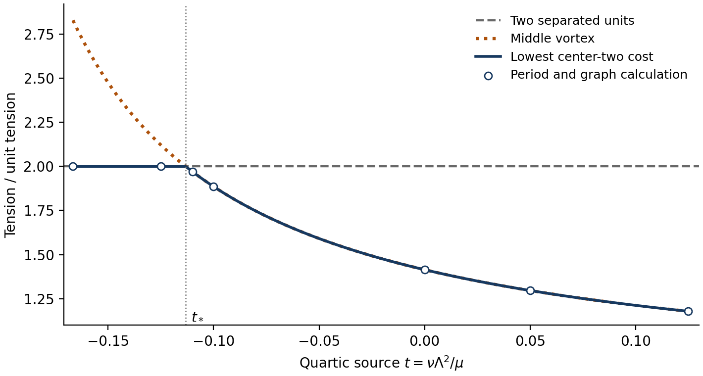

# When do two units of electric flux bind?

**QCDS-96/1 · December 1996 · Regular biennial article of the counterfactual QCD string programme**

## Abstract

A string that confines a fundamental electric source fixes one tension. A second source carrying two units of center charge tests what the string is made of. In the leading weak-monopole effective action we calculate both tension coefficients in a maximally singular vacuum of softly deformed supersymmetric $SU(4)$ gauge theory. Their identification with microscopic long-string energies uses decoupling at fixed rank. We vary the quadratic and quartic chiral sources together so that their ratio $t$ remains fixed as both deformations vanish. The periods of the same microscopic curve determine how its three monopole condensates respond. The two lowest competing costs in the center-two sector are the tension of a middle vortex and the tension of two unit strings. In units of the center-one tension the limiting answer is $\min\{2,\sqrt{2}(1+2t)/(1+4t)\}$ for $-1/6\leq t\leq1/8$. At the ordinary mass deformation the logarithmic slope is $-2$. At $t=-0.11327046\ldots$ the minimizing channel changes, with all condensates nonzero. We give the weight assignments, a contour calculation on split curves and a Wilson-loop measurement that could distinguish these channels. Without an additional charge sink, a membrane wrapped freely on the flat M-theory circle fails both the charge and binding tests. A relative membrane with an allowed boundary could pass the charge test under an explicit topological condition. Its tension and spectrum require further dynamics. The pure Yang–Mills entry in the prediction ledger stays open.

## 1. An electric source with a choice of strings

Place two heavy, static sources far apart in a theory containing gauge fields and adjoint matter. Each source transforms in the two-index antisymmetric representation of $SU(4)$, which is self-conjugate. At long distances the pair can support a tube carrying two units of electric center charge. Alternatively, two fundamental tubes can share the flux, with a common source at each end. An experiment on the linear potential can distinguish a binding energy per unit length from an energy localized near the sources. The choice of four colors matters. For two colors this antisymmetric source is neutral. For three colors it is equivalent to an antifundamental. Four is the first number of colors for which the experiment compares a new center sector with two copies of the original one.

There is a way to change the strength of this binding while keeping the sources, the charge lattice and the vacuum label fixed. Near a point of maximal monopole degeneracy of the supersymmetric Coulomb branch, a derivative of the superpotential sets a scale for every condensate. An ordinary adjoint mass selects one direction in the space of derivatives. A second, independently specified perturbation can rotate that direction. A common change of the tension scale disappears from the ratio. A rotation can be seen even after the unit tension has been used to set the length scale. We choose a quartic perturbation because it preserves the reflection that exchanges the two outer monopoles of the four-color curve. This leaves only two elementary costs to compare.

Write $u_p=\mathrm{Tr}\,\Phi^p/p$, where the trace is in the fundamental representation and the scalar eigenvalue convention is fixed by the monic polynomial in §3. Choose the vacuum with real extrema, take $\Lambda>0$, and fix phases so that $\mu>0$ and $\nu$ is real. Our family of superpotentials and our weak-deformation limit are
$$
 W_{\rm tree}=\mu u_2+\nu u_4,\qquad
 t=\frac{\nu\Lambda^2}{\mu},\qquad
 \epsilon=\frac{\mu}{\Lambda}\longrightarrow0^+
 \quad\text{at fixed }t .
 \tag{1}
$$
Here $\mu$ has mass dimension one and $\nu$ has mass dimension minus one. This is a Wilsonian source experiment. Specify the quartic interaction at a cutoff above $\Lambda$, fix the definitions of the chiral operators and the undeformed strong scale, and reduce the strengths of both sources. An experiment which keeps a finite quartic coupling as it sends the mass to zero explores a different ray. A derivative with respect to $t$ compares neighboring rays through the undeformed point.

We first find the coefficient of a long flux energy at nonzero $\epsilon$. We then take the limit in (1). The denominator uses the unit tension in the *same* theory. Both tensions vanish in fixed four-dimensional mass units as $\epsilon$ tends to zero. The weak monopole action predicts a finite quotient. Identifying it with the microscopic limit uses the hierarchy in §5. Define
$$
 {\cal R}(t)=\lim_{\epsilon\to0^+}
 \frac{\sigma_{[2]}(\epsilon,t)}{\sigma_{[1]}(\epsilon,t)},\qquad
 [k]\in {\mathbb Z}_4 .
 \tag{2}
$$
Square brackets on a charge allow adjoint screening and any distribution of flux in the transverse plane. An index on a magnetic period will label one primitive Abelian vortex. Confusing the two labels gives an incorrect answer on a finite portion of (1). The limiting ratio is continuous through the exchange of channels even though its derivative jumps. The jump belongs to a leading long-string energy. Its relation to a finite-length measurement is addressed below.

The 1994 working calculation and the 1995 corollary followed a fundamental $SU(2)$ source into a condensed monopole vacuum. They used the same action to ask which vibrations of the core could be resolved, and at what soft mass. That construction identifies the electric probe and explains why its tension is positive. It has only one nonzero center class. The 1995 calculation of Douglas and Shenker supplies the multimonopole vacuum and the elementary tension ratios for a quadratic perturbation. We use their curve and primitive cycles, calculate the derivative for a second chiral source, then minimize over the allowed flux distributions. The quadratic answer provides a normalization and a check. [1–4]

A geometrical construction has to identify both measurements in (2). One matching scale can make a candidate agree with the unit tension at one value of $t$. It then has to account for screening of four units, binding of two units, and the response of that binding to (1). We apply these requirements to the flat type IIA lift available by December 1996. This construction supplies a wrapped-membrane tension and a definite charge group. These two calculable quantities already decide the simplest candidate.

## 2. Weights, flux and the long-distance observable

Take the gauge group to be simply connected $SU(N)$, with no dynamical particles of fundamental center charge. Use orthonormal vectors $e_a$ in $\mathbb R^N$ and project to the hyperplane of zero sum. Write the color weights as $h_a=e_a-N^{-1}\sum_b e_b$. The simple roots are $\alpha_i=h_i-h_{i+1}$ for $1\leq i<N$. Their squared length is two, so they equal their coroots in the chosen inner product. The fundamental weight $\omega_j=\sum_{a=1}^j h_a$ pairs to $\delta_{ij}$ with $\alpha_i^\vee$. These assignments fix the unit of vortex winding before any tension is calculated. In particular a fundamental probe need not have unit winding in every dual photon.

In a magnetic frame with one light hypermultiplet of primitive charge in each factor, an original electric weight $\lambda$ imposes the winding vector
$$
 n_i=\langle\lambda,\alpha_i^\vee\rangle,\qquad
 \lambda=\sum_{i=1}^{N-1}n_i\omega_i,\qquad
 k(\lambda)=\sum_{i=1}^{N-1}i\,n_i\pmod N .
 \tag{3}
$$
The first relation is the Dirac pairing between the external line and the condensed monopoles. In a convention with a unit charged condensate the corresponding flux through the plane is $2\pi n_i$. To see the last relation, act on an antisymmetric product of $j$ fundamentals by the center generator $\exp(2\pi i/N)$. It acquires the phase $\exp(2\pi i j/N)$. Taking products and conjugates gives (3) on the whole weight lattice. This argument uses the global form of the gauge group and the matter representations and persists under continuation to the strong-coupling point.

The kernel of $k$ is precisely the root lattice. In the basis of fundamental weights the simple roots are the columns of the $A_{N-1}$ Cartan matrix. The sum in (3) for any column is zero modulo $N$, including the rightmost column where the ordinary integer sum is $N$. The determinant of this tridiagonal matrix is $N$, by expanding the last row and using the initial determinants one and two. Its column lattice has index $N$, equal to the size of the image of $k$. Containment of the root lattice in the kernel is therefore equality. The microscopic adjoint fields can carry its generators. Individual Abelian windings can be sharply defined along an intermediate string segment and still change at an adjoint screening event.

In a static-source definition one measures a rectangular Wilson loop of spatial extent $R$ and Euclidean time $\mathcal T$. For a representation $\mathcal S$ of center charge $k$ with overlap onto the lowest state, set
$$
 V_{\cal S}(R)=-\lim_{{\cal T}\to\infty}{1\over{\cal T}}
       \log\langle W_{\cal S}(R,{\cal T})\rangle,\qquad
 \sigma_{[k]}=\lim_{R\to\infty}{V_{\cal S}(R)\over R}.
 \tag{4}
$$
Vacuum normalization is understood and the source self-energy changes an additive constant in $V_{\cal S}$. One may also work with a closed flux line winding a spatial circle and subtract the energy of the zero-flux vacuum in the same theory. The energy divided by circumference approaches the infinite-string tension. The transverse box has to allow two well separated cores. At finite width two unit strings can interact with each other or with their images. A plateau in (2) only has the stated physical meaning after the transverse size and source overlaps have been checked.

There are two reasons a metastable tension can appear in (4) at an intermediate size. A source with a specified Abelian weight can have a small overlap onto a screened state. Moreover an adjoint excitation attached to an endpoint or a change of flux along the string can cost a finite energy. If the saving in slope is $\Delta\sigma>0$ and the two endpoint rearrangements together cost $2M_{\rm end}$, a crossing estimate is $R\Delta\sigma\simeq2M_{\rm end}$. The scale $M_{\rm end}$ depends on the source and cannot be deduced from the leading tensions. This estimate explains the order of limits in (2). Near a crossing the length required to distinguish the slopes can greatly exceed the width of either tube. The distinction between Abelian intermediate strings and the asymptotic Wilson energy already occurs for the mass perturbation. [3]

A favorable feature of $SU(4)$ is that a single source can prepare both relevant costs. The weights of the two-index antisymmetric representation are the six sums $h_a+h_b$ with $a<b$. Their pairings include $(0,1,0)$ and $(1,0,-1)$. The first winds the middle monopole field. The second winds the two outer fields with opposite local orientation, yet carries the same center charge. The difference between these two weights is a root. Sources in the same representation can therefore have overlap with one-core and two-core states. In §6 we list all six weights and the corresponding costs.

## 3. Periods at a vacuum of maximal degeneration

For pure $\mathcal N=2$ $SU(N)$ choose the monic polynomial and curve
$$
 P(x)=x^N+c_2x^{N-2}+c_3x^{N-3}+\cdots+c_N,\qquad
 y^2=P(x)^2-4\Lambda^{2N},\qquad
 \lambda_{\rm SW}={x\over2\pi i}{P'(x)\,dx\over y}.
 \tag{5}
$$
There is no $x^{N-1}$ coefficient because the trace of $\Phi$ vanishes. The $c_j$ are coordinates for this calculation. We define the chiral invariants by expansion of the characteristic polynomial in this convention. Multiplication of $P$ and $y$ by a common constant changes neither the differential nor its periods if the constant term in the curve is rescaled with them. Changing the scale *inside* $x/(2\Lambda)$ changes the numerical prescription for $t$. Giving the curve makes the latter prescription reproducible. The period normalization in (5) agrees with the differential used for the rank calculation in [3]. The common conversion to a tension cancels out of (2).

Let $T_N(\cos\theta)=\cos N\theta$ and $U_{N-1}(\cos\theta)=\sin(N\theta)/\sin\theta$. The real maximally singular polynomial, its critical points and its normalized derivative are
$$
 P_*(x)=2\Lambda^N T_N(x/2\Lambda),\quad
 x_i=2\Lambda\cos\theta_i,\quad \theta_i={\pi i\over N},\quad
 Q(x)={1\over N}P_*'(x)=\Lambda^{N-1}U_{N-1}(x/2\Lambda).
 \tag{6}
$$
In $\theta_i$ the index $i$ denotes a positive integer. The imaginary unit in the differential has its ordinary complex meaning. The identity for $T_N^2-1$ gives
$$
 P_*^2-4\Lambda^{2N}=(x^2-4\Lambda^2)Q^2,\qquad
 Q(x)=\prod_{i=1}^{N-1}(x-x_i).
 \tag{7}
$$
All roots in this product are simple. The endpoints at $\pm2\Lambda$ are separate simple branch points. Each $x_i$ is the point at which a pair of other branch points coalesces. Enclose that pair by a small cycle on one sheet. The $N-1$ cycles can be made disjoint, hence the massless dyons are mutually local and can be represented as monopoles in one low-energy action. Points with intersecting vanishing cycles require a different analysis. [1–3]

Denote the period over the shrinking cycle by $a_i=\oint_i\lambda_{\rm SW}$. These are dual periods, often written $a_{D,i}$. Although $a_i=0$ at (7), its first variation need not vanish. First choose a contour which encloses the moving pair and no other branch points. Use $P'/y=\partial_x\log(P+y)$ and hold $\Lambda$ fixed. Varying the logarithm yields $\delta P/y$. Integration by parts around a closed contour replaces $x\,d(\delta P/y)$ by $-(\delta P/y)\,dx$. Taking the degenerate limit using (7) gives, with consistent local sheet orientations,
$$
 \delta a_i=-{\delta P(x_i)\over s_i Q'(x_i)},\qquad
 s_i=2i\Lambda\sin\theta_i,\qquad s_i^2=x_i^2-4\Lambda^2 .
 \tag{8}
$$
One may reverse a primitive cycle if the corresponding monopole charge is reversed as well. Both chiral derivatives on that cycle acquire the same sign, so their ratio and the vortex tension are invariant. Integrating the unvaried differential around the double point would give zero. It is the derivative of a vanishing period that fixes the condensate.

At fixed $N$ and $\Lambda$ the tangent polynomials have degree at most $N-2$. Their values at the $N-1$ distinct extrema determine them uniquely. Lagrange interpolation and (8) give an inverse without a matrix inversion,
$$
 \delta P(x)=\sum_i{\delta P(x_i) Q(x)\over (x-x_i)Q'(x_i)}
            =-\sum_i s_i\,\delta a_i\,{Q(x)\over x-x_i}.
 \tag{9}
$$
The right hand side is a polynomial, including at $x=x_i$. Its leading coefficient is $\delta c_2=-\sum_i s_i\,\delta a_i$. Since $u_2=-c_2$, this gives the sine multiplying an ordinary adjoint mass without using any measured tension. Varying $\Lambda$ with a $c_j$ would also vary the constant of (5) and spoil the extraction of the chiral derivatives.

## 4. What the two chiral sources do to a condensate

The next coefficient needed in (9) is the one multiplying $x^{N-4}$. This is where a normalization of the chiral operator has an observable consequence. Newton identities for a traceless matrix give $u_2=-c_2$, $u_3=-c_3$, and $u_4=c_2^2/2-c_4$ for $N\geq4$. The quartic single trace contains the square of the quadratic coordinate when expressed in the $c$ basis. Treating $-c_4$ as the quartic perturbation changes the ray in coupling space. At our vacuum the difference is a term proportional to the quadratic response. It leaves certain infinitesimal *relative* slopes unchanged, but shifts a finite crossing when the couplings on the horizontal axis are held fixed.

Expansion of (6) at large $x$ gives $c_2^*=-N\Lambda^2$, $c_3^*=0$. Since $Q=P_*'/N$, its coefficient of $x^{N-3}$ is $b_2=(N-2)c_2^*/N=-(N-2)\Lambda^2$. Polynomial division gives the first three coefficients of $Q(x)/(x-x_i)$ as $1,\ x_i,\ x_i^2+b_2$. Consequently (9) yields
$$
 \frac{\partial u_2}{\partial a_i}=s_i,\qquad
 \frac{\partial u_4}{\partial a_i}
 =s_i\big[x_i^2+b_2-c_2^*\big]
 =s_i(x_i^2+2\Lambda^2).
 \tag{10}
$$
The dimensions are useful checks. A magnetic period has dimension one, so the two gradients have dimensions one and three. The effect of the second source on the first is set by a squared mass. In particular the constant $2\Lambda^2$ is of the same order as $x_i^2$ on the outer nodes. It cannot be dropped in a finite source scan. On an even-color curve the middle node has $x_i=0$. This node still responds to $u_4$, a direct consequence of the single-trace definition.

There is another way to recover these derivatives that exposes their operator dependence. Expand the characteristic polynomial at infinity,
$$
 \log P(x)=N\log x-\sum_{p\geq 1}{u_p\over x^p},\qquad
 \sum_{p\geq1}{1\over x^p}{\partial u_p\over\partial a_i}
 =s_i\,{Q(x)\over(x-x_i)P_*(x)} .
 \tag{11}
$$
The second identity is (9) divided by $-P_*$. For the low trace degrees used here the first is simply the logarithm of a product over eigenvalues. The expansion $Q/P_*=P_*'/(N P_*)$ starts with $x^{-1}+2\Lambda^2 x^{-3}+\cdots$. Multiplication by $(x-x_i)^{-1}$ gives the coefficients $s_i$, $s_i x_i$, $s_i(x_i^2+2\Lambda^2)$ at orders two, three and four. This derives (10) without differentiating the quartic Newton identity. It also explains the choice of an even trace. A cubic source has opposite responses on reflected nodes and vanishes on the middle one. Under a quartic source the outer pair remains degenerate, so a measurement of their common slope does not require separating two nearly equal levels.

For four colors the monic polynomials are short enough to do the whole inversion by hand. At $\Lambda=1$, $P_*=x^4-4x^2+2$ and $Q=x^3-2x$, with nodes $\sqrt2,0,-\sqrt2$ in that order. Division of $Q$ by $x-\sqrt2$ gives $x^2+\sqrt2 x$, division by $x$ gives $x^2-2$, and division by $x+\sqrt2$ gives $x^2-\sqrt2 x$. Thus the four-color Jacobian in (9) reads
$$
 \begin{split}
 \delta c_2&=-\sqrt2 i(\delta a_1+\delta a_3)-2i\,\delta a_2,\\
 \delta c_3&=-2i(\delta a_1-\delta a_3),\\
 \delta c_4&=4i\,\delta a_2 .
 \end{split}
 \tag{12}
$$
Because $c_2^*=-4$, the derivative of $c_2^2/2-c_4$ is $-4\delta c_2-\delta c_4$. Dividing this by the quadratic derivative one column at a time gives $(4,2,4)$ in units of $\Lambda^2$. Evaluating $\delta c_4$ in the middle column alone gives the wrong sign and strength. The explicit matrix provides a check both on the middle response and on the sign of the odd trace under reflection.

Let $F_i=\partial W_{\rm tree}/\partial a_i$ at the singular point. Restore $\Lambda$, set $H_i=2+4\cos^2\theta_i$, and write
$$
 F_i=\mu s_i(1+t H_i),\qquad
 {1\over\Lambda^2}\frac{\partial u_4/\partial a_i}
                         {\partial u_2/\partial a_i}=H_i .
 \tag{13}
$$
On the selected four-color branch all $F_i$ have a common phase for $-1/6\leq t\leq1/8$. The smallest factor encountered anywhere on that interval is $1/3$ on the outer nodes. None of the terms omitted in a small-$\epsilon$ expansion is amplified by dividing by a vanishing condensate. The interval is chosen to straddle a genuine competition without hitting a vacuum singularity of the perturbed theory. For a different $N$ the $H_i$ differ. The stated interval everywhere in the numerical prediction refers to $SU(4)$.

The effective superpotential near the maximally singular point includes mutually local monopoles $M_i,\widetilde M_i$,
$$
 W_{\rm eff}=\sqrt2\sum_i a_i M_i\widetilde M_i
                 +W_{\rm tree}(u(a)).
 \tag{14}
$$
In the condensed vacuum the $M$ equations impose $a_i=0$. The $a_i$ equations at that point then set $M_i\widetilde M_i=-F_i/\sqrt2$. The D-flat constraints set the two moduli in a charge pair equal. These facts do not require a diagonal metric on the space of periods. A positive, nonsingular Wilsonian metric changes the potential away from its supersymmetric minimum and the relation between masses and condensates. It does not change the simultaneous vanishing of the F and D auxiliary fields in the vacuum. The presence of a condensate in every factor gives all dual photons a mass as soon as $\epsilon>0$. This justifies following the same confining vacuum on both sides of the later channel exchange.

The quadratic and quartic gradients in (10) are computed in the undeformed parent. The use made of them is first order in the small overall deformation, at fixed relative strength. There is no expansion of $(1+tH_i)$ in $t$ in (13). Terms from the nonlinear superpotential carry powers of the soft scale and can depend on $t$ in other ways. Relative off-diagonal kinetic mixing can vanish only logarithmically. A power of $\epsilon$ does not bound the total error. For instance the Hessian of the same superpotential multiplies $a_i a_j$ in the core. Its contribution to the vacuum *gradient* vanishes at $a=0$. Its contribution to a vortex solution need not vanish. This is how the distinction between a holomorphic condensate and a physical tension enters an actual calculation.

## 5. From a period derivative to a string energy

Retain the linear term $\sum_iF_i a_i$ in (14), the monopole hypermultiplets and the leading two-derivative Abelian action. A common $SU(2)_R$ rotation puts aligned linear terms into the Fayet–Iliopoulos form for all diagonal factors. With monopole charges equal to one, define $\xi_i=|M_i|^2+|\widetilde M_i|^2=\sqrt2|F_i|$ in the unrotated vacuum. In a rotated factor a single charged scalar $q_i$ then takes modulus $\sqrt{\xi_i}$ at infinity. With magnetic field $B_i$ in the transverse plane, the static energy of the single-factor vortex truncation is
$$
 E_i=\int d^2x\left\{{B_i^2\over2g_i^2}
        +|D_1q_i|^2+|D_2q_i|^2
        +{g_i^2\over2}(|q_i|^2-\xi_i)^2\right\},\qquad
 \int B_i\,d^2x=2\pi n_i .
 \tag{15}
$$
The conventional coefficient relating a tabulated microscopic mass to $F_i$ can differ with the normalization of $\Phi$ and $a_i$. Equations (5), (13) and (14) fix that convention internally. All measurements below are ratios of coefficients obtained in the same convention.

Complete squares using $D_1+iD_2$ and $B_i-g_i^2(\xi_i-|q_i|^2)$ when $n_i>0$. Integration of the current divergence vanishes for a regular finite-energy vortex. The energy becomes the two nonnegative squares plus $\xi_i\int B_i$. Reverse both signs for negative winding. The conjugate fields omitted from (15) enter additional nonnegative supersymmetric squares and vanish on these solutions in the rotated frame. The bound is attained by ordinary critical vortices on the plane, with arbitrarily separated centers in a factor of fixed orientation. At this order the cost of an elementary unit and the minimum in a fixed vector $n$ are therefore
$$
 T_i^{(0)}=2\pi\xi_i,\qquad
 E^{(0)}(n)=\sum_i |n_i|T_i^{(0)} .
 \tag{16}
$$
Here $E^{(0)}$ is per unit physical length. For mixed signs we used a separate completion in each *decoupled* factor. A single supersymmetry central charge for the whole vector would only bound the magnitude of a signed sum. For example $n=(1,0,-1)$ has zero signed sum at reflection symmetry and a strictly positive energy $2T_1^{(0)}$. Treating this vector as a zero-tension vortex would eliminate confinement in the very example under consideration. The bound in (16) follows from independence of the leading factors and from the existence of the factor vortices. [3,5,6]

The regime in which their independence holds deserves attention. At a fixed number of colors, the mutually local light monopoles give a large diagonal logarithm in the magnetic inverse coupling. Each hypermultiplet is charged in a single chosen factor. The off-diagonal entries from heavy thresholds stay finite, in the same basis. Evaluate the Wilsonian couplings at scales of order the inverse vortex widths, retaining the light monopoles as fields. If $K$ is the real positive inverse coupling matrix and $D$ its diagonal part at that scale, then
$$
 K=D^{1/2}(1+U)D^{1/2},\qquad
 \|U\|=O(1/\log(\Lambda/m_{\rm core}))\longrightarrow0 .
 \tag{17}
$$
The estimate only concerns the relative size of the off-diagonal kinetic terms. The individual diagonal logarithms need not agree. Each $g_i$ cancels from its own boundary term in (16). The low-energy cutoff in the logarithm is supplied by the Higgs masses in the condensed vacuum. Inserting the singular Coulomb-branch metric literally at $a_i=0$ after retaining the monopoles would double count their infrared effect. At growing $N$ the heavy thresholds approach each other. We take no limit in which their spacings compete with $m_{\rm core}$. [3,4]

For the linearized two-derivative model one can bound the effect of (17) without solving the coupled vortices. If $\|U\|=\delta<1$, the magnetic quadratic form lies between $1-\delta$ and $1+\delta$ times its diagonal value. The moment-map potential uses $K^{-1}$, whose relative eigenvalues lie between $(1+\delta)^{-1}$ and $(1-\delta)^{-1}$. Both statements follow by congruence with the square root of $D$ or its inverse. The charged scalar kinetic energy is positive and common to the two functionals. The magnetic and auxiliary-field parts, including each of the three real components before the common rotation, are positive quadratic forms. Applied to the vortex functional with neutral scalars set to their zero minimum in the linear theory, these inequalities give
$$
 (1-\delta)E_D(n)\ \leq\ \inf E_K(n)\
                 \leq\ (1-\delta)^{-1} E_D(n),\qquad
 E_D(n)=\sum_i |n_i|\,T_i^{(0)} .
 \tag{18}
$$
The upper bound follows by using the diagonal minimizers as trial fields. For a threshold reached by separating strings it holds for a sequence of trial fields. The lower bound applies to every configuration in the given vector sector in this functional. There is no need to align the signs of different $n_i$ in making either comparison. The sandwich is deliberately coarse. It proves convergence of the leading coefficients as $\delta\to0$. It would be inappropriate to use it to infer the sign of a binding energy whose leading term vanishes.

There are additional terms beyond (18). A typical core momentum satisfies $m_{\rm core}\sim g_i\sqrt{\xi_i}$ and $\sqrt{\xi_i}=O(\sqrt{\mu\Lambda})$ with finite nonzero relative factors on the chosen interval. A second derivative of $W_{\rm tree}$ at the singular point is $O(\mu)$ there. Upon canonical normalization of the neutral magnetic scalars this gives a mass of order $g_i g_j\mu$. Its ratio to a core mass vanishes as the overall source is reduced. Physical core momenta divided by a fixed heavy scale also vanish. The heavy scale here is the lightest omitted nonlocal or non-Abelian threshold at the fixed value of $N$, and can be a fraction of $\Lambda$. These estimates are the usual power counting of the weak monopole patch. Equation (18) is a bound within the linear action. Power counting justifies using that action for leading weak-deformation strings. It gives no uniform bound on arbitrary high-momentum configurations of the full microscopic theory.

The consequences differ for a leading tension and for its first correction. On the quadratic ray a normalized tension ratio has a finite limit, independent of the magnetic couplings. An attempt to compute its first displacement at nonzero $\epsilon$ would have to keep kinetic mixing, neutral-scalar relaxation and threshold matching to the required accuracy. The earlier unit-vortex calculation explicitly found a negative relaxation contribution in a specified two-derivative action. Separate core couplings and neutral directions occur for four colors. Multiplying each of the present tensions by the same correction from the $SU(2)$ solution has no justification. The observable chosen here is accessible because the direction of the *linear* source changes already at leading order. [4]

For later use it is convenient to factor out a common positive scale $C=4\sqrt2\pi\mu\Lambda$ in the conventions (5), (14) and (15). With $\mu>0$ we have
$$
 T_i^{(0)}=C\,\sin(\pi i/N)\,|1+tH_i| .
 \tag{19}
$$
Nothing below requires matching $C$ between different papers which use different definitions of the strong scale and the period. Through (1) the same $C$ multiplies all sectors at a fixed $\mu$. A measurement at each $t$ may instead fix $T_1$ and express every other energy per length in its units. This procedure removes the $t$ dependence of the outer tension as an absolute calibrator. It preserves the *relative* response, which will be different on the middle node.

## 6. Screening and the two-flux energy

Equations (3) and (16) present a small minimization problem. For a prescribed class we can change an integer winding by a root or split it among several strings. In the leading action, combining windings of opposite sign within the same factor never increases the minimum obtained after allowing annihilation. Thus it is enough to minimize over one net vector in each class,
$$
 \sigma^{(0)}_{[k]}=\min_{n\in{\mathbb Z}^{N-1},\
                          \sum_i i n_i=k\ ({\rm mod}\ N)}
                         \sum_i |n_i|T_i^{(0)} .
 \tag{20}
$$
Every finite-cost vector can be realized by a collection of factor vortices. In an open-string measurement the endpoint regions which deliver their net weight have finite cost at fixed $\epsilon$. Their contribution to $V(R)/R$ vanishes at asymptotic separation. Conversely a set of strings with arbitrary orientations and total winding $n$ costs at least the right hand side. The positive minimum elementary weight means that only finitely many integer vectors need be considered below any given cost. Configurations with many cancelling windings cannot compete with an elementary low-cost representative as $\epsilon$ vanishes on a compact interval with all $1+tH_i$ bounded away from zero.

For a quadratic source (20) has a solution for every fixed $N$. Let $z=\exp(2\pi i/N)$. The magnitude of the chord from $1$ to $z^j$ is $2\sin(\pi j/N)$ for $1\le j<N$. Starting at $1$, take a step multiplying the current vertex by $z^i$ for each positive unit of $n_i$ and by $z^{-i}$ for each negative unit. The last vertex is $z^k$. Each step of type $i$ has magnitude $2\sin(\pi i/N)$ regardless of its position or sign. The polygonal path has length at least the direct chord. For $k\ne0$ a step of type $k$ attains the bound. Hence
$$
 \frac{\sigma^{(0)}_{[k]}}{\sigma^{(0)}_{[1]}}
      =\frac{\sin(\pi k/N)}{\sin(\pi/N)}
      \quad (t=0,\ 1\leq k<N).
 \tag{21}
$$
For $k=0$ the empty path has zero cost. There is no need to postulate a geometrically circular arrangement of physical strings. The chord construction proves an inequality for a set of weights already fixed by a gauge-theory period. Interpreting the auxiliary polygon as a membrane target would use the result to choose a geometry.

For four colors write $A=T_1^{(0)}=T_3^{(0)}$ and $B=T_2^{(0)}$. On the real interval of (1), (19) takes the form
$$
 {A\over C}={1+4t\over\sqrt2},\qquad
 {B\over C}=1+2t,\qquad
 r(t)={B\over A}=\sqrt2\,{1+2t\over1+4t}.
 \tag{22}
$$
A word in the elementary fluxes that has odd center charge must contain at least one odd step. Every odd step costs $A$. A single step realizes the bound in either odd sector. For charge two there are exactly two possibilities for the lower bound. A word which contains a middle step costs at least $B$. A word of only odd steps needs at least two steps and therefore costs at least $2A$. Both values can be reached. One middle step suffices for the first. Two steps of charge one suffice for the second. This is a proof of the minimum over *all* windings, including windings with an arbitrary number of root additions. Thus P26 gives
$$
 {\cal R}(t)=\min\{2,r(t)\},\qquad
 t_*={\sqrt2-2\over8-2\sqrt2}=-0.11327046\ldots,\qquad
 {d\over dt}\log{\cal R}(t)\bigg|_{0}=-2 .
 \tag{23}
$$
The derivative follows from $2/(1+2t)-4/(1+4t)$ on the middle branch. The minimum equals two from the left endpoint through $t_*$ and equals $r(t)$ to its right. All elementary tensions are strictly positive at the crossing. It is an equality of the costs of two realizations of the *same* conserved charge.

**Table 1. Weights of the four-color antisymmetric probe.** The color labels specify which two fundamental indices are antisymmetrized. Cost means the leading diagonal cost before allowing any further adjoint screening.

| Colors | Windings $(n_1,n_2,n_3)$ | Cost |
|:---:|:---:|:---:|
| $1,2$ | $(0,1,0)$ | $B$ |
| $1,3$ | $(1,-1,1)$ | $2A+B$ |
| $1,4$ | $(1,0,-1)$ | $2A$ |
| $2,3$ | $(-1,0,1)$ | $2A$ |
| $2,4$ | $(-1,1,-1)$ | $2A+B$ |
| $3,4$ | $(0,-1,0)$ | $B$ |

One way to construct the table is to mark occupied color slots by $b_a=0,1$ and take $n_i=b_i-b_{i+1}$. Exactly two slots are occupied, so $\sum i n_i=2-4b_4$. The table exhausts the six choices. The two rows of cost $2A$ permit an outer vortex and an oppositely oriented outer antivortex in *different* magnetic factors. Their conserved center charges have the same sign modulo four. They have no annihilation channel to the vacuum because charge two is nonzero. Two copies of an outer vortex in the same factor also carry charge two. The leading threshold admits both realizations. The table identifies source overlaps already present in the antisymmetric probe, whereas the minimization in (20) also admits screened representatives outside its list of weights.

The quantity that can be called a binding energy per unit length is
$$
 {\cal B}(t)=\lim_{\epsilon\to0^+}
 {2\sigma_{[1]}-\sigma_{[2]}\over\sigma_{[1]}}
      =\max\{0,2-r(t)\}.
 \tag{24}
$$
At $t=0$ this gives $2-\sqrt2$. In contrast, $2-r(t)$ may be negative. Its sign says that the *elementary middle representative* is more expensive than the separated pair. Giving that negative number as the binding of the lowest charge-two sector would violate the variational upper bound obtained by preparing two distant unit strings. Near $t_*$ the difference between the elementary slopes varies linearly because $r'(t)=-2\sqrt2/(1+4t)^2$. If an omitted effect displaces an energy by a relative amount $\eta$, it can exchange the apparent ordering over a width of order $\eta/|r'(t_*)|$ in the dimensionless source, with coefficients set by the affected tensions. The leading calculation gives no coefficient for that displacement.

For $t<t_*$ a measurement which selects a localized middle core could still find a massive, apparently isolated excitation per unit length. To decide its lifetime at finite soft mass would require a process that changes the Abelian flux assignment and a calculation of its matrix element. At the same $t$ two unit strings could possess subleading attraction and form a very shallow bound pair. Such a state is compatible with the limiting value two. Equation (23) predicts the leading *slope* of the lowest energy. It does not settle a binding energy which is small compared with $\mu\Lambda$, the existence of a sharp threshold at finite $\epsilon$, or a transition of the four-dimensional vacuum.

## 7. An independent period calculation and a search over fluxes

There are two opportunities for a plausible wrong answer in (23). The first occurs before solving a vortex, when coordinates on the singular curve are inverted. The second occurs after solving it, when its local charge is equated to an asymptotic center sector. We check the first by integrating the original differential on nonsingular contours of deformed curves. We check the second by a shortest-path calculation with the resulting elementary weights. These calculations can test the internal prediction even without configurations drawn from a nonperturbative four-dimensional path integral. The latter would supply a physical test of a different kind.

Use $\Lambda=1$ for this section. To build the reference curve numerically use $P_0=2$, $P_1=x$, $P_{j+1}=xP_j-P_{j-1}$. Find the zeros of $Q=P_N'/N$ numerically, sort them in descending order and add the endpoints $2,-2$ when finding nearest-neighbor distances. For a given node take a circle of radius $0.32$ times the smaller adjacent spacing. Change a single coefficient of $P$ at a time and integrate first with $+h$, then with $-h$. Keep the circle fixed for this pair of integrals. A coefficient perturbation can leave some branch pairs unsplit, for example at $x=0$ for a monomial that vanishes there. The integration contour stays regular in either case. The matrix of central differences approximates $\partial a_i/\partial c_j$ and retains the full response of the other periods to the same variation.

More explicitly, put $z=x_i+\rho e^{i\varphi}$, $\delta P=\pm h z^{N-j}$ and set
$$
 y_*(z)=i\sqrt{2-z}\sqrt{2+z}\,Q(z),\qquad
 y_h(z)=y_*(z)
   \sqrt{1+\frac{\delta P(2P_*(z)+\delta P)}{y_*^2(z)}} .
 \tag{25}
$$
The first two square roots vary analytically in these small discs. The last one is chosen near $+1$ by continuity from zero perturbation. The implementation checks that the modulus of its correction to one is less than $0.8$ on the sampled contour, and varies the radius and step to test the result. The integral uses $z(P_*'+\delta P')\,dz/(2\pi i\,y_h)$ directly. In particular it does not insert the pole residue (8) or sample the analytic values of $H_i$. Directional differences evaluate the response of finite contours of the original differential. The same family of curves, chiral operators and charge assignments are shared inputs. The separate numerical evaluation checks the period manipulations under those assumptions.

Let $J_{ij}$ be this period Jacobian, where column $j$ is ordered by $c_2,c_3,\ldots,c_N$. Solve $J^{\mathsf T}g^{(p)}=\partial_c u_p$ for each chiral gradient. The right hand side of the quadratic equation has first entry $-1$ and the others zero. For the quartic it has first entry $c_2^*$ and entry $-1$ at $c_4$. The transpose here is an ordinary transpose of complex derivatives. Replacing it by the Hermitian transpose would reverse a phase in the leading imaginary gradients. Absolute tensions could fail to reveal that mistake. Comparing the signed complex gradient against (10) and its reflection across the curve tests the sheet convention as well.

**Table 2. Contour convergence at $N=4$.** The two errors are maxima over the three nodes. The first is in units of $\Lambda$, the second in units of $\Lambda^2$. The contour uses 128 equally spaced angles. Each row compares independently perturbed, integrated and inverted periods with (10).

| $h$ | $\max\lvert g^{(2)}-s\rvert$ | $\max\lvert g^{(4)}/g^{(2)}-H\rvert$ |
|---:|---:|---:|
| $0.0100$ | $1.46\times10^{-7}$ | $7.69\times10^{-7}$ |
| $0.0030$ | $1.32\times10^{-8}$ | $6.92\times10^{-8}$ |
| $0.0010$ | $1.46\times10^{-9}$ | $7.69\times10^{-9}$ |
| $0.0003$ | $1.33\times10^{-10}$ | $6.92\times10^{-10}$ |
| $0.0001$ | $1.50\times10^{-11}$ | $7.63\times10^{-11}$ |

The decrease follows the expected square of the central-difference step until cancellation starts affecting the final digits. At $h=10^{-4}$, changing both radius fraction and angular rule to $(0.27,64)$ and $(0.39,256)$ gives maximum quartic-ratio errors of $7.59\times10^{-11}$ and $8.17\times10^{-11}$. Keeping the same code and the $h=10^{-5}$ step, the four-color and six-color quartic gradients divided by their quadratic counterparts are $(4,2,4)$ and $(5,3,2,3,5)$ to the displayed integer precision. On the eight-color curve the largest quartic-ratio error is below $1.6\times10^{-9}$. These checks probe a nonsymmetric outer node, the middle node, and the changing separation of branch points. The precision refers to the numerical evaluation of the limiting curve. It gives no physical error bar on a finite-$\epsilon$ tension.

For the second calculation make a graph with vertices $0,\ldots,N-1$. From each vertex $k$ put edges to $k+i$ and $k-i$ modulo $N$, each of cost $|g_i^{(2)}+t g_i^{(4)}|$ in the chosen units. All weights are positive in the four-color scan, so a shortest-path search from zero gives the cost in every sector, with no bound on the number of screening steps chosen by hand. In the independent quadratic checks for several ranks we also use the analytic elementary sines and compare the graph against the chord proof. For the quartic scan both inputs to the edge cost are obtained from the finite-contour Jacobian. The minimization takes place *after* these units have been combined. Minimizing the two sources separately would allow the winding vector to change between terms of a single action.

**Table 3. Single-middle and lowest center-two costs in units of the unit string.** The last column is signed and refers to the elementary middle string. The binding of the physical sector is its positive part. Rounding is to six places.

| $t$ | $B/A$ from periods | $\sigma^{(0)}_{[2]}/\sigma^{(0)}_{[1]}$ from graph | $2-B/A$ |
|---:|---:|---:|---:|
| $-1/6$ | 2.828427 | 2.000000 | -0.828427 |
| $-1/8$ | 2.121320 | 2.000000 | -0.121320 |
| $-0.11$ | 1.969797 | 1.969797 | 0.030203 |
| $-0.10$ | 1.885618 | 1.885618 | 0.114382 |
| $0$ | 1.414214 | 1.414214 | 0.585786 |
| $0.05$ | 1.296362 | 1.296362 | 0.703638 |
| $1/8$ | 1.178511 | 1.178511 | 0.821489 |

One can infer the intersection of the elementary costs directly from the two numerical gradients. On the real slice write $p_i=\operatorname{Im}g_i^{(2)}$, $q_i=\operatorname{Im}g_i^{(4)}$. The common imaginary conventions in (8) make them positive here. The equation $p_2+tq_2=2(p_1+tq_1)$ gives $t=(2p_1-p_2)/(q_2-2q_1)$. The recovered value is $-0.11327046$ to eight decimals. The log slope from the same gradients is $q_2/p_2-q_1/p_1=-2.000000$ to six decimals. Before projection onto the real slice, the maximum real part of the four-color quadratic gradient and the maximum imaginary part of the quartic ratio are both below $10^{-9}$ at $h=10^{-5}$. This last check does not use a fit through the data points near zero. Finite field differences are investigated in §8, because a physical energy measurement would observe the ratio and would typically have access only to a few values of the source.

One can reproduce Tables 1–3 using the source and stored printout beside this article. The program needs polynomials of degree at most twelve for the tabulated examples, short Fourier sums on circles, small dense linear solves and a graph with a handful of vertices. All are feasible within the computing budget of 1996. No later lattice numbers or fits enter the contour or charge calculation. The period check could fail while the graph check succeeds, for example if the quartic Newton coefficient were omitted. Conversely, an implementation that identifies $B$ with the ground tension passes the period checks and fails the first two rows of Table 3. [Calculation and printout](README.md)

## 8. A measurement that separates the proposed mechanisms

For an actual test choose a scale prescription before measuring any string energy. Fix the normalization of the chiral source by specifying the coefficients in (5) and the trace convention in (1), or by an independent Coulomb-branch calibration in the parent theory. Fix a vacuum by boundary conditions that approach the same real monopole point. Fix the ratio of the two bare or matched perturbations in that convention and lower $\epsilon$ along this ray. A retuning of $\nu$ for each measured ratio would erase the principal information in the experiment. The objective is to compare an external intervention, measured off the tube, with an energy on the tube.

A useful static measurement employs at least two trial source geometries. Couple a compact antisymmetric source to a single flux path. In another operator carry the two fundamental paths away from each other in the transverse plane and project their indices at the ends onto the antisymmetric representation. The two trial operators have the same global charge. Vacuum-normalized correlations between all pairs can resolve their different overlaps. At large Euclidean time their lowest eigenenergy at the same $R$ should coincide whenever both overlaps are nonzero. At intermediate time the one-core operator can prefer the middle-vortex energy. This is precisely the situation in which extracting a slope from a single projected path can mistake a metastable excited branch for the asymptotic tension. No claim is made about the efficiency of such operators in a particular microscopic regulator.

Closed strings give an alternative without endpoint subtractions. On a spatial circle measure a winding fundamental Wilson operator for class one, its antisymmetrized two-index counterpart for class two, and pairs of spatially separated winding fundamental operators carrying the same total charge. In each case subtract the zero-flux vacuum energy with identical boundary conditions on all fields. Choose the same spatial spin structure in the two sectors. The unit-string fermion count in the 1995 $SU(2)$ analysis does not supply the Casimir coefficients for all of these $SU(4)$ states. A closed two-string scattering threshold can even have more translational zero modes than an isolated bound string. Using one imposed $1/L$ term to fit both sectors could bias the extracted tension in favor of either picture. [4]

For example, if the measured vacuum-subtracted energy obeys $E_k(L)=\sigma_{[k]}L+c_k+a_k/L+o(L^{-1})$, a combination which cancels both nuisance terms is
$$
 \widehat\sigma_{[k]}(L)
 =\frac{E_k(L)-3E_k(2L)+2E_k(4L)}{3L}.
 \tag{26}
$$
The coefficients of a constant and of $a_k/L$ vanish separately, while the coefficient of $\sigma L$ is three. For a genuine next term $d_k/L^3$ the residual in (26) is $7d_k/(32L^4)$. This follows from $(1-3/8+2/64)/3=7/32$. For a two-string state at finite transverse volume, relative-motion levels or residual interactions may give a different expansion. Repeat at multiple transverse sizes and compare ordinary successive slopes to (26). One can extract a limiting tension from $E(L)/L$ even in a situation where an improved estimator has no justified rate of convergence. The estimate (26) only accelerates the stated expansion.

A dimensionless version of the experiment takes $\widehat\sigma_{[2]}/\widehat\sigma_{[1]}$ at equal source and successive larger lengths. At the quadratic ray its limit should be $\sqrt2$. An independent measurement near that ray uses two nonzero, opposite sources of magnitude $d$ with $0<d<|t_*|$, and forms the odd finite difference of the logarithm. On the bound branch (23) gives
$$
 S_d=\frac{\log {\cal R}(d)-\log {\cal R}(-d)}{2d}
     =\frac{\operatorname{arctanh}(2d)-\operatorname{arctanh}(4d)}{d}
     =-2-\frac{56}{3}d^2+O(d^4).
 \tag{27}
$$
Every term here is dimensionless. The cancellation of the constant logarithm removes a common multiplicative calibration of the two ratios. An unknown rescaling of the *source* axis would still rescale the reported slope. This is why an independently normalized quartic operator is an input to the experiment. On the interval in (27) both source rays remain on the same minimizing branch. Increasing $d$ past $|t_*|$ causes the negative-source point to sample the plateau. The change in a central difference then measures a channel exchange as well as the local response.

An attempt to refute the prediction should include a negative-source measurement with a generous gap between the two trial costs. At $t=-1/8$ the leading single-middle energy is about $2.121320$ unit tensions, while a pair reaches two. If all correlators prepared with a middle path yield the larger number, a separated pair provides a variational control. If the pair really lies above two asymptotically in the same vacuum, first check volume and common-unit normalization. At infinite separation two individually prepared, widely separated charge-one strings always give an upper bound at their summed energy. A finite limiting ratio *below* two by a nonvanishing amount at this ray after those checks would be substantive evidence against the assumed leading description. On the positive ray $t=1/8$ the predicted $1.178511$ gives a much wider separation between the elementary and pair channels. Measuring just these two rays already tests more than a fit to one unit of flux.

## 9. What can carry the charge in the type IIA lift?

The 1995 identification of the type IIA strong-coupling circle gives a concrete string to test. An M2 membrane has one time direction and two spatial directions. Take it to extend along the electric source separation and to wrap the circle in the other spatial direction. In a flat product with constant eleven-dimensional radius $R_{11}$, and in the corresponding common asymptotic length units, its energy per length in the source direction is
$$
 \sigma_{\rm wrap}(w)=T_{\rm M2}\,2\pi R_{11}|w|
        =\frac{|w|}{2\pi\alpha'} .
 \tag{28}
$$
Here $w$ is integral winding. The conventional relations $T_{\rm M2}=1/((2\pi)^2\ell_p^3)$, $R_{11}=g_s\ell_s$ and $\ell_p^3=g_s\ell_s^3$ give the last expression with $\alpha'=\ell_s^2$. Equivalently the factor $2\pi R_{11}$ comes directly from integrating the area action around the wrapped direction. Formula (28) tests an isolated, freely wrapped membrane with no allowed boundary, background flux or additional source of string charge. [7,8]

It is worth checking that a more ingenious drawing of this membrane in the *same* flat product cannot lower the ratio in (28). Parametrize an internal cross section by $u\in[0,1]$ and let $\chi$ be the angular coordinate. For a straight static tube with translation invariance in the long direction the cross section has length at least $\int R_{11}|\partial_u\chi|du \geq 2\pi R_{11}|w|$. The extra transverse derivatives in the length integrand are nonnegative. The bound is attained by uniform winding at constant transverse position. More generally a two-dimensional area has an analogous lower bound from its projection onto the plane of the long direction and the circle. Several disconnected membranes carry the sum of their integer windings and can attain the same bound when their orientations agree. Thus at fixed positive winding two the leading flat tension is twice that at winding one. Introducing a radius chosen to fit the unit tension, or an overall conversion of frame, multiplies both by the same number.

The charge test is even simpler. In the flat vacuum used in (28) the internal cross section is an absolute closed one-cycle of a space homotopic to a circle. Its winding is in $\mathbb Z$. Four copies of the basic wrapped string have winding four and cannot be absorbed into the vacuum by a local adjoint process provided by that construction. In the microscopic experiment the four-index antisymmetric representation is a singlet. The group of unscreened charges is $\mathbb Z_4$. Sending $w$ to $w\bmod4$ in a dictionary between labels does not introduce an actual sink of four units. Even if one performs this quotient by hand and chooses the least absolute winding in each fiber, the ratio for class two is still two. It misses both $\sqrt2$ and the derivative at $t=0$. Agreement on the plateau would merely identify the energy of two independent copies. A candidate must reproduce the bound side with the same microscopic parameters.

Open membranes provide an alternative available at this date. An M2 can have boundary on an M5 brane. In the static string geometry, the internal cross section can then be a path whose endpoints lie on an allowed locus $S$ in the internal ambient space $Y$. Moving an endpoint on $S$ can change a representative by a path on $S$. Joining paths and discarding such boundary pieces suggests a group of relative one-cycles. We can calculate a necessary topological condition for a fairly broad class of proposals without guessing a metric or a specific gauge-theory fivebrane. Assume for this test that $Y$ is connected with $H_1(Y;\mathbb Z)=\mathbb Z$, that $S$ is nonempty and path connected, and that relative homology captures the conserved additive charge in the absence of extra flux couplings. The exact sequence of the pair contains
$$
 H_1(S;\mathbb Z)\ \xrightarrow{\iota_*}\ H_1(Y;\mathbb Z)\
 \longrightarrow H_1(Y,S;\mathbb Z)\longrightarrow H_0(S;\mathbb Z)\
 \longrightarrow H_0(Y;\mathbb Z) .
 \tag{29}
$$
The final arrow is an isomorphism under these hypotheses. Exactness identifies $H_1(Y,S;\mathbb Z)$ with the quotient of $H_1(Y;\mathbb Z)$ by the image of $H_1(S;\mathbb Z)$. If that image consists of multiples of $d$, the candidate charge group is $\mathbb Z/d\mathbb Z$. To obtain the four-color answer the image must be exactly $4\mathbb Z$. A loop of degree four is insufficient if a second allowed loop has degree two. It is the greatest common divisor of *all* image windings that counts. If a degree-one loop is allowed, every class is screened. If none of the allowed loops winds the ambient circle, the absolute integer survives. These are falsifiable specifications of the permitted endpoints. [9]

One can also read (29) by starting with an open path and joining its two endpoints by a path in $S$. This constructs a closed cycle in $Y$. A different closure changes the cycle by a loop entirely in $S$. Arbitrary choices of the closing path produce exactly the quotient just calculated. Multiple disconnected allowed branes require extra care, since the difference of the two endpoint components can then survive in the kernel of the $H_0$ map. Flux couplings or other dynamical charged objects could also change the conservation law. Thus (29) specifies what a proposed relative membrane with these hypotheses would need. It leaves the construction of the vacuum and the identification of its external electric line as real work.

Topology alone gives no cost to a representative. Even with the desired image one must determine, at a fixed $t$, the membrane action per unit physical length for an allowed path. Paths of classes one and two can favor different portions of $Y$. A variation of the metric, boundary locus or background fields could change the two minimum energies unequally. It is precisely the independent perturbation (1) which would have to prescribe that variation. Postulating a square in a plane with adjustable sides would reproduce the chord lengths at $t=0$ and would allow an arbitrary response at $t\ne0$. The period derivatives predict which response to measure and make such a fit unnecessary on the gauge side. A proposed geometry must calculate its own response from the same four-dimensional source.

There are further dynamical requirements even if the charge and tension tests pass. A straight isolated tube in four-dimensional space breaks transverse translations in two directions. A freely wrapped membrane in flat noncompact space has more movable transverse positions. An endpoint locus could remove some or support additional internal zero modes. A proposed confining superstring must specify the spectrum, including fermions required by unbroken properties of the vacuum and broken supersymmetries of the tube, in a regime where the membrane approximation and the gauge observable can be compared. The relative charge calculation cannot determine a mass gap for an internal angle or a polarized excitation. In 1996 the brane system of Hanany and Witten is an example of deriving gauge data from a specified brane arrangement, in type IIB and three-dimensional gauge dynamics. Borrowing its existence supplies neither the four-dimensional vacuum above nor the missing quadratic fluctuation operator. [10]

## 10. Which result advances the programme?

One input to the proposed geometric comparison was previously supplied by memory, the relative cost of different electric fluxes. Starting with the microscopic curve and the charge pairing gives (21) on the quadratic ray. It reproduces the known weakly deformed gauge-theory result in the programme, with its restriction to a supersymmetric vacuum and fixed finite $N$. The pure-gauge, large-$N$ and hadronic components of P10 require their own physical tests. Substituting this realization for a Yang–Mills measurement would assign it to the wrong theory. The later geometric target also asks for a polarized excitation with additional parameters fixed independently. A ground-state tension ratio cannot supply that excitation.

The new entry P26 is the response to changing a particular microscopic chiral source. It contains a place to look for a change of minimizing channel and an operation, measuring two center sectors at the same deformation, that can refute the predicted value. Its derivation uses the *relative* gradients at the singular point and the exact weight lattice, both fixed before looking at a string spectrum. The numerical exercises check the mathematics and the bookkeeping within the same curve and charge assumptions. The physical prediction uses decoupling of the heavier modes at fixed rank. No microscopic Wilson-energy measurement for this source scan has been made here. The existence of a response in a change of Lagrangian also gives no coefficient for a finite-mass correction along the undeformed quadratic ray.

The geometric search has narrowed. With no additional charge sink, the freely wrapped, flat IIA fundamental string lacks the quotient and the binding seen in the gauge vacuum. The next candidate is a relative membrane ending on a specified fivebrane. Its charge image, minimal areas and allowed extra light fields should be calculated in that order within one background. A successful charge calculation alone can authorize a comparison of sectors. A successful tension calculation with unfixed scales alone cannot authorize a comparison of excitations. If the area approximation cannot coexist with a four-dimensional regime, the scale inequalities and the modes obstructing the overlap will be the result to report. The classification of the present exit is **narrowed** for the geometric construction and **derived, with physical test open** for the registered gauge response.

## Appendix A. Sensitivity to the choice of operator and to the order of limits

Several conventions that agree on the sine ratio at $t=0$ describe measurably different finite-source experiments. Suppose a new coordinate for the quartic trace is defined by $u'_4=u_4+b\Lambda^2u_2$, with a known constant $b$. A laboratory that fixes the coefficients of $u_2,u'_4$ to numerical values $\mu',\nu'$ is implementing the physical coefficients $\mu=\mu'+b\nu'\Lambda^2$ and $\nu=\nu'$. Writing $t'=\nu'\Lambda^2/\mu'$, its physical source axis in (1) is
$$
 t={t'\over 1+b t'},\qquad
 {d t\over d t'}\bigg|_0=1 .
 \tag{30}
$$
In a neighborhood of zero the normalized log slope is unchanged by this additive mixing. The numerical crossing on the primed axis solves $t'=t_* /(1-bt_*)$ if the denominator is nonzero. A multiplicative renormalization of $u_4$ *does* change the log slope quoted per unit source. These transformation laws explain the use of a root coordinate and a trace reference in the prediction. They also distinguish uncertainty in how a source was specified from a disagreement about a physical Wilson energy. In particular an overall scale fit to a fundamental string cannot determine a quartic operator normalization.

A double-trace control makes the origin of the response more transparent. Replace $u_4$ by $u_2^2$ with its own small coefficient $\nu_{\rm dt}$. On the chosen vacuum, $d(u_2^2)=2u_2^*\,du_2=2N\Lambda^2\,du_2$. Every elementary gradient then changes by the same factor. For source strengths where it stays nonzero, the unit-normalized tension ratios are independent of that coefficient at leading order. Both perturbations have degree four in the adjoint scalar and preserve the outer reflection. Their physical effects differ because the single trace samples the separate positions $x_i^2$. A source misidentified as a double trace would give a null response in this experiment. A deformation proportional to $u_4-u_2^2/2=-c_4$ has the opposite special feature for $SU(4)$: it changes only the middle elementary cost in the linearization (12). These cases can be distinguished by also measuring an independently normalized condensate or tension if the operator definition is in doubt.

Now consider an attempted extrapolation in the number of colors. At quadratic deformation and fixed $k$, Taylor expansion of (21) gives
$$
 {\sin(\pi k/N)\over\sin(\pi/N)}
 = k\left[1-{\pi^2(k^2-1)\over6N^2}+O(N^{-4})\right].
 \tag{31}
$$
This is an expansion of a sequence of *already taken* weak-deformation limits. For each $N$, the dual effective theory requires the core scales to lie below all omitted thresholds, and the inverse coupling matrix to be diagonally dominated as in (17). For example the spacing of nodes near the endpoint in (6) decreases as $\Lambda/N^2$. A uniform proof of decoupling would have to bound the actual heavy periods and all off-diagonal terms as functions of $N$. A Taylor series in a trigonometric function cannot provide such a bound. Also, for $k/N$ fixed one cannot Taylor expand the numerator as at fixed $k$. These two order-of-limits questions affect how much of P10 one could test even within the supersymmetric parent.

The comparison at fixed $N$ has an analogous infrared order. The mass scale regulating the Coulomb-branch logarithm tends to zero as $\epsilon$ tends to zero. Taking that limit at fixed length samples an arbitrarily short segment in core units. At exactly zero deformation there is no condensate and both tensions vanish. A possible joint limit would choose $L$ so that $Lm_{\rm core}\to\infty$, separate the cores by distances many times their widths and ensure projection onto the correct screened state. If the saving in tension is small, $L\Delta\sigma$ can also have to exceed a finite rearrangement cost. The iterated limits in (2) avoid asserting any one of these conditions follows from the others. Response to an independently specified source is clearest as a derivative of the limiting ratio, which is the derivative in (23). An exchange of this derivative with a finite-$\epsilon$ limit would require uniform differentiability near zero. The comparison at fixed neighboring rays in (27) avoids relying on that extra estimate.

## Appendix B. Historical scope and memory

**Remembered and re-derived.** Monopole condensation after a small adjoint mass, the Chebyshev point and the leading quadratic sine ratio were known by 1995. Equations (5)–(10), (15)–(16) and (20)–(21) recover these inputs of the comparison with explicit periods, windings and source normalization. Double dimensional reduction to the IIA string is also historical physics. Equation (28) redoes the area and winding calculation for the object actually tested. None of these results carries a priority claim.

**Remembered and used to choose the work.** A future construction associates a confining string with a membrane ending on a fivebrane. This suggested trying a charge test on the simpler lift and looking at an allowed boundary. No future fivebrane embedding, tension formula or fluctuation spectrum is an input to §§3–9. A future lattice comparison of pure gauge theories motivated retaining P10 but supplies no data in Tables 1–3.

**Derived here for this source scan.** The four-color single-trace quartic gradients, the minimization over screened weights and the switch in (23) constitute the prospective P26 test. The 1996 derivation requires only the specified curve, linear weak-deformation action, single-trace convention and the microscopic electric lattice. The tangent calculation and the source representation give algebraically independent checks on different parts of it. The contribution claimed is the explicit test within this programme. There is no claim of first discovery in the literature.

**Retrospective comparisons, outside the cutoff.** Edelstein, García Fuertes, Mas and Mateos Guilarte later analyzed confinement under quadratic and cubic Casimir perturbations, including the importance of relative phases and mixing. Auzzi and Konishi later calculated nonuniversal corrections beyond the leading mass deformation. These works provide close comparisons for two distinct restrictions in the present calculation. Neither a change of the source direction at fixed weak-deformation limit nor a leading charge quotient determines those higher-order corrections. Witten and subsequently Hanany, Strassler and Zaffaroni identified a concrete fivebrane setting for a relative membrane and discussed its dynamics. Their results are reserved for the later historical slot. [Casimir perturbations](https://arxiv.org/abs/hep-th/0001184) · [Tension corrections](https://arxiv.org/abs/hep-th/0205172) · [Fivebrane construction](https://arxiv.org/abs/hep-th/9706109) · [Membrane strings](https://arxiv.org/abs/hep-th/9707244)

## References available by December 1996

1. N. Seiberg and E. Witten, *Electric-magnetic duality, monopole condensation, and confinement in N=2 supersymmetric Yang–Mills theory* (1994). The dual patch and its deformation. [Paper](https://arxiv.org/abs/hep-th/9407087)
2. P. C. Argyres and A. E. Faraggi, *The vacuum structure and spectrum of N=2 supersymmetric SU(N) gauge theory* (1994 preprint, 1995 publication). The higher-rank curve and charges. [Paper](https://arxiv.org/abs/hep-th/9411057)
3. M. R. Douglas and S. H. Shenker, *Dynamics of SU(N) supersymmetric gauge theory* (1995), §§2–3. Degenerate curves, primitive cycles, distinct elementary tensions and long-distance screening. [Paper](https://arxiv.org/abs/hep-th/9503163)
4. QCD string programme, *An electric string near the monopole vacuum of pure SU(2)* (1994 working calculation), and *What the vortex doublet predicts on a Seiberg–Witten electric string* (QCDS-95/S1). Unit-source identification, local tension and physical limits. [1994 calculation](../1994-monopole-string/monopole-vacuum.md) · [1995 article](../1995-electric-string-corollary/paper.md)
5. E. B. Bogomolny, *Stability of classical solutions*, Sov. J. Nucl. Phys. **24**, 449 (1976). Square completion of the vortex functional.
6. C. H. Taubes, *Arbitrary N-vortex solutions to the first order Ginzburg–Landau equations*, Commun. Math. Phys. **72**, 277–292 (1980). Existence with prescribed zeros. [Paper](https://doi.org/10.1007/BF01197552)
7. P. K. Townsend, *The eleven-dimensional supermembrane revisited* (1995). The membrane and the IIA circle. [Paper](https://arxiv.org/abs/hep-th/9501068)
8. E. Witten, *String theory dynamics in various dimensions* (1995). The IIA strong-coupling interpretation. [Paper](https://arxiv.org/abs/hep-th/9503124)
9. A. Strominger, *Open p-branes* (December 1995 preprint, 1996 publication). Permitted brane boundaries, including an open membrane ending on a fivebrane. [Paper](https://arxiv.org/abs/hep-th/9512059)
10. A. Hanany and E. Witten, *Type IIB superstrings, BPS monopoles, and three-dimensional gauge dynamics* (November 1996 preprint). The dimension and field content of its brane construction matter for the comparison. [Preprint](https://arxiv.org/abs/hep-th/9611230)
