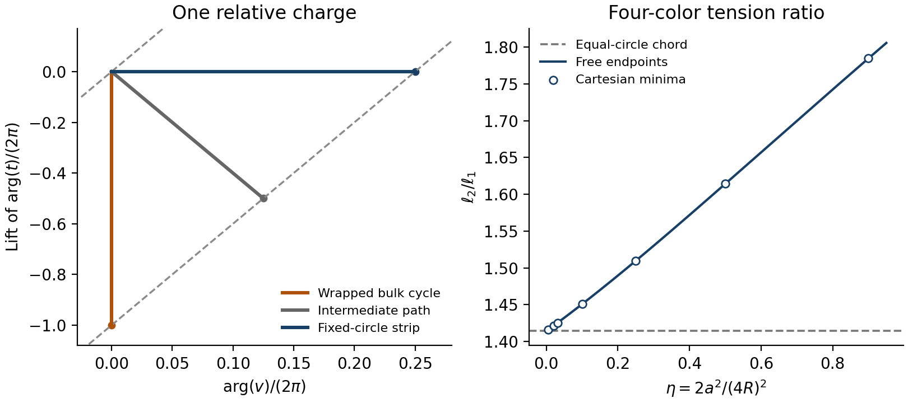

# Where does the color go when a string is lifted?

**QCDS-98/1 · December 1998 · Regular biennial article of the counterfactual QCD string programme**

## Abstract

We follow the string between two external color sources through the type IIA lift. In the fivebrane construction of four-dimensional supersymmetric Yang–Mills theory, a closed membrane wrapping the eleventh circle and an open membrane strip bound to the fivebrane represent the same relative charge. The map from integer winding to electric center flux is reduction modulo the number of colors. Localization changes the energy representative of that charge. We minimize the strip with both endpoints free on the fixed fivebrane. For four colors the center-two to center-one length ratio is $\sqrt2[1+\eta/4+O(\eta^2)]$, with $\eta=2|\zeta|/(4R)^2$ determined from the metric and the embedding. The same variational solution fixes the inertia of an internal rotation and a conditional finite-length level in that polarization. Its winding has no conserved relative-homology class. A dilute winding perturbation is irrelevant in the parametric classical membrane regime. The torsion charge cannot furnish a real additive BPS string charge. A long tube in a four-supercharge vacuum breaks all four supercharges and carries their fermionic modes. We compare this calculation with IIB electric–magnetic duality, circle T-duality, the type I–heterotic string and the two-wall construction. A label such as F1 or D1 identifies a bulk charge. Its color interpretation requires that the Wilson line, allowed string endpoints and screening processes be mapped with it. The geometric result gives a quantitative test in a specified probe. Continuation of its unprotected spectrum to pure four-dimensional Yang–Mills remains open.

## 1. The probe that has to survive the duality

An experimentally meaningful question about a color string begins with the ends. Introduce an external source in the fundamental representation of a simply connected four-dimensional $SU(N)$ gauge theory and its conjugate a distance $L$ away. Assume for the moment that all dynamical matter is adjoint. A long rectangular Wilson loop tests whether their energy grows as $\sigma L$ after subtraction of endpoint self-energies. If a theory drawn in other variables is to describe this measurement, it must tell us where to put the two sources, what can screen them, and how to calculate the energy in the selected sector. Exchanging elementary and solitonic particles in empty ten-dimensional space gives no instructions for the first operation. An exact duality of *the full source experiment* must give all three.

The word color can refer to two quite different facts in this example. A fundamental external line transforms in a definite representation before its endpoints are contracted. A gauge-invariant closed flux state has no free fundamental index, but one can measure its response to the center of the gauge group. The latter is the piece of the line label that adjoint charges cannot screen. For a product of $k$ fundamental lines the center phase is $\exp(2\pi i k/N)$, and the antisymmetric product of $N$ fundamental indices is a singlet. Thus the conserved charge of the long string is $[k]\in\mathbb Z_N$. Different microscopic color weights can yield different intermediate string energies. They describe the same asymptotic sector if their difference is a root. In a theory with dynamical fundamental quarks even this unscreened charge need not exist at infinite length.

The preceding biennial paper used these facts in a weakly deformed supersymmetric gauge theory. It registered a response of the two-flux ground tension to a specific external quartic perturbation. It also rejected a freely wrapped flat IIA string, in the absence of a charge sink, as an explanation of the observed binding. That calculation did not reject the IIA lift with a fivebrane. The very point of the alternative was that the fivebrane permits a membrane boundary, changes which charges are conserved, and can make a different representative much lighter. In 1997 Witten supplied a concrete curve for which this question can be answered, and Hanany, Strassler and Zaffaroni identified the corresponding string tensions and the importance of endpoint orthogonality. Both analyses are available at our December 1998 cutoff. [1–3]

The historical ordering matters. The unity of different superstring descriptions and the identification of the eleventh dimension associated with type IIA were already in print in 1995. The IIB charge multiplet and the type I–heterotic correspondence also preceded our 1996 article. We are taking up a published set of dualities to answer a hadronic question, with the additional evidence afforded by the 1997 fivebrane construction. Our forward calculation concerns the energy and rotational response of a free-end membrane in that geometry. There is no proposal here for discovering the duality web or for identifying every fundamental string in the web with a QCD flux tube. [2–8]

A useful distinction can be drawn through two operations. In the first we take a bulk string and move it toward a brane which is already present. The boundary conditions and the total conserved charges stay fixed, but there can be a lower-energy way to carry a charge near the brane. In the second we remove the brane from the theory, disallow its boundary states, and ask for conserved charges in the new problem. The charge group itself can change. The phrase “it gets colored when trapped in four dimensions” could describe the first operation as an energetic observation or the second as an assertion about sectors. The membrane construction is detailed enough to distinguish them. The string far from the fivebrane still projects to a nonzero relative class in the complete system. Its four-dimensional interpretation as a cheap flux tube relies on binding near the brane.

The other question concerns supersymmetry. An exactly supersymmetric vacuum can confine. A string in that vacuum has its own symmetry-breaking pattern and need not saturate any supersymmetry bound. A bulk BPS tension measured far from a brane therefore cannot be transported to the confining string by topology alone. We shall count the broken charges on the latter, identify the bosonic modes that are present in the classical probe, and give a finite-length measurement sensitive to the difference between a tube made solely of four-dimensional fields and a tube that retains motion in the internal space. The computation also says where classical control fails as an argument for a four-dimensional answer.

## 2. What the web maps before a color sector is chosen

A string electrically charged under a bulk two-form is detected by a surface coupling $\int B_2$. An open worldsheet also has boundary data, such as a charged worldline on a brane. Under a duality the bulk potential, the surface charge, the boundary worldvolume fields and the dynamical objects on which surfaces can end have to be transformed together. A four-dimensional Wilson line is detected instead by its transformation in the gauge theory. A charged boundary can give a relation between the two measurements. We will specify that relation explicitly in one background. It is absent for a bulk superstring in a vacuum with no designated four-dimensional gauge sector.

For an additive model of the bookkeeping let $\Gamma$ be the lattice of string representatives available for a particular measurement, and let $D\subset\Gamma$ be the subgroup of changes which allowed local processes can absorb. After screening the class is in $\Gamma/D$. Suppose a duality carries representatives by an isomorphism $M$ and carries the allowed processes with them. It then induces
$$
 [q]\in\Gamma/D\longmapsto [Mq]\in M\Gamma/MD .
 \tag{1}
$$
This follows because $q-q'\in D$ if and only if $Mq-Mq'\in MD$. There is no choice of tension or length in (1). It is a statement about additive labels and their equivalence. It is not by itself a classification of all line operators, all defects or all allowed mutually local charges in an arbitrary four-dimensional theory. In particular a choice of global gauge group and of electric versus magnetic lines is necessary before a four-dimensional electromagnetic duality can be applied to a Wilson loop. A specified M5 boundary will realize a version of (1) using relative cycles rather than a postulated quotient.

**Table 1. Strings and the additional information required to identify color.** “Charge” in the middle column is the charge in the stated bulk construction. A test in the right-hand column concerns the gauge observable.

| Dual descriptions | What is mapped | What fixes the meaning of the Wilson line |
|---|---|---|
| IIA and M-theory on a circle | F1 is an M2 wrapping the circle. An unwrapped M2 reduces to a D2. | With the specified M5 present, the image of circle winding is $[k]$ modulo $N$. The bound relative strip can carry it at lower tension. |
| IIB under $SL(2,\mathbb Z)$ | F1 and D1 charges mix as an integer doublet. BPS bulk tensions transform with the axion and dilaton. | The screening subgroup and the source defect must transform. A pair of integers alone has no intrinsic four-dimensional $N$-ality. |
| IIA and IIB under T-duality | Closed-string momentum and winding on the dualized circle exchange. Brane Neumann and Dirichlet data exchange. | Identify the dual of the entire source preparation, especially when the circle is tangent to a color brane or to the measured string. |
| Type I and heterotic $\mathrm{Spin}(32)/\mathbb Z_2$ | The type I D1 supplies the transverse and chiral gauge modes of the heterotic string. | A particular four-dimensional subgroup, its massless and heavy matter, and the allowed screening weights have to be specified. |
| M-theory on an interval and heterotic $E_8\times E_8$ | The stretched M2 gives a string with boundaries on the two gauge walls. | An interval with two walls does not by itself give the four-color relative class or confining area law. |

These examples represent different levels of evidence. In the first row there is a specific background with a candidate four-dimensional confining vacuum. We shall construct both a charge homotopy and an energy comparison. In the second row there is a calculable bulk BPS invariant. We can test covariance of a proposed screening measurement algebraically, but have supplied no IIB confining background by that calculation. The heterotic example has a microscopic match of chiral degrees of freedom. Matching a chiral current and matching an electric center string answer different questions, even if both can occur in the same language. Viewing the web as several different charts becomes scientifically useful only after specifying what is held fixed on changing charts.

### 2.1 A check in the IIB charge lattice

Let $\tau=C_0+i e^{-\Phi}$ with $\operatorname{Im}\tau>0$. Use an oriented charge column $Q=(p,q)^{\mathsf T}$, with a sign convention for the second charge such that the Einstein-frame BPS tension is
$$
 T_E(p,q;\tau)=T_0\,{|p-q\tau|\over\sqrt{\operatorname{Im}\tau}},\qquad
 \tau'={a\tau+b\over c\tau+d},\quad
 Q'=\begin{pmatrix}a&b\\c&d\end{pmatrix}Q,\quad ad-bc=1 .
 \tag{2}
$$
Primitive pairs describe elementary members of the multiplet. Nonprimitive charges can also describe parallel copies at threshold. The formula follows from the norm of the wrapped one-cycle on the M-theory torus in the IIB limit or equivalently the IIB supersymmetry charge norm. Inserting the transformation gives $p'-q'\tau'=(p-q\tau)/(c\tau+d)$ and $\operatorname{Im}\tau'=\operatorname{Im}\tau/|c\tau+d|^2$. Their quotient in (2) is invariant. Keeping the string-frame metric fixed while comparing this expression on two sides would miss the frame conversion. There is no $N$ in (2), and the norm of a primitive charge is generally nonzero. Nothing in this invariance lets $N$ identical strings annihilate. [6]

Consider a specific algebraic test of the extra data. Take $\Gamma=\mathbb Z^2$ and suppose the screening lattice is generated by $(4,0)$ and $(0,1)$. This is an example specifying charges, not the derivation of a brane model. The measured class is then $p\bmod4$. The $S$ matrix sends $(p,q)$ to $(-q,p)$ and changes $\tau$ to $-1/\tau$. The new screening generators are $(0,4)$ and $(-1,0)$. The *second* component now measures the electric center class of the mapped experiment. A fundamental string with initial pair $(1,0)$ maps to the D-string pair $(0,1)$ and still carries class one. Applying the old first-component measurement to the transformed object would return zero and appear to show that S-duality destroys color. The error would be using the old boundary conditions in a different experiment. For a general matrix in (2) the transformed measuring row is $(1,0)M^{-1}=(d,-b)$ modulo four. This makes a computational check possible for transformations that mix both components.

There is also a simple distinction from four-dimensional electric–magnetic duality. In the monopole patch of the 1994 gauge theory an original electric line is a magnetic source for a *four-dimensional dual photon*. It creates a vortex of the charged condensate in that local description. The IIB potential doublet consists of ten-dimensional two-forms. An assignment of the dual photon to some reduction of those fields and brane modes could connect the two transformations in a concrete compactification. It has to reproduce the integral Dirac pairings of the source and the monopole. Writing the same pair of integers next to a four-dimensional line and an IIB string does not derive this connection. [1,6]

### 2.2 T-duality and the scope of the source map

For a closed string on a circle of radius $R_c$ the compact contributions to the two momenta are $p_L=n/R_c+wR_c/\alpha'$ and $p_R=n/R_c-wR_c/\alpha'$. The transformation $R_c\mapsto\alpha'/R_c$, $n\leftrightarrow w$ preserves $p_L$ and reverses $p_R$. It therefore preserves the oscillator mass formula and the associated level matching with the consistently transformed right-moving sector. A long closed flux tube that winds a *spatial measurement circle* also has a winding number in the ordinary spacetime sense. The latter operation specifies how the experiment is performed. A putative dual that exchanges this winding with momentum has to map the measurement into the corresponding momentum sector. Comparing the same wound-loop operator on both sides would generally compare different states. [4,5]

The open-string boundary gives an additional check. A gauge field component parallel to a brane around a compact circle sets a Wilson-line holonomy. After T-duality along that direction the eigenvalues specify transverse positions of the dual branes. A string of specified endpoints and compact momentum can become a stretched string of specified separation and winding images. The mass contribution from separation, $|\Delta x|/(2\pi\alpha')$, can be traced back to the difference of the endpoint holonomies. The Chan–Paton labels survive in the mapped endpoints. Tracing over a pair of indices to form a gauge-invariant observable does not produce an unscreened $\mathbb Z_N$ automatically. One still asks which dynamical objects in the actual compactification can terminate the string. T-duality on an unrelated compact direction will not interchange the center class with a kinematic winding of the measured loop.

A related subtlety concerns supersymmetry. A periodic spin structure used to compactify a supersymmetric gauge brane and an antiperiodic spin structure deliberately used to lift its fermions produce distinct theories. The full dual must transform the boundary conditions, including any twists. A familiar supersymmetric flat-circle mass formula cannot be imported unaltered for the latter compactification. We will use the antiperiodic D4 construction in §8 precisely to contrast two *different physical vacua*, one with a Goldstino requirement for its confining tube and one with supersymmetry broken already by the compactification.

### 2.3 What is matched on a heterotic string?

The heterotic–type I correspondence supplies a microscopic control on what it means to recognize the *same* string. In the type I description, a single D1 has a tension proportional to $1/g_I$ in string frame. After the coupling and metric conversion this has the dependence required of the fundamental heterotic string. Tension scaling alone leaves the field content undetermined. The light 1–1 sector gives eight transverse bosons and the eight right-moving fermions paired with them in light-cone conventions. Open strings running between the D1 and the D9 system have eight mixed boundary directions. The surviving chiral 1–9 fermions furnish 32 real left movers carrying the gauge indices. The type I orientation projection and the worldsheet gauge projection enter the spectrum. These degrees of freedom build the current algebra appropriate to the heterotic gauge string. In particular a chiral gauge sector resides on the extended object even without two external color indices attached at distant endpoints. [7]

This is a counterexample to a universal statement that an extended string can only see gauge quantum numbers once trapped in four dimensions. The gauge group just matched is the ten-dimensional heterotic group. A four-dimensional confining $SU(4)$ sector would require a specific embedding, matter spectrum and vacuum. Heavy dynamical representations with nonzero $SU(4)$ center charge can break its string, even if the light truncation accidentally appears to have an exact center. Conversely a pure four-dimensional adjoint theory can have a stable flux tube with a completely gauge-invariant worldsheet spectrum and no heterotic current algebra. The two uses of gauge quantum numbers can be distinguished by measuring an unscreened Wilson loop on the one hand and the chiral currents on the other. There is no reason to infer the 32 left movers on our relative M2 solely from a bulk superstring duality.

The $E_8\times E_8$ heterotic route has a different boundary construction. In the eleven-dimensional interval description the M2 may stretch between the two end planes. Its area per unit external length is the membrane tension times the interval length in the simplest product metric. The two ends encounter different gauge sectors, and the anomaly and boundary conditions carry gauge information. A relative path between disconnected boundary components can already have a charge recording its two ends. In the connected-fivebrane problem below, that term of the exact sequence vanishes and a finite cyclic group comes instead from multiplication by $N$ on loops. Thus the common description “a membrane ending on gauge branes” covers two inequivalent charge calculations. Identification of an interval scale or of a wall representation with a QCD tension or an external quark is additional physical work. [8]

## 3. The same winding measured in the bulk and on the fivebrane

Take the internal space $Y=\mathbb C_v\times\mathbb C_w\times\mathbb C_t^*$, with the last factor supplied with a flat cylindrical metric rather than a flat metric in the complex $t$ plane. An extra spectator direction is held fixed. The fivebrane contains the four external spacetime directions and a curve $\Sigma$ parametrized by $z\in\mathbb C^*$,
$$
 v=a z,\qquad w=a/z,\qquad t=z^N,\qquad a=\sqrt{|\zeta|}>0 .
 \tag{3}
$$
A phase redefinition of $w$ selects one of the supersymmetric vacua for the present local metric computation. It does not continuously identify the distinct vacua at fixed asymptotic data. Use $\log t=(X+iY_c)/R$ so $Y_c$ has period $2\pi R$ and $R=R_{11}$. Reversing the sign of the logarithmic coordinate reverses orientation conventions but no length. In the coordinates $v,w,X,Y_c$ the metric for the calculation is $|dv|^2+|dw|^2+dX^2+dY_c^2$. The pure curve and this fixed flat probe metric are the common input for all results on geometry below. The weak four-dimensional magnetic curve used in 1996 is a different description. Its quartic source $t$ in that paper must not be confused with the exponential coordinate $t$ in (3). [2,3]

A long string in four dimensions is an M2 with one spatial direction along the string and a second along a curve in $Y$. If its boundary can move on $\Sigma$, its additive sector is measured by $H_1(Y,\Sigma;\mathbb Z)$. In this pair, $Y$ retracts to a circle in the argument of $t$ and $\Sigma$ retracts to a circle in the argument of $z$. The inclusion sends a loop of $z$ winding once to a loop of $t$ winding $N$ times. The long exact sequence gives
$$
 H_1(\Sigma)=\mathbb Z\ \xrightarrow{\times N}\ H_1(Y)=\mathbb Z
 \ \longrightarrow H_1(Y,\Sigma)=\mathbb Z_N\longrightarrow 0 .
 \tag{4}
$$
Here the terminal zero follows because both spaces are connected and their $H_0$ groups map isomorphically. This is precisely the image condition left open on the geometric side of the 1996 paper. The inclusion has been computed in a specified vacuum, without imposing a quotient by hand. A generator corresponds to one unit of electric center flux. An external fundamental can end the four-dimensional string. An adjoint source is center neutral. One may realize external probes as the limit of very heavy flavor sources before allowing pair creation. Keeping a finite mass of dynamical fundamental matter would eventually screen the asymptotic line. [1–3]

It is possible to follow one generator all the way from a bulk string to a relative strip. Parametrize a path by $s\in[0,1]$, choose an initial $z=1$, and let $b\in[0,1]$ label the deformation. Set
$$
 v=a e^{2\pi i b s/N},\qquad w=a e^{-2\pi i b s/N},\qquad
 t=e^{2\pi i(b-1)s}.
 \tag{5}
$$
At $s=0$ the point lies on $\Sigma$. At $s=1$ one has $t=e^{2\pi i b}= (v/a)^N$ and $w=a^2/v$, so the other endpoint remains on $\Sigma$. At $b=0$ only the circle coordinate varies and the path is a closed winding of degree minus one. At $b=1$ the path is open at fixed $t=1$, with the endpoints on two different sheets over that value. Its orientation fixes which generator is called fundamental. Reversing the parameter interchanges a fundamental string and its conjugate. Equation (5) is a homotopy with allowed boundaries. It need not be a family of solutions of the membrane equations of motion. In particular the intermediate energy need not interpolate monotonically. This is the period-available construction of Witten in our coordinates. [2, §3.1]

Consider what is conserved during this operation. Counting the compact winding as an integer is appropriate for a *closed* bulk cycle when no endpoint is allowed. The deformed path in (5) is open. To assign it a relative charge close its two ends by a path on $\Sigma$ and take the total winding in $Y$. Two choices of closing path differ by a loop of $\Sigma$ and therefore by $N$ windings in the ambient cylinder. The result modulo $N$ is unambiguous. Thus the original closed IIA fundamental string already has relative image one in magnitude as soon as the fivebrane is included in the system. A bulk representative can be moved far from the brane, where measuring its ordinary integer winding is natural locally. Bringing it back does not create a new conserved quantum number. Binding selects the representative which is cheap enough to appear as the flux tube of the four-dimensional sources.

There is a second topological calculation whose meaning should not be confused with (4). Wind the *orientation of a relative strip* as one goes along a closed external string. The swept cross section is now a relative *two*-cycle. The sequence one step earlier contains
$$
 0=H_2(Y)\ \longrightarrow H_2(Y,\Sigma)\
 \longrightarrow H_1(\Sigma)=\mathbb Z
 \ \xrightarrow{\times N}\ H_1(Y)=\mathbb Z .
 \tag{6}
$$
Since the last map is injective, $H_2(Y,\Sigma)=0$. There is no conserved additive relative-homology charge for the orientation winding, even though the electric center charge (4) cannot disappear singly. Homology permits adding boundaries and recombining chains. This is weaker than a smooth contraction within the space of strips of fixed topology. For example, the two endpoint loops of a rotated strip can each wind on the fivebrane even though their oriented difference is zero. To show a physical unwinding event one must exhibit an allowed membrane history, including any detachment or reconnection, with finite Euclidean action and the required boundary and fermion conditions. The existence, amplitude and rate of such a process remain open. Below we use it to identify an allowed worldsheet perturbation. In particular, suppressing winding of an almost free angular field at long distances need not affect the exact electric center label at all. [2, §3.2]

Relative homology also clarifies how to test a proposed “loss” of color under dimensional change. Removing the fivebrane changes the pair $(Y,\Sigma)$ to the absolute space $Y$. Adding a brane that supports a boundary of unit winding changes the image to the whole $\mathbb Z$ and can erase the center class. In the latter case the four-dimensional analogue is new matter that screens the external source. In contrast, moving the representative within a fixed pair, reducing on the existing circle, or applying a duality with all boundaries mapped keeps the physical equivalence relation. These operations allow a bulk winding, an open membrane, or a dual D-string to carry the measured sector in different descriptions. None gives a local, gauge-invariant color index to a free piece of the middle of a flux tube.

## 4. The distance between sheets when the endpoints can slide

A charge has been identified topologically. To find which representative is cheap we now use the metric. Divide out the fixed long physical length of a static translationally invariant membrane. In the flat probe approximation its area per length is the length of a curve in $Y$ multiplied by $T_{\rm M2}$. Lift the cylinder to its real covering space. For two fixed endpoints and a chosen lift the shortest curve is a straight line. The nontrivial part is the minimization over both points on the fivebrane. Holding their $t$ coordinates equal gives the usual sine chord, an upper bound when they are allowed to move. The nearby orthogonal chord has been noted in the historical analysis. We calculate its relative tension and use its stationarity again in a worldsheet response. [2,3]

Write $z_j=\exp(u_j+i\theta_j)$ at the two endpoints, and choose a lift labelled by an integer $k$. Set $m=(u_1+u_2)/2$, $d=u_2-u_1$, $\delta=\theta_2-\theta_1$ and $q_k=2\pi k/N$. The cylinder displacement is $NRd$ in $X$ and $NR(\delta-q_k)$ in $Y_c$. For the two complex planes the squared distances are $2a^2 e^{2m}(\cosh d-\cos\delta)$ and $2a^2 e^{-2m}(\cosh d-\cos\delta)$. The squared length at fixed endpoints is exactly
$$
 D^2(m,d,\delta;k)=4a^2\cosh(2m)(\cosh d-\cos\delta)
           +(NR)^2\{d^2+(\delta-q_k)^2\}.
 \tag{7}
$$
The real coordinate $u_j$ lives on the whole line. Allowing $\delta$ to vary on its lift includes endpoints on either side of a branch convention. Taking $k\mapsto k+N$ and $\delta\mapsto\delta+2\pi$ gives the same variational problem, as required by (4). A change of the center-of-mass angle $\phi=(\theta_1+\theta_2)/2$ is an isometry. It is left free throughout.

For fixed $\delta$, $d=0$ minimizes both nonnegative $d$ contributions. At $d=0$ the factor multiplying $\cosh(2m)$ is nonnegative, and it is positive on the physical charge-one solution. Hence $m=0$ minimizes the distance. If $\delta=0$ the planar distance vanishes for $d=0$ at every $m$ and the path is a pure circle winding. This limiting case is included as a competitor even though it does not select $m$. We obtain
$$
 \ell_k^2=\min_{\delta\in\mathbb R}
 \left[\,8a^2\sin^2(\delta/2)+(NR)^2(\delta-q_k)^2\,\right],
 \qquad \eta={2a^2\over (NR)^2}.
 \tag{8}
$$
The integrand is a squared physical length. Its second derivative divided by $2(NR)^2$ is $1+\eta\cos\delta$. For $0<\eta<1$ the function is strictly convex on the whole real line, including for $q_k=\pi$. It has a unique minimizer (up to exact center and conjugation conventions) given by
$$
 \delta_k+\eta\sin\delta_k=q_k,\qquad
 \sigma_k^{\rm strip}=T_{\rm M2}\ell_k .
 \tag{9}
$$
There is no large-$R$ expansion in this stationarity equation. Restricting it to the convex domain gives global control of the selected solution. At $\eta\geq1$ an analysis of competing stationary branches may be needed. The calculation supplies no continuation of the single-root prescription into that region. The tension is classical in a prescribed, undeformed fivebrane background. Recoil, quantum membrane corrections, string loops, and other dynamical excitations are not calculated by minimizing a Euclidean distance.

Two elementary checks help interpret (8). Choosing $\delta=0$ gives $\ell=2\pi R|k|$ for the lifted winding entirely along the cylinder. Choosing $\delta=q_k$ gives
$$
 \ell_{k,\rm chord}=2\sqrt2\,a\,|\sin(\pi k/N)| .
 \tag{10}
$$
The latter choice puts both endpoints at equal $t$ and minimizes their common radius. For $0<q_k<\pi$ its derivative in the remaining relative angle does not vanish. The optimizing path shortens its planar projection by moving the endpoints slightly toward one another and pays a quadratic cost in circle displacement. For $q_k=\pi$ the planar derivative vanishes and the chord is the optimizer in the convex regime. Thus an equal-$t$ approximation which is accurate in each absolute tension can still miss the leading *change* of the ratio with radius. The fact that the antipodal string is stationary at all these radii makes it a useful control.

Expand $\delta_k=q_k-\eta\sin q_k+O(\eta^2)$ in the minimum, paying attention to the cylinder term which contains a factor $1/\eta$ in units of $a^2$. Keeping only the shift in the planar sine would give twice the actual reduction. The series for positive $k$ with $q_k\leq\pi$ becomes
$$
 \begin{split}
 {\ell_k^2\over4a^2}
  &=1-\cos q_k-\tfrac12\eta\sin^2 q_k+O(\eta^2),\\
 {\ell_k\over\ell_{k,\rm chord}}
  &=1-\tfrac12\eta\cos^2(q_k/2)+O(\eta^2).
 \end{split}
 \tag{11}
$$
For four colors, $q_1=\pi/2$ and $q_2=\pi$. Consequently the normalized center-two tension of the strip obeys
$$
 {\ell_2\over\ell_1}=\sqrt2\,[1+\eta/4+O(\eta^2)] .
 \tag{12}
$$
Both $a$ and $R$ are defined in the eleven-dimensional metric. Equation (12) is a derivative with respect to that dimensionless geometric input. It is unrelated to differentiating a four-dimensional single-trace superpotential with respect to its quartic coefficient until a deformation of the embedding matching that *operator* has been calculated. The weak gauge-theory sine ratio and the leading small-$\eta$ geometric ratio have a common value. Neither the first derivative nor the finite corrections are protected by their equality at one point. [1,3]

We must also allow flux to be carried by more than one strip. For four colors conjugation gives $\ell_3=\ell_1$. The only nontrivial competition for charge two is $\ell_2$ against $2\ell_1$ if all elementary costs refer to the minima in their individual classes. The ends of each minimizing unit strip have $u=0$. A common rotation can join the end of one to the beginning of another, taking account of the circle lift. Their concatenation has class two. Replacing the joined path by the straight line between its endpoints can only shorten it. It shortens it strictly in the convex regime because the nonzero planar parts of the successive unit tangents are rotated by $\delta_1\in(0,\pi/2)$. The optimized two-sector strip can only do better. Any word of odd total class must in turn contain an odd segment of cost at least $\ell_1$. These arguments establish the four-color leading comparison against arbitrary separated probe strips of additive cost. They do not bound a new interacting brane configuration carrying the charge outside the fixed-probe calculation.

A basic decoupling question can already be asked without a worldsheet theory. For an oriented unit, the far-from-brane free object costs $2\pi R\,T_{\rm M2}$. The localized one has tension $T_{\rm M2}\ell_1$. Their ratio at small $\eta$ is of order $a\sin(\pi/N)/R$. This can be made small at fixed $N$ with the same nonzero relative class. It is the sense in which a light four-dimensional string emerges by trapping or binding. The tension and the mass gap of other bulk excitations still matter. A representative much cheaper than the faraway F1 can coexist with light Kaluza–Klein states and extra massless string fields. A binding ratio alone does not establish an autonomous four-dimensional confining theory.

**Table 2. Free-end distances at $N=4$.** The middle column gives the selected endpoint angle in radians, and the last column is the measured coefficient after division by $\eta$. The distances come from both endpoint coordinates in the original metric. The limiting coefficient in (12) is $1/4$.

| $\eta$ | $\delta_1$ | $\ell_1/a$ | $\ell_2/\ell_1$ | $(\ell_2/(\sqrt2\ell_1)-1)/\eta$ |
|---:|---:|---:|---:|---:|
| 0.005 | 1.565796 | 1.997498 | 1.415985 | 0.250468 |
| 0.020 | 1.550800 | 1.989976 | 1.421337 | 0.251857 |
| 0.03125 | 1.539562 | 1.984319 | 1.425390 | 0.252885 |
| 0.100 | 1.471291 | 1.949529 | 1.450826 | 0.258891 |
| 0.250 | 1.328122 | 1.873480 | 1.509718 | 0.270127 |
| 0.500 | 1.120613 | 1.752181 | 1.614232 | 0.282869 |
| 0.900 | 0.878178 | 1.584875 | 1.784638 | 0.291033 |

The first two columns make the direction of sliding visible. Relative to $\pi/2$, the angular displacement grows with increasing $a/R$. The central string remains at $\pi$ on every row. All the increase in the four-color ratio in this regime therefore comes from a reduction in the unit tension relative to its equal-$t$ chord. Treating the small-$\eta$ series as an interpolation over the full table would give a biased last column. The implicit equation (9), with convexity verified, can instead be used at any of the listed points. An independent Cartesian minimization and the computation of the table are described in Appendix A.

## 5. Which supersymmetries does the tube see?

The parent eleven-dimensional system, the vacuum described by the wrapped fivebrane, and a string *in that vacuum* preserve different numbers of charges. Only the supersymmetries preserved by the vacuum are candidates for a Ward identity for its four-dimensional tube. The holomorphic curve with the stated orientation gives a four-dimensional $\mathcal N=1$ vacuum with four real supercharges. This accounts for the asymptotic geometry of the two rotated fivebrane ends. A remote BPS IIA fundamental string in flat space would ordinarily be analyzed with a much larger bulk superalgebra. Its projector and its ten-dimensional tension bound do not by themselves define a projector for a four-dimensional confining string. Binding to the fivebrane changes the state and the symmetry algebra relevant to its long-distance excitations. [2,3,5]

There is a short obstruction to a BPS string charge here. A real additive string central or tensorial charge depending only on the electric center class would define a homomorphism from $\mathbb Z_N$ to a real vector space. If its value is $Z$ on the generator, then $NZ=0$. In a real vector space this implies $Z=0$. The pure four-dimensional $\mathcal N=1$ gauge theory in question has no additional continuous string charge of the required kind. Other theories with Fayet–Iliopoulos terms, different matter or extra topological charges can have BPS strings. The torsion argument alone would not exclude an independent real charge in such theories. For the pure gauge vacuum it removes the protection that a BPS bulk string would enjoy. A straight center-charged tube of positive tension therefore breaks all four of its vacuum supercharges. [2, §3.2]

Act on a translationally invariant long string by one of these four broken transformations. Its variation solves the linearized equations at zero longitudinal momentum. For a localized finite-tension string in a gapped four-dimensional supersymmetric vacuum the variations are localized Goldstino modes. Splitting a four-dimensional Majorana parameter into representations of boosts along the string gives two real left movers and two real right movers, or two nonchiral Majorana fields. These modes realize the broken supersymmetry nonlinearly. They do not imply equality of all massive bosonic and fermionic string levels or an unbroken linearly realized supersymmetric worldsheet. On a noncompact dynamical fivebrane a direct calculation of normalizations and possible extra fermions would require solving a coupled defect problem. The pure-gauge broken-charge count and the minimality of a full brane fluctuation spectrum are different statements. [2, §3.2]

This gives a measurable distinction between a supersymmetric color string and its nonsupersymmetric cousin. Consider a long spatial circle of circumference $L$. Give all microscopic fermions one physical spatial spin structure, keep bosons periodic, and subtract the zero-flux vacuum energy in the *same* spin structure. Denote by $E_R$ and $E_{NS}$ the resulting one-string energies with periodic and antiperiodic fermions. For one free real nonchiral Majorana of limiting speed one, the zero-point sums give coefficients $+\pi/(6L)$ in the ordinary Ramond ground sector and $-\pi/(12L)$ in the Neveu–Schwarz sector. Two of these fields thus contribute
$$
 (E_R-E_{NS})_{\rm Goldstinos}={\pi\over2L}+o(1/L).
 \tag{13}
$$
The time direction is noncompact in this measurement. Swapping a thermal time boundary condition instead would probe a different observable. An additional gapless *neutral boson* shifts the two vacuum energies equally and is invisible to (13). Further spin-sensitive fields could change the *total* coefficient. The earlier two-color paper calculated the minimal kernel in a specific weakly coupled dual action. That microscopic proof cannot be carried over to a curved fivebrane by counting supercharges. [1,2]

For clarity, the coefficients in the two most relevant candidate low-energy spectra are as follows. Two transverse periodic real bosons give $-\pi/(3L)$ in each closed-string vacuum. Adding the two Goldstino Majoranas gives a vanishing total $1/L$ coefficient for R and $-\pi/(2L)$ for NS. If a further periodic angular boson is effectively massless on that scale, subtract another $\pi/(6L)$ from each. The two pairs of coefficients are thus $(0,-\pi/2)$ and $(-\pi/6,-2\pi/3)$ when energies are expressed as $\sigma L+c+a/L+\cdots$. Both have the same difference. These formulae assume ordinary ground sectors, common relativistic speed and no additional massless fields. They provide a reason to look for the internal mode directly, using a charge or polarization insertion. A measurement of the Goldstino spin difference alone will not find it.

What would it mean for the string to “lose supersymmetry”? In this vacuum the string has already broken the four exact charges. The Goldstinos are evidence of that breaking. To remove them from a supersymmetric-vacuum calculation requires an actual change of conditions, such as explicit supersymmetry breaking in the microscopic vacuum, loss of localization, or a different state. Simply following the duality to a chart in which the effective string looks bosonic does not remove the Ward identities. Under an exact map the observable spin structures, the projected states and the contributions of extra sectors must map as well. Moving to nonsupersymmetric four-dimensional Yang–Mills eliminates the Ward identity that required these modes. Whether any light fermionic excitation remains then becomes a dynamical measurement.

## 6. A collective coordinate that can distinguish the brane tube

The embedding (3) has a continuous isometry
$$
 (v,w,t)\ \longmapsto\
 (e^{i\phi}v,\ e^{-i\phi}w,\ e^{iN\phi}t).
 \tag{14}
$$
It preserves the curve and the metric. It moves a given minimum strip through a continuous family at the same tension. The symmetry acts trivially on the intended pure gauge-theory excitations in the fivebrane interpretation. An extra light state carrying its charge is therefore an obstruction to identifying the whole probe spectrum with a pure four-dimensional color tube. The potentially relevant question is whether the angular motion disappears from its infrared spectrum. Continuous symmetry restoration in two dimensions by itself gives no answer. A compact free boson has a symmetric ground state and massless excitations. A symmetric gapped phase is another possibility. [2, §3.2]

Take the oriented unit strip, $N\geq3$, with distinguished order of its two endpoints. Define $\phi$ as the rotation angle of $v$ in (14). Its orbit on the embedded strip has period $2\pi$. A rotation by $2\pi/N$ returns $t$ to its previous value but moves both ends to different locations in the $v,w$ planes. Those strips are homotopic and equal in energy. They are different fields of the fixed-brane probe. A theory that gauges or projects this discrete action has a different spectrum of allowed angular charges. We will give the conversion also for the local coordinate $\psi=N\phi$, the phase of $t$. Treating this change of coordinates as a change of the global period can give an erroneous factor of $N^2$ in the stiffness or in a predicted gap.

Parametrize the straight segment by $-1/2\leq u\leq1/2$ and set $c=\cos(\delta_1/2)$, $s=\sin(\delta_1/2)$. At the minimizing endpoints, up to a constant origin on the lifted cylinder, the embedding is
$$
 v=a e^{i\phi}(c+2ius),\quad
 w=a e^{-i\phi}(c-2ius),\quad
 X=0,\quad Y_c=NR\{\phi+u(\delta_1-q_1)\}.
 \tag{15}
$$
The offset of $Y_c$ can be chosen so that each endpoint satisfies (3). In a cover centered at the mean of the endpoint lifts it differs from the original absolute cylinder coordinate by a fixed offset of $\pi R k$ for class $k$. This has no effect on the induced metric. The tangent $U=\partial_u y$ has squared norm $\ell_1^2$, where $y$ is the six-component internal position. The generator $V=\partial_\phi y$ has a component in the cylinder as well as rotations in two planes. The rotational kinetic term cannot be obtained merely by multiplying the original perimeter of the M-theory circle by a membrane tension.

Indeed the transverse norm that occurs in the determinant of the induced metric is $|V_\perp|^2=|V|^2-(U\cdot V)^2/\ell_1^2$. Using (15) gives
$$
 U\cdot V=2a^2\sin\delta_1+(NR)^2(\delta_1-q_1)=0,\qquad
 |V|^2=(NR)^2+2a^2(c^2+4u^2s^2).
 \tag{16}
$$
The vanishing of the first expression is exactly the stationary condition (9). This is one benefit of letting endpoints slide before quantizing the collective motion. An unrelaxed fixed-$t$ chord has an artificial tangential component. Using the norm of a Killing vector without projecting it off the string tangent is not generally valid. Here stationarity makes the projection exact without an extra gauge choice in the calculation.

Allow $\phi$ to vary slowly along the two external string coordinates and expand the membrane area action to two derivatives. The resulting worldsheet action has coefficient $K_\phi/2$ multiplying $(\partial\phi)^2$ in Euclidean signature. The integral of the squared normal displacement per unit string length gives
$$
 K_\phi=T_{\rm M2}\ell_1\int_{-1/2}^{1/2}|V_\perp|^2\,du
 =\sigma_1^{\rm strip}
  \left[(NR)^2+2a^2\left(c^2+\tfrac13s^2\right)\right].
 \tag{17}
$$
$K_\phi$ is dimensionless. In particular it is positive and bounded below by $\sigma_1^{\rm strip}(NR)^2$. For $\psi=N\phi$ the same local action has $K_\psi=K_\phi/N^2\geq\sigma_1^{\rm strip}R^2$. This gives the parametric dependence anticipated in the historical estimate using the phase of $t$. A state or defect operator must also be transformed with its periodicity. The equation gives the bare classical matching of a fixed, rigid fivebrane and a probe M2. A kinetic contribution from a moving fivebrane, a change in boundary dynamics or quantum renormalization of the compact radius would require additional input.

There is a useful distinction between the translation of a macroscopic straight tube and the motion in (14). A translation of the flux profile in one of the two external transverse directions changes the center of energy that a four-dimensional detector can locate. The rotation $\phi$ leaves that center fixed. Its external string moves only in internal relative coordinates. In the present classical embedding its kinetic energy per length is finite because the strip has finite width and only the M2 is varied. If a purported zero mode required moving an infinite portion of a noncompact fivebrane, its inertia could diverge and it could instead change a boundary condition. The distinction matters in applying the fixed-probe result to a dynamical defect. A calculation of the coupled membrane and fivebrane kinetic norm would settle that extension. Taking a count of collective coordinates of the classical M2 does not perform it.

An explicit field that pins $\phi$ to a preferred angle would break (14). Thus a term $\cos p\phi$ is forbidden by this exact isometry of the chosen background. There is another way in which a symmetric theory with compact target can develop a mass scale. In a Euclidean worldsheet plane consider a vortex outside a core of radius $\rho_0$, with $\phi=m\arg(x^1+i x^2)$. Its contribution from the annulus $\rho_0<\rho<D$ is
$$
 S_{\rm annulus}={K_\phi\over2}
   \int_{\rho_0}^{D}2\pi r\,dr\,{m^2\over r^2}
 =\pi K_\phi m^2\log(D/\rho_0),\qquad
 \Delta_m=\pi K_\phi m^2 .
 \tag{18}
$$
The last equality is the dimension of the winding insertion at the Gaussian compact-boson fixed point in this normalization. A pair of opposite defects at separation $D$ costs $2\Delta_m\log(D/\rho_0)$ outside the cores, consistently giving the two-point exponent. Counting insertion positions supplies two powers of length. To first order in a dimensionless dilute fugacity $y_m$, the flow is $d y_m/d\log D=(2-\Delta_m)y_m+\cdots$. A unit defect is perturbatively relevant if $\pi K_\phi<2$. A small radius in an electric-coordinate vertex formula has the *opposite* influence on the corresponding winding operator. The exchange of momentum and winding on the worldsheet must not be confused with the bulk IIA–IIB duality of §2. [2,9]

Equation (6) removes the homological obstruction to a vortex core. A finite-action core with the correct boundaries has yet to be constructed. If an allowed defect has extra fermion zero modes, the purely bosonic winding perturbation may vanish unless dressed by appropriate fields. Conversely, a gas of defects with large bare fugacity may be outside perturbation theory around a Gaussian boson. Our calculation determines an annular action and a classical stiffness, not either of those short-distance data. Even a definition using a projected orbit for which a $2\pi/N$ change of $\phi$ were a minimal winding would give the annular dimension $\pi K_\phi/N^2\geq\pi\sigma_1^{\rm strip}R^2$. The primitive period of the fixed oriented strip gives the stronger factor in (18). For any **fixed** $N$, either convention has a parametrically irrelevant dilute winding perturbation when $\sigma_1^{\rm strip}R^2$ is large.

Can a limit with calculable areas and a perturbatively relevant winding defect coexist? Denote $T_{\rm M2}=1/((2\pi)^2\ell_p^3)$. A sufficient parametric condition for treating this strip and the circle as large in eleven-dimensional Planck units is $\ell_1/\ell_p\gg1$, $R/\ell_p\gg1$, with the fivebrane smoothly curved on the relevant scale. On the fixed-rank small-$\eta$ branch this can be arranged by taking $a/\ell_p$ large at fixed small $a/R$. Then
$$
 \sigma_1^{\rm strip}R^2=
 {1\over(2\pi)^2}{\ell_1\over\ell_p}
                      \left({R\over\ell_p}\right)^2 .
 \tag{19}
$$
The same product controls the lower bound on the winding dimension and is the square of $\sqrt{\sigma_1^{\rm strip}}/(1/R)$. It grows on this classical scaling trajectory. Thus the calculable large-area route does not reach a small, Gaussian-relevant winding perturbation, and the ordinary bulk Kaluza–Klein scale fails to rise above $\sqrt{\sigma_1^{\rm strip}}$. Some excitations associated with the multiply wound fivebrane can have an even lower scale of order $1/(NR)$. Decreasing $R$ enough to reverse (19) leaves this sufficient classical regime. This argument rules out a proposed *parametric overlap*. It gives no theorem of masslessness for every quantum completion or every finite intermediate radius. [2, §5]

## 7. A quantitative polarization test at finite length

The matched inertia gives a second observable in the same probe once the geometry is fixed. Consider the zero spatial Fourier mode of $\phi$ on a straight string winding an external circle of length $L$. Choose an oriented unit strip and the unprojected period $2\pi$ of §6. Its time-dependent Lagrangian is $K_\phi L\dot\phi^2/2$. The eigenfunctions on the circle are $\exp(ij\phi)$ with integer angular charge $j$, and the moment of inertia is $K_\phi L$. For the ordinary sector with no angular winding, no induced Berry phase or background holonomy, the ground-to-first angular gap is
$$
 \Delta E_{|j|=1}={1\over2K_\phi L},\qquad
 {\Delta E_{|j|=1}\over\sqrt{\sigma_1^{\rm strip}}}
 = {1\over2K_\phi L\sqrt{\sigma_1^{\rm strip}}}.
 \tag{20}
$$
This is a polarization specified by the generator (14), with ordinary external transverse momentum zero. The states $j=\pm1$ are degenerate under charge conjugation of the angular motion at this order. Both ends of the transition must have the same spatial spin structure. We choose NS for the comparison to avoid a choice among spin-degenerate R vacua. The leading vacuum energies of spectator oscillators cancel in this gap. A central-charge estimate of the ground energy alone could not pick out this level.

There is a direct way to select the state in the probe calculation. An insertion that locates an endpoint at angle $\phi$ can be integrated against $e^{\pm i\phi}$ at fixed orientation. The vacuum-to-state correlator projects onto unit charge of the exact internal rotation. An operator invariant under (14) has no direct matrix element from the neutral vacuum to this state. Ordinary pure-gauge operators are expected to be invariant, which explains the utility and the limitation of the polarization test. It diagnoses a surviving *brane* degree of freedom. To interpret its absence in a pure-gauge correlator as a mass gap one would need an independent argument about the full spectrum or about decoupling of all charged states. A selection rule on an insertion can hide a light state in a spectrum measured with that insertion.

For a free compact mode the expression is exact at two derivatives. To use (20) for the full long strip requires more conditions. Other light fields must either factor at this order or leave the same lowest neutral-sector energy for the two angular charges. The angular momentum carried by fermion zero modes, a spin connection with nontrivial holonomy or a boundary gauge field can change the charge assignments and the ground sector. The minimal four-dimensional Goldstino multiplet alone does not fix these data for every brane state. The operation here quantizes the bosonic orbit at fixed spin and spectator content with no such twist. Higher-derivative operators and massless-field renormalization can replace $K_\phi$ by a long-distance value. A generated angular gap would eventually change the $1/L$ law. For these reasons we give an explicit leading conditional level in the matched probe and do not call it a spectral line of pure Yang–Mills.

An example fixes all geometric inputs before evaluating the level. Take $N=4$, $R=40\ell_p$, $a=20\ell_p$, hence $\eta=1/32$. Set $L\sqrt{\sigma_1^{\rm strip}}=1000$, in the NS comparison above. The independently minimized length, unit tension, stiffness and gap are
$$
 \begin{split}
 \ell_1/\ell_p&=39.686372,\qquad
 \sigma_1^{\rm strip}\ell_p^2=1.005268,\\
 K_\phi&=26279.36,\qquad
 {\Delta E_{|j|=1}\over\sqrt{\sigma_1^{\rm strip}}}
       =1.9026\times10^{-8}.
 \end{split}
 \tag{21}
$$
These numbers specify an illustrative geometry. The lengths $a,R$ are inputs in Planck units selected independently of the gap and of any four-dimensional measurement. Dividing energies by $\sqrt{\sigma_1}$ removes one scale. It does not set $K_\phi$, which depends on both the tension and the radius of the orbit. The very small number in (21) has a simple origin: the angle is slow because the strip is heavy to rotate and the external string is long. The digits are reproducibility checks for the leading formula. They do not indicate corresponding physical precision.

At these inputs $\sigma_1 R^2=1608.43$ and $K_\phi/N^2=1642.46$. The difference gives a measure of the planar contribution to the orbit norm after coordinate conversion. The bulk Kaluza–Klein mass in tension units is $1/(R\sqrt{\sigma_1})\simeq0.025$ while $L\sqrt{\sigma_1}=1000$. It is possible for a particular very-low-energy excitation on a very long strip to lie below the bulk Kaluza–Klein threshold while that same threshold lies *below* the confinement scale. This example distinguishes a calculable infrared probe measurement from decoupling of the extra bulk states at the scale of the gauge theory. Raising $L$ improves the first hierarchy but is powerless to improve the second. A candidate for an autonomous four-dimensional string has to satisfy both where they are required.

One may also compare a state of uniform angular winding around the long string. A classical configuration $\phi=2\pi m x/L$ has extra gradient energy $2\pi^2 K_\phi m^2/L$. The product of the charge-one gap and this winding-one energy in the free approximation is $\pi^2/L^2$, independent of the radius. In our relative geometry $m$ is not an exact topological quantum number of the full membrane, by (6). A winding preparation might mix with the vacuum or other states. The product is therefore an internal compact-boson consistency check, whereas the additive charge of (14) is the legitimate quantum number for (20) as long as the symmetry is present. Giving the two labels the same protection would lead to an erroneous assertion about an extra conserved winding of a physical color tube.

## 8. A distinct four-dimensional limit with supersymmetry removed

The 1998 D4 construction offers a different answer to part of the question. Put color D4-branes on a spatial circle with antiperiodic fermions. In the strong-coupling gravitational description that circle closes smoothly at a tip. A Wilson surface spanning a large contour in the uncompactified directions can fall to the tip, where a fundamental string has a finite redshifted tension. The four-dimensional vacuum no longer possesses the four supercharges invoked in §5. Its flux tube therefore need not carry their Goldstinos. None have been lost in an exact duality. The microscopic compactification changed which supercharges exist. Here the geometry also localizes a low-cost representative of electric flux, by a mechanism quite distinct from endpoint motion on a supersymmetric M5. [10]

For a normalization check, in the string-frame near-horizon D4 metric write $f(U)=1-(U_0/U)^3$. The warp factor along the noncompact directions is $(U/R_D)^{3/2}$ and smoothness at $U_0$ gives $M_{\rm KK}=3\sqrt{U_0}/(2R_D^{3/2})$. The metric radius obeys $R_D^3=\pi g_s N\ell_s^3$, and in these conventions the four-dimensional 't Hooft coupling is $\lambda=2\pi g_s N\ell_s M_{\rm KK}$. Substitution into the tip action gives
$$
 \sigma_{\rm tip}={1\over2\pi\ell_s^2}
                    (U_0/R_D)^{3/2}
             ={2\lambda\over27\pi}\,M_{\rm KK}^2 .
 \tag{22}
$$
The large contour determines the redshifted area density through its minimal radial location. As in the M5 example, the tension and the light spectrum have to be assessed in the same range of parameters. Weak curvature of the string-frame background requires large effective coupling, with $N$ large enough to suppress string loops in the used region. In that range $M_{\rm KK}/\sqrt{\sigma}$ does not become parametrically large. Sending $\lambda$ small to separate the gauge and compactification scales removes control of the classical tip tension. The existence of an area law in this background and an exact dual of a pure four-dimensional Yang–Mills spectrum are different claims. [10]

There is a physical center-charge sink in this setting as well. The color D4 source induces $N$ units of RR four-form flux on the transverse $S^4$. A probe D4 wrapped on that sphere is a particle in the remaining directions. The worldvolume coupling contains $\mu_4(2\pi\alpha')\int C_3\wedge F$. Integration by parts on the wrapped sphere gives, up to orientation, an electric source term proportional to $\int_{S^4}F_4\int A$. With the standard integral flux normalization the coefficient is $N$ in units of a fundamental-string endpoint. Gauss law on a compact brane then requires $N$ ends of the appropriate orientation. This derivation is the D4 counterpart of the baryon-vertex charge argument in the contemporary AdS discussion. It supplies a channel that can absorb $N$ strings in the specified background. It does not derive every competing $k$-string tension or equate the internal angular spectra of the D4 and fivebrane constructions. [10,11]

This comparison qualifies the trapping hypothesis in a useful way. A cheap string can be trapped by redshift near a radial tip or by membrane boundaries on a connected locus. A center class can be realized by a flux-induced baryon vertex or by the map of one-cycles into an ambient circle. Supersymmetry can be broken in the compactification vacuum or broken by a particular string in an exactly supersymmetric vacuum. These alternatives are distinguishable by source and spin measurements. One cannot transfer the Goldstino count, the value of the tension or the disappearance of a Kaluza–Klein tower by just transferring the word “trapped.” Both examples make direct contact with a four-dimensional external gauge line. Neither classical limit supplies a derived polarized spectrum of ordinary, nonsupersymmetric pure Yang–Mills at the confinement scale.

## 9. Disposition of the geometric target

The charge condition set in 1996 is now **reached** in the historical fivebrane construction. Equations (4) and (5) identify both the center quotient and the map of the IIA fundamental source to the relative generator. This result was already in the literature by the historical date. Within the programme it replaces the guessed screening rule with an inclusion map in a specified vacuum. The energy calculation goes further in a conditional model. Releasing the endpoints gives the correction (12), and the same stationary solution gives the angular inertia (17). The resulting P27 prediction was registered before the direct distance and moving-strip checks. Nothing in the calculation authorizes a replacement of a source derivative in P26 by a radius derivative in P27.

The proposed route from a semiclassical membrane to a pure-color spectrum is **narrowed**. In the fixed-brane probe there are two external translations and an internal rotation with calculable norm. Broken vacuum supersymmetry requires a fermionic sector for the supersymmetric string. The topological calculation supplies no conservation law for angular winding. Equations (18)–(19) exclude a perturbatively relevant dilute winding defect on the parametric large-strip, large-circle branch. The charged level (21) gives a concrete discriminator in the gapless probe. Neither its numerical value nor the bare compact-boson description is protected as the circle shrinks. The spin-dependent vacuum difference by itself would miss the extra boson. The 1998 target of a controlled pure four-dimensional polarized spectrum is still open.

The decisive next calculation for the same candidate is to integrate a winding-changing core with its membrane boundary, fivebrane response and fermionic insertions, and match the long-distance stiffness and fugacity in a regime where the bulk modes can be removed. If it yields a nonzero relevant interaction, one must compare its gap with the lightest bulk threshold and repeat the polarized measurement with the same sources. If the fivebrane motion makes the putative angular state nonnormalizable, computing that norm would instead eliminate the fixed-probe state from the dynamical spectrum. These are specific ways to continue after a negative scale comparison. Taking a geometric sine law as a universal QCD formula, or adding a mass term which explicitly breaks the isometry, would bypass the physical questions that the duality exposes.

## Appendix A. Direct extremization and tilt of the membrane

We give the numerical procedures because several near agreements in this problem are misleading. A string whose tension agrees with the equal-$t$ chord to three figures can have the wrong response to a change of $R$. An orbit norm which agrees with $\sigma (NR)^2$ to a few percent can have the wrong period by a factor of $N$. A check which merely evaluates (9) and (17) twice in the same variables would have little sensitivity to either ambiguity. The stored calculation works in Cartesian endpoint coordinates and measures a change of actual induced area. It uses the same curve and probe assumptions as the derivation. It supplies no independent gauge-theory data.

For a point labelled by $(u,\theta,j)$ use the six real Cartesian and lifted cylinder coordinates
$$
 (a e^u\cos\theta,\ a e^u\sin\theta,\
  a e^{-u}\cos\theta,\ -a e^{-u}\sin\theta,\
  NRu,\ R(N\theta-2\pi j)).
 \tag{23}
$$
For the left endpoint use $(u_1,-\delta/2,0)$, for the right $(u_2,\delta/2,k)$. Minimize the squared norm of the coordinate difference over both logarithmic radii and $\delta$, starting from two unequal pairs of radii and two different angles. The bounded numerical box in the printout contains each analytic minimizer strictly in its interior. The proof that a global minimum over unrestricted coordinates is being compared comes from (7)–(9), independent of the search box. Compare the resulting length with a bracketed root of (9). The checks in Table 2 use the Cartesian optimum for both classes and the root for the tabulated angle. The convergence of the scaled last column at small $\eta$ checks the sign and the factor of two in the cylinder relaxation.

Next rotate both endpoints by a common $+\Delta\phi$ and $-\Delta\phi$, interpolate the straight segments, and take a central finite difference of their internal positions. Impose a small uniform spatial tilt $h=\partial_x\phi$ of the external string. Write $U$ for the cross-section tangent and $V$ for this measured variation. At every point of the strip the static area integrand divided by its zero-tilt value is
$$
 \sqrt{1+h^2\left(|V|^2-\frac{(U\cdot V)^2}{|U|^2}\right)} .
 \tag{24}
$$
We integrate it by a twelve-point Gauss rule along the chord and record $2[E(h)-E(0)]/h^2$ per unit external length. The difference of square roots is evaluated as $x/(1+\sqrt{1+x})$ for the appropriate positive $x$. The calculation retains the tangential subtraction instead of setting (16) to zero as an input. The trial family need only be accurate through quadratic order in the tilt. Relaxation of gapped shape coordinates at order $h^2$ changes the area at higher order around a stationary zero-tilt profile.

**Table 3. Tilt measurement at the inputs of (21).** The reference inertia in (17) is $26279.363737$. The slope variable includes $NR$ to give a dimensionless measure of the actual internal displacement per unit external length.

| $hNR$ | $2[E(h)-E(0)]/h^2$ | Fractional change from (17) |
|---:|---:|---:|
| 0.080 | 26236.5660 | $-1.63\times10^{-3}$ |
| 0.040 | 26268.6381 | $-4.08\times10^{-4}$ |
| 0.020 | 26276.6807 | $-1.02\times10^{-4}$ |
| 0.010 | 26278.6929 | $-2.55\times10^{-5}$ |
| 0.005 | 26279.1960 | $-6.38\times10^{-6}$ |

The difference falls by about a factor of four on halving the tilt. Its sign is also fixed by the concavity of the square root for positive argument. This is a check on a low-derivative coefficient before charge quantization. The gap in (21) is then calculated from that matched inertia without adjusting it to a measured energy. Neither the phase-slip core nor a path integral over fivebrane fluctuations is part of the numerical calculation. The source and stored results give the independent minimization, the finite-tilt sequence and a small check that the mapped IIB screening measurements and tensions obey (1)–(2). All integrations and linear transformations fit well within the computing capabilities of the historical period. [Reproduction and results](README.md)

## Appendix B. A localized color source with no confining tension

There is a complementary IIB experiment available in 1998 in which the duality of line probes is particularly clear. In the near-horizon D3 system the fundamental string ending on an external heavy electric source gives a Wilson-line measurement. A D-string ending on a D3 gives the magnetic monopole probe, and the D3 is invariant under IIB S-duality. The endpoints, asymptotic axion and dilaton, definitions of genuine lines and boundary conditions transform along with the string doublet of (2). For a chosen global form of the gauge group it may be necessary to change the allowed electric and magnetic lines when passing to the dual description. A magnetic line is not implicitly a second ordinary Wilson line of that same fixed global form. [6,12]

The underlying four-dimensional theory in this example is conformal $\mathcal N=4$ gauge theory. After subtracting the two external masses, dimensional analysis leaves $V(L)=c(\lambda)/L$ for a fixed dimensionless coupling and line prescription. A term $\sigma L$ would introduce an independent squared mass absent in the conformal vacuum. From the string perspective the radial coordinate allows a hanging worldsheet to visit different redshifts as $L$ changes. In Euclidean Poincaré coordinates the relevant metric is $ds^2=R_A^2(dz^2+dx^2+dt_E^2)/z^2$. For a translation-invariant static profile its energy is proportional to $\int dx\,\sqrt{1+z'^2}/z^2$. Rescaling $x,z$ by $L$ gives an overall $1/L$ after subtracting the two straight-string divergences. At large coupling the prefactor is proportional to $R_A^2/\alpha'\sim\sqrt\lambda$. The S-dual string has a transformed prefactor and line assignment, with the same conformal scaling. [12]

This example separates two meanings of localization experimentally. Gauge degrees of freedom live on the D3 directions, and a fundamental endpoint has electric color. Nevertheless a widely separated source pair has a Coulombic potential. In the D4 tip geometry a scale fixes the cheapest accessible radial position and a long horizontal stretch does have a nonzero limiting area density. In the fivebrane geometry a relative path has a fixed positive length in the chosen vacuum. Thus an endpoint carrying color, localization of a four-dimensional gauge theory, and a positive flux tension are three distinct measurements. The D3 example supplies an actual dual map for a color source where the absence of confinement is known independently. It prevents the topological match in the fivebrane example from being mistaken for a proof that any localized gauge sector confines.

## Appendix C. Memory and historical evidence

**Remembered and re-derived.** The 1995 web, the 1997 MQCD curve, its center quotient and its conserved-charge interpretation are historical inputs with published derivations. Equations (2), (4)–(6), (10) and (22) reconstruct the specific charge, area and scale computations used here. The equal-coordinate sine relation, the existence of the orthogonality correction, the broken-supercharge count and the possibility that the angular mode changes the universality class were already discussed in the contemporary literature. Our calculation assigns no discovery of those facts to this series.

**Remembered and used to choose the calculation.** The goal of comparing a four-dimensional polarized energy with independently matched string data motivated the angular charge experiment. The possibility of other confining string backgrounds motivates keeping different charge carriers distinct. No later confining IIB geometry, pure-gauge lattice tension or numerical worldsheet spectrum is used as an input. Similarity of a remembered sine curve is not evidence for a protected continuation.

**Derived within this programme.** The free-end length equation over the stated convex domain, the fixed-four-color correction, the projected inertia and the conditional finite-length gap are the contents of the P27 check. The computed $\sigma R^2$ gives a quantitative obstruction to the proposed dilute-defect route in its classical regime. The underlying object is a classical M2 with fixed boundary locus. The charge calculation has stronger scope than these unprotected energy statements. Literature priority for the finite-radius coefficient and orbit test has not been established.

## References available by December 1998

1. QCD string programme, *When do two units of electric flux bind?* (QCDS-96/1), and *What the vortex doublet predicts on a Seiberg–Witten electric string* (QCDS-95/S1). Weak-deformation sector comparison and microscopic spin diagnostic. [1996 paper](../1996-center-flux-response/paper.md) · [1995 paper](../1995-electric-string-corollary/paper.md)
2. E. Witten, *Branes and the dynamics of QCD* (1997), §§2–3 and 5. The curve, circle action, relative homotopies, compact boson and scale comparison. [Paper](https://arxiv.org/abs/hep-th/9706109)
3. A. Hanany, M. J. Strassler and A. Zaffaroni, *Confinement and strings in MQCD* (1997 preprint, 1998 publication), §§4–6 and 9. External probes, sheet chords, orthogonality qualification in §4 footnote 3, and unprotected tensions. [Paper](https://arxiv.org/abs/hep-th/9707244)
4. C. M. Hull and P. K. Townsend, *Unity of superstring dualities* (1994 preprint, 1995 publication). [Paper](https://arxiv.org/abs/hep-th/9410167)
5. E. Witten, *String theory dynamics in various dimensions* (1995), and P. K. Townsend, *The eleven-dimensional supermembrane revisited* (1995). [Duality argument](https://arxiv.org/abs/hep-th/9503124) · [Membrane lift](https://arxiv.org/abs/hep-th/9501068)
6. J. H. Schwarz, *An SL(2,Z) multiplet of type IIB superstrings* (1995). [Paper](https://arxiv.org/abs/hep-th/9508143)
7. J. Polchinski and E. Witten, *Evidence for heterotic–type I string duality* (1995 preprint, 1996 publication), especially the D-string worldsheet fields. [Paper](https://arxiv.org/abs/hep-th/9510169)
8. P. Hořava and E. Witten, *Heterotic and type I string dynamics from eleven dimensions* (1995 preprint, 1996 publication). [Paper](https://arxiv.org/abs/hep-th/9510209)
9. J. M. Kosterlitz and D. J. Thouless, *Ordering, metastability and phase transitions in two-dimensional systems* (1973). The vortex energy and role of fugacity. [Paper](https://doi.org/10.1088/0022-3719/6/7/010)
10. E. Witten, *Anti de Sitter space, thermal phase transition, and confinement in gauge theories* (1998), §4. The compactified D4 model. [Paper](https://arxiv.org/abs/hep-th/9803131)
11. E. Witten, *Baryons and branes in anti de Sitter space* (1998), and M. R. Douglas, *Branes within branes* (1995 preprint). Flux-induced worldvolume charge and brane couplings. The D4 sphere calculation in §8 applies the coupling to the D4 background. [Baryon vertex](https://arxiv.org/abs/hep-th/9805112) · [Brane couplings](https://arxiv.org/abs/hep-th/9512077)
12. J. Maldacena, *Wilson loops in large N field theories* (1998), and S.-J. Rey and J.-T. Yee, *Macroscopic strings as heavy quarks in large N gauge theory and anti-de Sitter supergravity* (1998 preprint). The conformal D3 example in Appendix B. [Wilson loops](https://arxiv.org/abs/hep-th/9803002) · [Heavy quarks](https://arxiv.org/abs/hep-th/9803001)
